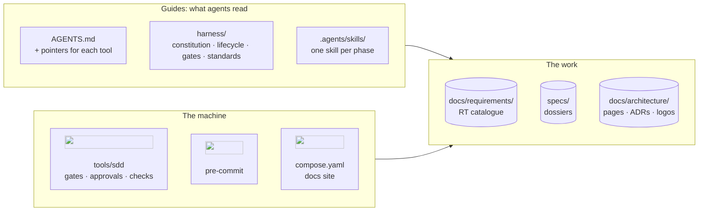

<h1 align="center">Orion Chemicals Data Platform</h1>

<p align="center">
  <strong>From a data need to a verifiable solution, specified first, governed by people, executed by AI.</strong><br>
  A data platform for the Orion Chemicals case, built with <em>spec-driven development</em>:
  every change starts from the requirements, passes eight gates, and teaches how it was made.
</p>

<p align="center">
  <a href="#start-here">Start here</a> ·
  <a href="#how-work-happens">How work happens</a> ·
  <a href="#where-we-are">Where we are</a> ·
  <a href="#quick-start">Quick start</a> ·
  <a href="#whats-inside">What's inside</a>
</p>

<p align="center">
   &nbsp;
   &nbsp;
   &nbsp;
   &nbsp;
   &nbsp;
   &nbsp;
   &nbsp;
   &nbsp;
   &nbsp;
  
</p>

## What this is

Orion Chemicals needs industrial data (sensors, maintenance orders, documents) that people can
trust: read safely from the plant, identified without guesswork, kept with its history, and
reproducible. Its 42 technical requirements are in [docs/requirements](docs/requirements/README.md).

This repository builds that platform **the way we want AI-assisted software to be built**:

- **Specifications first.** Nothing is coded before a written spec, tied to the requirements, has
  been approved.
- **Governed by people.** Two of us, a mentor and a mentee, approve every human gate, at a
  terminal. Agents propose and execute; they cannot approve.
- **AI executes at scale.** Any coding agent (Claude Code, Cursor, Codex, Copilot, Gemini CLI)
  follows the same instructions, skills and checks.
- **Every change teaches.** Each feature ships with a teaching guide that explains every
  decision, from the architecture down to the classes.

> **Status.** The harness is built (dossier 000). Platform features come next, one dossier at a
> time, starting with the catalogue's priorities.

## Start here

| If you are… | Start with | Then |
|---|---|---|
| 🎓 **Learning** (the mentee, or anyone curious) | the [learning path](docs/learn/README.md) | [how the harness works](harness/how-it-works.md), then the [teaching guides](specs/README.md) |
| 🧭 **Following the project** | [where we are](#where-we-are) below | the [requirements](docs/requirements/README.md) and their [traceability](docs/requirements/traceability.md) |
| 🛠️ **Developing** | the [quick start](#quick-start) | [CONTRIBUTING](CONTRIBUTING.md) and the tutorial [your first feature](docs/tutorials/first-feature.md) |
| 🤖 **A coding agent** | [AGENTS.md](AGENTS.md) | the skill of the current phase in `.agents/skills/` |

Everything is also a browsable site with search: `poetry run mkdocs serve` or
`docker compose up docs`, then http://127.0.0.1:8000 ([tutorial](docs/tutorials/docs-site.md)).

## How work happens

Every piece of work is a **dossier** (`specs/<id>-<slug>/`) that moves through seven phases.
Agents draft **one artifact at a time**; we review it with them in the chat (they brief us and
ask specific questions, so approving is never just signing); then each of us approves at a
terminal; machines check what machines can.

```mermaid
flowchart LR
    R[("Requirements<br/>RT01-RT42")] --> G0{"G0<br/>context"}
    G0 --> D["1 Discover<br/>PRD"] --> G1{"◆ G1"}
    G1 --> P["2 Plan<br/>backlog"] --> G2{"◆ G2"}
    G2 --> S["3 Structure<br/>approach"] --> G3{"◆ G3"}
    G3 --> SP["4 Specify<br/>spec · plan · tasks"] --> G4{"◆ G4"}
    G4 --> B["5 Build<br/>code + tests + docs"] --> G5{"G5<br/>checks"}
    G5 --> V["6 Validate<br/>review + teaching guide"] --> G6{"◆ G6"}
    G6 --> L["7 Release & Learn<br/>results"] --> G7{"◆ G7"}
```



◆ = approved by both of us at a terminal · G0 and G5 are closed by machines · an approval is
bound to the exact text approved, so editing it later re-opens the gate.

| Who | Does |
|---|---|
| 👥 **We** (mentor + mentee) | share the need, review every artifact, approve six gates, decide the merge, judge the results |
| 🤖 **Agents** (any tool) | read the requirements and the harness, draft PRD, backlog, approach and spec, build with tests, review each other, write the teaching guide |
| ⚙️ **The machine** | `sdd` computes gate states and records approvals; pre-commit refuses code before an approved spec and runs lint, types, architecture rules, tests and documentation checks |

The full picture, with every rule and how it is enforced: **[how the harness works](harness/how-it-works.md)**.

## Where we are

<!-- sdd:status:start -->
| Spec | Kind | Where it is | G0 | G1 | G2 | G3 | G4 | G5 | G6 | G7 | Guide |
|---|---|---|---|---|---|---|---|---|---|---|---|
| [000 · The SDD harness](specs/000-sdd-harness/prd.md) | enabler | Discover (G1) | ✅ | 🟡 | ⏸️ | ⏸️ | ⏸️ | ⏸️ | ⏸️ | ⏸️ | [📘](specs/000-sdd-harness/teaching-guide.md) |

✅ passed · 🟡 partly approved · ⚪ pending · 🟠 stale (changed after approval) · ❌ failed · ⏸️ blocked by an earlier gate
<!-- sdd:status:end -->

<!-- sdd:coverage:start -->
Requirements RT01-RT42: in discovery **0** · specified **0** · delivered **0** · validated **0** · not started **42**. [Full traceability matrix](docs/requirements/traceability.md).
<!-- sdd:coverage:end -->

## Quick start

You need Git, Python 3.11+, [Poetry](https://python-poetry.org/) 2.x and, optionally, Docker.

```bash
poetry install --with docs        # tools and docs into .venv/
poetry run pre-commit install     # the local gates run on every commit
poetry run sdd status             # where every dossier is
```

Before approving anything, put your names in [harness/team.yaml](harness/team.yaml).

**Start a feature by talking to your agent**, in plain words. You don't need to know the RTs:

> *"We want a CRUD to manage the list of industrial data sources."*

The agent reads all 42 requirements, tells you which ones the work serves (or that it is
outside the catalogue, which is allowed with a reason), and once you agree creates the dossier
and its branch. Then it guides you phase by phase. Walk-through:
[your first feature](docs/tutorials/first-feature.md).

## What's inside



| Folder | Holds |
|---|---|
| [AGENTS.md](AGENTS.md) | the instructions every coding agent follows |
| [harness/](harness/README.md) | the rules: constitution, lifecycle, gates, principles, security, quality, documentation standard, roles, templates |
| [specs/](specs/README.md) | one dossier per piece of work, from PRD to release, with its teaching guide |
| [docs/requirements/](docs/requirements/README.md) | the Orion Chemicals requirements (PDF + YAML catalogue) and their traceability |
| [docs/architecture/](docs/architecture/README.md) | architecture, deployment, decisions (ADRs), logo registry |
| [docs/learn/](docs/learn/README.md) · [docs/tutorials/](docs/tutorials/first-feature.md) | the learning path, primers, glossary, tutorials |
| [docs/research/](docs/research/sdd-landscape.md) | the research behind the harness |
| `tools/` | the `sdd` command and the agent guard (Python, clean architecture) |
| `.agents/skills/` | the canonical skills (Agent Skills standard); `.claude/`, `.cursor/`, `.github/` hold generated adapters |

## Decisions that shape everything

Spec-driven development with our own harness ([ADR-0001](docs/architecture/decisions/0001-spec-driven-development-with-our-own-harness.md)) ·
tool-agnostic sources ([ADR-0002](docs/architecture/decisions/0002-agents-md-and-agent-skills-are-canonical.md)) ·
approvals by people bound to content ([ADR-0003](docs/architecture/decisions/0003-gates-approved-by-people-bound-to-digests.md)) ·
local enforcement, no CI ([ADR-0004](docs/architecture/decisions/0004-local-enforcement-without-ci.md)) ·
Poetry ([ADR-0005](docs/architecture/decisions/0005-poetry-for-every-python-environment.md)) ·
Docker Compose ([ADR-0006](docs/architecture/decisions/0006-docker-compose-as-the-runtime.md)) ·
clean architecture ([ADR-0007](docs/architecture/decisions/0007-clean-architecture-for-all-python-code.md)) ·
all [decisions](docs/architecture/decisions/README.md).
