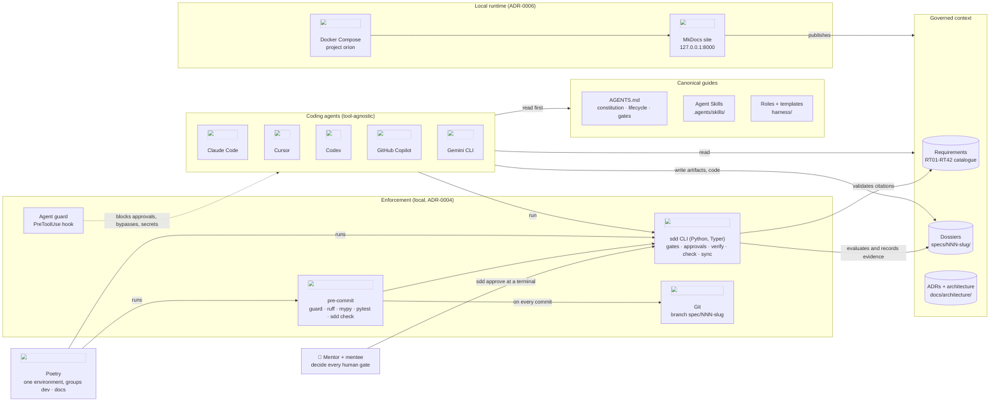
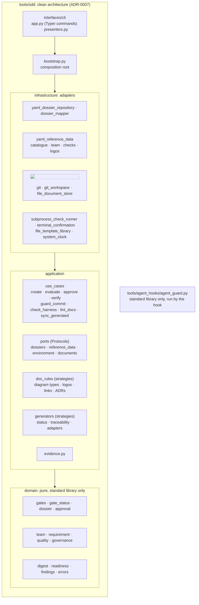
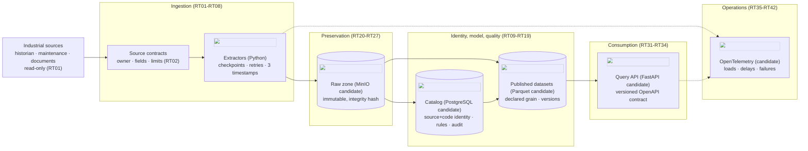

# Architecture

What exists today, how it is organised, and the shape of the platform it is meant to build. The
container-level view of what runs is in [deployment.md](deployment.md); every *why* is an ADR in
[decisions/](decisions/README.md).

## 1. The repository today: a harness, not yet a platform

Dossier 000 built the spec-driven development harness. No platform feature exists yet: each one
will arrive through its own dossier, starting from the requirements.

- **Guides** are what agents read before acting; **sensors** check what they produced; **we**
  decide. The full mechanism is in [harness/how-it-works.md](../../harness/how-it-works.md).
- The `sdd` CLI is the only component with code. It reads and writes plain files (YAML and
  Markdown) and calls git; it has no server and no database.
- The documentation site is the only container today.

## 2. Module map of `tools/`

| Package | Responsibility | Depends on |
|---|---|---|
| `sdd.domain` | the lifecycle's concepts and rules: gates, states, approvals, digests, readiness, governance | standard library |
| `sdd.application` | use cases; ports; documentation rules and generators as strategies | `domain` |
| `sdd.infrastructure` | YAML, Markdown files, git, subprocesses, the terminal, the clock | `application`, `domain`, PyYAML |
| `sdd.bootstrap` | builds adapters and wires use cases | all of the above |
| `sdd.interfaces.cli` | the `sdd` commands (Typer); maps errors to exit codes | `bootstrap`, `application`, `domain` |
| `agent_hooks` | the PreToolUse guard for coding agents | standard library |

The class-by-class explanation, with every decision justified, is the
[teaching guide of dossier 000](../../specs/000-sdd-harness/teaching-guide.md).

## 3. What we keep from the reference platform

The industrial data platform we studied (Kairon) contributes its *high-level architecture*, not
its technology choices:

| Reference practice | Kept as |
|---|---|
| Many small packages, each in `domain / application / infrastructure / interfaces` with one `bootstrap.py` | [principles.md](../../harness/principles.md) §1, enforced by import-linter |
| A `harness/` folder of standing rules, pointed to by the agent file | `harness/`, `AGENTS.md` |
| An upkeep matrix and a review of the whole branch before each commit | [architecture-upkeep.md](../../harness/architecture-upkeep.md), skill `commit-review` |
| ADRs for every decision, numbered, never deleted | [decisions/](decisions/README.md) |
| The README as a product page; architecture with official logos under `docs/architecture/` | [documentation standard](../../harness/documentation-standard.md) |
| Services reach the database through views and routines, as roles with no table privilege | [security.md](../../harness/security.md) §3 |
| One Poetry project with a dependency group per component; one Dockerfile per image | ADR-0005, `docker/` |
| Kubernetes (kind + Helm) | **replaced by Docker Compose** (ADR-0006) |

## 4. Where the platform is heading (candidates, not decisions)

The requirements describe a data platform for industrial sources. The picture below groups them
into the usual building blocks with *candidate* technologies; every box becomes real only through
a feature dossier and an ADR, and any candidate can lose to an alternative there.

The order of the first dossiers should follow the catalogue's priorities: access (RT01),
identity (RT09), time (RT12), reconstruction (RT20-RT25), scale (RT28-RT29), value (RT34) and
load observability (RT39).
