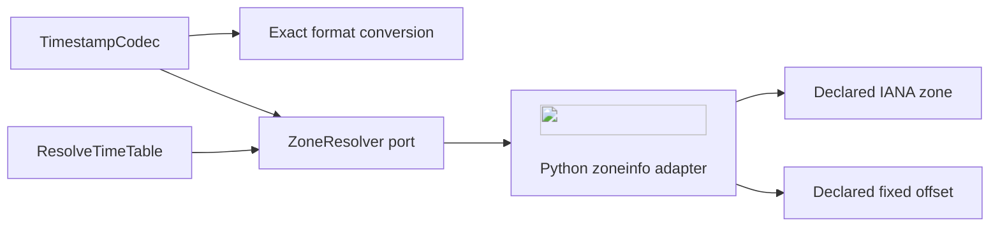

# ADR-0030: We preserve exact timestamps and apply declared site rules

- **Status:** Proposed
- **Date:** 2026-11-19
- **Dossier:** specs/001-timeseries-source
- **Requirements:** RT12. Refines [ADR-0029](0029-resolve-site-local-time-with-zoneinfo.md).

## Context

The first time core handles four directly resolved formats and exposes explicit outcomes for
local readings in the CLI. The [validation](../../../specs/001-timeseries-source/validation.md)
found rounding, missing source metadata and local codec support, and historical zone rules that
disagree with the two fictional fixed-offset site declarations. RT12 requires retention of the
source representation and known zone or offset, with ambiguity flagged.

## Decision

We retain original values and explicit UTC resolutions in `DecodedTimestamp` and use exact
numeric units for conversions. Both local formats use the declared site's fixed offset or IANA
rules through `ZoneResolver`, which returns both candidates for a repeated reading and the exact
first valid instant for a skipped reading.

## Alternatives considered

| Option | Precision and source metadata | Civil-time behaviour | Decision |
|---|---|---|---|
| Round numeric conversions through floats | Can truncate or shift the instant | No effect on zone rules | Rejected because downstream comparisons can silently change. |
| Require only UTC conversions | Can preserve UTC when the offset is known | Cannot decode either local fixture | Rejected because both local forms are part of the source contract. |
| Use IANA zone histories at all five sites | Retains zone names | Introduces historical shifts at the two sites that declare a fixed offset | Rejected because generated records would contradict the site policy. |
| Use exact format units and the declared site policy | Retains the source and reports unrepresentable values | Reports each valid interpretation or the exact gap boundary | Selected. |

## Consequences

- A caller chooses a format with sufficient precision or handles a value error. A repeated
  local reading may be generated from either UTC candidate and requires an explicit decision by
  any consumer that needs a unique instant.
- The fixed-offset sites have stable historical fixtures. IANA rule changes can affect the
  other three sites and remain visible in transition tests.
- Revisit the precision contract if a real acquisition source requires FILETIME ticks below
  Python's datetime precision.

## Diagram

The codec and the table use the same resolver. The site declaration selects either an IANA
zone lookup or fixed-offset arithmetic in the adapter.
