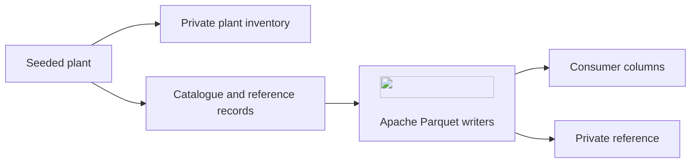

# ADR-0031: We separate the consumer catalogue from plant truth

- **Status:** Accepted
- **Date:** 2026-11-23
- **Dossier:** specs/004-plant-tag-catalogue
- **Requirements:** RT09, RT17, RT28

## Context

A synthetic fixture needs repeatable topology and sampling policies. Engineers must be able
to tell whether a match or sizing input is correct. The evaluation mapping contains canonical
names, equipment and instrument identities, rename history and a hold-out flag. Distributing
that mapping with the input would reveal the answers. The existing generator supports local
commands and has a locked tabular writer dependency.

## Decision

Build the plant and the catalogue from the same explicit seed, with one source namespace per
site and a consumer join key of site code and original name. Store the versioned topology and
answer key under `truth/`, and publish the consumer catalogue from an explicit allowlist
under `catalog/`. Stage both catalogue files, replace them individually, and use command
success as the signal to hand off the consumer file.

## Alternatives considered

| Option | Evaluation boundary | Operational cost | Decision |
|---|---|---|---|
| One combined table with private columns | Consumers receive the answers | One file to build | Rejected. |
| Separate files generated in independent runs | Outputs can disagree on seed or assignment | Require a second process and reconciliation | Rejected. |
| Separate files from one build | Consumers receive source metadata and the evaluator gets the reference | One local command, with a retry after interruption | Selected for this fixture. |
| Versioned directories with an atomic pointer | Supports readers during writes | Requires a publication protocol and cleanup policy | Revisit if live reads become necessary. |

## Consequences

- The result reproduces the same fixture under the same seed and locked versions. The reference
  joins to the consumer catalogue even when a name appears at multiple sites.
- A local run has one writer per destination. An interrupted second replacement can leave a mixed
  pair. Wait for successful completion or regenerate the pair before reading or sharing it.
- The output boundary keeps private fields out of the consumer file. Controls for training
  splits and broader leak detection remain part of the separate answer-key dossier.
- This decision applies the local portions of [ADR-0020](0020-deterministic-generation-and-simulated-reception-time.md),
  [ADR-0021](0021-output-as-immutable-files-and-segments.md) and
  [ADR-0022](0022-hidden-plant-and-site-local-time.md). Stream timing and streaming publication
  remain outside this decision.

## Diagram

The plant inventory retains topology. The catalogue writer emits separate consumer and reference
schemas from the same generation pass.
