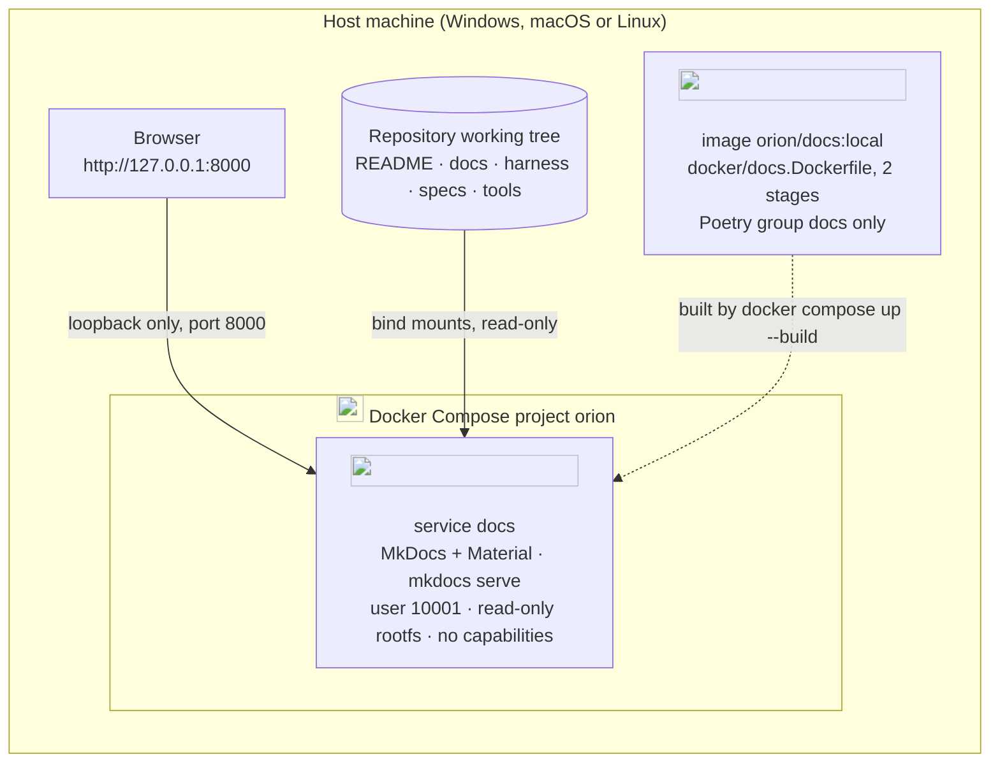

# Deployment

Everything runs on one machine with **Docker Compose** (ADR-0006). This page shows what runs, how
it is reached and how it is hardened. It changes in the same branch as `compose.yaml` or any
Dockerfile ([architecture-upkeep.md](../../harness/architecture-upkeep.md)).

## What runs today



| Service | Image | Port | Volumes | Hardening |
|---|---|---|---|---|
| `docs` | `orion/docs:local` from [docker/docs.Dockerfile](../../docker/docs.Dockerfile) (python:3.12-slim, two stages) | `127.0.0.1:8000` | the published folders of the repository, each read-only | non-root user `10001`, `read_only: true` + `/tmp` tmpfs, `cap_drop: [ALL]`, `no-new-privileges`, healthcheck |

```bash
docker compose up --build docs     # start (first build takes a minute)
docker compose ps                  # health
docker compose logs -f docs        # live log
docker compose down                # stop and remove the container
```

The tutorial [the documentation site](../tutorials/docs-site.md) explains the site in depth,
including running it without Docker.

## Rules for every future service

A dossier that adds a service to `compose.yaml` follows the baseline of
[security.md](../../harness/security.md) and documents it here, in the same change:

- an official base image pinned to a version, built in stages so build tools never ship;
- a non-root user, `read_only` root filesystem where possible, `cap_drop: [ALL]`,
  `no-new-privileges`;
- ports bound to `127.0.0.1`; internal traffic on named networks, one per trust zone;
- secrets as Compose `secrets:` from files in `deploy/secrets/` (git-ignored), never as plain
  environment variables in `compose.yaml`;
- named volumes for state, with the backup and restore procedure (RT41) in the service's README;
- a `healthcheck`, and `depends_on: condition: service_healthy` for its dependencies;
- a Compose `profile` when the service is optional, so `docker compose up` stays light.
