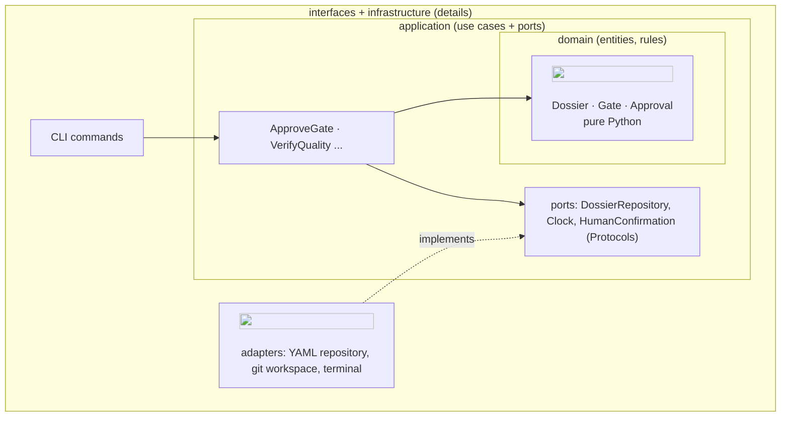

# Primer: clean architecture and SOLID

## The problem

Software that mixes business rules with frameworks, databases and I/O becomes hard to change:
replacing the database touches the rules, testing a rule needs a database, and every change has
surprising consequences. Clean architecture (Robert C. Martin), close cousin of *hexagonal
architecture* or *ports and adapters* (Alistair Cockburn), separates **policy** (the rules) from
**detail** (how things are stored, shown or transported).

## The dependency rule

Source code dependencies point **inwards**, towards the policy. The inner circles know nothing
about the outer ones.

The trick is **dependency inversion**: the use case needs to save a dossier, but instead of
importing a YAML library it declares a *port* (`DossierRepository`, a Protocol). The YAML
*adapter* implements that port. At start-up, the *composition root* (`bootstrap.py`) creates the
adapter and hands it to the use case. The arrow of the source code dependency (adapter → port)
now points against the flow of control (use case → storage).

## Why it pays off here

- **Fast, simple tests:** use cases run with in-memory fakes (`tests/sdd/fakes.py`), no files,
  no git, in milliseconds.
- **Replaceable details:** storing dossiers in a database instead of YAML is a new adapter and a
  line in `bootstrap.py`; no use case changes.
- **Agents cannot erode it:** import-linter fails the commit when a layer imports outwards.

## SOLID in one table

| Letter | Principle | Means in practice | Smell when violated |
|---|---|---|---|
| **S** | Single responsibility | a class has one reason to change | a class that parses, validates, saves and prints |
| **O** | Open/closed | add behaviour by adding code, not editing old code | a growing `if kind == ...` chain |
| **L** | Liskov substitution | any implementation of a port can replace another without surprises | a fake that "works" in tests but behaves differently from the adapter |
| **I** | Interface segregation | small, role-specific interfaces | one `Repository` with 30 methods, most unused by each caller |
| **D** | Dependency inversion | depend on abstractions; inject details | `datetime.now()` or `open()` inside a use case |

Concrete examples in our code are in [principles.md](../../../harness/principles.md#2-solid-applied)
and, class by class, in the [harness teaching guide](../../../specs/000-sdd-harness/teaching-guide.md).

## When not to apply it

Clean architecture costs files and indirection. A 50-line script, or a hook that must run with no
dependencies (our `agent_guard.py`), does not need four layers. The rule of thumb: apply it to
everything that holds business rules or will grow; state the exception explicitly when you skip it.
