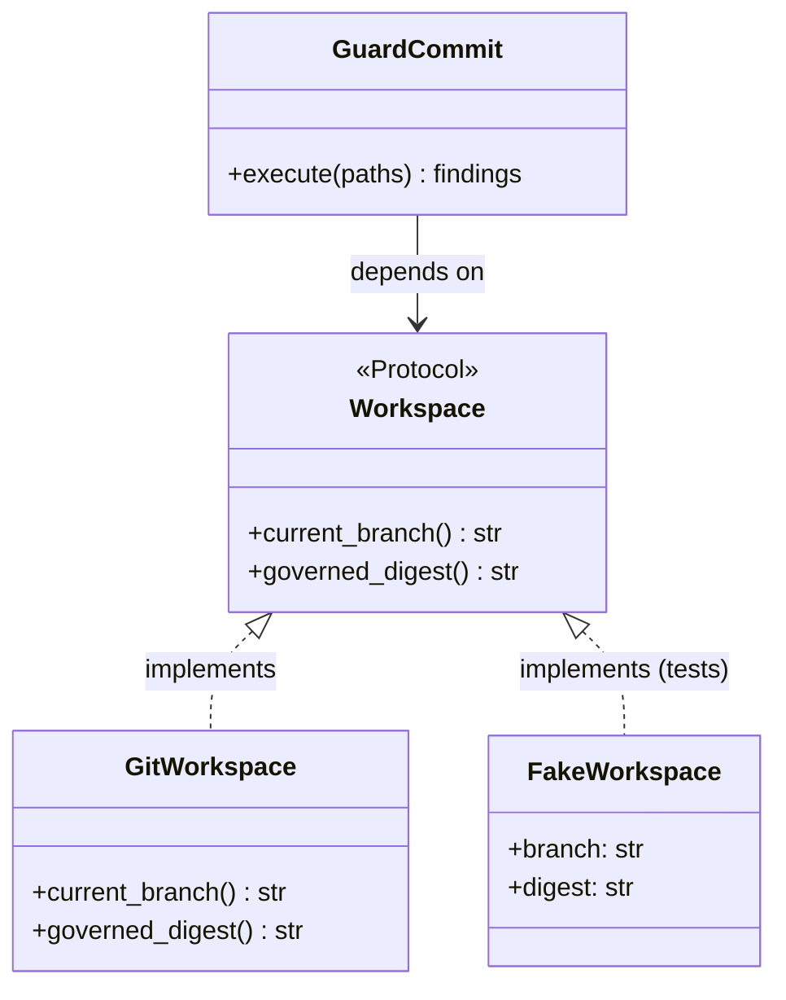

# Primer: design patterns used in this repository

A design pattern is a named solution to a recurring design problem. Naming it is half the value:
"this is a strategy" tells a reader the whole shape in three words. Use a pattern when it removes
a real force; never to look sophisticated.

## Ports and adapters (hexagonal architecture)

- **Problem:** business code must talk to files, databases, git, terminals, without depending on them.
- **Solution:** the application declares *ports* (interfaces); *adapters* implement them.
- **Here:** `sdd/application/ports/*` and `sdd/infrastructure/*`.

## Repository

- **Problem:** loading and saving an aggregate should not leak storage details into use cases.
- **Solution:** an interface with collection-like methods (`load`, `save`, `ids`).
- **Here:** `DossierRepository` (port) and `YamlDossierRepository` (adapter).
- **Not here:** for read-only reference data a smaller port (`RequirementCatalog`) is enough.

## Strategy

- **Problem:** several interchangeable rules or algorithms, and more will come.
- **Solution:** one interface, one class per variant; the caller iterates over a list.
- **Here:** documentation rules (`DocumentRule`: mermaid, links, ADR), generators (`Generator`:
  status, traceability, adapters), and the quality checks (data in `checks.yaml`).
- **Effect:** adding a rule never edits existing ones (open/closed).

## Composition root and dependency injection

- **Problem:** if every class creates its own dependencies, nothing can be replaced or tested.
- **Solution:** classes receive their dependencies in the constructor; one place builds the graph.
- **Here:** `sdd/bootstrap.py`; the CLI asks it for ready-made use cases.

## Value object

- **Problem:** passing raw strings and dicts lets invalid values travel far before failing.
- **Solution:** small immutable classes validated at construction, compared by value.
- **Here:** `Approval`, `Verification`, `Requirement`, `GateDefinition` (frozen dataclasses).

## Aggregate

- **Problem:** related objects must stay consistent (one approval per member per gate).
- **Solution:** changes go through the aggregate root, which enforces the invariants.
- **Here:** `Dossier.with_approval()` replaces a member's earlier approval and returns a new
  dossier (immutable, so history is explicit).

## Mapper

- **Problem:** the domain shape and the storage shape differ (dates, enums, ordering).
- **Solution:** a dedicated module converts in both directions.
- **Here:** `dossier_mapper.py` (domain ↔ YAML data), separate from the repository (single
  responsibility).

## Computed state (a state machine without stored state)

- **Problem:** a stored "status" field drifts from reality when content changes behind its back.
- **Solution:** compute the state from the evidence every time.
- **Here:** `evaluate_gates()` derives *pending / partial / passed / stale / failed / blocked* from
  approvals, digests and the verification ([how it works, §4](../../../harness/how-it-works.md#4-gates-and-their-states)).

## Patterns we will likely need with the platform

| Pattern | For | Requirement |
|---|---|---|
| Unit of work | several writes that must succeed or fail together | RT04 (checkpoint after preservation) |
| Transactional outbox | publishing an event only when the write committed | RT23, RT25 |
| Specification | composable query or validation rules | RT14 (quality rules) |
| Idempotency key | reprocessing without duplicates | RT21 |
| Circuit breaker + retry with back-off | transient source failures | RT05 |

Each will be introduced by the dossier that needs it, with an ADR and a section in its teaching guide.
