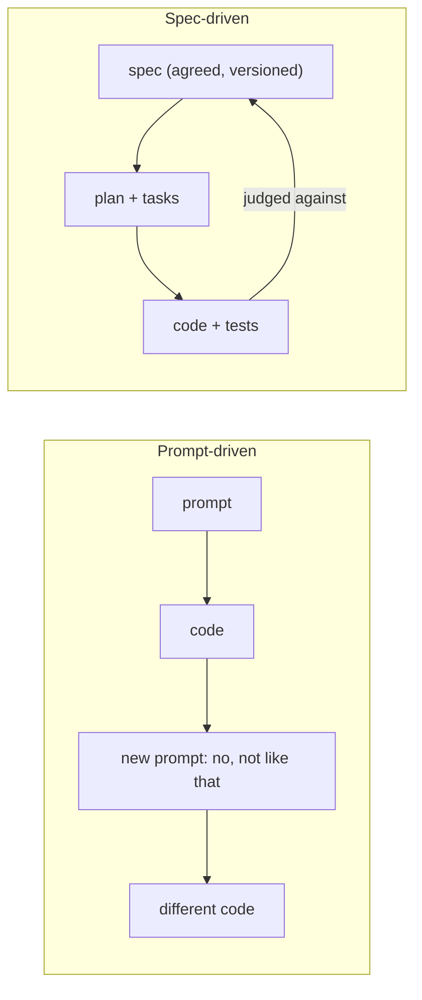

# Primer: spec-driven development

## The problem it solves

An AI coding agent is fast and tireless, and it will build *something* from any prompt. The
trouble is that "something" drifts: each prompt is interpreted afresh, nothing durable says what
was wanted, and reviewing code against an intention that lives only in someone's head is
guesswork. The faster the agent, the faster the drift.

Spec-driven development (SDD) fixes the reference point. People agree, in writing, on **what**
to build and **how we will know it works**; the agent derives the plan and the code from that
text; the result is judged against the text.

## The core ideas

1. **The spec is the source of truth.** Code is an output of the spec, not the other way round.
   When the spec is wrong, fix the spec first (here: G4 becomes stale and we re-approve).
2. **Specs are testable.** Every behaviour is written so that a test can confirm it. That is why
   we use EARS statements ([acceptance criteria](acceptance-criteria.md)).
3. **Phases with checkpoints.** Intent (PRD), plan (backlog), interface (approach), execution spec,
   build, validation, release. Each ends with a decision before the next begins.
4. **A constitution.** A few principles that apply to every change and that no spec may break.
5. **Machines check what machines can.** Formatting, types, tests, architecture rules: checked
   automatically, so human attention goes to judgement.

## What is different in this repository

Most SDD tools describe checkpoints but cannot *enforce* them. Here:

- **Only people close human gates**, at a terminal, and the approval is bound to the exact
  content approved ([ADR-0003](../../architecture/decisions/0003-gates-approved-by-people-bound-to-digests.md)).
- **No code before the spec is approved**: a commit hook refuses it.
- **Every feature teaches**: a teaching guide is part of the merge gate.

## Common pitfalls

| Pitfall | Symptom | Remedy |
|---|---|---|
| Spec as a formality | a spec copied from the code after the fact | specs are approved *before* the build (G4); the commit guard enforces it |
| Untestable spec | "the system should be fast and robust" | EARS with numbers: "When a load completes, the platform shall publish within 5 minutes (p95)" |
| Over-specifying | the spec dictates variable names | specify behaviour, contracts and decisions; leave code-level detail to the build and the review |
| Never updating the spec | code and spec disagree after a month | changing behaviour means changing the spec first |

## Further reading

- [Research: the SDD landscape](../../research/sdd-landscape.md) (Spec Kit, OpenSpec, BMAD, Kiro).
- [How the harness works](../../../harness/how-it-works.md).
