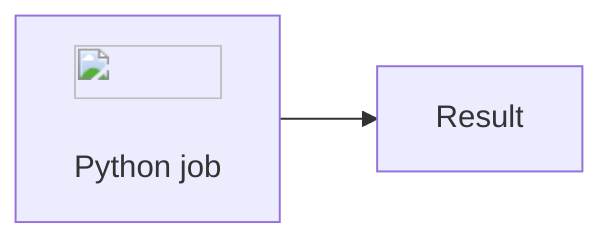
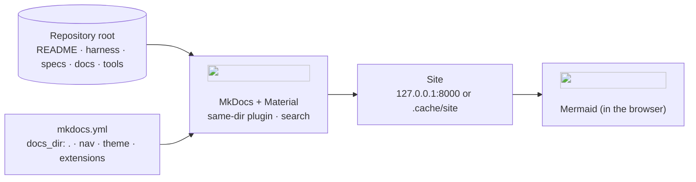

# Tutorial: the documentation site

The whole repository (README, harness, dossiers, ADRs, teaching guides, primers) is published as
a searchable website with MkDocs and the Material theme (ADR-0008). This tutorial takes you from
nothing to editing a page and seeing it update live, then explains how the site is put together.

## 1. Start the site

You have two ways; both give the same site at **http://127.0.0.1:8000**.

=== "With Poetry (live reload, recommended while writing)"

    ```bash
    poetry install --with docs      # once: installs MkDocs, Material and the same-dir plugin
    poetry run mkdocs serve         # builds the site and watches every file
    ```

    Open http://127.0.0.1:8000. Stop with `Ctrl+C`.

=== "With Docker Compose (nothing to install but Docker)"

    ```bash
    docker compose up --build docs  # first build takes about a minute
    ```

    Open http://127.0.0.1:8000. Stop with `docker compose down`. The repository is mounted
    read-only into the container, so edits on your machine appear on the site without a rebuild.
    On Windows, file-change notifications do not always cross into containers; if the page does
    not refresh after a save, reload it in the browser or use the Poetry way.

## 2. Find your way around

| Tab | What is there |
|---|---|
| **Home** | the root README: what this is, status board, quick start |
| **Learn** | the learning path, tutorials, primers, glossary |
| **Harness** | how it works, constitution, lifecycle, gates, standards, roles, templates, AGENTS.md |
| **Specs** | every dossier with its artifacts; the teaching guide of each one |
| **Architecture** | the architecture pages, deployment, ADRs |
| **Requirements** | the RT catalogue and the generated traceability matrix |

Press `/` to search; the moon/sun icon toggles the dark theme.

## 3. Edit a page and watch it change

1. With `mkdocs serve` running, open [docs/learn/glossary.md](../learn/glossary.md) in your editor.
2. Add a row to the table: `| **Live reload** | the site rebuilds when a file is saved |`.
3. Save. Within a second the terminal prints `Building documentation...` and the browser page
   refreshes with your row.
4. Undo the change (or keep it, if the term deserves to be in the glossary).

## 4. Add a diagram

Mermaid diagrams are written in fenced blocks and rendered by the site, by GitHub and by most
editors:

````markdown

````

Every node that names a tool carries its official logo from
[the registry](../architecture/logos/registry.yaml) ([why](../architecture/decisions/0013-mermaid-diagrams-with-official-logos.md)).
`poetry run sdd check` reports a missing logo or an unknown diagram type.

## 5. Add a page to the navigation

Pages exist on the site as soon as the Markdown file exists; the **navigation** is explicit in
`mkdocs.yml` under `nav:`. To add a page:

```yaml
nav:
  - Learn:
      - Learning path: docs/learn/README.md
      - My new page: docs/learn/my-new-page.md   # <- add a line where it belongs
```

`mkdocs.yml` is a governed file: changing it belongs to a dossier, like code. Dossier artifacts
and teaching guides are added to `nav:` by the dossier that creates them.

## 6. Check the site like the quality gate does

```bash
poetry run mkdocs build --strict --site-dir .cache/site
```

`--strict` turns every warning (a broken link, a missing anchor, a page outside the docs) into an
error. This is the `docs-site` check of gate G5 ([checks.yaml](../../harness/checks.yaml)). The
built site lands in `.cache/site/` (git-ignored); open `.cache/site/index.html` to browse it
offline (diagram logos still need the internet).

## 7. How it is put together



- **`docs_dir: .` with the `same-dir` plugin.** MkDocs normally publishes one `docs/` folder. We
  publish the repository root, so a link such as `../../harness/gates.md` works identically on
  GitHub, in your editor and on the site. The root `README.md` becomes the home page; every
  folder's `README.md` becomes that folder's index page.
- **`exclude_docs`** keeps caches, the virtual environment and generated tool adapters
  (`.claude/`, `.cursor/`, `.github/`) out of the site.
- **`pymdownx.superfences`** turns ```` ```mermaid ```` blocks into diagrams; `admonition`,
  `tabbed`, `tasklist` and `details` give notes, tabs (like the two ways of starting the site
  above), checkboxes and collapsible blocks.
- **The container** ([docker/docs.Dockerfile](../../docker/docs.Dockerfile)) installs only the
  `docs` Poetry group in a build stage and runs `mkdocs serve` as an unprivileged user, with the
  repository mounted read-only ([deployment](../architecture/deployment.md)).

## 8. Troubleshooting

| Symptom | Cause and fix |
|---|---|
| `Error: MkDocs encountered an error parsing the configuration file` with `!!python/name` | you opened `mkdocs.yml` with a generic YAML tool; only MkDocs understands that tag (pre-commit's YAML check skips this file) |
| `Config value 'plugins': The "same-dir" plugin is not installed` | run `poetry install --with docs` |
| A page is on the site but not in the menu | add it to `nav:` (it is reachable by search and links meanwhile) |
| A diagram shows as code | the fence must be exactly ```` ```mermaid ````; check the syntax with `poetry run sdd check` |
| Logos missing in a diagram | no internet access, or the URL changed: check it with `curl -sI <url>` and fix the registry |
| Port 8000 already in use | `poetry run mkdocs serve -a 127.0.0.1:8001`, or stop the other process |
| `WARNING: MkDocs may break support for all existing plugins and themes soon!` | a notice printed by Material for MkDocs about the future of MkDocs; it does not fail the build. Our exit path is in [ADR-0008](../architecture/decisions/0008-docs-as-code-with-mkdocs-material.md); set `DISABLE_MKDOCS_2_WARNING=true` to silence it |
