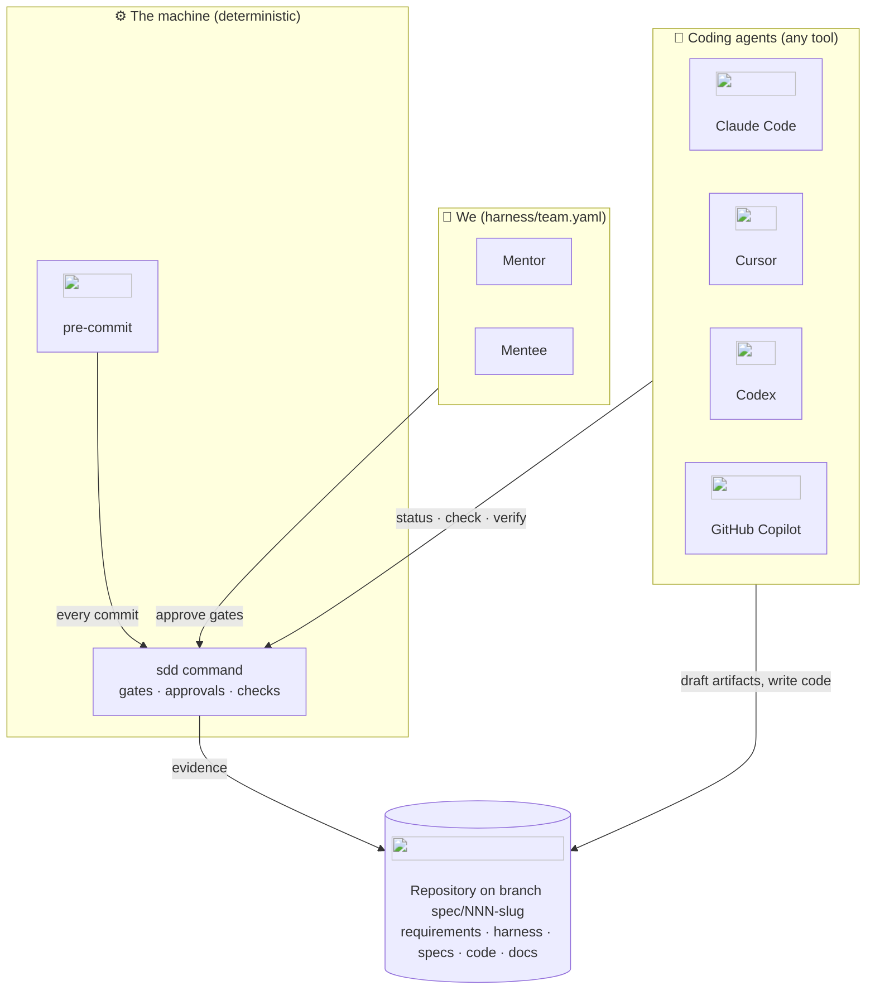
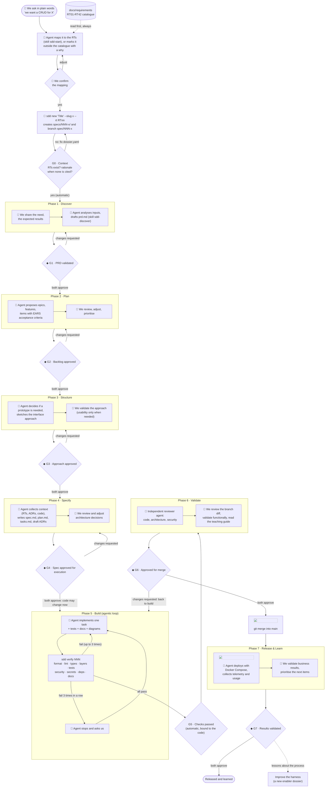
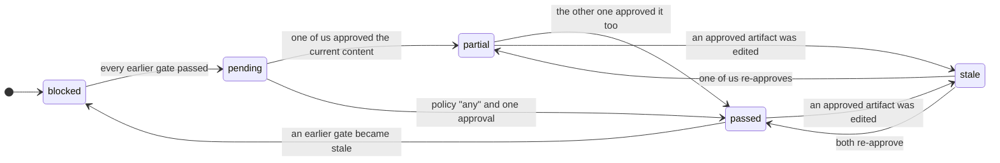
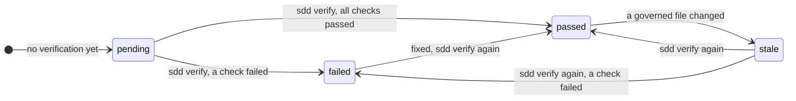
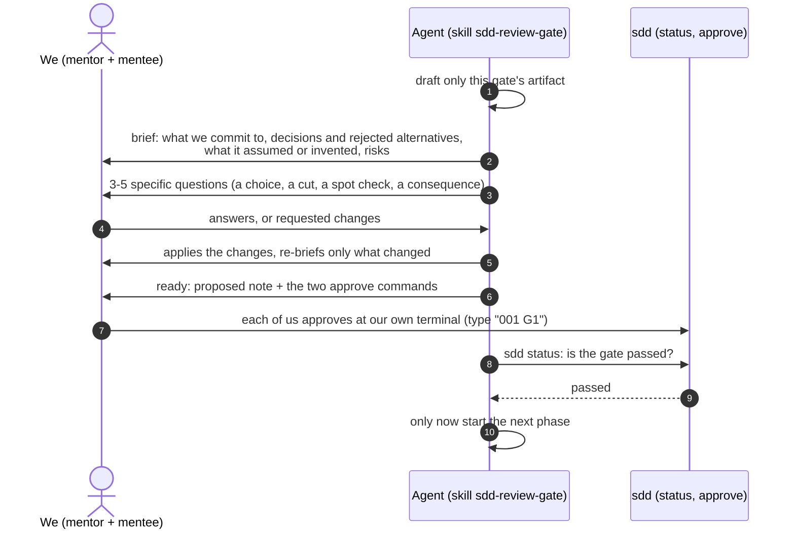
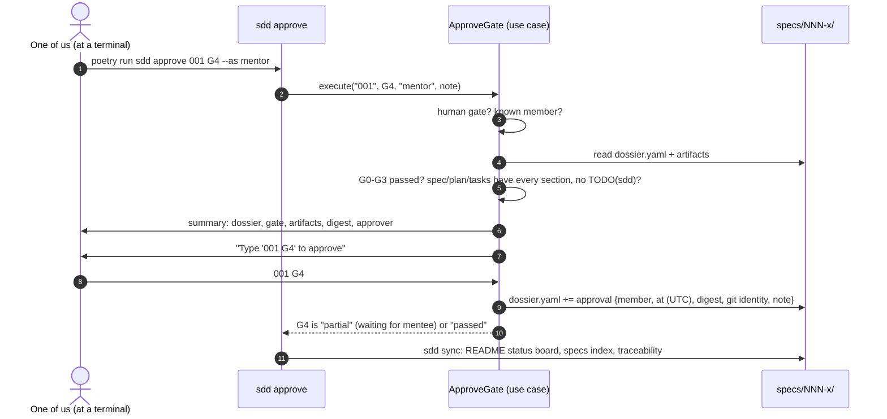
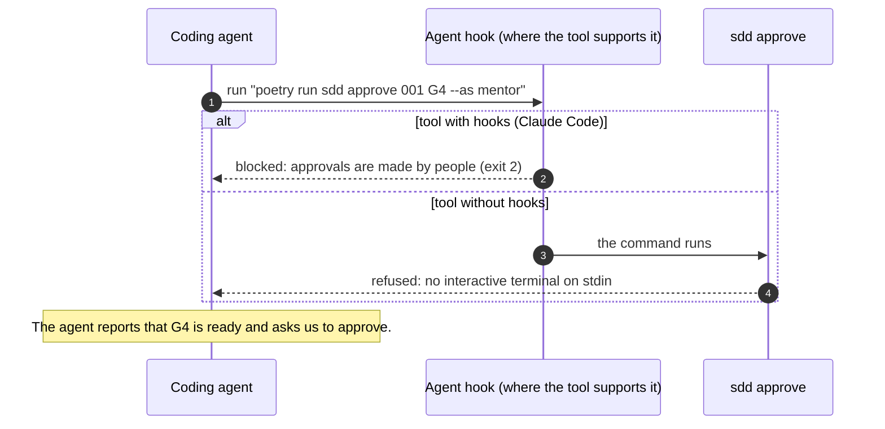
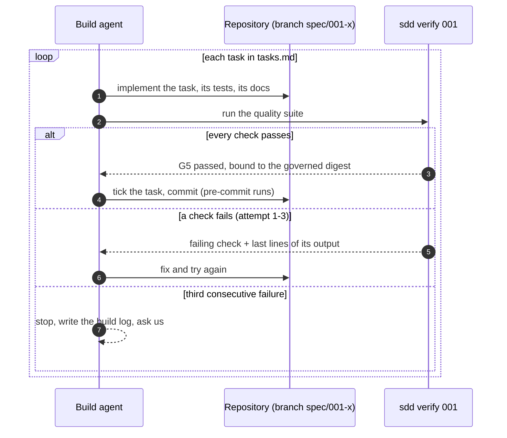
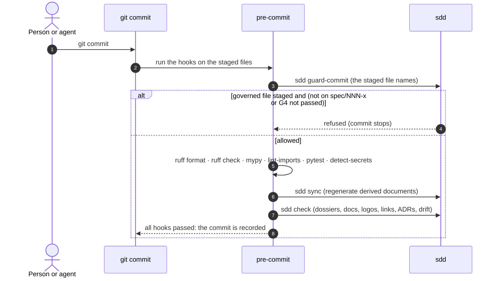

# How the harness works

This page explains, from end to end, how work happens in this repository: who does what, how a
need becomes released software, which checkpoints (*gates*) it passes, and how each rule is
enforced. It is the page to read first, and the one to come back to when something blocks you.

> **In one minute.** Every piece of work is a *dossier*: a folder `specs/<id>-<slug>/` with one
> Markdown artifact per phase. AI agents draft the artifacts and write the code; **we** (the
> mentor and the mentee) decide. Eight gates, G0 to G7, close the phases: six are closed by our
> approvals, two by machines. Approvals are bound to the content they approved, so editing an
> approved artifact silently invalidates the approval until we look again. Code can only change
> after we approved the specification. Everything runs locally: the `sdd` command, `pre-commit`
> and the agents' hooks are the enforcement; there is no CI.

The model comes from the target operating model *"AI-native software execution: driven by
specifications, governed by people, AI executes at scale"*. In this repository every human role
of that model (stakeholder, product owner, designer, tech lead, QA engineer) is played by the two
of us.

## 1. The actors



| Actor | What it does | What it may never do |
|---|---|---|
| **We** (mentor, mentee) | share the need, review every artifact, approve or send back each human gate, review the code, decide the merge, judge the results | approve without reading: every approval shows the digest of what is approved |
| **Coding agents** | read the requirements and the harness, draft the PRD, backlog, approach and spec, implement with tests, run the checks, write the documentation and the teaching guide, review each other | approve a gate, edit an approval, change code before G4, skip hooks, touch secrets |
| **The machine** (`sdd`, pre-commit, hooks) | computes gate states from the files, records approvals, runs the quality suite, refuses commits that break the rules, regenerates derived documents | decide anything that needs judgement |

## 2. The workflow, end to end

This is the whole lifecycle in one picture. 👥 marks our activities, 🤖 the agents', ◆ the gates
that only we can close.



Three properties of this flow matter more than any single box:

1. **Nothing is skipped.** A gate can only pass when every earlier gate passed. If an earlier
   gate becomes stale (someone edited its artifact), every later gate shows *blocked* until we
   re-approve it.
2. **Code follows the spec, never the other way round.** Governed files (code, tests,
   containers, dependencies, the harness itself) can only be committed on the dossier's branch
   after G4. Discovering mid-build that the spec is wrong means editing the spec, which makes G4
   stale, which brings us back into the loop. That is intended.
3. **Every loop ends with people.** Rejections at a human gate send the work back to its
   phase; the build loop has a hard limit after which the agent must ask us.

## 3. The dossier

```text
specs/001-source-contracts/
├── dossier.yaml        metadata + evidence: RTs served, approvals, G5 verification
├── prd.md              phase 1 · G1
├── backlog.md          phase 2 · G2
├── ux-approach.md      phase 3 · G3
├── spec.md             phase 4 · G4  ┐
├── plan.md             phase 4 · G4  ├ approved together
├── tasks.md            phase 4 · G4  ┘
├── validation.md       phases 5-6 · G6  ┐ approved together
├── teaching-guide.md   phases 5-6 · G6  ┘
└── release.md          phase 7 · G7
```

`sdd new` creates the folder from [the templates](templates/README.md), pre-filled with what is
known: the title, the branch, and a table of the cited requirements with how each one is
verified. Two conventions turn templates into a *definition of ready*:

- every `##` heading of a template is a **required section** of the artifact;
- every `TODO(sdd)` is text the author **must replace**; `sdd approve` refuses while one remains.

`dossier.yaml` holds the evidence. The parts we edit by hand are the title, the requirements and
the rationale; `approvals` and `verification` are written only by `sdd` (agents are blocked from
editing them, see §6).

## 4. Gates and their states

A gate's state is **never stored**: it is computed every time from the evidence in
`dossier.yaml` and the *current* content of the files. That is how a stale approval becomes
visible the moment an approved artifact changes.



The two automated gates have their own rules:

- **G0 · Context** passes when every RT cited in `dossier.yaml` *or mentioned in any artifact*
  exists in the catalogue, and an enabler or a feature that cites no RT (*outside the
  catalogue*, [ADR-0014](../docs/architecture/decisions/0014-work-outside-the-requirements-catalogue.md))
  states its rationale.
  It is checked continuously; no action closes it.
- **G5 · Checks passed** passes when the last `sdd verify` ran every check of
  [checks.yaml](checks.yaml) successfully **on the current governed code**. Change one governed
  file afterwards and G5 is *stale*.



The criteria of every gate, one by one, are in [gates.md](gates.md).

### Why digests

An approval stores the SHA-256 digest of the gate's artifacts at the moment we approved. Two
normalisations keep the digest about meaning, not noise: line endings are unified (Windows and
Linux agree), and Markdown task boxes are reset (ticking `- [x]` in `tasks.md` during the build
does not invalidate the approved plan, but rewording a task does).

## 5. What happens when…

### …a phase ends and a gate is next

Reading and signing is not a review, so the agent never hands us a finished stack of documents.
It works one gate at a time and reviews each one with us ([ADR-0015](../docs/architecture/decisions/0015-one-gate-at-a-time-reviewed-in-chat.md)).



`sdd check` warns when an artifact is complete while the gate before it has not passed
(`written-ahead`), so running ahead is visible.

### …we approve a gate



If any check fails, nothing is written and the command explains why (`Not ready for approval:`
followed by the missing sections and placeholders, or the earlier gate that is not passed).

### …an agent tries to approve



The terminal check is what makes this work for **every** tool: agents execute commands with no
terminal attached, so `isatty()` is false and the approval is refused before anything is asked.
Piping the answer in (`echo "001 G4" | sdd approve ...`) fails for the same reason.

### …the agent builds



### …anyone commits



## 6. How each rule is enforced

The harness follows the *guides and sensors* idea of harness engineering: **guides** steer the
agent before it acts (feed-forward), **sensors** check what it produced (feedback), and the
decisions stay with people.

```mermaid
flowchart LR
    subgraph guides["Guides (before the agent acts)"]
        AG["AGENTS.md<br/>+ one pointer file per tool"]
        CO["constitution.md · lifecycle.md · gates.md"]
        SK["Skills .agents/skills/<br/>one per phase + cross-cutting"]
        TP["Templates harness/templates/<br/>required sections, TODO(sdd)"]
    end
    subgraph sensors["Sensors (after the agent acts)"]
        HK["<img src='https://cdn.simpleicons.org/claude/D97757' width='24' height='24'/><br/>Agent hook<br/>(Claude Code PreToolUse)"]
        PCM["<img src='https://cdn.simpleicons.org/precommit/FAB040' width='24' height='24'/><br/>pre-commit<br/>guard · lint · types · tests · check"]
        VF["sdd verify (G5)<br/>full deterministic suite"]
        CK["sdd check<br/>consistency of everything"]
    end
    subgraph decide["Decisions (people)"]
        AP["sdd approve<br/>TTY only, digest-bound"]
    end
    guides --> sensors --> decide
```



| Rule | Guide | Sensor | Works in every tool? |
|---|---|---|---|
| Read the requirements first | AGENTS.md §1, every skill | G0 fails on unknown RTs | yes |
| Only people approve | AGENTS.md §3, constitution art. II | TTY check in `sdd approve`; hook blocks `sdd approve` and edits of `approvals:` | yes (TTY); hook adds a second net in Claude Code |
| No code before G4 | constitution art. III | `sdd guard-commit` in pre-commit | yes |
| Don't bypass the gates | AGENTS.md §3 | hook blocks `--no-verify`, `pre-commit uninstall`; guardrail files protected | Claude Code only; elsewhere relies on the guide |
| Quality, security, layers | principles.md, security.md, quality.md | pre-commit subset; full suite in `sdd verify` | yes |
| Documentation with every change | documentation-standard.md, architecture-upkeep.md | `sdd check`: ADR index, links, logos, generated drift; G6 needs a complete teaching guide | yes |
| No secrets | security.md, RT36 | detect-secrets; hook blocks `.env`, keys, `deploy/secrets/` | yes (scan); hook in Claude Code |

**Limits, stated honestly.** The harness protects against *mistakes* by agents and people, not
against a person deliberately cheating: someone with a terminal can approve without reading, and
someone can uninstall pre-commit. The digest and the git identity stored with each approval make
that visible in the history, which is the right tool between two people who trust each other.

## 7. The two planes of the operating model

The operating model has two horizontal planes under the lifecycle. Here is where each of their
parts lives in this repository; details in [context-plane.md](context-plane.md) and
[ai-control-plane.md](ai-control-plane.md).

| Governed context plane (what agents know) | Here |
|---|---|
| Work items, repositories, PRs | dossiers in `specs/`, backlog as Markdown, git branches (ADR-0012) |
| Codebase | the repository itself; module maps in the architecture pages |
| Architecture: patterns, guides | `docs/architecture/`, ADRs, [principles.md](principles.md) |
| Design system: tokens, components | added by the first spec with a user interface |
| Documentation: product, technology, domain | `docs/`, the teaching guides, the requirement catalogue |
| APIs and data: schemas, contracts | contracts sections of each spec; added with the platform |
| Test infrastructure, test data | `tests/`, fixtures, `harness/checks.yaml` |
| Observability: metrics, logs | added with the platform (OpenTelemetry is a candidate) |
| Security and policies | [security.md](security.md), the agent guard, detect-secrets |

| AI control plane (how agents are governed) | Here |
|---|---|
| Model routing | which model plays which role: [ai-control-plane.md](ai-control-plane.md#model-routing) |
| Guardrails: safety, policy | the agent guard, the constitution, TTY-only approvals |
| Cost control: tokens, budget | budget per dossier, stated in `plan.md` |
| Observability: usage, quality | the build log in `validation.md`, `sdd verify` history in `dossier.yaml` |
| Audit: traceability | approvals with digest and identity; RT → dossier → ADR → code traceability matrix |
| Fallback and loop limits | 3 failed verifications then escalate; fallback to a person |

## 8. One feature, start to finish (commands)

```bash
# 0. Context: we ask the agent in plain words; it reads every RT, proposes the mapping
#    (here RT01, RT02) and, once we agree, runs:
poetry run sdd rt
poetry run sdd new "Source integration contracts" --slug source-contracts --rt RT01 --rt RT02
git switch -c spec/001-source-contracts

# 1-4. The agent drafts prd.md, backlog.md, ux-approach.md, spec.md/plan.md/tasks.md;
#      after each one we review it together, then each of us approves at the terminal:
poetry run sdd approve 001 G1 --as mentor
poetry run sdd approve 001 G1 --as mentee
#      ... the same for G2, G3, G4

# 5. The agent builds, task by task, looping on the suite:
poetry run sdd verify 001

# 6. Review, validation.md and teaching-guide.md complete; then we approve the merge:
poetry run sdd approve 001 G6 --as mentor
poetry run sdd approve 001 G6 --as mentee
git switch main && git merge --no-ff spec/001-source-contracts

# 7. Release with Docker Compose, observe, write release.md, then approve G7.
poetry run sdd status 001
```

The long version, with what to look at in each step, is the tutorial
[Your first feature with SDD](../docs/tutorials/first-feature.md).

## 9. Why it is built this way

| Choice | Decision record |
|---|---|
| Our own lightweight harness instead of adopting one framework as is | [ADR-0001](../docs/architecture/decisions/0001-spec-driven-development-with-our-own-harness.md) |
| AGENTS.md and Agent Skills as the canonical, tool-agnostic sources | [ADR-0002](../docs/architecture/decisions/0002-agents-md-and-agent-skills-are-canonical.md) |
| Gates approved by both of us, bound to digests, at a terminal | [ADR-0003](../docs/architecture/decisions/0003-gates-approved-by-people-bound-to-digests.md) |
| Local enforcement only (pre-commit, `sdd`), no CI | [ADR-0004](../docs/architecture/decisions/0004-local-enforcement-without-ci.md) |
| Every feature has a teaching guide inside its dossier | [ADR-0010](../docs/architecture/decisions/0010-every-dossier-has-a-teaching-guide.md) |

All decisions: [docs/architecture/decisions/](../docs/architecture/decisions/README.md). The
code of `sdd` itself, class by class, is explained in the
[teaching guide of dossier 000](../specs/000-sdd-harness/teaching-guide.md).
