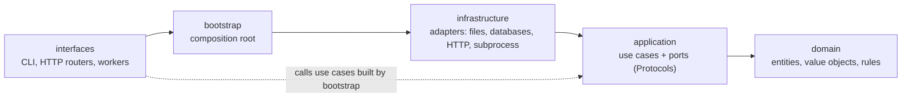

# Engineering principles

These apply to every Python module of the repository (today `tools/sdd` and
`tools/agent_hooks`, tomorrow the platform packages under `src/`) and, in spirit, to scripts,
Dockerfiles and configuration. The machine checks what it can (ruff, mypy, import-linter); the
review checks the rest. The primer [clean architecture and SOLID](../docs/learn/primers/clean-architecture-and-solid.md)
explains the ideas behind them.

## 1. Clean architecture

Every package is split into four layers, and **dependencies point inwards only**:

| Layer | Holds | May import | Never imports |
|---|---|---|---|
| `domain` | entities, value objects, domain rules, typed errors | the standard library | anything else |
| `application` | use cases, ports (`typing.Protocol`), application rules | `domain` | frameworks, I/O libraries (`yaml`, `typer`, `subprocess`, database drivers, HTTP clients) |
| `infrastructure` | adapters implementing the ports | `application`, `domain`, libraries | `interfaces` |
| `bootstrap` | the composition root: builds adapters, wires use cases | everything below | `interfaces` |
| `interfaces` | CLI, API routers, workers: translate input/output | `bootstrap`, `application`, `domain` | `infrastructure` directly |

The rules are contracts in `pyproject.toml` (`[tool.importlinter]`), checked by `lint-imports`
in pre-commit and in G5. A new package adds its own contracts in the same change.

- **Framework types never cross inwards.** FastAPI/pydantic models stay in `interfaces`;
  database rows and driver types stay in `infrastructure`. Mappers convert at the boundary.
- **Business rules live in `domain` and `application`**, never in a router, a SQL string or a
  Dockerfile.
- **One composition root per deployable** (`bootstrap.py`). Nothing else instantiates an adapter.
- **Configuration is read once** into an immutable `Settings` object and passed in.

## 2. SOLID, applied

| Principle | Rule here | Example in `tools/sdd` |
|---|---|---|
| **S**ingle responsibility | one reason to change per class and per module | `dossier_mapper.py` (representation) is separate from `yaml_dossier_repository.py` (storage) |
| **O**pen/closed | new behaviour = a new class behind an existing port or a data entry, not an `if` in old code | a new documentation rule is a new `DocumentRule`; a new quality check is a line in `checks.yaml` |
| **L**iskov substitution | every adapter honours its port's documented contract; fakes in tests are substitutable | `tests/sdd/fakes.py` implements every port |
| **I**nterface segregation | small role-specific ports, not one "repository of everything" | `Workspace`, `Clock`, `HumanConfirmation`, `CheckRunner` are separate |
| **D**ependency inversion | use cases depend on Protocols; adapters are injected by the composition root | `ApproveGate` receives a `HumanConfirmation`, never `input()` |

## 3. Design patterns we use (and when)

Use a pattern when it removes a real force, and name it in the docstring and the teaching
guide. The primer [design patterns](../docs/learn/primers/design-patterns.md) explains each one.

| Pattern | Use it for | Avoid it when |
|---|---|---|
| Ports and adapters (hexagonal) | every I/O boundary | never: it is the default |
| Repository | loading and saving aggregates | a one-off read of reference data (a small reader port is enough) |
| Strategy | interchangeable rules or algorithms (doc rules, quality checks, generators) | there is only one algorithm and no second one in sight |
| Composition root / dependency injection | wiring | — |
| Value object | immutable domain values validated at construction | the value has identity and a lifecycle (then it is an entity) |
| Aggregate | a consistency boundary changed only through its methods | — |
| Mapper | converting between domain objects and storage/transport formats | — |
| Factory | complex construction with invariants | a constructor is enough |
| Unit of work, outbox, specification | when the platform needs transactions, reliable events or composable queries | before the need exists |

## 4. Documentation in code: nothing is "obvious"

- **Every module** starts with a docstring: what it is for and where it sits in the architecture.
- **Every class and every function or method** (private ones too) has a docstring that states the
  *why* and the *contract*: arguments (units, ranges, time zones), return value, raised errors,
  side effects, what the caller must guarantee. Google style (`Args:`, `Returns:`, `Raises:`).
- **Explain domain terms** the first time they appear in a module (tag, checkpoint, grain, digest).
- **Comments explain why, never what.** Unusual code gets a comment saying why it is written so.
- **Type-annotate every signature**; `mypy --strict` must pass.

ruff enforces the presence of docstrings (`D` rules) and annotations (`ANN`); the review
enforces their quality.

## 5. Modularity and size

- **Many small modules over few big ones.** One public concept per file, named after it. A file
  past ~150 lines is a signal to split; past ~250 it needs a reason in the review.
- **Short functions that read top to bottom**; cyclomatic complexity ≤ 8 (ruff `C90`).
- **Packages mirror the architecture**: a new file goes in the layer that owns its reason to
  change.

## 6. Other design rules

- **Make illegal states unrepresentable:** enums and frozen dataclasses for domain values;
  validate in `__post_init__`.
- **Fail loudly with typed errors** (`domain/errors.py`) that the interface layer maps to exit
  codes or HTTP statuses. Never return `None` to mean "error".
- **Pure functions in the domain**: no clock, no randomness, no I/O. Pass time in.
- **Time is UTC and timezone-aware** everywhere (RT12).
- **Never build commands or queries by string interpolation of input**: subprocesses get argument
  lists without a shell; SQL uses bound parameters; identifiers come from a whitelist.
- **Database invariants belong in the database** (constraints, triggers) once there is one.
- **No premature features.** Build what the approved spec asks; note ideas in `release.md`.

## 7. Python toolchain

- **Poetry only** (ADR-0005): `poetry add` / `poetry add --group <g>`, `poetry install`,
  `poetry run`. One root `pyproject.toml`; each deployable uses a dependency group; the virtual
  environment lives in `.venv/` (`poetry.toml`).
- Python ≥ 3.11. Formatting and lint: `ruff format`, `ruff check` (line length 99). Types: mypy
  strict. Layers: import-linter. Tests: pytest (+ coverage ≥ 85 %).
- Dependencies are added only through a spec that names them; each new runtime dependency is an
  ADR or a line in one.
