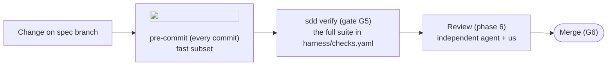

# Quality: testing, the G5 suite and code review

Quality is checked in three rings. The first two are machines; the third is us and an
independent reviewer agent.



## 1. The deterministic suite (gate G5)

Defined in [checks.yaml](checks.yaml) and run by `poetry run sdd verify <id>`:

| Check | Tool | Proves |
|---|---|---|
| `format` | ruff format | one formatting, no diffs about style |
| `lint` | ruff check | no common bugs; docstrings and annotations present; security smells (`S` rules); complexity ≤ 8 |
| `types` | mypy --strict | types are consistent across layers |
| `architecture` | import-linter | the clean-architecture layer contracts hold |
| `tests` | pytest + coverage | behaviour is tested; coverage ≥ 85 % (branch coverage) |
| `security` | bandit | no known insecure constructs in the code |
| `secrets` | detect-secrets | no credentials in tracked files |
| `dependencies` | pip-audit | no dependency with a known vulnerability (needs network) |
| `harness` | sdd check | dossiers, documentation, logos, links, ADRs and generated files are consistent |
| `docs-site` | mkdocs build --strict | the documentation site builds without a warning (broken anchors included) |

The pre-commit hooks run the fast subset (format, lint, types, layers, tests, secrets, guard,
sync, check) on every commit; `sdd verify` is the complete, recorded run.

## 2. Testing strategy

- **Tests come with the code**, in the same task. A behaviour of the spec without a test is not
  done; an RT's "how we verify it" is a test whenever it can be automated.
- **Unit tests** cover the domain and the use cases with in-memory fakes of the ports. They are
  fast (milliseconds) and are where most tests live.
- **Integration tests** cover the adapters against the real thing (files in `tmp_path`, a git
  repository, a subprocess; later a throwaway PostgreSQL container that is always removed).
- **End-to-end tests** exercise the interfaces (the CLI with `typer.testing.CliRunner`; later the
  HTTP API and Docker Compose services) as a person would.
- Fakes honour the port contracts (Liskov): if a fake behaves differently from the adapter, the
  integration tests of the adapter must show it.
- Test names describe behaviour (`test_editing_an_approved_artifact_makes_it_stale`).
- Deliberately untested code is listed in the teaching guide with the reason.

## 3. Code review checklist

The reviewer (role [reviewer](roles/reviewer.md)) and we use this list in phase 6; findings go
into `validation.md`.

**Correctness**
- [ ] Every SPEC behaviour is implemented and tested; nothing beyond the spec was added.
- [ ] Error paths are handled with typed errors; no silent `except`.
- [ ] Time handling is UTC and timezone-aware.

**Design**
- [ ] Layers respected (import-linter green is necessary, not sufficient: look at intent).
- [ ] Each class has one responsibility; ports are small; adapters are wired only in bootstrap.
- [ ] Patterns used are named and justified; no speculative abstraction.

**Readability**
- [ ] Every module, class and function has a docstring with the why and the contract.
- [ ] Names say what things are; no abbreviations a newcomer cannot decode.
- [ ] Files and functions are small; no copy-paste.

**Security** (see [security.md](security.md))
- [ ] Inputs validated at the boundary; no string-built commands or queries.
- [ ] No secrets; identities have least privilege; the STRIDE rows are verified.

**Documentation** (see [architecture-upkeep.md](architecture-upkeep.md))
- [ ] ADRs, architecture pages, diagrams with logos, READMEs updated; `sdd sync` run.
- [ ] The teaching guide explains every decision and the code tour matches the diff.

## 4. Running the suite yourself

```bash
poetry run ruff format . && poetry run ruff check .
poetry run mypy
poetry run lint-imports
poetry run pytest
poetry run pre-commit run --all-files
poetry run sdd verify <id>     # the recorded run that closes G5
```
