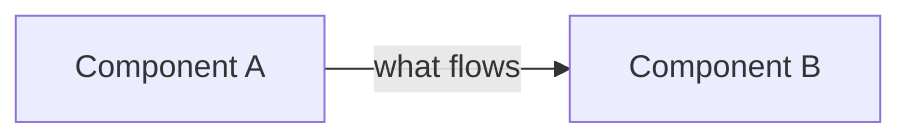
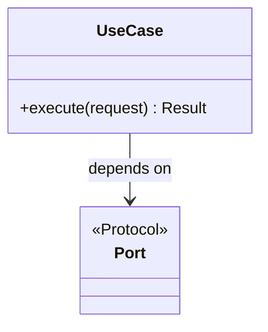

# Teaching guide · {{id}} · {{title}}

> The didactic record of this dossier: **every decision, with its justification**, from the
> architecture down to the classes. It is written for the mentee who was not in the room,
> reads in order, and is approved at **G6** together with `validation.md`. Rules:
> [documentation standard](../../harness/documentation-standard.md#the-teaching-guide).
> Diagrams are Mermaid; every tool node carries its official logo.

## 1. The problem in plain words

TODO(sdd): Explain the problem to someone who knows programming but not this domain. Define
every domain term the first time it appears (tag, historian, checkpoint, grain, ...). Two or
three paragraphs, no jargon left unexplained.

## 2. Requirements served

TODO(sdd): For each RT ({{requirements}}), one paragraph: what it asks, why it matters to Orion
Chemicals, and where in this dossier it is satisfied (behaviour ids, tests). Link the
[traceability matrix](../../docs/requirements/traceability.md).

## 3. Architecture before and after

TODO(sdd): Two Mermaid flowcharts (before / after) of the part of the system that changed, with
the official logos, followed by a paragraph per changed arrow or box: what it is and why it had
to change. Highlight new elements (for example with a `classDef new` style).

## 4. Decisions and the alternatives that lost

TODO(sdd): One subsection per decision (link its ADR). For each: the forces at play, the options
weighed in a table (criteria as columns), the choice, and what we give up by making it. A reader
must be able to disagree with the decision using only this section.

| Option | Criterion 1 | Criterion 2 | Criterion 3 | Verdict |
|---|---|---|---|---|
| | | | | |

## 5. The design: layers, classes and patterns

TODO(sdd): Walk through the code structure. A Mermaid `classDiagram` of the main classes and
ports; then, for each class, its single responsibility and why it exists as a separate class.
Then a table of the design patterns used, where and why, and a table mapping SOLID principles to
concrete places in the code. Explain every abstraction: what would break or get harder without it.

| Pattern | Where | Why here |
|---|---|---|
| | | |

| Principle | How this code applies it |
|---|---|
| Single responsibility | |
| Open/closed | |
| Liskov substitution | |
| Interface segregation | |
| Dependency inversion | |

## 6. How it behaves at runtime

TODO(sdd): The main flows as Mermaid `sequenceDiagram`s (happy path and the most important
failure), and a `stateDiagram-v2` when something has a lifecycle. Narrate each diagram step by
step.

## 7. Data and contracts

TODO(sdd): The data model (`erDiagram`), the API or file contracts, and the invariants the data
must respect (uniqueness, time in UTC, versioning). Say where each invariant is enforced and why
there.

## 8. Code tour

TODO(sdd): A guided reading order through the files, from the composition root inwards or from
the entry point outwards. For each file: its role, the two or three lines that matter (short
snippets), and the "why" behind anything non-obvious. Link files with relative paths.

## 9. Security

TODO(sdd): The threats that apply (from the spec's STRIDE table), how the code mitigates each, and
how we verified it. Mention secrets, permissions, inputs and dependencies explicitly.

## 10. How we tested it

TODO(sdd): The testing strategy: which levels (unit, integration, end-to-end), the fakes and
fixtures and why they are trustworthy, what is deliberately not tested and why. Map tests to the
RTs' "how we verify it".

## 11. Run it yourself

TODO(sdd): A hands-on exercise for the mentee: exact commands to run (Poetry, Docker Compose,
`sdd`), what to observe, and one small change to try (with the expected result) to prove the
understanding.

## 12. Pitfalls and what we would do differently

TODO(sdd): What surprised us, what we got wrong first, the trade-offs we would revisit with
more time or scale.

## 13. Questions for the mentee

TODO(sdd): Five to ten questions that check understanding (not memory): "what happens if...",
"why not...", "how would you extend...". Answers are discussed in the mentoring session.

## 14. Glossary

TODO(sdd): Every term introduced by this dossier, one line each, alphabetical.

| Term | Meaning |
|---|---|
| | |
