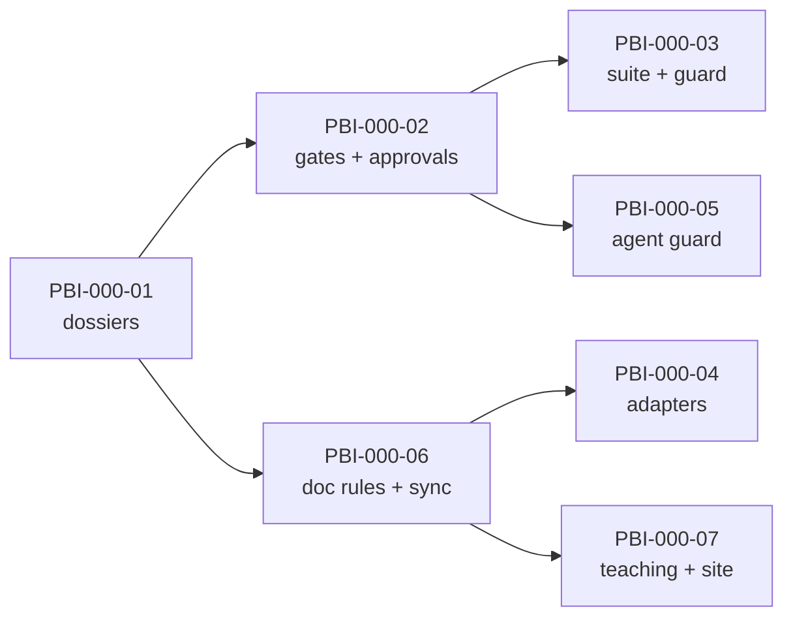

# Backlog · 000 · The SDD harness

> **Phase 2 · Plan**, closed by **G2 · Backlog approved** (both of us approve).
> The backlog lives in the repository as Markdown (ADR-0012); this file is its part for this
> dossier. How to fill it: [lifecycle, phase 2](../../harness/lifecycle.md#phase-2-plan).

## Epics

- **E1 · Governed lifecycle:** the seven phases and eight gates exist, are enforced and are
  approved only by us (PRD goals 1-3, 5).
- **E2 · Tool-agnostic agent harness:** any coding agent finds the same instructions, skills
  and roles (PRD goal 6).
- **E3 · Documentation and teaching:** every decision is recorded and taught, and the repository
  reads as a course (PRD goals 4-5).

## Features

- **E1.F1** A dossier per piece of work, created from templates, with its requirements checked.
- **E1.F2** Gate states computed from approvals and digests; approvals only from people.
- **E1.F3** A deterministic quality suite and a commit guard, run locally.
- **E2.F1** Canonical AGENTS.md, skills and roles; generated adapters per tool.
- **E2.F2** A guard that stops agents from approving, bypassing gates or touching secrets.
- **E3.F1** Documentation standard, ADRs, architecture pages with official logos, checked.
- **E3.F2** Teaching guide per dossier, learning path, primers, tutorials, documentation site.

## Work items

### PBI-000-01 · Create a dossier from the templates

- **Feature:** E1.F1
- **Serves:** RT42
- **Size:** M
- **Acceptance criteria (EARS):**
  - AC1: When `sdd new` is run with a title, slug and RTs, the harness shall create
    `specs/<next id>-<slug>/` with `dossier.yaml` and one artifact per lifecycle phase.
  - AC2: If an RT is not in the catalogue, then `sdd new` shall refuse and create nothing.
  - AC3: When a dossier is created, the PRD shall contain each cited RT with its verification.
  - AC4: If a feature cites no RT, then G0 shall pass only when `dossier.yaml` states a
    rationale, and the status board and traceability matrix shall show it as outside the
    catalogue (ADR-0014).
  - AC5: When we ask for work in plain words, the `sdd-start` skill shall make the agent read
    every RT and propose the mapping (served, left out, or outside the catalogue) before
    running `sdd new`.

### PBI-000-02 · Evaluate gates and record approvals

- **Feature:** E1.F2
- **Serves:** RT38
- **Size:** L
- **Acceptance criteria (EARS):**
  - AC1: When both members approved the current artifacts of a human gate, the harness shall
    report the gate as passed.
  - AC2: If an approved artifact changes, then the harness shall report the gate as stale and
    every later gate as blocked.
  - AC3: If standard input is not an interactive terminal, then `sdd approve` shall refuse and
    record nothing.
  - AC4: If an earlier gate has not passed or an artifact still has a `TODO(sdd)` or misses a
    template section, then `sdd approve` shall refuse.
  - AC5: When an approval is recorded, the harness shall store member, UTC time, digest, git
    identity and note.
  - AC6: If an artifact is complete while the human gate before it has not passed, then
    `sdd check` shall warn; and each human phase shall end with a review in the chat (briefing
    and specific questions) before we approve (ADR-0015).

### PBI-000-03 · Quality suite and commit guard

- **Feature:** E1.F3
- **Serves:** RT42, RT36
- **Size:** M
- **Acceptance criteria (EARS):**
  - AC1: When `sdd verify` runs after G4, the harness shall run every check of
    `harness/checks.yaml` and record the result bound to the governed digest.
  - AC2: If a governed file changes after a passing verification, then G5 shall be stale.
  - AC3: If a commit stages a governed file outside a spec branch whose G4 passed, then the
    commit guard shall refuse it.
  - AC4: When a commit is made, pre-commit shall run the guard, lint, types, layer contracts,
    tests, secret scanning, `sdd sync` and `sdd check`.

### PBI-000-04 · Canonical agent sources and generated adapters

- **Feature:** E2.F1
- **Serves:** none directly (enabler)
- **Size:** M
- **Acceptance criteria (EARS):**
  - AC1: The repository shall provide AGENTS.md, Agent Skills in `.agents/skills/` and roles in
    `harness/roles/` as canonical sources.
  - AC2: When `sdd sync` runs, the harness shall generate Claude Code skills and subagents,
    Cursor commands and Copilot prompts, and remove orphans.
  - AC3: If a generated file differs from its source, then `sdd check` shall report an error.

### PBI-000-05 · Agent guard

- **Feature:** E2.F2
- **Serves:** RT36, RT38
- **Size:** S
- **Acceptance criteria (EARS):**
  - AC1: If an agent runs `sdd approve`, `--no-verify`, `pre-commit uninstall`, a forced push or
    a hard reset, then the guard shall block the call.
  - AC2: If an agent edits the approvals or verification of a dossier, a guardrail file, or a
    secret file, then the guard shall block the call.
  - AC3: Where `SDD_ALLOW_GUARDRAIL_EDITS=1` is set by a person, the guard shall allow guardrail
    edits (never approvals or secrets).

### PBI-000-06 · Documentation rules

- **Feature:** E3.F1
- **Serves:** RT42
- **Size:** M
- **Acceptance criteria (EARS):**
  - AC1: If a flowchart node names a registered tool without its logo, then `sdd check` shall
    report it (error in architecture pages and the root README, warning elsewhere).
  - AC2: If a relative link points to a missing file, or an ADR is missing from the index or its
    status, then `sdd check` shall report an error.
  - AC3: When `sdd sync` runs, the harness shall regenerate the README status board, the specs
    index and the traceability matrix.

### PBI-000-07 · Teaching and the site

- **Feature:** E3.F2
- **Serves:** none directly (enabler)
- **Size:** L
- **Acceptance criteria (EARS):**
  - AC1: Every dossier shall have a fourteen-section teaching guide required at G6.
  - AC2: The repository shall provide a learning path, primers, a glossary and tutorials.
  - AC3: When `mkdocs serve` or `docker compose up docs` runs, the site shall publish the whole
    repository with working relative links and rendered Mermaid diagrams.

## Order and dependencies

The domain model of dossiers and gates comes first because everything else evaluates it; the
generators and documentation rules follow; the teaching material comes last because it explains
the rest.

## Definition of done

Every item is done only when: its acceptance criteria are verified by tests, G5 passes, the
documentation upkeep in [architecture-upkeep.md](../../harness/architecture-upkeep.md) is done,
and the teaching guide explains it.

Nothing beyond the standard.
