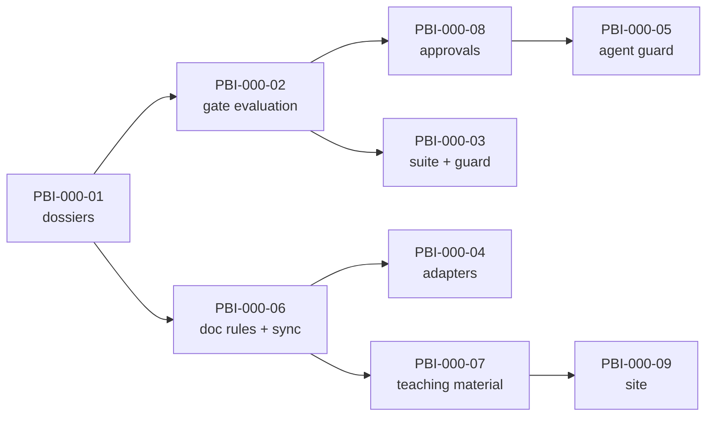

# Backlog · 000 · The SDD harness

> **Phase 2 · Plan**, closed by **G2 · Backlog approved** (both of us approve).
> The backlog lives in the repository as Markdown (ADR-0012); this file is its part for this
> dossier. How to fill it: [lifecycle, phase 2](../../harness/lifecycle.md#phase-2-plan).

## Epics

- **E1 · Governed lifecycle:** the seven phases and eight gates exist, are enforced and are
  approved only by us (PRD goals 1-3, 5).
- **E2 · Tool-agnostic agent harness:** any coding agent finds the same instructions, skills
  and roles (PRD goal 6).
- **E3 · Documentation and teaching:** every decision is recorded and taught, and the repository
  reads as a course (PRD goals 4-5).

## Features

- **E1.F1** A dossier per piece of work, created from templates, with its requirements checked.
- **E1.F2** Gate states computed from approvals and digests; approvals only from people.
- **E1.F3** A deterministic quality suite and a commit guard, run locally.
- **E2.F1** Canonical AGENTS.md, skills and roles; generated adapters per tool.
- **E2.F2** A guard that stops agents from approving, bypassing gates or touching secrets.
- **E3.F1** Documentation standard, ADRs, architecture pages with official logos, checked.
- **E3.F2** Teaching guide per dossier, learning path, primers, tutorials, documentation site.

## Work items

Each item is a self-contained card: someone (or a coding agent) who has read only the card,
[AGENTS.md](../../AGENTS.md) and [principles.md](../../harness/principles.md) can build it. The
code lives in `tools/sdd/` (Python, Poetry) in four layers, `domain` <- `application` <-
`infrastructure` / `interfaces`, wired only in `tools/sdd/bootstrap.py`; ports are
`typing.Protocol`s in `tools/sdd/application/ports/`; tests live in `tests/sdd/`.

### PBI-000-01 · Create a dossier from the templates

- **Feature:** E1.F1
- **Serves:** RT42
- **Size:** M
- **Depends on:** none (first item).
- **Context:** every piece of work is a *dossier*: a folder `specs/<id>-<slug>/` with a
  `dossier.yaml` (id, slug, title, kind, requirements or rationale, approvals) and one Markdown
  artifact per lifecycle phase. Creating it by hand is error-prone, so one command starts it and
  refuses work that cites a requirement (RT) that does not exist. The command creates only the
  first artifact: each later one is created when the gate before it passes (PBI-000-08,
  ADR-0018), so a phase's file never exists before its turn.
- **What:**
  - Command `poetry run sdd new "Title" --slug kebab-name (--rt RTnn ... | --rationale "why")
    [--kind feature|enabler]`.
  - Output: `specs/<next id>-<slug>/dossier.yaml` and `prd.md` (rendered from
    `harness/templates/prd.md`), and the branch name `spec/<id>-<slug>` printed for us to switch
    to. No other artifact is created.
  - The PRD's requirements table lists each cited RT with its "how we verify it" copied from
    `docs/requirements/rt-catalog.yaml`.
  - Exit code 2 with a clear message when an RT is unknown; nothing is written.
- **How:**
  1. Domain: `Dossier` and `DossierKind` (`tools/sdd/domain/dossier.py`) validate id, slug and
     the rule "requirements or rationale, never both empty" (raise `InvalidDossierError`);
     `Requirement` (`domain/requirement.py`) models a catalogue entry.
  2. Application: use case `CreateDossier.execute(NewDossier)` in
     `application/use_cases/create_dossier.py`. It asks the `RequirementCatalog` port for each
     RT (raise `UnknownRequirementError` before touching the disk), computes the next id from
     `DossierRepository.ids()`, asks the scaffolding service for the first artifacts and saves
     through `DossierRepository.create`.
  2b. Which files exist when is data, not code in the use case: `artifacts_after(gate)` in
     `domain/gates.py` returns the artifacts of the next gate that has any (`None` means "at
     creation": G1's `prd.md`; G1 gives `backlog.md`; G2 `ux-approach.md`; G3 `spec.md`,
     `plan.md`, `tasks.md`; G4 `validation.md`, `teaching-guide.md`, skipping G5, which has no
     file; G6 `release.md`; G7 nothing). `ScaffoldArtifacts` in
     `application/scaffold_artifacts.py` renders those templates through the `TemplateLibrary`
     port (`{{id}}`, `{{title}}`, `{{branch}}`, requirements table, moved out of
     `create_dossier.py`) and writes them through the new `DossierRepository.add_artifacts`,
     which writes only the files that do not exist and returns the names it wrote.
  3. Infrastructure: `YamlDossierRepository` (`yaml_dossier_repository.py`, with
     `dossier_mapper.py` for YAML <-> domain), `FileTemplateLibrary`, `YamlReferenceData`
     (the catalogue).
  4. Interface: the `new` Typer command in `interfaces/cli/app.py`; domain errors are mapped to
     exit code 2 in one place (`_run`), never inside the use case.
  5. Gate G0 reads the same data: it passes only when every cited RT exists, or a rationale is
     written (work outside the catalogue, ADR-0014); the status board and the traceability
     matrix mark such dossiers as outside the catalogue.
- **Out of scope:** approvals and the creation of the later artifacts when a gate passes
  (PBI-000-08), gate evaluation (PBI-000-02), the `sdd-start` conversation that decides which RTs
  apply (a skill, reviewed by us, not testable by machine).
- **Acceptance criteria (EARS):**
  - AC1: When `sdd new` is run with a title, slug and RTs, the harness shall create
    `specs/<next id>-<slug>/` with `dossier.yaml` and `prd.md` only.
  - AC2: If an RT is not in the catalogue, then `sdd new` shall refuse and create nothing.
  - AC3: When a dossier is created, the PRD shall contain each cited RT with its verification.
  - AC4: If a feature cites no RT, then G0 shall pass only when `dossier.yaml` states a
    rationale, and the status board and traceability matrix shall show it as outside the
    catalogue (ADR-0014).
- **Verification:** `tests/sdd/test_use_cases.py` (use case with fakes: unknown RT writes
  nothing, next id, only `dossier.yaml` and `prd.md` created, rendered table),
  `tests/sdd/test_infrastructure.py` (YAML round trip, `add_artifacts` skips existing files),
  `tests/sdd/test_cli.py` (exit codes), `tests/sdd/test_domain.py` (dossier invariants,
  `artifacts_after` for every gate).

### PBI-000-02 · Evaluate gates

- **Feature:** E1.F2
- **Serves:** RT38
- **Size:** M
- **Depends on:** PBI-000-01.
- **Context:** work moves through eight gates, G0-G7. Whether a gate is passed must never be
  stored as a flag someone can flip: it is *computed* every time from the approvals recorded in
  `dossier.yaml` and the current content of the artifacts. Each approval carries a SHA-256
  digest of the text that was approved, so editing an approved artifact makes its gate *stale*
  and blocks every later gate.
- **What:**
  - A pure function `evaluate_gates(dossier, evidence) -> tuple[GateStatus, ...]` in
    `tools/sdd/domain/gate_status.py` that returns, per gate, a `GateState` (`passed`,
    `partial`, `pending`, `stale`, `failed`, `blocked`) and a human reason ("waiting for
    mentee", "waits for G1").
  - The digest of a gate's artifacts (`domain/digest.py`): SHA-256 over the artifacts' texts
    normalised for line endings and task boxes (`- [ ]` vs `- [x]`), so ticking a task does not
    stale a gate.
  - Command `poetry run sdd status [id]` printing the board; `sdd check` warning `written-ahead`
    (see AC3).
- **How:**
  1. Gate definitions live in `domain/gates.py` (`GateId`, `GateKind` human or automated,
     `GateDefinition` with its artifacts); `gates_before(gate)` gives the order.
  2. `GateEvidence` carries the current digest and which artifacts are complete, collected by
     the application layer (`application/evidence.py`) from the `DocumentStore` port; the domain
     never reads files.
  3. `evaluate_gates` walks the gates in order; helpers `_context_status` (G0),
     `_approval_status` (G1-G4, G6, G7: one approval per team member, each with the digest that
     must equal the current one), `_verification_status` (G5, from `sdd verify` results).
     A gate whose predecessor is not passed is `blocked`; an approval with an old digest makes
     the gate `stale`.
  4. Use case `EvaluateDossier.one/all` returns a `DossierReport` for the CLI and the
     generators; the `status` command prints it through `interfaces/cli/presenters.py`.
  5. The `written-ahead` rule lives in `check_harness.py` (`_dossier_findings`): if an artifact
     of phase N is complete while the human gate N-1 has not passed, emit a WARNING finding
     (not an error: the bootstrap dossier needs it).
- **Out of scope:** recording approvals (PBI-000-08), G5 verification (PBI-000-03).
- **Acceptance criteria (EARS):**
  - AC1: When both members approved the current artifacts of a human gate, the harness shall
    report the gate as passed.
  - AC2: If an approved artifact changes, then the harness shall report the gate as stale and
    every later gate as blocked.
  - AC3: If an artifact is complete while the human gate before it has not passed, then
    `sdd check` shall warn (ADR-0015).
- **Verification:** `tests/sdd/test_gate_status.py` (a table of states: one approval gives
  `partial`, two give `passed`, an edit gives `stale` and later gates `blocked`, ticking a task
  box keeps the digest), `tests/sdd/test_domain.py` (digest normalisation),
  `tests/sdd/test_use_cases.py` (`written-ahead` finding).

### PBI-000-03 · Quality suite and commit guard

- **Feature:** E1.F3
- **Serves:** RT42, RT36
- **Size:** M
- **Depends on:** PBI-000-02.
- **Context:** gate G5 ("checks passed") is the only gate a machine closes. It runs the same
  fixed list of checks for every dossier, and the result is valid only for the exact governed
  files it ran on. A second guard keeps code from being committed on a branch whose spec was
  not approved (G4).
- **What:**
  - `poetry run sdd verify <id>` runs every check of `harness/checks.yaml` in order (format,
    lint, types, architecture contracts, tests with coverage, bandit, secrets, dependency
    audit, `sdd check`, docs build), prints each result, and stores in `dossier.yaml`
    `verification:` the outcomes plus the digest of the governed files.
  - `poetry run sdd guard-commit [paths]` (called by pre-commit): exit 1 when any staged path is
    governed (code, tests, `docker/`, `compose.yaml`, `pyproject.toml`, `harness/`, `.agents/`,
    `.claude/`) and the branch is not `spec/<id>-<slug>` with G4 passed.
  - `.pre-commit-config.yaml` hooks: guard-commit, ruff, mypy, lint-imports, pytest,
    detect-secrets, `sdd sync`, `sdd check`.
- **How:**
  1. Checks are data: `harness/checks.yaml` (id, title, command as a list, `pass_files`),
     loaded into `QualityCheck` (`domain/quality.py`) by a `QualityCheckCatalog`. Adding a check
     is a data change only (open/closed).
  2. Use case `VerifyQuality.execute(id)` in `use_cases/verify_quality.py` iterates the catalogue
     and calls the `CheckRunner` port; the adapter `SubprocessCheckRunner` runs the command
     without a shell from the repository root, resolving the executable with `shutil.which`
     (Windows) and passing tracked and new files when `pass_files` is set. A check passes on
     exit 0. Results become `Verification` / `CheckOutcome` (`domain/approval.py`).
  3. Governed-file rules are pure functions in `domain/governance.py` (`is_governed(path)`,
     `spec_id_from_branch(branch)`); `GuardCommit.execute(paths)` combines them with the
     `Workspace` port (current branch) and `EvaluateDossier` (is G4 passed).
  4. G5 is `stale` when the digest of governed files differs from the one stored by `verify`
     (reuse the digest function of PBI-000-02).
  5. The CLI commands `verify` and `guard-commit` only translate arguments and exit codes.
- **Out of scope:** the content of each check's tool configuration (in `pyproject.toml`), CI.
- **Acceptance criteria (EARS):**
  - AC1: When `sdd verify` runs after G4, the harness shall run every check of
    `harness/checks.yaml` and record the result bound to the governed digest.
  - AC2: If a governed file changes after a passing verification, then G5 shall be stale.
  - AC3: If a commit stages a governed file outside a spec branch whose G4 passed, then the
    commit guard shall refuse it.
  - AC4: When a commit is made, pre-commit shall run the guard, lint, types, layer contracts,
    tests, secret scanning, `sdd sync` and `sdd check`.
- **Verification:** `tests/sdd/test_use_cases.py` (`TestGuard`, verify with a fake
  `CheckRunner`), `tests/sdd/test_gate_status.py` (stale G5), `tests/sdd/test_infrastructure.py`
  (real subprocess runner), and `poetry run pre-commit run --all-files` for AC4.

### PBI-000-04 · Canonical agent sources and generated adapters

- **Feature:** E2.F1
- **Serves:** none directly (enabler)
- **Size:** M
- **Depends on:** PBI-000-06 (the generators share its `sync` command and text tools).
- **Context:** several coding agents (Claude Code, Cursor, Copilot, Codex, Gemini CLI) will work
  here. Each looks for instructions in a different place. We keep one canonical copy and
  *generate* the rest, so no tool drifts from the others (ADR-0002).
- **What:**
  - Canonical sources: `AGENTS.md` (instructions), `.agents/skills/<name>/SKILL.md` (Agent
    Skills with front matter `name`, `description`), `harness/roles/<role>.md` (roles).
  - Generated, with a "generated, do not edit" banner: `.claude/skills/<name>/*` (same
    content), `.claude/agents/<role>.md` (subagents), `.cursor/commands/<name>.md` and
    `.github/prompts/<name>.prompt.md` (short pointers to the skill). `CLAUDE.md` and
    `GEMINI.md` are small hand-written files that import `AGENTS.md`.
  - `poetry run sdd sync` writes them and deletes orphans; `sdd sync --check` writes nothing and
    fails on any difference.
- **How:**
  1. `AdapterGenerator` in `application/generators/adapters.py` takes the `DocumentStore` port,
     reads the canonical files, and returns `GeneratedFile(path, content)` values; it does no
     I/O of its own. Front matter is parsed and rendered by
     `generators/text_tools.py` (`split_front_matter`, `render_front_matter`,
     `generated_banner`).
  2. `SyncGenerated.execute(write)` in `use_cases/sync_generated.py` compares each generated
     file with disk: with `write=True` it writes or removes (orphans = files under the four
     target directories that no source produces), with `write=False` it reports drift as
     findings (`SyncResult.findings`).
  3. `sdd check` calls the same drift check, so an edited generated file is an error.
  4. Adding a new tool is a new generator class plus one line in the sync list (open/closed);
     no existing generator changes.
- **Out of scope:** native hooks for tools other than Claude Code.
- **Acceptance criteria (EARS):**
  - AC1: The repository shall provide AGENTS.md, Agent Skills in `.agents/skills/` and roles in
    `harness/roles/` as canonical sources.
  - AC2: When `sdd sync` runs, the harness shall generate Claude Code skills and subagents,
    Cursor commands and Copilot prompts, and remove orphans.
  - AC3: If a generated file differs from its source, then `sdd check` shall report an error.
- **Verification:** `tests/sdd/test_docs_and_sync.py` (generation, orphan removal, drift as
  error) and `poetry run sdd sync --check` clean.

### PBI-000-05 · Agent guard

- **Feature:** E2.F2
- **Serves:** RT36, RT38
- **Size:** S
- **Depends on:** PBI-000-08 (it protects what approvals write).
- **Context:** an agent can run any shell command. A hook that Claude Code runs *before every
  tool call* blocks the few actions only people may take. It is a safety net against mistakes;
  the TTY-only approval and pre-commit still hold when a tool has no hooks.
- **What:** `tools/agent_hooks/agent_guard.py`, registered in `.claude/settings.json` as a
  `PreToolUse` hook. It reads `{"tool_name", "tool_input"}` as JSON on standard input and exits
  2 with a reason on standard error to block, 0 to allow. It blocks:
  1. approvals: running `sdd approve`; editing the `approvals` or `verification` sections of
     any `dossier.yaml`;
  2. gate bypasses: `git commit --no-verify`, `pre-commit uninstall`, forced pushes,
     `git reset --hard`;
  3. guardrail edits: `.claude/settings.json`, `.pre-commit-config.yaml`, `harness/team.yaml`,
     `tools/agent_hooks/` (unless the person started the agent with
     `SDD_ALLOW_GUARDRAIL_EDITS=1`; this never unlocks approvals or secrets);
  4. secrets: reading or writing `.env` files (except `.env.example`), `deploy/secrets/`,
     private keys.
- **How:**
  1. Pure functions that return a reason string or `None`: `shell_reason(command)` for shell
     tools (`Bash`, `PowerShell`), matched with regular expressions, and `file_reason(...)` for
     edit tools (`Edit`, `Write`, `MultiEdit`, `NotebookEdit`) and file reads, matched on the
     path (made relative to the project by `relative_path`). `decide(payload, project_dir,
     environ)` dispatches on the tool name and returns the first reason; `main()` only reads
     stdin, calls `decide` and sets the exit code.
  2. For dossier files, `edited_content` computes the text after the edit and
     `protected_sections` extracts `approvals` and `verification` from before and after; any
     difference blocks.
  3. The override variable is read from the `environ` passed to `decide` (the hook process's own
     environment), which the agent cannot set.
  4. The module is standalone (standard library only) so it runs before the project is
     installed.
- **Out of scope:** hooks for Cursor, Codex, Copilot, Gemini CLI.
- **Acceptance criteria (EARS):**
  - AC1: If an agent runs `sdd approve`, `--no-verify`, `pre-commit uninstall`, a forced push or
    a hard reset, then the guard shall block the call.
  - AC2: If an agent edits the approvals or verification of a dossier, a guardrail file, or a
    secret file, then the guard shall block the call.
  - AC3: Where `SDD_ALLOW_GUARDRAIL_EDITS=1` is set by a person, the guard shall allow guardrail
    edits (never approvals or secrets).
- **Verification:** `tests/agent_hooks/test_agent_guard.py` (one test per blocked action, one
  per allowed look-alike, and the override).

### PBI-000-06 · Documentation rules

- **Feature:** E3.F1
- **Serves:** RT42
- **Size:** M
- **Depends on:** PBI-000-01.
- **Context:** documentation is part of the definition of done, so it is checked by machine:
  every tool in an architecture diagram shows its official logo, links do not break, and every
  decision record is indexed. The same pass regenerates the status board, the specs index and
  the traceability matrix, so those can never be stale.
- **What:**
  - `poetry run sdd check` reports findings (`ERROR` fails with exit 1, `WARNING` does not):
    - missing logo for a registered tool in a Mermaid flowchart node (error in
      `docs/architecture/` and the root `README.md`, warning elsewhere);
    - relative Markdown link to a file that does not exist;
    - ADR missing from `docs/architecture/decisions/README.md` or without a valid status.
  - `poetry run sdd sync` regenerates: the status table in `README.md`, the specs index and the
    traceability matrix (RT -> dossiers, with the "Work outside the catalogue" section).
- **How:**
  1. Rules are small pure modules in `application/doc_rules/`: `mermaid.py` (extract
     `flowchart` blocks, match node labels against `LogoRegistry`, i.e.
     `docs/architecture/logos/registry.yaml`), `links.py`, `adr.py`, `markdown.py` (shared
     parsing). Each returns `tuple[Finding, ...]`.
  2. `LintDocs.execute()` runs all rules over the `DocumentStore`; `CheckHarness.execute()`
     adds dossier and generated-file findings and is what the CLI prints.
  3. Generators in `application/generators/` (`status.py`, `traceability.py`) return
     `GeneratedFile`s; they replace only the text between the marker comments in `README.md`
     (`<!-- sdd:status:start -->` ... `<!-- sdd:status:end -->`, and `sdd:coverage`), so
     hand-written text around them is never touched. `SyncGenerated` (see PBI-000-04) writes
     them.
  4. `Finding` / `Severity` live in `domain/findings.py`; `has_errors` decides the exit code.
- **Acceptance criteria (EARS):**
  - AC1: If a flowchart node names a registered tool without its logo, then `sdd check` shall
    report it (error in architecture pages and the root README, warning elsewhere).
  - AC2: If a relative link points to a missing file, or an ADR is missing from the index or its
    status, then `sdd check` shall report an error.
  - AC3: When `sdd sync` runs, the harness shall regenerate the README status board, the specs
    index and the traceability matrix.
- **Verification:** `tests/sdd/test_docs_and_sync.py` (one test per rule with a failing and a
  passing document; regeneration is idempotent).

### PBI-000-07 · Teaching material

- **Feature:** E3.F2
- **Serves:** none directly (enabler)
- **Size:** M
- **Depends on:** PBI-000-06 (links and diagrams are checked by its rules).
- **Context:** the mentee must understand every decision, not only run the code. Each dossier
  therefore carries a teaching guide, and the repository itself reads as a course.
- **What:**
  - `harness/templates/teaching-guide.md` with fourteen `##` sections (the required
    structure, from architecture to classes, abstractions and patterns, with Mermaid diagrams).
  - Per dossier, `teaching-guide.md` created from it by `sdd new`.
  - `docs/learn/`: `README.md` (learning path), `glossary.md`, and `primers/`
    (acceptance criteria, ADRs, clean architecture and SOLID, design patterns, spec-driven
    development); `docs/tutorials/` (`first-feature.md`, `agents.md`, `docs-site.md`).
- **How:**
  1. No new code: the G6 refusal reuses `readiness_problems` (`domain/readiness.py`), which
     treats the template's `##` headings as required and any `TODO(sdd)` as unfinished. Adding
     a section to the template makes it required everywhere.
  2. Primers are short, one concept each, each ending with a pointer to where the concept lives
     in this repository (file and class).
  3. Diagrams follow the skill `diagrams-with-logos`.
- **Acceptance criteria (EARS):**
  - AC1: Every dossier shall have a fourteen-section teaching guide, and the harness shall refuse
    the G6 approval while it is incomplete.
  - AC2: The repository shall provide a learning path, primers, a glossary and tutorials.
- **Verification:** `tests/sdd/test_domain.py` (readiness of a template with 14 headings),
  `tests/sdd/test_use_cases.py` (G6 refused while incomplete), and `sdd check` (links and
  diagrams of the learning pages).

### PBI-000-08 · Record approvals

- **Feature:** E1.F2
- **Serves:** RT38
- **Size:** M
- **Depends on:** PBI-000-02 (gate states), PBI-000-01 (the scaffolding service).
- **Context:** an approval is the audit record that a named person accepted an exact text at a
  time. It must be impossible for an agent to create one, because agents run commands without
  an interactive terminal; a person at a terminal is what proves a human decided. When the
  second approval closes a gate, the next phase may start, so the same command creates that
  phase's files from the templates (ADR-0018).
- **What:** `poetry run sdd approve <id> <gate> --as <member id from harness/team.yaml> [--note "..."]`.
  It prints a summary of what is being approved, asks the person to type a confirmation (`y` or
  `yes` at `Approve? [y/N]`, ADR-0016), and appends to `approvals.<gate>` in `dossier.yaml`:
  `member`, `at` (UTC ISO 8601), `digest` (`sha256:...`), `git_identity`, `note`.
  It refuses, recording nothing, when: standard input is not a terminal; the answer is not
  `y`/`yes`; an earlier gate has not passed; the gate is automated (G0, G5); an
  artifact keeps a `TODO(sdd)` or lacks a template section; the member is unknown.
  When the approval turns the gate *passed*, it creates the artifacts of the next gate (G1:
  `backlog.md`; G2: `ux-approach.md`; G3: `spec.md`, `plan.md`, `tasks.md`; G4: `validation.md`,
  `teaching-guide.md`; G6: `release.md`), never overwriting a file, and prints one line
  `created: <name>` for each.
- **How:**
  1. Use case `ApproveGate.execute(...)` in `use_cases/approve_gate.py`; it asks the
     `HumanConfirmation` port first (adapter `terminal_confirmation.py` checks
     `sys.stdin.isatty()` and raises `HumanConfirmationRequiredError`; an answer other than
     `y`/`yes` raises `ApprovalDeclinedError`), so the check cannot be skipped by the caller.
  2. Preconditions run before the prompt, in this order: member known (`Team.member`, from
     `harness/team.yaml` via `TeamDirectory`), gate is human (`GateKindError`), earlier gates
     passed (`_require_earlier_gates` -> `GateOrderError`), artifacts ready
     (`readiness_problems` -> `GateNotReadyError`).
  3. The digest comes from the same function the evaluator uses (PBI-000-02), so what was
     approved is exactly what will be compared later; time from the `Clock` port; git identity
     from the `Workspace` port (`(git identity not configured)` when unset).
  4. `Approval` (`domain/approval.py`) is immutable; `YamlDossierRepository.save` writes it.
  5. Each domain error maps to a distinct, readable CLI message and exit code in `_run`.
  6. After saving, `ApproveGate` evaluates the dossier again; only when the gate's state is
     `PASSED` does it call `ScaffoldArtifacts.after(dossier, gate)` (PBI-000-01) and return the
     names created, which the CLI prints. A file that already exists is kept. The whole step is
     all-or-nothing: `add_artifacts` removes the files it wrote if one write fails, and
     `ApproveGate` then saves the dossier as it was before the approval and re-raises, so a
     failed scaffolding leaves neither an approval nor a stray file.
- **Out of scope:** signed approvals, revoking an approval (edit the artifact: the gate goes
  stale).
- **Acceptance criteria (EARS):**
  - AC1: If standard input is not an interactive terminal, or the answer is not `y` or `yes`,
    then `sdd approve` shall refuse and record nothing.
  - AC2: If an earlier gate has not passed or an artifact still has a `TODO(sdd)` or misses a
    template section, then `sdd approve` shall refuse.
  - AC3: When an approval is recorded, the harness shall store member, UTC time, digest, git
    identity and note.
  - AC4: When an approval turns a gate *passed*, the harness shall create the artifacts of the
    next gate from the templates without overwriting an existing file, and shall create none
    when the gate is only *partial*.
  - AC5: If creating the next gate's artifacts fails, then the harness shall undo the approval,
    remove the files it created in that call and report the error.
- **Verification:** `tests/sdd/test_use_cases.py` (`test_agents_without_terminal_are_refused`,
  each refusal leaves the dossier file unchanged, the stored fields, the first approval of two
  creates nothing, the second creates the next gate's files, an existing file is kept, a failing
  scaffolding leaves the dossier file and the folder as they were),
  `tests/sdd/test_cli.py` (exit codes, messages, the `created:` lines),
  `tests/sdd/test_infrastructure.py` (terminal adapter).

### PBI-000-09 · Documentation site

- **Feature:** E3.F2
- **Serves:** none directly (enabler)
- **Size:** M
- **Depends on:** PBI-000-07 (publishes its pages).
- **Context:** the whole repository documentation is read as a website, locally, with no hosted
  service (PRD constraint). It runs the same way everywhere through Docker Compose.
- **What:**
  - `mkdocs.yml` (Material theme, plugins `same-dir` and `search`, Mermaid rendering through
    `pymdownx.superfences`) that publishes the repository's Markdown, including files outside
    `docs/` (AGENTS.md, `harness/`, `specs/`).
  - `docker/docs.Dockerfile` and the `docs` service in `compose.yaml`, so
    `docker compose up --build docs` serves http://127.0.0.1:8000 with the sources mounted
    read-only.
  - `poetry run mkdocs build --strict` as the `docs-site` check of `harness/checks.yaml`.
- **How:**
  1. Install the docs dependencies in the Poetry group `docs` (`poetry install --with docs`);
     never `pip install`.
  2. Publish the repository as it is: `docs_dir: .` with the `same-dir` plugin in `mkdocs.yml`,
     excluding folders that are not documentation; fix every relative link the strict build
     reports instead of silencing it.
  3. Mermaid: configure the custom fence so diagrams (with `` logos in node labels) render
     in the browser; verify with the real site, not only with the Markdown source.
  4. Keep the container local: publish the port on loopback only (`127.0.0.1:8000:8000`),
     mount the sources read-only (`:ro`), no secrets.
- **Acceptance criteria (EARS):**
  - AC1: When `mkdocs build --strict` runs, the site shall build without warnings and publish the
    whole repository with working relative links.
  - AC2: When `mkdocs serve` or `docker compose up docs` runs, the site shall render the Mermaid
    diagrams.
- **Verification:** AC1 is the `docs-site` check of `sdd verify`; AC2 is checked by running
  `docker compose up --build docs`, opening an architecture page and confirming the diagram
  renders (recorded in `validation.md`).

## Order and dependencies

The domain model of dossiers and gates comes first because everything else evaluates it; the
generators and documentation rules follow; the teaching material and the site come last because
they explain and publish the rest. Every item is now size S or M.

## Definition of done

Every item is done only when: its acceptance criteria are verified by tests, G5 passes, the
documentation upkeep in [architecture-upkeep.md](../../harness/architecture-upkeep.md) is done,
and the teaching guide explains it.

Nothing beyond the standard.
