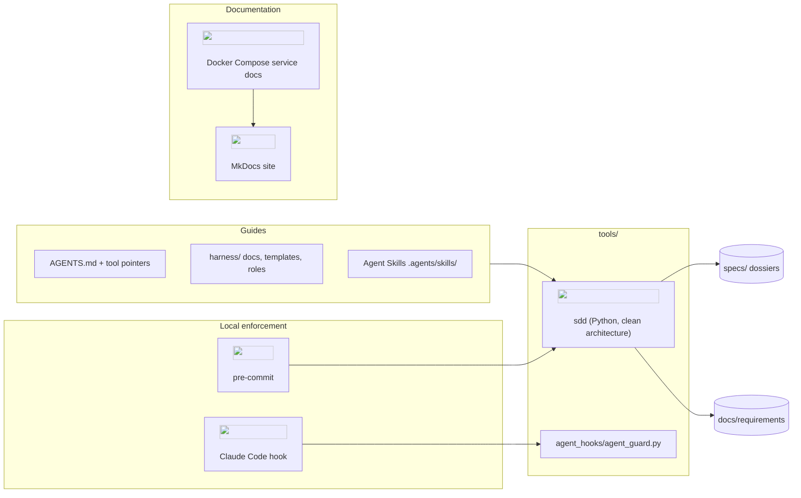
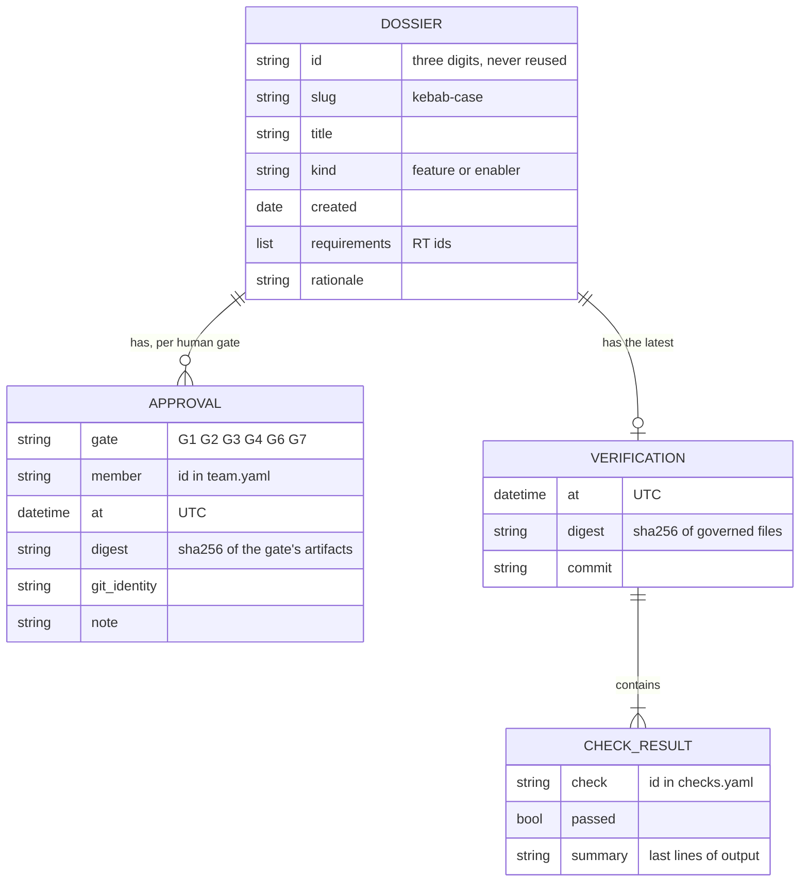

# Execution specification · 000 · The SDD harness

> **Phase 4 · Specify**, closed by **G4 · Specification approved for execution** (both of us
> approve `spec.md`, `plan.md` and `tasks.md` together). After G4, code may change on branch
> `spec/000-sdd-harness`. Any later edit of these three files makes G4 stale until we re-approve.
> How to fill this file: [lifecycle, phase 4](../../harness/lifecycle.md#phase-4-specify).

## Context collected

- **Requirements:** RT36, RT38, RT42 (`docs/requirements/rt-catalog.yaml`, transcribed from the
  PDF of 28 September 2026); the PDF's priority list for the platform.
- **Target operating model** (image shared by us): seven phases, human gates, governed context
  plane, AI control plane. Every human role is played by the two of us.
- **Reference platform** (industrial_data_platform / Kairon, studied in full): `CLAUDE.md` →
  `harness/` pattern, upkeep matrix, commit review, ADRs, clean-architecture packages with a
  composition root, README as a product page, diagrams with official logos, database access
  through roles without table privileges, Kubernetes runtime (replaced here).
- **Research** ([sdd-landscape.md](../../docs/research/sdd-landscape.md)): Spec Kit, OpenSpec,
  BMAD, Kiro (EARS), AGENTS.md, Agent Skills, harness engineering (guides and sensors).
- **Our decisions in the conversation:** English only; no CI; backlog in Markdown; own harness;
  MkDocs with a tutorial; Mermaid with logos; harness only, no platform pilot.
- **Tool documentation:** Claude Code hook contract (PreToolUse, JSON on stdin, exit code 2
  blocks), Material for MkDocs status (maintenance mode; Zensical successor).

## Behaviour

- **SPEC-000-B01:** When `sdd new` is run, the harness shall create the next dossier id with
  `dossier.yaml` and the nine artifacts rendered from `harness/templates/`. *(PBI-000-01 AC1, AC3)*
- **SPEC-000-B02:** If `sdd new` cites an RT that is not in the catalogue, then the harness shall
  refuse with exit code 2 and create nothing. *(RT42, PBI-000-01 AC2)*
- **SPEC-000-B03:** The harness shall compute every gate state (passed, pending, partial, stale,
  failed, blocked) from `dossier.yaml` and the current files, never from a stored status.
  *(PBI-000-02 AC1, AC2)*
- **SPEC-000-B04:** When an approval is recorded, the harness shall bind it to the SHA-256 digest
  of the gate's artifacts, normalised for line endings and task boxes. *(RT38, PBI-000-02 AC2, AC5)*
- **SPEC-000-B05:** If standard input is not an interactive terminal, or the typed confirmation
  differs, then `sdd approve` shall refuse and record nothing. *(PBI-000-02 AC3)*
- **SPEC-000-B06:** If an earlier gate has not passed, an artifact misses a template section or
  contains `TODO(sdd)`, the gate is automated, or the member is unknown, then `sdd approve` shall
  refuse. *(PBI-000-02 AC4)*
- **SPEC-000-B07:** When `sdd verify` runs on a dossier whose G4 passed, the harness shall run
  every check of `harness/checks.yaml` without a shell and record the outcomes with the governed
  digest and the commit. *(RT42, PBI-000-03 AC1, AC2)*
- **SPEC-000-B08:** If staged files include a governed file and the branch is not
  `spec/<id>-<slug>` with G4 passed, then `sdd guard-commit` shall exit with 1. *(RT42,
  PBI-000-03 AC3)*
- **SPEC-000-B09:** When `sdd sync` runs, the harness shall regenerate the README status and
  coverage blocks, `specs/README.md`, the traceability matrix and the tool adapters, and remove
  orphan adapters. *(PBI-000-04 AC2, PBI-000-06 AC3)*
- **SPEC-000-B10:** When `sdd check` runs, the harness shall report dossier errors (G0, unknown
  approvers), stale or failed gates (warnings), documentation errors (diagram type, logos, links,
  ADRs) and generated drift, and exit with 1 on any error. *(PBI-000-04 AC3, PBI-000-06 AC1-AC2)*
- **SPEC-000-B11:** If a coding agent calls `sdd approve`, bypasses hooks, edits approvals,
  guardrails or secrets, then the Claude Code guard shall block the call with exit code 2 and a
  reason, unless guardrail edits were allowed by a person. *(RT36, RT38, PBI-000-05)*
- **SPEC-000-B12:** When `mkdocs build --strict` runs, the site shall build from the repository
  root without warnings. *(PBI-000-07 AC3)*
- **SPEC-000-B13:** If a feature cites no RT, then G0 shall fail unless `dossier.yaml` states a
  rationale; when it passes, the PRD, the status board (`feature (outside RTs)`) and the
  traceability matrix (section "Work outside the catalogue") shall mark it as outside the
  catalogue, and it shall not count towards RT coverage. *(ADR-0014, PBI-000-01 AC4, AC5)*
- **SPEC-000-B14:** If an artifact is complete (no placeholder) while the human gate before it
  has not passed, then `sdd check` shall report a `written-ahead` warning; and at the end of
  every human phase the skill `sdd-review-gate` shall have the agent brief us, ask specific
  questions, wait for our answers and stop until `sdd status` shows the gate passed.
  *(ADR-0015, PBI-000-02 AC6)*

## Architecture impact

Before: an empty repository (one README line). After:

New components: the `sdd` package (domain, application, infrastructure, bootstrap, interfaces),
the agent guard, the pre-commit configuration, the docs image and Compose service. New
dependencies: PyYAML and Typer (runtime); ruff, mypy, import-linter, pytest, pytest-cov, bandit,
pip-audit, detect-secrets, pre-commit (dev group); MkDocs, Material, mkdocs-same-dir (docs group).

## Contracts and data

`dossier.yaml` is the only stored data; its shape is the contract between `sdd` and people:

Other contracts: the CLI (commands, exit codes 0/1/2, ASCII output); the generated blocks
`<!-- sdd:status -->` and `<!-- sdd:coverage -->` in the README; `harness/team.yaml`,
`harness/checks.yaml`, `docs/architecture/logos/registry.yaml`, `rt-catalog.yaml` schemas
(documented in each file's header); the Claude Code hook contract.

## Design

Clean architecture with the dependency rule enforced by three import-linter contracts. The
domain is pure (gates, dossier aggregate, approvals, digests, team, readiness, governance); the
application holds use cases, ports as `typing.Protocol`, and two families of strategies
(documentation rules and generators); infrastructure adapts YAML, Markdown, git, subprocesses
and the terminal; `bootstrap.py` is the composition root; the Typer CLI is the only interface.
Patterns: ports and adapters, repository, strategy, composition root, value objects, aggregate,
mapper, computed state. Full class diagrams and the justification of every abstraction are in
the [teaching guide](teaching-guide.md#5-the-design-layers-classes-and-patterns).

## Security and threat model

| Threat (STRIDE) | Where | Mitigation | Verified by |
|---|---|---|---|
| Spoofing: an agent approves as a person | `sdd approve` | TTY-only confirmation; agent guard blocks the command | `test_agents_without_terminal_are_refused`, `test_terminal_requires_a_tty`, `test_blocks_forbidden_commands` |
| Tampering: an approval or verification is edited by hand | `dossier.yaml` | approvals bound to digests; guard blocks edits of the sections; `sdd check` reports unknown approvers | `test_editing_an_approved_artifact_makes_it_stale`, `test_dossier_metadata_edits_allowed_but_not_approvals` |
| Tampering: an agent disables a guardrail | `.claude/settings.json`, pre-commit, team, guard | guard protects the files; override only via the agent's environment, set by a person | `test_guardrails_need_the_override` |
| Repudiation: "I never approved that" | approvals | member, UTC time, digest, git identity, note stored in git | `TestDossierRepository.test_round_trip...` |
| Information disclosure: secrets in the repo or in agent context | all files | detect-secrets (pre-commit, G5); guard blocks `.env*`, keys, `deploy/secrets/`; `.gitignore` | `test_secrets_are_off_limits`, G5 `secrets` check |
| Elevation: command injection through a check or git argument | subprocess calls | argument lists, no shell, executables resolved with `shutil.which`; checks file is governed | bandit, ruff `S` rules (G5) |
| Elevation: unsafe YAML | YAML loading | `yaml.safe_load` only | code review; bandit |
| Denial of service | — | not applicable: local single-user tool | — |
| Container escape / host writes | docs service | non-root, read-only rootfs and mounts, no capabilities, loopback port | `compose.yaml` review |

## Validation plan

| Behaviour or RT | Test level | Test or evidence | Data needed |
|---|---|---|---|
| B01, B02 | unit + e2e | `TestCreate`, `test_new_status_rt_and_sync`, `test_typed_errors_exit_with_2` | fake catalogue; copied templates |
| B03 | unit | `tests/sdd/test_gate_status.py` (every state) | fake digests |
| B04 | unit | `TestDigest`, `test_editing_an_approved_artifact_makes_it_stale` | — |
| B05, B06 | unit + integration | `TestApprove`, `TestTerminalAndRunner` | fake TTY |
| B07 | unit + integration | `TestVerify`, `test_runner` | fake runner; real subprocess |
| B08 | unit + e2e | `TestGuard`, `test_guard_and_check` | — |
| B09, B10 | unit + e2e | `TestSync`, `TestCheckHarness`, doc rule tests | in-memory store |
| B14 | unit | `test_artifacts_written_before_the_previous_gate_are_flagged`, `test_work_in_order_is_not_flagged`; the skill is a text protocol (reviewed, not unit-tested) | in-memory dossiers |
| B13 | unit | `TestContext`, `test_feature_without_rt_is_marked_outside_the_catalogue`, `test_outside_catalogue_and_rationale_rules`, `test_work_outside_the_catalogue_is_listed_with_its_rationale` | fake catalogue |
| B11 | unit | `tests/agent_hooks/test_agent_guard.py` | temporary project |
| B12 | build | G5 check `docs-site` | the repository |
| RT36 (spirit) | scan | G5 check `secrets`; guard tests | — |
| RT38 (spirit) | integration | approvals round trip in YAML | — |
| RT42 (spirit) | suite | G5 itself; `test_drift_and_missing_markers_are_errors` | — |

## Architecture decisions

ADR-0001 to ADR-0013 in [docs/architecture/decisions/](../../docs/architecture/decisions/README.md):
own harness, canonical sources, approvals bound to digests, local enforcement, Poetry, Docker
Compose, clean architecture, MkDocs + Material, English, teaching guide per dossier, requirement
catalogue as YAML, backlog as Markdown, Mermaid with official logos. (They were written as
*Accepted* because they record decisions taken with us in the conversation; G4 confirms them.)

## Documentation impact

Everything is new: root README, AGENTS.md and pointers, CONTRIBUTING, `harness/`, `docs/`
(requirements, research, architecture, ADRs, learn, tutorials), this dossier. The upkeep matrix
applies from dossier 001 on.

## Out of scope

Platform features, CI, hosted tracker, signed approvals, native hooks for other agents, design
system (no user interface yet).
