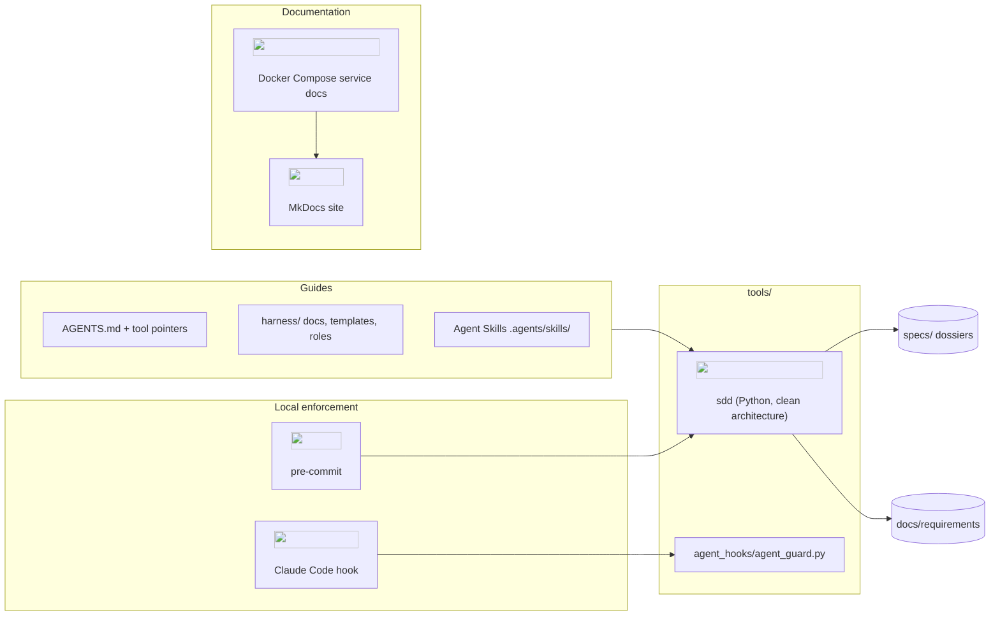
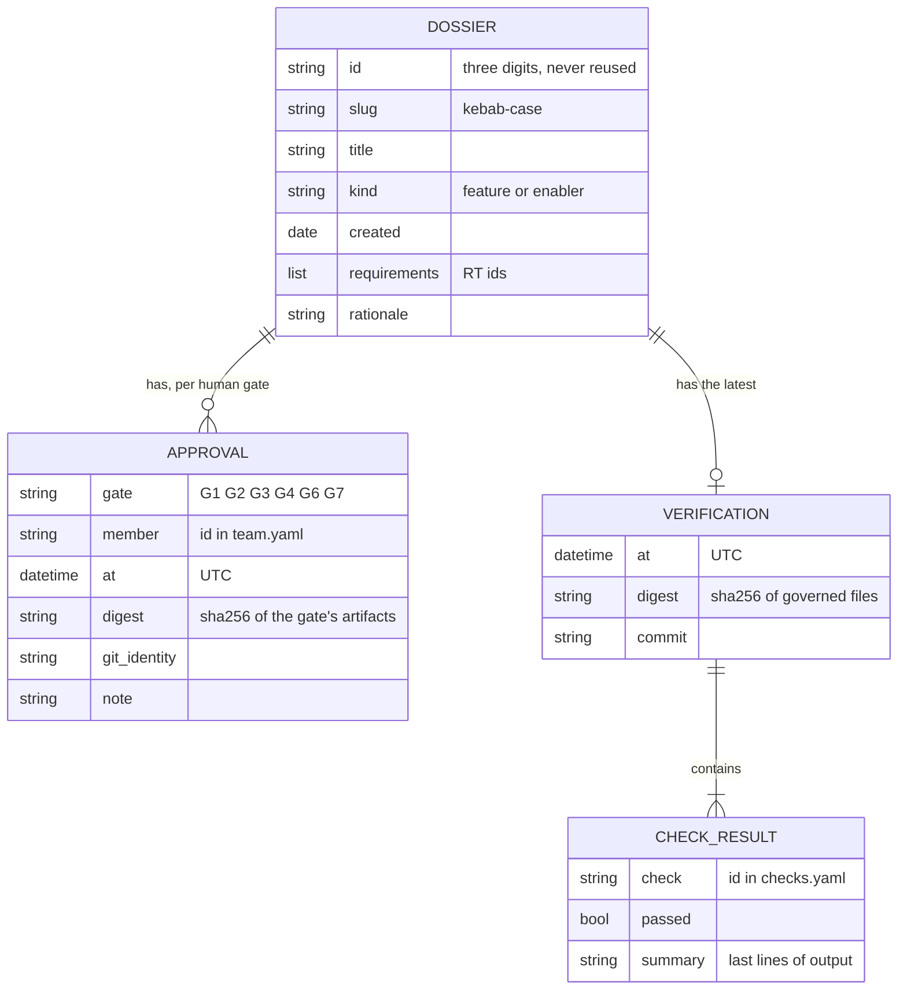
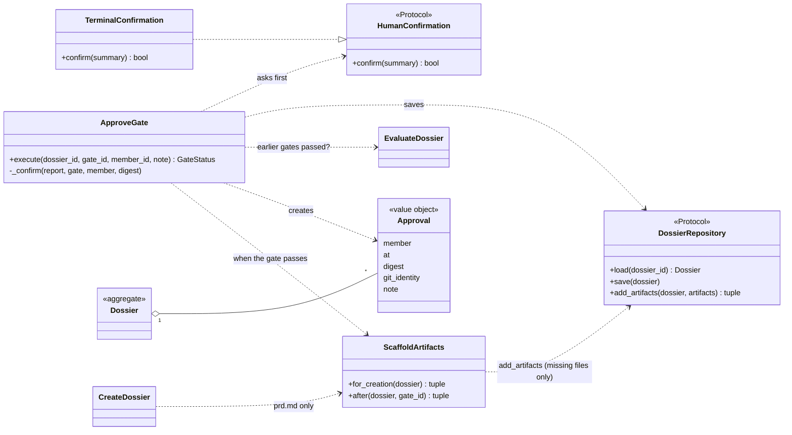

# Execution specification · 000 · The SDD harness

> **Phase 4 · Specify**, closed by **G4 · Specification approved for execution** (both of us
> approve `spec.md`, `plan.md` and `tasks.md` together). After G4, code may change on branch
> `spec/000-sdd-harness`. Any later edit of these three files makes G4 stale until we re-approve.
> How to fill this file: [lifecycle, phase 4](../../harness/lifecycle.md#phase-4-specify).

> **Tables first.** Wherever the content is a list of things with attributes (sources, behaviours,
> components, contracts, classes, patterns, ADRs, documents, exclusions), use a table, one row per
> thing, so we can scan, compare and review row by row. Prose is for the few sentences a table
> cannot hold; diagrams are for shape and flow. A table cell holds one fact: if it needs a
> paragraph, shorten it and link to where the detail lives.

## Context collected

| Source | Where | What it contributed |
|---|---|---|
| Requirements | `docs/requirements/rt-catalog.yaml`, from the PDF of 28 September 2026 | RT36, RT38, RT42 and the PDF's priority list for the platform |
| Target operating model | image shared by us | seven phases, human gates, governed context plane, AI control plane; every human role is played by the two of us |
| Reference platform | industrial_data_platform / Kairon (studied in full) | `CLAUDE.md` -> `harness/` pattern, upkeep matrix, commit review, ADRs, clean-architecture packages with a composition root, README as a product page, diagrams with official logos; its Kubernetes runtime is replaced here |
| Research | [sdd-landscape.md](../../docs/research/sdd-landscape.md) | Spec Kit, OpenSpec, BMAD, Kiro (EARS), AGENTS.md, Agent Skills, harness engineering (guides and sensors) |
| Our decisions in the conversation | chat | English only; no CI; backlog in Markdown; own harness; MkDocs with a tutorial; Mermaid with logos; harness only, no platform pilot |
| Tool documentation | Claude Code hooks; Material for MkDocs | hook contract (`PreToolUse`, JSON on stdin, exit code 2 blocks); Material in maintenance mode, Zensical is the successor |
| Approved artifacts | [prd.md](prd.md) (G1), [backlog.md](backlog.md) (G2), [ux-approach.md](ux-approach.md) (G3) | goals and scenarios; nine self-contained cards PBI-000-01 to PBI-000-09; no prototype, plain-text CLI contract, `y/N` approval prompt |
| ADRs and principles | ADR-0001 to ADR-0015 (accepted), ADR-0016 and ADR-0017 (proposed here); [principles](../../harness/principles.md), [security](../../harness/security.md), [quality](../../harness/quality.md), [architecture upkeep](../../harness/architecture-upkeep.md) | decisions already taken and the rules the design must respect |
| Modules touched by the remaining build | `tools/sdd/application/ports/environment.py`, `.../use_cases/approve_gate.py`, `tools/sdd/infrastructure/terminal_confirmation.py`, `tools/sdd/domain/errors.py`, `tools/sdd/domain/gates.py`, `tools/sdd/application/use_cases/create_dossier.py`, `tools/sdd/application/ports/dossiers.py`, `tools/sdd/infrastructure/yaml_dossier_repository.py`, `tools/sdd/interfaces/cli/app.py`, `tests/sdd/{fakes,test_domain,test_use_cases,test_infrastructure,test_cli}.py` | the `y/N` change (B05) and the scaffolding (B01, B19) touch exactly these |
| Build state (bootstrap) | this dossier | the harness already exists: code, tests, documents, skills and roles were written before this specification was approved, and the backlog cards describe what exists. The remaining build is small ([tasks.md](tasks.md), T14 and T17 to T22): the `y/N` prompt (B05), creating files as gates pass (B01, B19), a test for the backlog card fields (B15), the documentation left in the table below, then `sdd verify 000`. Everything else is verified, not rebuilt |

## Behaviour

| ID | Behaviour (EARS) | RT | Backlog criteria |
|---|---|---|---|
| SPEC-000-B01 | When `sdd new` is run, the harness shall create the next dossier id with `dossier.yaml` and `prd.md` (rendered from `harness/templates/prd.md`) and no other artifact. | none (enabler) | PBI-000-01 AC1, AC3 |
| SPEC-000-B02 | If `sdd new` cites an RT that is not in the catalogue, then the harness shall refuse with exit code 2 and create nothing. | RT42 | PBI-000-01 AC2 |
| SPEC-000-B03 | The harness shall compute every gate state (passed, pending, partial, stale, failed, blocked) from `dossier.yaml` and the current files, never from a stored status. | RT38 | PBI-000-02 AC1, AC2 |
| SPEC-000-B04 | When an approval is recorded, the harness shall bind it to the SHA-256 digest of the gate's artifacts, normalised for line endings and task boxes. | RT38 | PBI-000-02 AC2, PBI-000-08 AC3 |
| SPEC-000-B05 | If standard input is not an interactive terminal, then `sdd approve` shall refuse before showing anything; if the person answers anything but `y` or `yes` (any case) to `Approve? [y/N]`, then it shall cancel; in both cases it shall record nothing. Today's typed `<id> <gate>` phrase is replaced (ADR-0016). | RT38 | PBI-000-08 AC1 |
| SPEC-000-B06 | If an earlier gate has not passed, an artifact misses a template section or contains `TODO(sdd)`, the gate is automated, or the member is unknown, then `sdd approve` shall refuse; the readiness rule applies to the teaching guide at G6 too. | RT38 | PBI-000-08 AC2, PBI-000-07 AC1 |
| SPEC-000-B07 | When `sdd verify` runs on a dossier whose G4 passed, the harness shall run every check of `harness/checks.yaml` without a shell and record the outcomes with the governed digest and the commit. | RT42 | PBI-000-03 AC1, AC2 |
| SPEC-000-B08 | If staged files include a governed file and the branch is not `spec/<id>-<slug>` with G4 passed, then `sdd guard-commit` shall exit with 1. | RT42 | PBI-000-03 AC3 |
| SPEC-000-B09 | When `sdd sync` runs, the harness shall regenerate the README status and coverage blocks, `specs/README.md`, the traceability matrix and the tool adapters (generated from the canonical `AGENTS.md`, `.agents/skills/` and `harness/roles/`), and remove orphan adapters. | none (enabler) | PBI-000-04 AC1, AC2, PBI-000-06 AC3 |
| SPEC-000-B10 | When `sdd check` runs, the harness shall report dossier errors (G0, unknown approvers), stale or failed gates (warnings), documentation errors (diagram type, logos, links, ADRs) and generated drift, and exit with 1 on any error. | RT42 | PBI-000-04 AC3, PBI-000-06 AC1, AC2 |
| SPEC-000-B11 | If a coding agent calls `sdd approve`, bypasses hooks, edits approvals, guardrails or secrets, then the Claude Code guard shall block the call with exit code 2 and a reason, unless guardrail edits were allowed by a person. | RT36, RT38 | PBI-000-05 AC1, AC2, AC3 |
| SPEC-000-B12 | When `mkdocs build --strict` runs, the site shall build from the repository root without warnings; when `docker compose up docs` runs, the site shall render the Mermaid diagrams on http://127.0.0.1:8000. | none (enabler) | PBI-000-09 AC1 (the `docs-site` check), AC2 (by hand) |
| SPEC-000-B13 | If a feature cites no RT, then G0 shall fail unless `dossier.yaml` states a rationale; when it passes, the PRD, the status board (`feature (outside RTs)`) and the traceability matrix (section "Work outside the catalogue") shall mark it as outside the catalogue, and it shall not count towards RT coverage. | none (ADR-0014) | PBI-000-01 AC4 |
| SPEC-000-B14 | If an artifact is complete (no placeholder) while the human gate before it has not passed, then `sdd check` shall report a `written-ahead` warning; and at the end of every human phase the skill `sdd-review-gate` shall have the agent brief us, ask specific questions, wait for our answers and stop until `sdd status` shows the gate passed. | none (ADR-0015) | PBI-000-02 AC3 |
| SPEC-000-B15 | The backlog template shall give every work item the fields of a self-contained card (Feature, Serves, Size, Depends on, Context, What, How, Out of scope, Acceptance criteria, Verification), each unfinished one marked `TODO(sdd)`, so that `sdd approve` refuses G2 until all are filled. | none (ADR-0017) | PBI-000-08 AC2 |
| SPEC-000-B16 | The repository shall provide the learning path, primers, glossary and tutorials under `docs/learn/` and `docs/tutorials/`, and `sdd check` shall verify their links and diagrams. | none (enabler) | PBI-000-07 AC2, PBI-000-06 AC1, AC2 |
| SPEC-000-B17 | When a commit is made, pre-commit shall run the guard, lint, types, layer contracts, tests, secret scanning, `sdd sync` and `sdd check`. | RT36, RT42 | PBI-000-03 AC4 |
| SPEC-000-B18 | The spec template, the role `spec-architect` and the skill `sdd-specify` shall ask for the specification as tables (one row per source, behaviour, component, dependency, contract, class, pattern, ADR, document and exclusion), and this spec shall follow them. | none (enabler) | none (added at the G4 review) |
| SPEC-000-B19 | When an approval turns a gate *passed*, the harness shall create the artifacts of the next gate from the templates (G1: `backlog.md`; G2: `ux-approach.md`; G3: `spec.md`, `plan.md`, `tasks.md`; G4: `validation.md`, `teaching-guide.md`; G6: `release.md`), shall never overwrite an existing file, shall create nothing while the gate is only *partial*, and shall print one `created:` line per file; if creating them fails, then it shall undo the approval, remove the files it created and report the error. | none (ADR-0018) | PBI-000-01 AC1, PBI-000-08 AC4, AC5 |

## Architecture impact

Before: an empty repository (one README line). After:

| Component | Change | Layer or place | Why |
|---|---|---|---|
| `sdd` package | added | `tools/sdd/`: `domain`, `application`, `infrastructure`, `bootstrap.py`, `interfaces` | gates, dossiers, approvals, checks and generators in clean architecture |
| Agent guard | added | `tools/agent_hooks/agent_guard.py`, `.claude/settings.json` | stops agents from approving, bypassing gates or touching secrets |
| Pre-commit configuration | added | `.pre-commit-config.yaml`, `.secrets.baseline` | local enforcement without CI (ADR-0004) |
| Docs image and Compose service | added | `docker/docs.Dockerfile`, `compose.yaml`, `mkdocs.yml` | the site runs the same everywhere (ADR-0006, ADR-0008) |
| Harness, skills, roles, templates | added | `harness/`, `.agents/skills/`, generated `.claude/`, `.cursor/`, `.github/prompts/` | the guides every agent reads (ADR-0002) |
| Approval confirmation | changed (build, T17) | port `HumanConfirmation`, adapter `TerminalConfirmation`, `ApproveGate._confirm` | `y/N` prompt (ADR-0016) |
| Artifact scaffolding | added (build, T21) | `domain/gates.py` (`artifacts_after`), `application/scaffold_artifacts.py` (`ScaffoldArtifacts`), port method `DossierRepository.add_artifacts` and its YAML/file adapter | files appear as gates pass (ADR-0018) |
| `CreateDossier` | changed (build, T21) | `application/use_cases/create_dossier.py` | creates `dossier.yaml` and `prd.md` only, through `ScaffoldArtifacts` |
| `ApproveGate` | changed (build, T21) | `application/use_cases/approve_gate.py`, `interfaces/cli/app.py` | after the second approval, scaffolds the next gate's files and prints `created:` lines |

| Dependency | Version | Group | Why |
|---|---|---|---|
| PyYAML | `>=6.0.2,<7` | runtime | read and write `dossier.yaml`, catalogues |
| Typer | `>=0.12.5,<1` | runtime | the `sdd` command line |
| pytest, pytest-cov | `>=8.3,<10`, `>=6,<8` | dev | tests and the 85 % coverage threshold |
| mypy, types-pyyaml | `^1.13`, `^6` | dev | `mypy --strict` |
| ruff | `>=0.8,<1` | dev | format and lint, including docstrings and security rules |
| import-linter | `^2.1` | dev | enforces the layer contracts |
| bandit, pip-audit, detect-secrets | `^1.8`, `^2.7`, `^1.5` | dev | security checks of G5 |
| pre-commit | `^4.0` | dev | local hooks |
| MkDocs, mkdocs-material, mkdocs-same-dir | `^1.6.1`, `^9.7`, `^0.1.3` | docs | the documentation site |

## Contracts and data

`dossier.yaml` is the only stored data; its shape is the contract between `sdd` and people:

| Contract | Shape | Producer | Consumers | Versioning |
|---|---|---|---|---|
| `specs/<id>-<slug>/dossier.yaml` | the ER diagram above | `sdd new`, `sdd approve`, `sdd verify` | `sdd status`, `check`, `sync`, people | additive keys only; a breaking change needs an ADR |
| `sdd` command line | commands `new` (creates `dossier.yaml` and `prd.md`), `status`, `approve` (prints `created: <file>` for each artifact it scaffolds), `verify`, `check`, `sync`, `guard-commit`, `rt`; exit 0 success, 1 findings, 2 error (`error:` line); ASCII output | `tools/sdd/interfaces/cli/` | people, agents, pre-commit | exit codes and command names are stable |
| README generated blocks | `<!-- sdd:status:start/end -->`, `<!-- sdd:coverage:start/end -->` | `sdd sync` | people, `sdd check` (drift) | marker names are stable |
| `harness/team.yaml` | members (`id`, `name`, `role`) and approval policy (`all` or `any`) | people | `YamlTeamDirectory` | documented in the file header |
| `harness/checks.yaml` | per check: `id`, `title`, `command` (list), `pass_files` | people | `YamlQualityCheckCatalog`, `sdd verify` | adding a check is a data change |
| `docs/architecture/logos/registry.yaml` | per tool: name, logo URL | people | `YamlLogoRegistry`, the Mermaid rule | documented in the file header |
| `docs/requirements/rt-catalog.yaml` | RT01-RT42: id, phase, what must hold, how we verify it | people (from the PDF) | `YamlRequirementCatalog`, `sdd rt`, G0 | a test counts 42 entries |
| Claude Code hook | JSON `{tool_name, tool_input}` on stdin; exit 2 plus a reason on stderr blocks | Claude Code | `agent_guard.py` | follows Claude Code's documented contract |

## Design

Clean architecture with the dependency rule enforced by three import-linter contracts: `domain`
<- `application` <- `infrastructure` / `interfaces`, wired only in `tools/sdd/bootstrap.py`.
Full class diagrams and the justification of every abstraction are in the
[teaching guide](teaching-guide.md#5-the-design-layers-classes-and-patterns).

| Layer | Class or module | Responsibility (one reason to change) | Collaborators (ports) |
|---|---|---|---|
| domain | `Dossier`, `DossierKind` | dossier aggregate and its invariants | none (pure) |
| domain | `Approval`, `Verification`, `CheckOutcome` | immutable value objects of what was approved or verified | none |
| domain | `GateDefinition`, `GateId`, `GateKind`, `artifacts_after` | the eight gates, their order, and which artifacts appear when a gate passes | none |
| domain | `evaluate_gates`, `GateEvidence`, `GateStatus` | computed gate state | none |
| domain | `digest_texts`, `digest_files` | normalised SHA-256 of artifacts and governed files | none |
| domain | `Team`, `TeamMember` | who may approve and the policy | none |
| domain | `readiness_problems`, `is_governed`, `Finding` | readiness of artifacts, governed paths, findings | none |
| application | `ScaffoldArtifacts` | render the templates of a gate's artifacts and write only the missing ones | `TemplateLibrary`, `RequirementCatalog`, `DossierRepository` |
| application | `CreateDossier` | start a dossier: `dossier.yaml` and `prd.md` | `DossierRepository`, `ScaffoldArtifacts`, `RequirementCatalog`, `Clock` |
| application | `EvaluateDossier` | build a `DossierReport` of gate states | `DossierRepository`, `RequirementCatalog`, `TeamDirectory`, `Workspace` |
| application | `ApproveGate` | the approval rules, the record, and asking for the next files when the gate passes | `DossierRepository`, `EvaluateDossier`, `TeamDirectory`, `TemplateLibrary` (readiness), `ScaffoldArtifacts`, `Workspace`, `HumanConfirmation`, `Clock` |
| application | `VerifyQuality` | run the check suite and record the result | `DossierRepository`, `EvaluateDossier`, `QualityCheckCatalog`, `CheckRunner`, `Workspace`, `Clock` |
| application | `GuardCommit` | refuse governed changes outside an approved spec branch | `Workspace`, `EvaluateDossier` |
| application | `LintDocs` | run the documentation rules over the Markdown files | `DocumentStore`, the document rules (`doc_rules/`) |
| application | `CheckHarness` | the repository check printed by `sdd check` | `EvaluateDossier`, `DossierRepository`, `TeamDirectory`, `LintDocs`, `SyncGenerated` |
| application | `SyncGenerated` and its generators (`StatusGenerator`, `TraceabilityGenerator`, `AdapterGenerator`) | regenerate derived documents and adapters, or report drift | `DocumentStore`, the `Generator` strategies |
| infrastructure | `YamlDossierRepository`, `FileDocumentStore`, `FileTemplateLibrary`, `Yaml*Catalog`, `GitWorkspace`, `SubprocessCheckRunner`, `SystemClock`, `TerminalConfirmation` | one adapter per port | files, git, subprocesses, the terminal |
| interfaces | `app.py`, `presenters.py` | translate arguments, exit codes and output | the use cases through `Harness` |
| bootstrap | `build_harness` | the only place that wires adapters into use cases | everything |

| Pattern | Where | Why this one (and the alternative that lost) |
|---|---|---|
| Ports and adapters | `application/ports/` and `infrastructure/` | tests use fakes, adapters swap freely; direct file access in use cases would need real files in every test |
| Repository | `DossierRepository`, `YamlDossierRepository` | the aggregate is saved and loaded without YAML leaking into the domain |
| Strategy | doc rules in `application/doc_rules/`, `Generator` implementations | add a rule or a tool adapter without touching existing ones |
| Composition root | `bootstrap.py` | one wiring place; a service locator or globals would hide dependencies |
| Value object | `Approval`, `Verification`, `Finding` | immutable facts, easy to compare and test |
| Aggregate | `Dossier` | approvals only change through the dossier, which keeps its invariants |
| Mapper | `dossier_mapper.py` | YAML <-> domain conversion in one place |
| Computed state | `evaluate_gates` | a stored status could be flipped by hand; a computed one cannot |

| SOLID principle | How the design respects it |
|---|---|
| Single responsibility | one use case per command; `ApproveGate` changes only when the approval rules change |
| Open / closed | a new check is a row in `checks.yaml`; a new agent tool is a new generator plus one line in the sync list |
| Liskov | every adapter honours its port's contract; fakes in `tests/sdd/fakes.py` prove it by substitution |
| Interface segregation | small ports (`Clock`, `HumanConfirmation`, `CheckRunner`) instead of one large environment interface |
| Dependency inversion | use cases depend on `Protocol` ports; the terminal, git and files are details behind them |

The part this dossier still changes, the approval and creation flow: the `y/N` port of ADR-0016
(`confirm` loses its `expected` argument) and the scaffolding service of ADR-0018:

## Security and threat model

| Threat (STRIDE) | Where | Mitigation | Verified by |
|---|---|---|---|
| Spoofing: an agent approves as a person | `sdd approve` | TTY-only confirmation (unchanged by the `y/N` prompt: the terminal test runs first); agent guard blocks the command | `test_agents_without_terminal_are_refused`, `test_terminal_requires_a_tty`, `test_blocks_forbidden_commands` |
| Tampering: scaffolding overwrites an artifact that people already wrote, or leaves an approval without its files | `ScaffoldArtifacts`, `add_artifacts`, `ApproveGate` | writes only files that do not exist; all-or-nothing: on a failed write the files written are removed and the approval is undone | new `test_existing_artifacts_are_never_overwritten` (use case and adapter) |
| Repudiation / automation bias: a reflex `y` approves what nobody read | `sdd approve` | summary with digest and approver before the prompt; review in the chat first (ADR-0015); note, time and digest stored in git | `test_both_approvals_pass_the_gate` (the summary shown names the approver); the rest is process, reviewed by us |
| Tampering: an approval or verification is edited by hand | `dossier.yaml` | approvals bound to digests; guard blocks edits of the sections; `sdd check` reports unknown approvers | `test_editing_an_approved_artifact_makes_it_stale`, `test_dossier_metadata_edits_allowed_but_not_approvals` |
| Tampering: an agent disables a guardrail | `.claude/settings.json`, pre-commit, team, guard | guard protects the files; override only via the agent's environment, set by a person | `test_guardrails_need_the_override` |
| Repudiation: "I never approved that" | approvals | member, UTC time, digest, git identity, note stored in git | `TestDossierRepository.test_round_trip...` |
| Information disclosure: secrets in the repo or in agent context | all files | detect-secrets (pre-commit, G5); guard blocks `.env*`, keys, `deploy/secrets/`; `.gitignore` | `test_secrets_are_off_limits`, G5 `secrets` check |
| Elevation: command injection through a check or git argument | subprocess calls | argument lists, no shell, executables resolved with `shutil.which`; checks file is governed | bandit, ruff `S` rules (G5) |
| Elevation: unsafe YAML | YAML loading | `yaml.safe_load` only | code review; bandit |
| Denial of service | not applicable | local single-user tool | not applicable |
| Container escape / host writes | docs service | non-root, read-only rootfs and mounts, no capabilities, loopback port | `compose.yaml` review |

## Validation plan

| Behaviour or RT | Test level | Test or evidence | Data needed |
|---|---|---|---|
| B01 | unit + e2e | `TestCreate` (adapted in T21: only `dossier.yaml` and `prd.md` exist after creation), `test_new_status_rt_and_sync` (adapted: lists the two files) | fake catalogue; copied templates |
| B02 | unit + e2e | `TestCreate`, `test_typed_errors_exit_with_2` | fake catalogue |
| B03 | unit | `tests/sdd/test_gate_status.py` (every state) | fake digests |
| B04 | unit | `TestDigest`, `test_editing_an_approved_artifact_makes_it_stale` | none |
| B05 | unit + integration | after T17: `TestApprove.test_agents_without_terminal_are_refused`, new `test_answer_other_than_yes_saves_nothing` (replaces `test_wrong_confirmation_saves_nothing`), `TestTerminalAndRunner.test_terminal_requires_a_tty`, new `test_terminal_accepts_only_yes` (`y`, `YES` approve; `n`, empty, `001 G1` cancel) | fake TTY |
| B06 | unit | `TestApprove` (`test_cannot_skip_a_gate`, `test_incomplete_artifact_is_not_ready`, `test_automated_gate_and_unknown_member`), `TestReadiness` | in-memory dossiers |
| B07 | unit + integration | `TestVerify`, `test_runner` | fake runner; real subprocess |
| B08 | unit + e2e | `TestGuard`, `test_guard_and_check` | none |
| B09, B10 | unit + e2e | `TestSync`, `TestCheckHarness`, doc rule tests | in-memory store |
| B11 | unit | `tests/agent_hooks/test_agent_guard.py` | temporary project |
| B12 | build + manual | G5 check `docs-site` (build); `docker compose up --build docs`, open an architecture page, confirm a diagram renders (recorded in `validation.md`) | the repository |
| B13 | unit | `TestContext`, `test_feature_without_rt_is_marked_outside_the_catalogue`, `test_outside_catalogue_and_rationale_rules`, `test_work_outside_the_catalogue_is_listed_with_its_rationale` | fake catalogue |
| B14 | unit | `test_artifacts_written_before_the_previous_gate_are_flagged`, `test_work_in_order_is_not_flagged`; the skill is a text protocol (reviewed, not unit-tested) | in-memory dossiers |
| B15 | unit | new `TestBacklogTemplate.test_every_card_field_is_a_required_placeholder` in `tests/sdd/test_domain.py` (T18): the template has every card field and each unfinished one is a `TODO(sdd)` | the template file |
| B16 | scan | `sdd check` (links, diagrams) over `docs/learn/` and `docs/tutorials/` | the repository |
| B17 | integration | `poetry run pre-commit run --all-files` (evidence in `validation.md`) | the repository |
| B19 | unit + e2e | new in T21: `TestGates.test_artifacts_after_each_gate` (`test_domain.py`: every gate, G5 skipped, G7 nothing), `TestApprove.test_first_approval_creates_nothing`, `test_second_approval_creates_the_next_gates_files`, `test_existing_artifacts_are_never_overwritten`, `test_failed_scaffolding_undoes_the_approval` (use case: dossier file and folder unchanged), `test_add_artifacts_removes_what_it_wrote_when_one_write_fails` (adapter), `test_cli` (the `created:` lines) | fakes; temporary dossier |
| B18 | review | we read this spec; the template's required `##` headings are checked by the G4 readiness rule | this file |
| RT36 (spirit) | scan | G5 check `secrets`; guard tests | none |
| RT38 (spirit) | integration | approvals round trip in YAML | none |
| RT42 (spirit) | suite | G5 itself; `test_drift_and_missing_markers_are_errors` | none |

## Architecture decisions

| ADR | Decision | Status | Refines or supersedes |
|---|---|---|---|
| [0001-0015](../../docs/architecture/decisions/README.md) | own harness, canonical sources, approvals bound to digests, local enforcement, Poetry, Docker Compose, clean architecture, MkDocs + Material, English, teaching guide per dossier, requirement catalogue as YAML, backlog as Markdown, Mermaid with official logos, work outside the catalogue, one gate at a time | Accepted (recorded with us in the conversation; G4 confirms them) | none |
| [0016](../../docs/architecture/decisions/0016-approval-confirmation-is-a-yes-no-prompt.md) | the approval confirmation is `y/N` at an interactive terminal | Proposed; Accepted when G4 is approved (T19 updates the file and the index) | refines ADR-0003 |
| [0017](../../docs/architecture/decisions/0017-backlog-items-are-self-contained-cards.md) | backlog items are self-contained cards | Proposed; Accepted when G4 is approved (T19) | refines ADR-0012 |
| [0018](../../docs/architecture/decisions/0018-artifacts-are-created-as-gates-pass.md) | artifacts are created as the gates pass, not all at once | Proposed; Accepted when G4 is approved (T19) | refines ADR-0015; changes how ADR-0010 creates the teaching guide |

## Documentation impact

| Document | Change | Upkeep rule | Status |
|---|---|---|---|
| Everything of the harness (root README, `AGENTS.md` and pointers, `CONTRIBUTING.md`, `harness/`, `docs/`, this dossier) | new: the bootstrap | the upkeep matrix applies from dossier 001 on | done |
| ADR-0003, ADR-0010 | notes that ADR-0016 and ADR-0018 refine them | ADR for every decision | done |
| `harness/gates.md`, `harness/how-it-works.md`, `harness/lifecycle.md`, `harness/templates/README.md` | the `Approve? [y/N]` prompt (sequence diagram included) and the table of which file appears when | harness documents, architecture pages | done |
| `docs/tutorials/first-feature.md`, `CONTRIBUTING.md`, root `README.md`, skill `sdd-start` | `sdd new` creates two files; files appear as gates pass; `y/N`; the spec is reviewed as tables | tutorials, READMEs | done |
| `teaching-guide.md` (sections 5 and 6) | the `confirm(summary)` port, the sequence with `y`, and the two decisions explained | teaching guide | done; T19 re-reads it |
| Spec template, role `spec-architect`, skill `sdd-specify`, lifecycle phase 4 | the spec is written as tables (B18); `sdd sync` regenerates `.claude/` | harness documents | done |
| Backlog template, role `backlog-planner`, skill `sdd-plan`, lifecycle phase 2, primer | self-contained cards (B15) | harness documents | done |
| ADR index, ADR-0016, ADR-0017, ADR-0018 | drafted as Proposed; status to Accepted after G4 | ADR index | T19 |
| Docstrings of `TerminalConfirmation`, `ApproveGate`, `ApprovalDeclinedError`, `CreateDossier`, `DossierRepository` | stop mentioning the typed phrase and the nine artifacts | docstrings are part of the change | T17, T21 |

## Out of scope

| Excluded | Why | Where it goes |
|---|---|---|
| Platform features (ingestion, catalog, API) | this dossier delivers the harness only | future feature dossiers, from the catalogue's priorities |
| CI on a server, a hosted tracker | local only (ADR-0004) | possible later enablers |
| Signed approvals | not needed between two people who trust each other (ADR-0003) | possible later enabler |
| Native hooks for agents other than Claude Code | only Claude Code has a hook contract we use today | revisit when we add an agent tool (PRD risk) |
| A design system | there is no user interface yet | a future dossier that introduces one |
