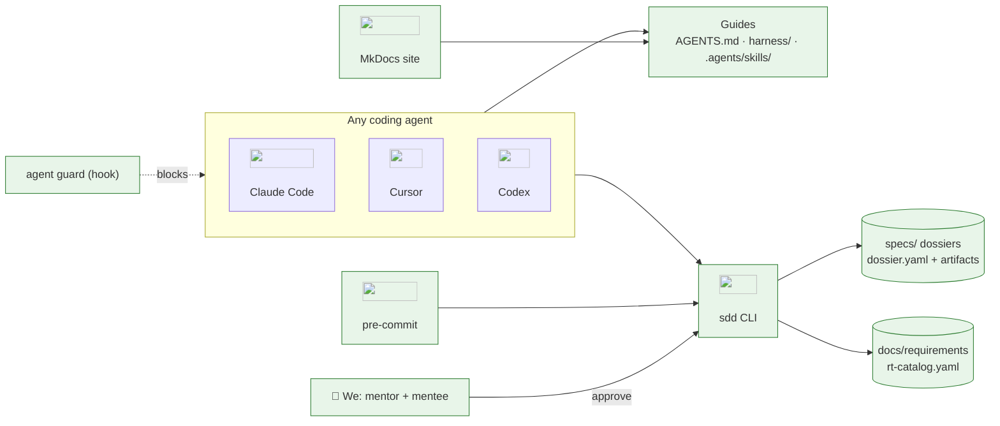
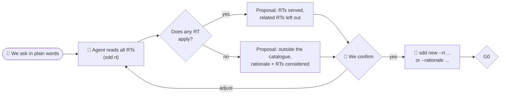
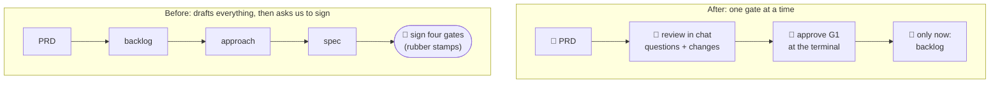
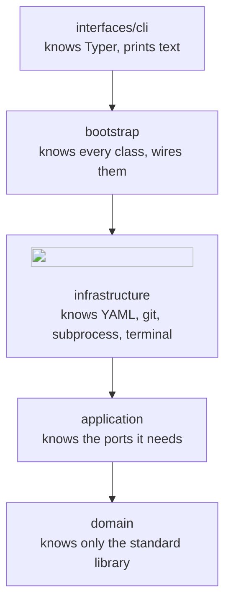
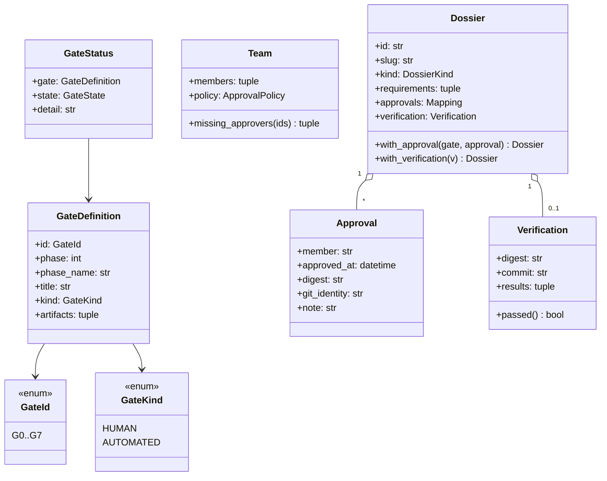
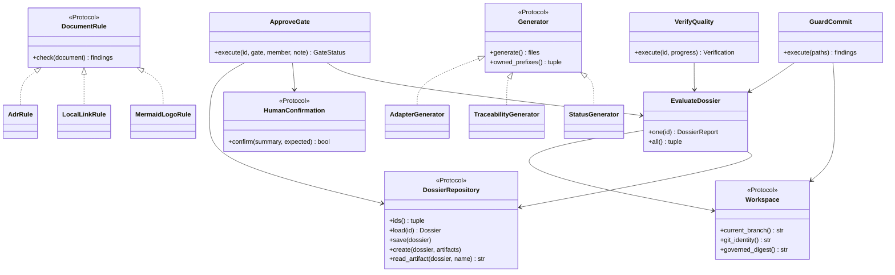
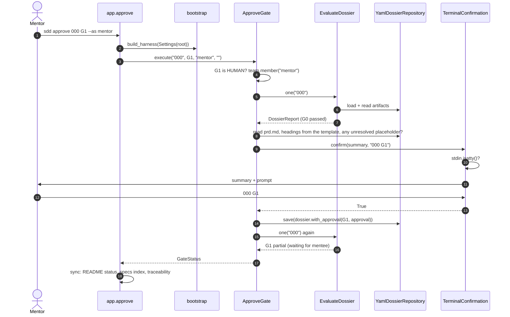
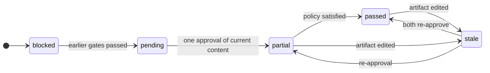

# Teaching guide · 000 · The SDD harness

> The didactic record of this dossier: **every decision, with its justification**, from the
> architecture down to the classes. It is written for the mentee who was not in the room,
> reads in order, and is approved at **G6** together with `validation.md`. Rules:
> [documentation standard](../../harness/documentation-standard.md#the-teaching-guide).
> Diagrams are Mermaid; every tool node carries its official logo.

## 1. The problem in plain words

We want AI coding agents to do most of the typing on a data platform, while the two of us stay
in charge of *what* gets built and *why*. Agents are fast, but they have three weaknesses: they
forget (each session starts from scratch), they drift (each prompt is reinterpreted), and they
are eager (they will happily "approve" their own work or skip a failing check if nothing stops
them).

A **harness** is everything around the agent that turns that raw power into reliable work. It
has three parts, and this dossier builds all three:

- **Guides**: text the agent reads before acting. `AGENTS.md`, the constitution, the lifecycle,
  the skills, the templates.
- **Sensors**: machines that check what the agent produced. Linters, type checker, tests,
  architecture contracts, a commit guard, documentation checks.
- **Gates**: checkpoints where *people* decide. Here, the mentor and the mentee approve six of
  the eight gates; machines close the other two.

Some vocabulary used everywhere below:

- **Dossier**: a folder `specs/<id>-<slug>/` containing everything about one piece of work.
- **Artifact**: one Markdown file of a dossier, produced in one phase (PRD, backlog, spec, ...).
- **Gate**: the checkpoint closing a phase, G0 to G7.
- **Digest**: a fingerprint (SHA-256) of some content. Equal content, equal digest; one changed
  character, a completely different digest.
- **Governed file**: a file whose change alters behaviour or rules (code, tests, containers,
  dependencies, the harness itself).

## 2. Requirements served

This is an *enabler*: it delivers no platform feature, so it does not *deliver* any RT. It
applies three of them to our own way of working ([traceability](../../docs/requirements/traceability.md)):

- **RT36 · No credentials in code or published files.** The platform will connect to industrial
  sources with credentials; they must never land in git. Here: `detect-secrets` runs in
  pre-commit and in G5, `.gitignore` excludes `.env*` and `deploy/secrets/`, and the agent guard
  stops an agent from even reading those files (SPEC-000-B11).
- **RT38 · Changes record actor, time, reason, before/after.** For the platform this will mean an
  audit log of mappings and rules. Here: every approval records who, when (UTC), the digest of
  exactly what was approved, the git identity and a note; the "before/after" is the git history
  of the artifact (SPEC-000-B04, B05).
- **RT42 · Automated validation before publication.** For the platform: contracts and regression
  tests before a change goes live. Here: nothing merges without the deterministic suite of G5,
  and pre-commit runs a fast subset on every commit (SPEC-000-B07, B08, B10).

## 3. Architecture before and after

Before this dossier the repository held one line of README. After it:



Every box is new (green). Reading the arrows:

- **agents → guides.** Every tool reads `AGENTS.md` (or a pointer to it) and the skills. This is
  the *feed-forward* half of the harness: the agent knows the rules before acting.
- **agents → sdd.** Agents call `sdd new`, `sdd status`, `sdd check`, `sdd verify`. They never call
  `sdd approve` successfully (the next arrow and §6 explain why).
- **We → sdd.** Approvals come only from us, at a terminal.
- **sdd → specs, requirements.** The tool reads and writes plain files; there is no server and no
  database. Everything it knows is in git.
- **pre-commit → sdd.** On every commit, git runs the hooks, which call `sdd guard-commit`,
  `sdd sync` and `sdd check` (plus linters and tests).
- **guard ⇢ agents.** In Claude Code, a hook inspects each tool call before it runs.

## 4. Decisions and the alternatives that lost

### 4.1 Build our own harness instead of adopting a framework ([ADR-0001](../../docs/architecture/decisions/0001-spec-driven-development-with-our-own-harness.md))

| Option | Our 7 phases + gates | Enforced approvals | Any agent | Weight | Verdict |
|---|---|---|---|---|---|
| Spec Kit as is | partial | no | yes | light | no gates; we would glue them on |
| Spec Kit + our gates | yes | yes | yes | medium | two sources of truth for the workflow |
| BMAD | partial | no | partial | heavy | too much ceremony for two people |
| Kiro | partial | no | no | light | its own IDE |
| **Own harness** | yes | yes | yes | light | **chosen**; we pay with maintenance |

The deciding force: no framework *enforces* human approval. Our operating model is defined by it.

### 4.2 How to prove an approval came from a person ([ADR-0003](../../docs/architecture/decisions/0003-gates-approved-by-people-bound-to-digests.md))

| Option | Stops agents in any tool | Bound to content | Infrastructure needed | Verdict |
|---|---|---|---|---|
| A status field in a file | no | no | none | any agent can write it |
| Signed git tags | yes | yes (commit) | GPG/SSH keys for both | strong; maybe later |
| Pull-request reviews on a host | yes | yes | a server, CI | we are local-only |
| **TTY-only command + digest** | yes | yes (artifacts) | none | **chosen** |

The insight: agents run commands with standard input not attached to a terminal, so
`sys.stdin.isatty()` is false for them, in every tool. It is a weak guarantee against a person
who wants to cheat, and a strong one against an agent that means well and gets it wrong. Between
two people who trust each other, that is the right trade-off.

### 4.3 Where gate state lives

| Option | Stale approvals visible | Can drift from reality | Verdict |
|---|---|---|---|
| Store `state: passed` in `dossier.yaml` | no | yes | a stored status lies as soon as an artifact changes |
| **Compute the state from evidence + current files** | yes | no | **chosen** (`evaluate_gates`) |

### 4.4 Canonical sources and generated adapters ([ADR-0002](../../docs/architecture/decisions/0002-agents-md-and-agent-skills-are-canonical.md))

Five tools, five instruction locations. Writing them by hand guarantees drift; symbolic links are
unreliable on Windows. We keep one canonical source per kind (AGENTS.md, Agent Skills, roles) and
*generate* the rest, and `sdd check` fails when a generated file differs from its source.

### 4.5 Local enforcement only ([ADR-0004](../../docs/architecture/decisions/0004-local-enforcement-without-ci.md))

No CI server exists, so the gates run where the change is made: pre-commit on every commit, the
full suite with `sdd verify`. The same commands are a future CI job.

### 4.6 Clean architecture for a small tool ([ADR-0007](../../docs/architecture/decisions/0007-clean-architecture-for-all-python-code.md))

A tool of about 1,600 statements could be three scripts. We chose clean architecture anyway because (1) the tool
is the first example the mentee studies, so it must show the structure the platform will use,
(2) the rules (gate evaluation) must be testable without files or git, and (3) agents will
extend it, and import contracts keep them from eroding it.

### 4.7 Work outside the requirements catalogue ([ADR-0014](../../docs/architecture/decisions/0014-work-outside-the-requirements-catalogue.md))

**The question that triggered it.** Right after the first build we asked: *"How do we start a
CRUD that is not in the requirements, without telling the agent which RT to read?"* Two
problems hid in that question:

1. **Usability.** The docs showed `sdd new --rt RT01` as if people chose the RTs. Choosing them
   means reading 42 requirements, which is exactly the work an agent is good at. Our job is to
   check its answer.
2. **A rule that was too strict.** G0 said *a feature cites at least one RT*. A CRUD that
   serves no RT could only pass by being mislabelled as an enabler or by citing a loosely
   related RT. Both corrupt the traceability matrix, which then claims progress that did not
   happen.

**The new flow** puts the mapping where it belongs:



| Option | Honest matrix | Extra concept to learn | Verdict |
|---|---|---|---|
| Keep "a feature cites ≥ 1 RT" | no (forced false citations) | none | lost |
| A third kind `extra` | yes | yes, a new word for "feature without RT" | lost |
| **A feature may cite no RT, if it states a rationale** | yes, listed separately | no | **chosen** |

**In the code** the rule is one domain fact plus one application rule:

- `Dossier.outside_catalogue` (domain): `kind is FEATURE and not requirements`.
  `Dossier.needs_rationale`: enablers *or* work outside the catalogue. These are properties of
  the aggregate because they describe the dossier itself, not how it is stored or shown.
- `context_problems` (application, G0) now asks one question, `needs_rationale and not
  rationale`. The message comes from a small table keyed by kind (`_MISSING_RATIONALE`).
  A dictionary instead of an `if` chain keeps the function flat, and each kind's message
  sits in one place.
- The three places that *show* the fact read the same property, so they cannot disagree:
  the PRD text (`_NO_RT` in `create_dossier.py`), the board label (`kind_label` in
  `status.py`) and the matrix section (`_outside_catalogue` in `traceability.py`).
  `where_it_is` was extracted from the board so the matrix reuses it instead of duplicating it
  (DRY across two generators).

**What did not change, on purpose:** coverage still counts only real citations, and enablers
still need a rationale.

### 4.8 One gate at a time, reviewed in the chat ([ADR-0015](../../docs/architecture/decisions/0015-one-gate-at-a-time-reviewed-in-chat.md))

**The problem we hit.** The first thing we tried to do with the finished harness was approve G1.
Looking at it, we saw the agent had already written the backlog, the approach and the whole
specification. Approving the PRD then felt like a formality, because everything after it
existed. That is *automation bias*: when a machine hands us a finished result, we tend to
accept it. And nothing, not even a digest, proves we read anything: a digest proves *what* was
approved, never *that it was understood*.

**What a gate is for.** A gate exists so that a decision is taken by a person *before* the next
piece of work builds on it. If the next piece is already built, the gate only decorates it.



**Three decisions inside it:**

1. *Sequencing is a tool rule, not only a courtesy.* `CheckHarness._written_ahead` compares each
   human gate's artifacts with the gate before it (`_PREDECESSOR`: G2←G1, G3←G2, G4←G3, G6←G4,
   G7←G6; G6 waits for G4 and not G5 because the teaching guide is written while building). An
   artifact is "written" when it has no placeholder left (`readiness_problems`). It is a
   *warning*, not an error: work in progress is normal, but running ahead stays visible.
2. *The review is a conversation, specified as a skill* (`sdd-review-gate`): a briefing in
   pieces (including what the agent assumed or invented), then three to five questions that
   cannot be answered with "yes". Questions do not prove understanding, but they make skimming
   hard, and the answers become the `--note` of the approval, a trace of what we engaged with.
3. *The approval stays at the terminal.* Letting the agent record an approval on our chat "yes"
   would reverse ADR-0003: nothing would distinguish our word from an agent claiming it, and one
   chat represents one person while two of us must approve.

**Why `written-ahead` lives in `CheckHarness` and not in the domain.** It needs the artifact
text (a port) and the gate states (an application result), so it is an application rule; the
domain only provides the pure pieces it combines (`GateId`, `readiness_problems`). The same
reason keeps it out of the agent guard, which is standard-library only and cannot compute gate
states.

**Honest limit.** Dossier 000 triggers this very warning for G2, G3, G4 and its teaching guide:
the bootstrap could not follow a rule born after it. We review it gate by gate in the chat to
repair that as much as can be repaired.

## 5. The design: layers, classes and patterns

### 5.1 The layers and what each one knows



`pyproject.toml` declares three import-linter contracts; `lint-imports` fails if any import goes
the wrong way. Two subtleties worth understanding:

- `interfaces` must not import `infrastructure` *directly*, but it may import `bootstrap`, which
  does. That is why the second contract has `allow_indirect_imports = true`: the CLI may depend on
  the composition root, never on an adapter.
- `domain` and `application` are forbidden to import `yaml`, `typer` and `subprocess`. That is
  what keeps all the I/O at the edges.

### 5.2 The domain



| Class or module | Single responsibility | Why it exists as its own unit |
|---|---|---|
| `gates.py` (`GateId`, `GateDefinition`, `GATES`) | the catalogue of the lifecycle | the lifecycle is *data*: order, kind, artifacts. Changing which files G4 judges is one line |
| `dossier.py` (`Dossier`) | the aggregate root: identity, requirements, evidence | invariants (id format, slug, one approval per member per gate) live in one place |
| `approval.py` (`Approval`, `Verification`, `CheckOutcome`) | the evidence that closes gates | value objects: immutable, compared by value, replaced never edited (audit) |
| `team.py` (`Team`, `ApprovalPolicy`) | who "we" are and how approvals combine | the policy "all" vs "any" is a rule, not a loop in a use case |
| `gate_status.py` (`evaluate_gates`) | compute every gate's state | a **pure function**: the heart of the harness, testable in microseconds |
| `digest.py` | fingerprints with normalisation | the meaning of "same content" (line endings, task boxes) is a domain decision |
| `readiness.py` | is an artifact complete? | derives required sections from the template itself (single source of truth) |
| `governance.py` | which files are governed; branch names | the constitution's article III expressed as code |
| `findings.py`, `errors.py` | how problems are reported | typed errors and findings let the CLI map them without parsing strings |

Why **frozen dataclasses** everywhere? Immutability makes the history explicit:
`dossier.with_approval(...)` returns a *new* dossier, so no function can silently change a dossier
another function is still looking at, and tests compare whole objects with `==`.

### 5.3 The application: ports, use cases, strategies



- **Ports are small Protocols**, grouped by family in four files (`dossiers`, `reference_data`,
  `environment`, `documents`). `typing.Protocol` gives *structural* typing: an adapter does not
  inherit from the port, it just has the right methods, and mypy checks it. That keeps
  infrastructure free of application imports beyond the types it returns.
- **Use cases receive ports in `__init__`** (constructor injection) and expose one method. None
  of them prints or reads input: `ApproveGate` asks a `HumanConfirmation`, it never calls
  `input()`. That is why the tests can script a "person" in one line.
- **`EvaluateDossier` is the read model.** Status, check, generators, approve, verify and guard
  all start from a `DossierReport`. One place computes gate states; nobody re-implements them.
- **Strategies** for things that will multiply: `DocumentRule` (today mermaid type, logos, links,
  ADRs) and `Generator` (status, traceability, adapters). `LintDocs` and `SyncGenerated` loop over
  a list and never change when a new rule or generator is added (open/closed).

### 5.4 Patterns used

| Pattern | Where | Why here |
|---|---|---|
| Ports and adapters | `application/ports`, `infrastructure/*` | every I/O boundary is replaceable and fakeable |
| Repository | `DossierRepository` / `YamlDossierRepository` | use cases load and save dossiers without knowing YAML or folders |
| Mapper | `dossier_mapper.py` | YAML shape ≠ domain shape (dates, enums, order); conversion in one module |
| Strategy | `DocumentRule`, `Generator`, `checks.yaml` | rules, generators and checks multiply; adding one edits nothing existing |
| Composition root | `bootstrap.build_harness` | one place creates adapters; swapping one is a one-line change |
| Value object | `Approval`, `Verification`, `Requirement`, `GateDefinition` | invalid values cannot exist; equality by value |
| Aggregate | `Dossier` | the only way to add an approval enforces "one per member per gate" |
| Computed state | `evaluate_gates` | no stored status that can lie |
| Template method (light) | artifact templates + readiness | the template defines the required sections; code reads them |

### 5.5 SOLID in this code

| Principle | How this code applies it |
|---|---|
| Single responsibility | `YamlDossierRepository` knows *where* (folders); `dossier_mapper` knows *how* (shape); `GitWorkspace` knows git; `presenters` only formats text |
| Open/closed | a new doc rule is a new class added to the tuple in `bootstrap.py`; a new quality check is a YAML entry; a new required section is a `##` heading in a template |
| Liskov substitution | `tests/sdd/fakes.py` implements every port; the integration tests show the real adapters behave the same way (e.g. `MemoryStore.exists` mirrors directory semantics) |
| Interface segregation | `GuardCommit` depends on `Workspace` and `EvaluateDossier`, not on a "harness context" object with everything in it |
| Dependency inversion | `ApproveGate` depends on `HumanConfirmation` (abstraction); `TerminalConfirmation` (detail) is chosen in `bootstrap.py` |

### 5.6 Why each abstraction exists (what would break without it)

- **Without `HumanConfirmation`**, the TTY check would sit inside the use case, and testing
  approval logic would need a real terminal.
- **Without `Workspace`**, gate evaluation would call git; the 30 gate-state tests would need a
  repository each.
- **Without `DossierReport`**, every command would recompute states slightly differently.
- **Without `GeneratedFile.block`**, generators could only own whole files, and the README
  could not mix hand-written text with generated status.
- **Without `evidence.py`**, the domain would need to read files to know current digests; instead
  the application gathers evidence and the domain stays pure.

## 6. How it behaves at runtime

### 6.1 `sdd approve 000 G1 --as mentor`



Step 4 is where order is enforced (every earlier gate must be passed); step 7 is readiness;
step 9 is the TTY check that defeats agents. Only after all of them does step 13 write.

### 6.2 Gate states



`evaluate_gates` walks the gates in order and keeps a variable `waiting_for`: the first gate that
is not passed sets it, and every gate after it is reported *blocked* with "waits for Gn". That
single variable implements "nothing is skipped".

### 6.3 A commit on a spec branch

`pre-commit` passes the staged file names to `sdd guard-commit`. `GuardCommit` filters governed
paths (`is_governed`), reads the branch, extracts the dossier id (`spec_id_from_branch`), asks the
evaluator for G4's state, and returns an error finding unless it is *passed*. The CLI turns any
error finding into exit code 1, and pre-commit stops the commit.

## 7. Data and contracts

The only stored data is `dossier.yaml` (diagram in [spec.md](spec.md#contracts-and-data)). Its
invariants and where they are enforced:

| Invariant | Enforced in | Why there |
|---|---|---|
| id is three digits, slug kebab-case, title not empty | `Dossier.__post_init__` | the domain refuses to represent an invalid dossier |
| folder name equals `<id>-<slug>` | `YamlDossierRepository.load` | it is a storage fact |
| one approval per member per gate (the latest) | `Dossier.with_approval` | aggregate invariant |
| approvals and verification are written only by `sdd` | agent guard + digests + `sdd check` | defence in depth: prevent, then detect |
| timestamps are UTC with offset | `SystemClock.now` | one clock adapter, the same rule as RT12 |
| ids of RTs exist | G0 (`context_problems`) | checked continuously, not only at creation |
| enablers and features citing no RT have a rationale | `Dossier.needs_rationale` + G0 | the fact is domain; reporting it is a gate rule |

The digest of a gate is computed over `(file name, normalised content)` pairs, sorted. Including
the name means moving text from `plan.md` to `spec.md` is a change; sorting means the order in
`GateDefinition.artifacts` does not matter; normalisation (LF, unticked boxes) means Windows vs
Linux and ticking a task are not changes.

## 8. Code tour

Read in this order, from the entry point inwards.

1. **[interfaces/cli/app.py](../../tools/sdd/interfaces/cli/app.py)**: one Typer command per use
   case. Notice `_run`: the single place mapping `SddError` to exit code 2, so commands stay
   short.

   ```python
   def _run(action: Callable[[Harness], int | None]) -> None:
       try:
           code = action(_harness())
       except SddError as error:
           typer.echo(f"error: {error}", err=True)
           raise typer.Exit(2) from error
       raise typer.Exit(code or 0)
   ```

2. **[bootstrap.py](../../tools/sdd/bootstrap.py)**: the composition root. Every adapter is
   created here and nowhere else; the documentation rules and generators are listed as tuples
   (the strategy lists).
3. **[application/use_cases/approve_gate.py](../../tools/sdd/application/use_cases/approve_gate.py)**:
   read `execute` top to bottom; it is the five numbered rules of the module docstring, in order.
4. **[domain/gate_status.py](../../tools/sdd/domain/gate_status.py)**: `evaluate_gates` and its
   three helpers, one per kind of gate. The human-gate helper is the core of ADR-0003:

   ```python
   fresh = tuple(a.member for a in approvals if a.digest == current_digest)
   outdated = tuple(a.member for a in approvals if a.digest != current_digest)
   missing = team.missing_approvers(fresh)
   ```

   An approval counts only if its digest equals the digest of the files *now*.
5. **[domain/digest.py](../../tools/sdd/domain/digest.py)**: `normalise_text` (two regex-free
   replacements and one regex for task boxes) and `digest_texts`.
6. **[application/evidence.py](../../tools/sdd/application/evidence.py)**: how the application
   gathers what the pure domain needs (current digests, G0 problems).
7. **[infrastructure/terminal_confirmation.py](../../tools/sdd/infrastructure/terminal_confirmation.py)**:
   the `isatty()` check, six lines that make approvals human-only in every tool.
8. **[application/doc_rules/mermaid.py](../../tools/sdd/application/doc_rules/mermaid.py)**: how a
   flowchart label is found (two regular expressions), why subgraph titles are skipped, and how
   severity depends on the document's path.
9. **[application/use_cases/sync_generated.py](../../tools/sdd/application/use_cases/sync_generated.py)**:
   the write-or-report pattern shared by `sdd sync` and `sdd check`.
10. **[tools/agent_hooks/agent_guard.py](../../tools/agent_hooks/agent_guard.py)**: standard library
    only (it must run before Poetry exists); `protected_sections` compares the `approvals:` and
    `verification:` blocks before and after an edit.

## 9. Security

The STRIDE table is in [spec.md](spec.md#security-and-threat-model). The mitigations, in code:

- **No shell anywhere.** `run_git` and `SubprocessCheckRunner` pass argument lists and resolve
  executables with `shutil.which`; the suite's commands come from a governed file. bandit's
  warnings on `subprocess` are acknowledged inline with the reason (`# nosec B603 ...`).
- **Safe YAML.** Every YAML read is `yaml.safe_load`; a YAML file cannot construct Python objects.
- **Secrets.** detect-secrets in pre-commit and G5; the guard blocks `.env*` (except
  `.env.example`), keys and `deploy/secrets/`; `.gitignore` excludes them.
- **Approvals.** TTY check (all tools), guard (Claude Code), digests (detection), git identity
  (audit).
- **Container.** The docs service runs as user 10001 with a read-only root filesystem, no Linux
  capabilities, `no-new-privileges`, read-only mounts and a loopback-only port.

## 10. How we tested it

- **116 tests, about 96 % branch coverage**, in four groups:
  - `test_domain.py`, `test_gate_status.py`: pure domain, one test per rule and per state;
  - `test_use_cases.py`, `test_docs_and_sync.py`: use cases with the fakes of `fakes.py`;
  - `test_infrastructure.py`: adapters against `tmp_path`, a real `git init`, real subprocesses;
  - `test_cli.py`: the CLI end to end in a throwaway copy of the harness files.
- **Fakes are trustworthy because they are tested indirectly**: each adapter's integration test
  checks the behaviour the fake imitates (for example, `FileDocumentStore.exists` for folders).
- **The guard** is tested through its pure `decide` function and through `main()` with a fake
  standard input.
- **Not tested automatically:** the interactive prompt with a real terminal (covered by a fake TTY
  stream), and the visual rendering of diagrams on GitHub (checked once with Mermaid's renderer).

## 11. Run it yourself

```bash
poetry install --with docs
poetry run pytest -q                       # 116 passed
poetry run sdd status                      # dossier 000: G0 passed, G1 pending
poetry run sdd rt RT38                     # read a requirement
poetry run sdd check                       # consistency report
```

Exercise: prove that an edit invalidates an approval.

1. Review this dossier's `prd.md` together; both of us approve G1.
2. `poetry run sdd status 000`: G1 *passed*, G2 *pending*.
3. Add a sentence anywhere in `prd.md`; run status again. Expected: G1 *stale*, G2 to G7 *blocked*.
4. Remove the sentence. Expected: G1 *passed* again, without re-approving. Explain why (§7).

Second exercise: try `echo "000 G1" | poetry run sdd approve 000 G1 --as mentor` and explain the
refusal.

## 12. Pitfalls and what we would do differently

- **Bootstrapping is circular.** The harness could not govern its own creation; we wrote the
  dossier as the work progressed and approve it retroactively. Stated in the PRD on purpose.
- **Windows details cost time:** line endings (solved by `.gitattributes` and digest
  normalisation), `python3` not existing, `make` missing (so no Makefile: `poetry run sdd` is the
  front), console encodings (ASCII CLI output).
- **A logo disappeared from the CDN** (OpenAI from Simple Icons) while writing; the registry now
  pins a release for it, and URLs are checked before use.
- **Material for MkDocs entered maintenance mode**; we pinned it and wrote the exit path in the ADR.
- **The import-linter "forbidden" contract checks indirect imports** by default; the
  interfaces → bootstrap → infrastructure chain needed `allow_indirect_imports`.
- With more time: signed approvals, native hooks for Cursor and Codex, a generated SVG of the
  architecture for offline reading.

## 13. Questions for the mentee

1. Why does `evaluate_gates` not store its result anywhere? What bug would a stored status allow?
2. An agent edits `spec.md` after G4 to "fix a typo". What does `sdd status` show, and what must
   we do? Is that friction worth it?
3. Why is the digest computed over file *names* as well as contents?
4. Ticking a box in `tasks.md` does not make G4 stale, but rewording a task does. Where is that
   rule implemented, and why is it a domain rule and not an infrastructure detail?
5. Why can the CLI import `bootstrap` but not `infrastructure`? What would go wrong if it could?
6. How would you add a rule "every ADR must link a dossier"? Which files change, and which do not?
7. The agent guard is standard-library only and not in clean architecture. Is that a violation of
   ADR-0007? Defend your answer.
8. What would you need to change to store dossiers in PostgreSQL instead of YAML?
9. Why does `sdd approve` refuse when stdin is piped, even if the text is correct?
10. A feature outside the catalogue passes G0 with any non-empty rationale. Which gate actually
    judges whether the rationale is good, and why is that a human gate rather than a rule in code?

## 14. Glossary

| Term | Meaning |
|---|---|
| Adapter | infrastructure class implementing a port with a real technology |
| Aggregate | object cluster changed only through its root (`Dossier`) |
| Composition root | where all objects are created and wired (`bootstrap.py`) |
| Computed state | a state derived from evidence each time instead of stored |
| Digest | SHA-256 fingerprint of normalised content |
| Enabler | dossier that builds tooling; supports RTs without delivering them |
| Evidence | approvals and verification in `dossier.yaml`, plus current digests |
| Governed file | file whose change needs an approved spec (G4) |
| Port | application-layer `typing.Protocol` describing a needed capability |
| Readiness | template sections present, no `TODO(sdd)` left |
| Strategy | interchangeable classes behind one interface |
| TTY | interactive terminal; required by `sdd approve` |
| Value object | immutable, validated, compared by value |
