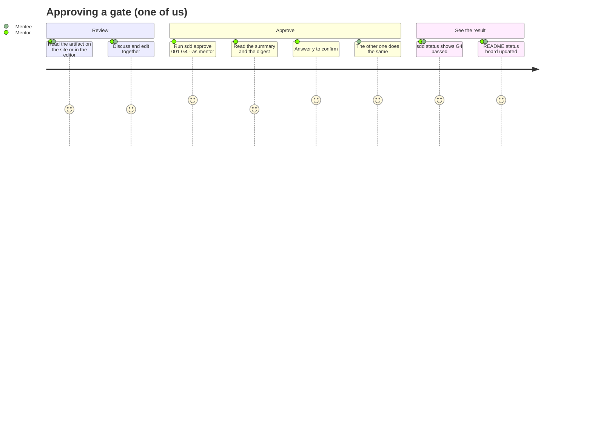
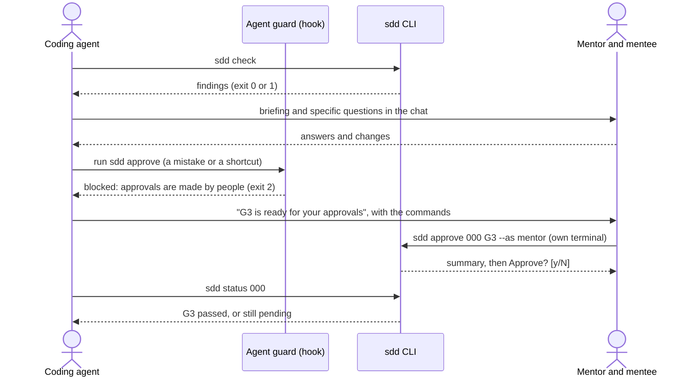

# Approach · 000 · The SDD harness

> **Phase 3 · Structure**, closed by **G3 · Approach approved** (both of us approve).
> In a data platform the "user experience" is often an API, a command line, a dataset or a
> dashboard: *how a person or a system meets what we build*. How to fill this file:
> [lifecycle, phase 3](../../harness/lifecycle.md#phase-3-structure).

## Is a prototype needed?

No. The harness meets its users through three interfaces that follow well-known conventions: a
command line (`sdd`, in the style of git: one verb per command, plain-text output, exit codes),
Markdown files in the repository, and a documentation website with a standard theme. None of
them carries enough uncertainty about *how* people will use it to justify a prototype; the
scenarios of the PRD can be walked through directly on the real thing.

## Interface approach

| Who | Through | Main interactions |
|---|---|---|
| We (mentor, mentee) | terminal: `poetry run sdd ...` | `status` to see where things are, `approve` at a gate, `rt` to read requirements |
| We | the documentation site | read the learning path, the harness, the teaching guides |
| Coding agents | `AGENTS.md`, skills, roles; terminal | read the guides, `new`, `check`, `sync`, `verify`; never `approve` |
| Git (pre-commit) | hooks | `guard-commit`, `sync`, `check` on every commit |
| Claude Code | `PreToolUse` hook (`agent_guard.py`) | a blocked call prints the reason on standard error; the agent stops and asks us |

Which backlog item shapes which interface:

| Interface | Items |
|---|---|
| Command line `sdd` (`new`, `status`, `approve`, `verify`, `check`, `sync`, `guard-commit`, `rt`) | PBI-000-01, 02, 03, 06, 08 |
| Markdown files and generated adapters, read by agents | PBI-000-04, 07 |
| Agent guard (hook, JSON on standard input, exit 2 to block) | PBI-000-05 |
| Documentation site (local, `docker compose up docs`) | PBI-000-09 |

Design rules for the command line: every command answers one question or performs one action;
output is plain ASCII so it reads the same in Windows terminals and agent transcripts; errors are
one line starting with `error:` (exit code 2), findings are a table (exit code 1), success is exit
code 0; every refusal says what to do next. One refusal is a list on purpose: an approval that is
not ready prints `Not ready for approval:` followed by one line per problem, so we fix them all
in one pass. The approval prompt shows the dossier, gate, artifacts, digest and approver, and
asks `Approve? [y/N]`; anything but `y` cancels and records nothing.

**Decision from the G3 review:** the confirmation is `y/N`, not the typed `<id> <gate>` phrase
that the tool asks for today (`TerminalConfirmation` in
`tools/sdd/infrastructure/terminal_confirmation.py`, with the expected text built in
`ApproveGate._confirm`). The check that keeps agents out is the terminal test (`isatty()`), not
the phrase, so the lighter prompt costs no safety. The code changes in the build, after G4, as a
task of PBI-000-08 (its "asks the person to type a confirmation" is still true: the person types
`y`). Until then the tool still asks for the phrase, and this gate's walk-through uses it.

The agent's side of the same flow: it can do everything except close a gate, and every refusal
is a message, never silence.

## How we validate the approach

By walking through the three PRD scenarios on the real harness during the G3 review:

1. **We, approving:** this very gate. One of us runs `sdd approve 000 G3 --as <id>` while the
   other watches `sdd status 000` change from `pending` to `partial` to `passed`. We judge
   whether the prompt told us enough to know what we were approving.
2. **A coding agent, working:** we ask an agent to run `sdd approve` and see it refused with a
   reason (the guard did this once already in this session, by mistake, and the agent stopped).
   We read the refusal and judge whether it says what to do next.
3. **The mentee, learning:** we run `docker compose up --build docs`, open
   http://127.0.0.1:8000 and follow the learning path to this dossier's teaching guide. This
   step needs PBI-000-09, so it is validated at G6, not at G3; at G3 we only agree that the site
   is the place where the mentee reads.

The first two can be done today; the third is deferred to the build, on purpose.
