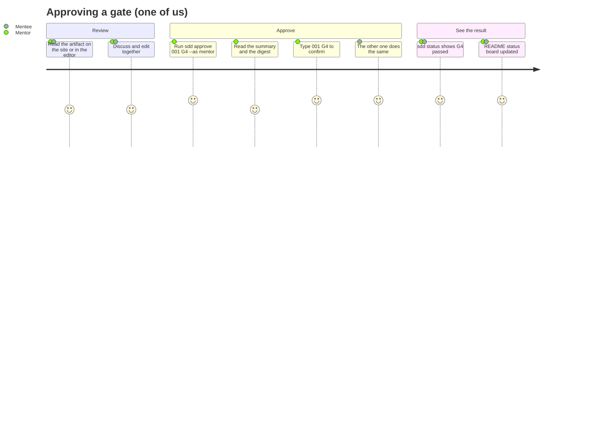

# Approach · 000 · The SDD harness

> **Phase 3 · Structure**, closed by **G3 · Approach approved** (both of us approve).
> In a data platform the "user experience" is often an API, a command line, a dataset or a
> dashboard: *how a person or a system meets what we build*. How to fill this file:
> [lifecycle, phase 3](../../harness/lifecycle.md#phase-3-structure).

## Is a prototype needed?

No. The harness meets its users through three interfaces that follow well-known conventions: a
command line (`sdd`, in the style of git: one verb per command, plain-text output, exit codes),
Markdown files in the repository, and a documentation website with a standard theme. None of
them carries enough uncertainty about *how* people will use it to justify a prototype; the
scenarios of the PRD can be walked through directly on the real thing.

## Interface approach

| Who | Through | Main interactions |
|---|---|---|
| We (mentor, mentee) | terminal: `poetry run sdd ...` | `status` to see where things are, `approve` at a gate, `rt` to read requirements |
| We | the documentation site | read the learning path, the harness, the teaching guides |
| Coding agents | `AGENTS.md`, skills, roles; terminal | read the guides, `new`, `check`, `sync`, `verify`; never `approve` |
| Git (pre-commit) | hooks | `guard-commit`, `sync`, `check` on every commit |

Design rules for the command line: every command answers one question or performs one action;
output is plain ASCII so it reads the same in Windows terminals and agent transcripts; errors are
one line starting with `error:` (exit code 2), findings are a table (exit code 1), success is exit
code 0; every refusal says what to do next.

## How we validate the approach

By walking through the three PRD scenarios on the real harness during the G3 review: one of us
approves a gate of this dossier while the other watches the status change; we ask an agent to run
`sdd approve` and see it refused; we open the site and follow the learning path to this dossier's
teaching guide.
