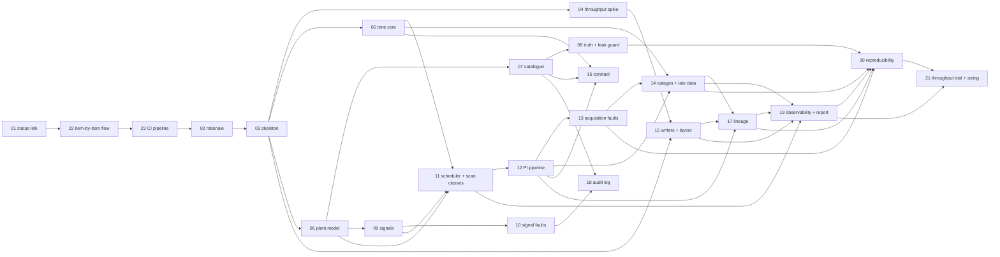

# Backlog · 001 · Time-series source: global plant data generator

> **Phase 2 · Plan**, closed by **G2 · Backlog approved** (both of us approve).
> The backlog lives in the repository as Markdown (ADR-0012); this file is its part for this
> dossier. How to fill it: [lifecycle, phase 2](../../harness/lifecycle.md#phase-2-plan).

All paths below that do not exist yet are **proposals** that the specification (G4) confirms or
changes; the paths that exist today were read before being named. Everything is simulated:
Orion Chemicals, its five sites and every tag, value and fault are fictional.

## How this backlog is approved (decision of the mentor, 2026-11-04)

This dossier is large, and what we learn from building one item changes the next ones. So the
backlog is approved **one item at a time**, and built one item per branch (the flow is delivered
by PBI-001-22):

1. **G2 is a partial approval.** It covers the *skeleton* of this file (epics, features, shared
   ground rules, order) and the **full review of PBI-001-01 only**. Every other card is an
   **outline**: it shows intent, size and dependencies, and is expected to change.
2. **Each card is refined just before it is built**, in the light of the code that already
   exists, reviewed with us in the chat, and approved by both of us. Only then is it built.
3. **Build loop per card (gate G5, one card at a time):** a branch of its own from an up-to-date
   `main`; implement until every acceptance criterion is met and `sdd verify` passes; commit,
   push and open a pull request; **stop and wait** until we confirm the merge; then sync with
   `main`, delete the local branches that are not `main`, and branch again for the next card.
4. Changing the skeleton (order, epics, ground rules) after G2 makes G2 stale and needs a new
   approval; refining one card does not stale the others. If refining or building a card shows
   that the specification (G4) is wrong or incomplete, the agent stops, proposes the change in
   the chat and edits the specification: **G4 becomes stale on purpose** and no code is written
   until we approve the refined specification (PBI-001-22, AC9).
5. Until the tool of PBI-001-22 exists, the cards built before it (01, 22, 23) are approved by
   re-running `sdd approve 001 G2` with a new note on the refined file; from PBI-001-22 on, each
   card has its own approval.

Cards **01, 22 and 23 are written in full** because they define this flow and the CI that
protects it; **02 to 21 are outlines** until their turn.

> **Scope note.** Our decision of 2026-11-04 added two harness changes to the two in the first PRD:
> the item-by-item flow (PBI-001-22) and the CI pipeline (PBI-001-23, which serves RT42). The PRD
> and `dossier.yaml` were amended to cite RT42 and list the four changes, so G1 is approved
> again on the amended text before G2.

## Epics

| Epic | Outcome | PRD goal served |
|---|---|---|
| **E1 · A plant that hides itself** | A hidden plant model, a realistic tag catalogue (about 60 % convention, 25 % site dialects, 15 % ad hoc) and an answer key under `truth/`, with a test that proves the structure never leaks. | Goal 1 (realistic plant and catalogue) |
| **E2 · Realistic data and problems** | Reproducible signals, signal faults, a PI-like acquisition pipeline, acquisition faults, outages with late data, and global time realism, every fault labelled. | Goal 2 (realistic, reproducible problems) |
| **E3 · Fast, governed and observable runs** | A Dockerised service that sustains the target rates, writes marked and traceable files, keeps an audit log, reports every run, and is measured (RT28, RT29); plus the two harness fixes this dossier carries. | Goals 3 and 4 (throughput and delay; governed, traceable, observable runs) |

## Features

| Feature | What a user can do when it is delivered | Epic | Items |
|---|---|---|---|
| F1.1 Plant and catalogue | Generate five sites with a realistic, messy catalogue of at least 1,000 tags. | E1 | 06, 07 |
| F1.2 Answer key and leak guard | Read the true structure of every tag from `truth/` and trust that nothing else in the output reveals it. | E1 | 08 |
| F1.3 Source contract per site | Read, for each site, the interface, identifiers, time reference, frequencies and limits, without the plant structure. | E1 | 16 |
| F2.1 Signals and signal faults | Get process-like signals with noise, spikes, drift, bias, steps, trends, saturation and oscillation at known moments. | E2 | 09, 10 |
| F2.2 PI-like acquisition | Get what a historian holds: exception, snapshot, compression, bad quality, frozen sensors, duplicates, missing data, outages and late bursts. | E2 | 11, 12, 13, 14 |
| F2.3 Global time | Get three timestamps per event in several representations, from sites with different zones, DST rules and wrong clocks. | E2 | 05 |
| F3.1 Fast, safe service | Start one container that writes to a local folder, in real time or ahead of the clock, at a measured rate. | E3 | 03, 04, 15 |
| F3.2 Governance, lineage, observability | Trace any record back to its run, reconstruct a configuration change, and see the health and outcome of every run. | E3 | 17, 18, 19 |
| F3.3 Measured and reproducible | Reproduce a run byte for byte from its seed, and read the sizing and throughput report. | E3 | 20, 21 |
| F3.4 Harness hygiene and flow | Create a new dossier whose `sdd check` passes, never start one without a rationale, build and approve a large backlog one item per branch, and have every pull request blocked unless the CI passes. | E3 | 01, 02, 22, 23 |

## Work items

### Shared ground rules (apply to every card below)

- **Package.** All new code lives in the package `tssource` under `src/tssource/`, with the four
  layers of `harness/principles.md`: `domain/`, `application/` (use cases and `typing.Protocol`
  ports), `infrastructure/` (adapters), `interfaces/` (the CLI), and one composition root
  `bootstrap.py`. Tests live in `tests/tssource/`, with fakes for every port in
  `tests/tssource/fakes.py`. PBI-001-03 creates the skeleton, so every other card assumes it.
- **Libraries.** `numpy`, `pyarrow` and `tzdata` as a new Poetry dependency group `tssource`;
  `typer` is already a dependency. Anything else needs a line in an ADR (principles, section 7).
- **Determinism.** The domain has no clock and no global randomness. Randomness comes from a
  `numpy.random.Generator` built from one `numpy.random.SeedSequence(seed)` that is *spawned*
  with a stable key per site, tag and purpose, so adding a tag never changes the numbers of
  another tag. Time is passed in, always UTC and timezone-aware (RT12).
- **Docstrings, types, size.** Every module, class and function has a docstring (why and
  contract); `mypy --strict`; files over about 150 lines are split; complexity at most 8.
- **Synthetic marker.** Every file the generator writes states that it is synthetic data of a
  fictional company (PBI-001-15 implements it; earlier cards use the helper once it exists).
- **Formats are proposals.** Where a card names a file format (JSON Lines, Parquet) the
  specification may change it; the *observable fields and rules* in the criteria stay.
- **Verification commands** are always `poetry run pytest tests/tssource -q` for the test files
  named in the card, and `poetry run sdd verify 001` for the whole suite (gate G5).

### PBI-001-01 · Status table links the teaching guide only when it exists

- **Feature:** F3.4 Harness hygiene
- **Serves:** none directly. It repairs the harness so that this dossier can be committed
  (carried by this dossier by our decision; the rationale and the friction note are in the PRD).
- **Size:** S
- **Depends on:** none (built right after G4, before anything else, so `sdd check` and
  pre-commit pass)
- **Context:** `sdd sync` writes a status table into `README.md` and `specs/README.md` with a
  link to `<folder>/teaching-guide.md` for every dossier, but ADR-0018 creates that file only
  when G4 passes, so `sdd check` reports a broken link right after `sdd new` and pre-commit
  blocks the commit.
- **What:** the status table shows the 📘 link only when `teaching-guide.md` exists in the
  dossier folder, and the text `not yet` otherwise. `poetry run sdd sync` on a repository with a
  dossier at G1 produces a table with no broken link and `poetry run sdd check` exits 0.
- **How:**
  1. In `tools/sdd/application/generators/status.py`, the table builder (the function that
     contains the row `f"| {where_it_is(report)} | {chips} | [📘]({folder}/teaching-guide.md) |"`)
     decides the last cell from a fact "this dossier has a teaching guide".
  2. Get that fact without I/O in the generator: add `has_teaching_guide: bool` to
     `DossierReport` (`tools/sdd/application/use_cases/evaluate_dossier.py`) filled by
     `EvaluateDossier` through the existing `DossierRepository` port
     (`tools/sdd/application/ports/dossiers.py`: `read_artifact` returns `None` when the file is
     missing, so reuse it; add no new port method unless the spec shows a need).
  3. Keep the pure function pure: it receives the report, never a path.
  4. Regenerate with `poetry run sdd sync`; the three-dossier table must not change for dossier
     000, whose teaching guide exists.
- **Out of scope:** changing when ADR-0018 creates the guide; any other column of the table.
- **Acceptance criteria (EARS):**
  - AC1: Where a dossier folder contains `teaching-guide.md`, the status table shall link it.
  - AC2: If a dossier folder has no `teaching-guide.md`, then the status table shall show `not yet`
    in the Guide column and no link to a missing file.
  - AC3: When `sdd sync` runs for a dossier at G1, `sdd check` shall report no broken link.
- **Verification:** `tests/sdd/test_docs_and_sync.py` (new cases for AC1 and AC2 with the fake
  repository in `tests/sdd/fakes.py`) and a CLI test in `tests/sdd/test_cli.py` for AC3;
  `poetry run pytest tests/sdd -q`, then `poetry run sdd check`.

### PBI-001-02 · A rationale is required for every dossier

- **Feature:** F3.4 Harness hygiene
- **Serves:** none directly (harness repair carried by this dossier).
- **Size:** S
- **Depends on:** 23 (built right after the CI, as the first card that follows the new flow)
- **Context:** today only enablers and features outside the catalogue need a rationale
  (`Dossier.needs_rationale`), so dossier 001 started with an empty one. We want the "why" of
  every dossier recorded, whatever its kind.
- **What:** `poetry run sdd new "T" --slug x --rt RT01` without `--rationale` fails with a clear
  message and exit code 2 (the code the CLI already uses for validation errors); gate G0 fails
  for any dossier whose rationale is empty or whitespace, with the message
  "a dossier must state its rationale in dossier.yaml". Dossiers 000 and 001 already have one.
- **How:**
  1. `tools/sdd/domain/dossier.py`: `needs_rationale` returns `True` for every dossier. Remove
     the now-pointless split, keeping the property so callers read well, or delete the property
     and its callers; choose the smaller change and update the docstring.
  2. `tools/sdd/application/evidence.py`: replace the per-kind map `_MISSING_RATIONALE` with one
     message; G0 problem list keeps the unknown-RT check unchanged.
  3. `tools/sdd/application/use_cases/create_dossier.py`: reject an empty rationale before any
     file is created (raise the typed error already used for invalid requests, see
     `tools/sdd/domain/errors.py`); update the field docstring.
  4. `tools/sdd/interfaces/cli/app.py` (`new`): change the help text of `--rationale`; the
     error maps to the existing exit code.
  5. Update `harness/templates/prd.md` or the skills only if they claim the old rule (grep for
     "mandatory for enablers"); `.agents/skills/` is the canonical copy, run `sdd sync`.
- **Out of scope:** rewriting rationales of old dossiers; checking the rationale's quality.
- **Acceptance criteria (EARS):**
  - AC1: If `sdd new` is called without a rationale, then it shall create nothing and exit with
    code 2.
  - AC2: If a dossier's rationale is empty or only whitespace, then gate G0 shall fail with the
    message "a dossier must state its rationale in dossier.yaml".
  - AC3: When a dossier has a rationale and valid RTs, gate G0 shall pass.
- **Verification:** `tests/sdd/test_domain.py` (the cases around `needs_rationale` change),
  `tests/sdd/test_use_cases.py` (create without rationale), `tests/sdd/test_cli.py` (exit code);
  `poetry run pytest tests/sdd -q`, `poetry run sdd check`.

### PBI-001-03 · Skeleton: package, CLI, container, quality gates

- **Feature:** F3.1 Fast, safe service
- **Serves:** RT01, RT36 (must not break), RT29 (resources are measured later).
- **Size:** M
- **Depends on:** 01, 22, 23, 02 (so that commits pass and the new flow and CI are in force)
- **Context:** nothing of the generator exists. Every other card needs the same package layout,
  the same quality gates and a container that follows the hardening baseline, so this card makes
  the walking skeleton: it does nothing useful but is built, typed, linted, tested and runs.
- **What:** `poetry install --with tssource` works; `poetry run tssource --help` lists the
  commands `run`, `bench`, `config` and `report` (only `--help` text; each says "not implemented
  yet" and exits 1 until its card); `docker compose up --build tssource` starts a container that
  stays healthy; `lint-imports`, `mypy`, `ruff` and `pytest` all include the new package.
- **How:**
  1. `pyproject.toml`: add the dependency group `tssource` (numpy, pyarrow, tzdata); add
     `{ include = "tssource", from = "src" }` to `[tool.poetry] packages`; script
     `tssource = "tssource.interfaces.cli.app:main"`; extend `ruff.src`, `mypy.packages` and
     `mypy_path`, `pytest.pythonpath`, `--cov=tssource`; add `tssource` to
     `[tool.importlinter] root_packages` and a copy of the three contracts of `sdd` for
     `tssource` (layers, interfaces never touch infrastructure, domain and application free of
     `numpy`, `pyarrow`, `typer`, `pathlib` writes via a port, `subprocess`). Bandit also scans
     `src`.
  2. `src/tssource/{domain,application,infrastructure,interfaces}/__init__.py`, `bootstrap.py`
     (empty composition root), `interfaces/cli/app.py` with the Typer app and `main()`, and
     `domain/errors.py` with the base error `TssourceError`.
  3. `src/tssource/application/settings.py`: an immutable `Settings` dataclass (seed, output
     directory, mode, start, end, speed factor) read once from CLI options and environment
     variables prefixed `TSSOURCE_` in `bootstrap.py`; no credentials anywhere (RT36).
  4. `docker/tssource.Dockerfile` (slim Python base pinned by digest, non-root user 10001, no
     compiler in the final image) and a service `tssource` in `compose.yaml` with the same
     hardening as `docs`: `read_only: true`, `tmpfs: /tmp`, `cap_drop: [ALL]`,
     `no-new-privileges`, no published ports, `user: "10001:10001"`, one writable bind mount for
     the output folder (`./data/ts_source`), and a `healthcheck` that runs
     `tssource health` (a command that exits 0 while the process writes its heartbeat file;
     the heartbeat itself arrives in PBI-001-19, here it returns 0).
  5. Add `data/` to `.gitignore` (read the file first; do not add what already matches).
  6. Test that `tssource --help` runs and that a deliberately wrong import in a scratch module is
     caught by `lint-imports` (a contract test is optional; the import-linter run is the proof).
- **Out of scope:** any generation logic; the Kafka or HTTP interface.
- **Acceptance criteria (EARS):**
  - AC1: When `tssource --help` runs, the CLI shall list `run`, `bench`, `config`, `report` and
    `health` and exit with code 0.
  - AC2: The `tssource` compose service shall run with a read-only root file system, no Linux
    capabilities, `no-new-privileges`, a non-root user and no published port.
  - AC3: If `domain` or `application` code imports `numpy`, `pyarrow` or `typer`, then
    `lint-imports` shall fail.
  - AC4: The repository shall contain no credential in the new files (`detect-secrets` passes).
- **Verification:** `tests/tssource/test_cli.py` (AC1); a test that parses `compose.yaml` for
  AC2 (`tests/tssource/test_compose_hardening.py`); `poetry run lint-imports` (AC3);
  `poetry run sdd verify 001` (AC4).

### PBI-001-04 · Throughput spike: can Python meet the rate?

- **Feature:** F3.1 Fast, safe service
- **Serves:** RT29, RT28.
- **Size:** M
- **Depends on:** 03
- **Context:** the largest technical risk in the PRD is that Python cannot sustain 25,000
  events/s of backfill, which would make the generator the limit of every later test. We prove
  or disprove it first, with throwaway-quality generation but the real writers, before anything
  else is built on top.
- **What:** `poetry run tssource bench` writes into a scratch folder a synthetic block of
  events (random walks for 2,050 tags, one value per scan tick) through candidate serialisers and
  a simple file writer (PBI-001-15 then adopts the winner or replaces them), and prints and saves `bench.json`: events/s per second of
  wall time (the distribution: mean, p50, p95, p99, minimum), CPU seconds, peak memory, and
  whether the 25,000 events/s floor was held for the whole run.
- **How:**
  1. `domain/benchmark.py`: `Distribution` value object (percentile maths in numpy-free pure
     Python for small arrays, or accept an array through the application layer).
  2. `application/bench.py`: use case `RunBenchmark` with ports `EventSink` (write a batch of
     events) and `ResourceProbe` (CPU seconds, peak RSS) and `Clock`.
  3. `infrastructure/`: a vectorised block generator (numpy, one `Generator.standard_normal`
     call per block of ticks for all tags), a JSON Lines gzip writer and a Parquet writer for
     comparison, a probe using `time.process_time` and `resource` or `psutil`-free equivalents
     (`os`/`tracemalloc`; no new dependency).
  4. Compare three serialisations (orjson-free JSON Lines gzip, JSON Lines plain, Parquet by
     row group) and one thread layout (generation thread plus writer thread through a bounded
     `queue.Queue`) and record the numbers in the output; the winner is written in an ADR in
     PBI-001-15 or by the specification.
  5. Run on this machine, inside the container, for 60 seconds.
- **Out of scope:** realism of the signal; the final file layout; the 150,000 events/s stretch
  is *reported*, never required.
- **Acceptance criteria (EARS):**
  - AC1: When `tssource bench` finishes, it shall write `bench.json` with mean, p50, p95, p99
    and minimum events per second per second of wall time, the number of events, the CPU time
    and the peak memory.
  - AC2: While the benchmark runs, the writer queue depth shall never exceed its declared bound.
  - AC3: If the sustained rate falls under 25,000 events/s, then the command shall exit with
    code 3 and print which stage (generation or writing) is the bottleneck.
  - AC4: When run twice with the same seed, the benchmark shall produce the same events (the
    timings may differ).
- **Verification:** `tests/tssource/test_benchmark.py` (distribution maths, bound, exit code,
  determinism with a small block); the real numbers are a measurement recorded by the spike,
  not a unit test, and are attached to the RT29 report (PBI-001-21).

### PBI-001-05 · Time core: zones, daylight saving, representations, wrong clocks

- **Feature:** F2.3 Global time
- **Serves:** RT07, RT12.
- **Size:** L
- **Depends on:** 03
- **Context:** the five sites sit in different time zones with different daylight saving rules,
  and the sources write time in different ways. The platform must show it can store UTC with the
  original representation and flag ambiguity. This card is the pure time model; it also runs
  early because a wrong rule would poison every later test (PRD risk).
- **What:** a library, with a command `tssource time-table --site <code> --date <YYYY-MM-DD>`
  that prints, for a local time, the UTC instant(s), the offset and a flag `ambiguous`, `gap` or
  `ok`. The sites and their IANA zones: Brazil `America/Sao_Paulo`, US Gulf Coast
  `America/Chicago`, Belgium `Europe/Brussels`, China `Asia/Shanghai`, India `Asia/Kolkata`.
  Timestamp representations (each declared per site in the source contract): ISO 8601 with
  offset; ISO 8601 local without offset; epoch seconds UTC; epoch milliseconds UTC; local
  "MM/DD/YYYY HH:MM:SS" text; Windows FILETIME-style ticks (100 ns since 1601). Each event gets
  the three timestamps of RT07: **occurrence time** (when the measured thing happened),
  **source update time** (when the source last stored or corrected it) and **reception time**
  (when our service handled it). A site can have a **misconfigured clock**: a constant offset
  (for example local time labelled as UTC) or a drift of N seconds per day, announced in the
  truth labels, never in the data.
- **How:**
  1. `domain/time/zone.py`: `SiteZone` value object wrapping `zoneinfo.ZoneInfo` (standard
     library; `tzdata` guarantees data in the slim image), with `to_utc(local_naive)` returning a
     `LocalResolution` (`ok`, `gap`, `ambiguous`; both candidate instants when ambiguous; for a
     gap, the next valid instant).
  2. `domain/time/representation.py`: a `TimestampRepresentation` enum and pure
     `encode(instant, zone, representation)` / `decode`. Encoding of local time must use the
     *actual* offset at that instant, so the ambiguous hour appears twice with different
     offsets in naive-local sites.
  3. `domain/time/clock_fault.py`: `ClockFault` (constant offset, drift per day, start, end)
     that maps a true instant to the instant the site writes.
  4. `domain/time/event_times.py`: `EventTimes(occurrence, source_update, reception)` frozen
     dataclass; validation: all UTC aware; reception is not before occurrence unless the site
     clock is faulty.
  5. Tests include the real transitions of the chosen years: US 2nd Sunday of March and 1st
     Sunday of November; EU last Sunday of March and October; Brazil with no daylight saving
     since 2019 and with it before; India and China with a fixed offset and no change.
- **Out of scope:** applying the clock fault to a stream (PBI-001-14 does); leap seconds.
- **Acceptance criteria (EARS):**
  - AC1: When a local time falls in the daylight-saving gap of a zone, the resolver shall report
    `gap` and return the next valid instant.
  - AC2: When a local time falls in the repeated hour, the resolver shall report `ambiguous` and
    return both UTC instants.
  - AC3: The encoder shall represent a given instant in each of the six representations and the
    decoder shall return the same instant for the five that carry an offset or are UTC.
  - AC4: Where a representation carries no offset (local text), the decoder shall require the
    site zone and shall flag the ambiguous hour instead of choosing silently.
  - AC5: While a clock fault is active at a site, the written occurrence time shall differ from
    the true instant by the declared offset or accumulated drift.
  - AC6: The two zones with fixed offsets (China, India) shall never produce a gap or ambiguity
    (India offset +05:30).
- **Verification:** `tests/tssource/domain/test_zone.py`, `test_representation.py`,
  `test_clock_fault.py`, `test_event_times.py` (include the named transitions as table-driven
  cases with the dates written in the test).

### PBI-001-06 · Hidden plant model

- **Feature:** F1.1 Plant and catalogue
- **Serves:** RT28 (declared tags and frequencies), RT17 (each tag has a declared expected
  frequency).
- **Size:** L
- **Depends on:** 03
- **Context:** the generator needs a plant to describe, and the plant structure is the answer a
  future model must rebuild, so it lives only in the domain and in `truth/`. The model borrows
  its organisation from the Tennessee Eastman Process (a reactor, separator, stripper,
  compressor, recycle) and from standard instrument sets of public engineering practice, but
  nothing is loaded from TEP and it is not a physical simulator.
- **What:** `tssource plant build --seed N` (also used by `run`) produces the in-memory model
  and writes it, only, to `truth/plant.json`: sites (5), areas, equipment (with a class and a
  stable surrogate identifier), instruments, control loops (measurement, controller, final
  element) and the relations between equipment (flows). The default size is **about 2,050
  instrumented points**: Brazil ~700, US Gulf Coast ~450, Belgium ~350, China ~350, India ~200,
  of which about 1,950 are continuous and about 100 are lab analytes. At least 10 per equipment
  class.
- **How:**
  1. `domain/plant/entities.py`: frozen dataclasses `Site`, `Area`, `Equipment`, `Instrument`,
     `ControlLoop`, `Stream` (a material link between equipment); `EquipmentClass` enum
     (reactor, column, heat exchanger, pump, compressor, tank, furnace, separator, valve
     station, analyser house); `ScanClass` enum (1 s, 5 s, 10 s, 30 s, 1 min, 5 min, 15 min,
     report-by-exception, lab); `Measurement` enum (temperature, pressure, flow, level,
     analytic, speed, current, vibration, position, status).
  2. `domain/plant/templates.py`: one instrument-set template per equipment class (which
     measurements, which loops, scan class, range, engineering unit), written as data (a
     tuple of frozen specs), so a new class is a new entry (open/closed).
  3. `domain/plant/builder.py`: `PlantBuilder(seed).build(site_profile)`; site profiles
     (size, products, equipment mix) are data; stable surrogate ids from the seed and the
     structural path, never from the display name.
  4. Related instruments are tied through **latent drivers** (a shared feed-rate or cooling
     water temperature per area) recorded in the model; PBI-001-09 uses them so that related
     signals move together without any value being copied.
  5. Counts per site and scan class must be a declared table in the module, tested.
- **Out of scope:** tag names (PBI-001-07); signal values; more than the default size.
- **Acceptance criteria (EARS):**
  - AC1: When the plant is built with a seed, the model shall contain 5 sites and at least
    1,000 instrumented points, with the per-site counts within 10 % of the declared table.
  - AC2: The model shall contain at least 10 instruments of each equipment class.
  - AC3: When built twice with the same seed, the model shall be identical; with another seed,
    the surrogate identifiers shall differ.
  - AC4: Every control loop shall reference an existing measurement, controller and final
    element of the same area.
  - AC5: The plant model shall be written only under `truth/` and nowhere else.
- **Verification:** `tests/tssource/domain/test_plant_builder.py`,
  `tests/tssource/domain/test_plant_templates.py`, `tests/tssource/test_truth_layout.py`
  (AC5, together with PBI-001-08).

### PBI-001-07 · Naming convention and messy tag catalogue

- **Feature:** F1.1 Plant and catalogue
- **Serves:** RT09, RT28.
- **Size:** L
- **Depends on:** 06
- **Context:** a later model will learn from tags that follow the company convention and must
  then explain the ones that do not. The catalogue must therefore be realistic: a clear majority
  conforms, a sizeable part uses local site dialects and another part follows nothing, and the
  same display name can mean different things at different sites.
- **What:** (a) the convention as a versioned document
  `docs/architecture/tag-naming-convention.md` with its grammar
  `<SITE>.<AREA>.<EQUIPMENT>.<ISA-5.1 TAG>.<SIGNAL>` (example `ORN.A200.R201.TIC-2011.PV`),
  the lab branch `ORN.LAB.<AREA>.<SAMPLEPOINT>.<ANALYTE>`, the signal codes (PV, SP, OUT, MODE,
  ALM) and the ISA-5.1 letters used; (b) `catalog/tags.parquet` (the consumer's view) with one
  row per tag: published name, descriptor (English or Portuguese, sometimes empty), engineering
  unit as spelled by the site (`degC`, `°C`, `DEG C`, `C`, empty...), data type, scan class,
  site code, a `generator` marker; (c) the answer key `truth/tag_key.parquet` with, for each
  tag: surrogate id, equipment, loop, measurement, canonical unit, canonical convention name,
  conformity tier (`convention` ~60 %, `dialect` ~25 %, `adhoc` ~15 %) and the list of
  violation types applied.
- **How:**
  1. `domain/naming/convention.py`: `CanonicalName` value object with `parse` and `render`;
     validation that a canonical name matches the grammar; the ISA-5.1 letter table as data.
  2. `domain/naming/violations.py`: one Strategy class per violation type implementing a
     `Violation` protocol `apply(canonical, rng) -> str`: dropped area, swapped separators,
     different case, equipment glued to the loop, legacy abbreviation, suffix like `_PV` or
     `.PV`, numeric-only, free text, typos, renamed after a "migration" (the old name and the
     new name both appear, at different times, with the change in `truth/`). Violations are
     data in a registry; a new one is a new class.
  3. `domain/naming/dialects.py`: one `SiteDialect` per site (separator, case, abbreviations,
     descriptor language: Brazil mostly Portuguese, others English) chosen from the seed; a
     fixed share of each site's tags use the dialect, the rest the convention or ad hoc.
  4. `domain/naming/catalogue_builder.py`: assigns each instrument a tier with the 60/25/15
     targets (random draw, but with a floor: at least 1,000 convention tags and 20 examples of
     every violation type are *guaranteed* by adjusting the draw), applies violations, produces
     descriptors (templates in English and Portuguese, with abbreviations and gaps), unit
     spellings, and **name collisions**: the same published name at two or three sites for
     different equipment (for example `TIC-101`).
  5. Hold-out support: the answer key marks one site as the `holdout` site for a future model
     (a flag in `truth/`, never in the catalogue).
- **Out of scope:** the machine learning model; Chinese or Spanish descriptors (by decision).
- **Acceptance criteria (EARS):**
  - AC1: When the catalogue is built, it shall contain at least 1,000 tags whose published name
    equals the canonical convention name, and the share of each tier shall be within 5
    percentage points of 60 / 25 / 15.
  - AC2: The catalogue shall contain at least 20 tags for each violation type.
  - AC3: Where a published name equals at two or more sites, the answer key shall map each to a
    different equipment surrogate id, and at least 15 such collisions shall exist.
  - AC4: The descriptors shall use only English and Portuguese, and at least 5 % of tags shall
    have an empty descriptor and at least 5 % an empty or unusual unit spelling.
  - AC5: When a canonical name is parsed and rendered, the result shall equal the input.
  - AC6: The catalogue file shall contain no column of the answer key (equipment, loop, tier,
    canonical name, violation types, surrogate id).
- **Verification:** `tests/tssource/domain/test_convention.py`, `test_violations.py`,
  `test_dialects.py`, `test_catalogue_builder.py` (counts by tier, violation, collision;
  language check with a closed word list in the test); `tests/tssource/test_catalog_files.py`
  for AC6.

### PBI-001-08 · Truth files and the leak guard

- **Feature:** F1.2 Answer key and leak guard
- **Serves:** RT09, RT38 (the truth records versions of the convention and plant model).
- **Size:** M
- **Depends on:** 06, 07
- **Context:** the plant structure must never be visible in what consumers receive. We write
  the answer key in one place and prove, by test, that nothing from it appears elsewhere. This
  is the main guarantee behind PRD goal 1 ("zero plant-structure fields outside `truth/`").
- **What:** the output folder layout `catalog/`, `stream/`, `archive/`, `lab/`, `truth/`, and
  the files of `truth/`: `plant.json`, `tag_key.parquet`, `faults.jsonl.gz` (every injected
  fault: type, tag surrogate, start, end, parameters), `clock_faults.json`, `outages.json`,
  `README.md` explaining that these are answers. A command `tssource leakcheck <folder>` that
  exits 0 when no truth-only field or value appears outside `truth/` and 1 otherwise, listing
  the offending file and field.
- **How:**
  1. `domain/layout.py`: the enumeration `OutputArea` (catalog, stream, archive, lab, truth)
     and the `TruthField` registry: names of all columns and keys that exist only in truth.
  2. `application/leakcheck.py`: use case `LeakCheck` with a port `OutputReader` that lists
     files and reads the column names or keys of each; it flags (a) any truth field name in a
     non-truth area, (b) any surrogate id value found in a non-truth file, (c) any pair of tags
     whose values in the stream are identical for 100 samples (an exact copy would reveal a
     relation), using the first 1,000 events per tag.
  3. `infrastructure/`: readers for JSON Lines gzip and Parquet; the `truth` writer adapter
     refusing to write outside `truth/`.
  4. Also check the contract files (PBI-001-16) and log files (PBI-001-19).
- **Out of scope:** statistical leak detection beyond the exact-copy test.
- **Acceptance criteria (EARS):**
  - AC1: When all outputs of a short run are inspected, the leak guard shall find no truth field
    name or surrogate id outside `truth/` and exit with code 0.
  - AC2: If a truth field is added to a catalogue column, then `leakcheck` shall exit with code 1
    naming the file and the field.
  - AC3: If two tags in the stream carry exactly identical values for 100 consecutive samples,
    then `leakcheck` shall report the pair.
  - AC4: The truth writer shall raise an error when asked to write a path outside `truth/`.
- **Verification:** `tests/tssource/test_leakcheck.py` (clean run, injected leak, injected copy),
  `tests/tssource/test_truth_layout.py`.

### PBI-001-09 · Signal behaviour: process-like signals without a simulator

- **Feature:** F2.1 Signals and signal faults
- **Serves:** RT28 (values are the load), RT17 (setpoint and mode tags are report-by-exception).
- **Size:** L
- **Depends on:** 06
- **Context:** signals must look like plant data (levels, flows, temperatures that wander,
  respond to setpoint changes, trip, degrade) without solving physics. Signals of related
  instruments must be statistically related through shared latent drivers so a future model
  can find structure *in the data*, but never be copies.
- **What:** a generator that, for each continuous instrument and a time grid, produces float
  values in engineering units: stationary behaviour (mean-reverting around an operating point
  with measurement noise), setpoint changes (first-order response to a new setpoint), grade or
  product campaign changes (operating-point shifts with ramps), trips (fast drop to a safe
  value then restart), slow degradation (fouling: a long trend), diurnal and weekly load
  patterns, and status tags (digital, with states like Running/Stopped). Behaviour events are
  *process* events: they are legitimate, not faults, and are written to `truth/` as such so a
  quality rule that flags them can be told apart from a real signal fault.
- **How:**
  1. `domain/signals/behaviour.py`: a `Behaviour` protocol `render(grid, rng, drivers) -> array`
     and implementations `MeanReverting` (Ornstein-Uhlenbeck, vectorised with a closed-form
     step), `FirstOrderResponse`, `CampaignShift`, `Trip`, `Degradation`, `DigitalState`.
  2. `domain/signals/drivers.py`: `LatentDriver` (a shared low-frequency signal per area, built
     once per day and reused by the instruments) and the mixing weights by measurement type
     (a flow follows the feed driver, a temperature the cooling driver...).
  3. `domain/signals/profile.py`: per-instrument parameters (operating point, range, noise
     level, time constant) derived from the instrument and its template; clipped to the
     instrument range.
  4. Generation is **chunked by time** (for example one hour per chunk), vectorised across
     tags; the state at the end of a chunk is carried into the next so that the stream is
     continuous across chunks and identical regardless of the chunk size (tested).
  5. Related-signal strength is parameterised; the default correlation between a loop's PV and
     its controller output is between 0.3 and 0.9, never 1.0.
- **Out of scope:** any physics; faults (PBI-001-10).
- **Acceptance criteria (EARS):**
  - AC1: When a tag is rendered with a seed over a day, the values shall stay inside the
    instrument range and have a stable mean near the operating point.
  - AC2: When a setpoint change occurs, the process variable shall approach the new value with
    the declared time constant (within 5 % at 5 time constants).
  - AC3: When the same seed and period are rendered with chunks of 1 hour and of 6 hours, the
    values shall be identical.
  - AC4: Where two instruments share a latent driver, the correlation of their changes over a
    day shall be positive and below 1.0.
  - AC5: Every process event (setpoint change, shift, trip) shall appear in `truth/` with its
    type, tag and time.
- **Verification:** `tests/tssource/domain/test_behaviours.py`, `test_drivers.py`,
  `test_chunk_invariance.py` (AC3).

### PBI-001-10 · Signal faults: noise, spikes, drift, bias, steps, trends, saturation, oscillation

- **Feature:** F2.1 Signals and signal faults
- **Serves:** RT28 (fault rates are part of the declared load), RT17.
- **Size:** M
- **Depends on:** 09
- **Context:** the reliability engineer needs signal problems at known moments to check whether
  a quality rule detects them and what it confuses with real process changes. Faults are
  *signal* defects (the instrument misreports); acquisition defects come in PBI-001-13.
- **What:** a fault engine that overlays on the clean signal: extra noise (a noisier
  period), spikes (single-sample outliers of 5 to 20 standard deviations), drift (slow
  sensor offset growth), bias (constant offset after a "calibration"), step (sudden permanent
  offset), trend (monotonic slope), saturation (value pinned at the range end), oscillation
  (limit cycle on a loop, period 30 s to 30 min) and calibration reset (return to the true
  value). Each injected fault is a labelled row in `truth/faults.jsonl.gz`: tag surrogate, fault
  type, start and end (UTC), parameters, and the ids of affected events once written.
- **How:**
  1. `domain/faults/signal_faults.py`: a `SignalFault` protocol
     `apply(values, grid, rng) -> values` and one class per kind; a `FaultSchedule` that draws,
     per tag and per day, how many faults (rates per kind in a configuration table; the
     defaults must put every kind at least once in a 30-day backfill of the default plant).
  2. `domain/faults/labels.py`: `FaultLabel` frozen dataclass; labels carry start and end, not
     event ids (those are attached by lineage, PBI-001-17).
  3. Fault parameters come from the configuration file `config/faults.yaml` (rates, bounds);
     changing that file goes through the audit log (PBI-001-18).
  4. Faults never overlap on the same tag unless the configuration allows it; a conflict
     resolution rule is explicit (the later start wins and the label records both).
- **Out of scope:** acquisition faults; the process events of PBI-001-09 (they are not faults).
- **Acceptance criteria (EARS):**
  - AC1: When a 30-day backfill of the default plant is scheduled, every signal fault kind shall
    occur at least once and be labelled with type, tag, start and end.
  - AC2: When a spike fault is injected, exactly the labelled samples shall deviate by more than
    5 standard deviations.
  - AC3: While a saturation fault is active, the value shall equal the range end.
  - AC4: When a drift fault is injected, the offset at the end of the period shall equal the
    declared drift times the duration within 1 %.
  - AC5: When the same seed and configuration are used twice, the labels shall be identical.
- **Verification:** `tests/tssource/domain/test_signal_faults.py`, `test_fault_schedule.py`.

### PBI-001-11 · Clock, scheduler and scan classes (including lab tags)

- **Feature:** F2.2 PI-like acquisition
- **Serves:** RT17, RT28, RT29.
- **Size:** L
- **Depends on:** 05, 06, 09
- **Context:** the generator must produce data at different frequencies, both in real time and
  faster, for the same output. Periodic tags (1 s to 15 min), report-by-exception tags
  (setpoints, modes, digital states) and irregular laboratory results (a sample taken at one
  time, a result available hours later) have different rules for "expected data", which is what
  RT17 needs.
- **What:** `tssource run --mode realtime|backfill --start ... --end ...` produces, per site,
  samples at the tick grid of each scan class; real-time mode paces them with the wall clock;
  backfill mode runs as fast as possible over a past period; **speed factor** mode (for example
  60x) paces proportionally. Lab tags: each result has a **sample time** (occurrence), a **result
  time** (when the lab validated it, 30 minutes to 24 hours later) and sometimes a correction
  published later with a new result time. `truth/expected_counts.parquet` states, per tag and
  day, how many events the scan class expects (null for report-by-exception and lab tags), so
  completeness can be computed only where a frequency is defined.
- **How:**
  1. `domain/schedule/grid.py`: `TickGrid(scan_class, anchor)` generating tick instants
     (integer arithmetic on nanoseconds from an anchor, no floating accumulation, so no drift).
  2. `domain/schedule/lab.py`: `LabSampler` producing sample times (rules like "every 4 hours
     at the same minute" plus irregular extras), result delays and corrections.
  3. `application/clock.py`: port `RunClock` (`now`, `sleep_until`) with implementations in
     `infrastructure/`: `WallClock` (real time), `AcceleratedClock(speed)`, and
     `BackfillClock` (never sleeps).
  4. `application/scheduler.py`: one asyncio task per site and scan class (not one per tag)
     pulling the next chunk from the generator, using `sleep_until` of the next tick; the
     scheduler records its **lag** (actual minus scheduled) for the metrics card.
  5. `application/rbe.py`: report-by-exception tags are emitted only when the value changes
     by more than their exception deviation (the pipeline card applies it), and always at
     start, at a heartbeat interval (for example one hour) and at the end.
  6. The same input must produce the same events in all three clock modes (the clock only
     affects pacing).
- **Out of scope:** the PI pipeline (exception, compression); outages.
- **Acceptance criteria (EARS):**
  - AC1: When a backfill of one hour runs for one site, each scan class shall produce exactly
    the ticks of its grid, with no gap and no drift (the last tick equals anchor plus n times
    the period).
  - AC2: While running in real time, the scheduler lag at the 99th percentile shall stay under
    50 ms for the 1-second scan class on the reference machine (a measurement in the RT29 report;
    the unit test uses a fake clock).
  - AC3: When the same period is run in backfill, in real time and at 60x, the events shall be
    identical.
  - AC4: Where a tag is a lab tag, every result shall carry a sample time earlier than its
    result time, and a correction shall carry a later result time than the original.
  - AC5: Where a tag has a periodic scan class, `expected_counts` shall hold the number of
    ticks per day; where it is report-by-exception or lab, it shall hold null.
- **Verification:** `tests/tssource/domain/test_tick_grid.py`, `test_lab_sampler.py`,
  `tests/tssource/application/test_scheduler.py` (fake `RunClock`),
  `test_clock_modes_equivalence.py`.

### PBI-001-12 · PI-like acquisition pipeline: exception, snapshot, compression, archive

- **Feature:** F2.2 PI-like acquisition
- **Serves:** RT23, RT28, RT17.
- **Size:** L
- **Depends on:** 11
- **Context:** a PI-style historian does not store every scan: an interface sends a value only
  when it passes the **exception** test (it moved more than a deviation, or enough time went
  by), the system keeps the latest event as the **snapshot**, and when the next value arrives it
  decides, with **compression** (a swinging-door algorithm with a deviation, a minimum and a
  maximum time), whether the previous snapshot is written to the **archive**. Reproducing this
  gives the output the real shape of a historian and the event-rate band of the PRD.
- **What:** two outputs per site: `stream/` events after the exception test (what the collector
  sends; JSON Lines gzip, one file per site per hour) and `archive/` records after compression
  (Parquet, one file per site per day), each with `source_event_ids` listing the stream events
  that justify the stored point. Per-tag exception and compression settings appear in the
  contract (PBI-001-16) as defaults and in `truth/` as the values used.
- **How:**
  1. `domain/acquisition/exception.py`: `ExceptionFilter(excdev, excmin, excmax)` stateful per
     tag: pass the value if it deviates more than `excdev`, or `excmax` has elapsed; never twice
     within `excmin`.
  2. `domain/acquisition/compression.py`: `SwingingDoor(compdev, compmin, compmax)` per tag
     with the snapshot and the previously archived point; returns the list of points to
     archive on each new event; digital tags archive every change.
  3. `domain/acquisition/snapshot.py`: `Snapshot` value object per tag (last event).
  4. `application/pipeline.py`: use case `AcquirePlantData` wiring scheduler output ->
     exception -> stream sink and snapshot -> compression -> archive sink through ports
     `StreamSink`, `ArchiveSink`. Events are processed in occurrence order, tag by tag,
     vectorised per chunk where the algorithm allows and with a documented fallback loop where
     it does not (the swinging door is sequential per tag; parallelise across tags).
  5. Event ids: a stable `event_id` is assigned when an event enters the stream
     (`<site>-<tag surrogate short>-<n>`, assigned before any output so it is stable between
     runs).
  6. Out-of-order events (PBI-001-14) bypass compression, as a real buffer subsystem does.
- **Out of scope:** acquisition faults and outages; the lab tags go to `lab/` without
  compression (their rule is fixed by PBI-001-11).
- **Acceptance criteria (EARS):**
  - AC1: When a tag's value changes by less than `excdev` since the last reported value and
    `excmax` has not elapsed, the exception filter shall not emit an event.
  - AC2: When the value leaves the compression corridor, the swinging door shall archive the
    previous snapshot, and reconstructing the signal by linear interpolation from the archive
    shall stay within `compdev` of every stream value.
  - AC3: Over a 24-hour run of the default plant the stream rate shall fall between 5 and 50
    events per second per 1,000 tags, and the archive shall hold fewer records than the stream.
  - AC4: Every archive record shall list at least one `source_event_id` that exists in the
    stream of the same run.
  - AC5: When the same seed and period are run twice, the stream and archive shall have
    identical content.
- **Verification:** `tests/tssource/domain/test_exception_filter.py`, `test_swinging_door.py`
  (property test: interpolation error bound), `tests/tssource/application/test_pipeline.py`,
  `test_event_rate_band.py` (uses a one-day backfill with a small tag set scaled to the band).

### PBI-001-13 · Acquisition faults: missing, frozen, bad quality, duplicates

- **Feature:** F2.2 PI-like acquisition
- **Serves:** RT17, RT28.
- **Size:** M
- **Depends on:** 12
- **Context:** historians hold bad news too: sensors that stop updating, values the system
  marks as bad, points that disappear, records delivered twice. They are *acquisition* defects
  and must carry quality information in the PI/OPC UA style.
- **What:** a fault layer between the scan and the exception filter that injects: **missing**
  data (no event for N ticks), **frozen sensor** (the same value repeated while the quality
  stays good, for minutes to hours), **bad quality** (events with a quality flag and often a
  system digital state such as `Bad Input`, `I/O Timeout`, `Shutdown`, `Pt Created`),
  **questionable quality** (substituted, interpolated or annotated values), **duplicates**
  (the same event delivered twice, sometimes with a different reception time) and **tag-level**
  problems (a tag with a wrong engineering unit for a period, a renamed tag). Quality uses a
  small set of codes: `Good`, `Uncertain`, `Bad`, with sub-reasons (sensor failure, last usable
  value, engineering units exceeded). Every injected fault is labelled in `truth/faults`.
- **How:**
  1. `domain/faults/acquisition_faults.py`: `AcquisitionFault` protocol
     `apply(events, rng) -> events` with classes `Missing`, `Frozen`, `BadQuality`,
     `Questionable`, `Duplicate`, `WrongUnit`, `Rename`; rates in `config/faults.yaml`.
  2. `domain/quality.py`: `Quality` enum and `QualityReason`; bad events carry a digital state
     string instead of a number where PI does (value type union: float or text).
  3. The frozen sensor needs a state in the pipeline: a repeated value passes the exception
     filter as "no movement"; label it from the fault schedule, not by detecting it.
  4. Duplicate events keep the *same* `event_id` (a delivered-twice event is one event
     delivered twice), so downstream deduplication has something to find.
  5. Label granularity: one label per fault, including start, end, tag, type, count of events
     affected.
- **Out of scope:** outages that stop a whole site (PBI-001-14).
- **Acceptance criteria (EARS):**
  - AC1: When a frozen fault is injected, the stream shall repeat the same value for the labelled
    period with quality `Good`, and the label shall give the period.
  - AC2: When a bad-quality fault is injected, each affected event shall carry quality `Bad`,
    a reason and, where the type is digital, a state text.
  - AC3: When a duplicate fault is injected, the stream shall hold two records with the same
    `event_id` and the label shall count the extra records.
  - AC4: In a 30-day backfill every acquisition fault kind shall occur at least once and be
    labelled.
  - AC5: Where a tag is hit by a wrong-unit fault, the catalogue unit shall stay unchanged and
    the label shall hold the period and the wrong unit.
- **Verification:** `tests/tssource/domain/test_acquisition_faults.py`,
  `tests/tssource/application/test_fault_labels.py`.

### PBI-001-14 · Outages, store-and-forward, late data and three timestamps

- **Feature:** F2.2 PI-like acquisition
- **Serves:** RT23, RT07, RT12, RT17.
- **Size:** L
- **Depends on:** 05, 12, 13
- **Context:** the hard question of the PRD: what happens when the link to a plant drops for
  six hours and then returns a burst of old data. A real collector keeps the data in a buffer
  and replays it in order when the link returns, while some events arrive out of order. The
  same plants also have wrong clocks.
- **What:** configurable outages per site (start, duration, scope: whole site or one interface),
  default including one six-hour outage per site in a 30-day backfill; during an outage events
  are produced but not published; when it ends the buffered events are published in occurrence
  order as a burst (rate capped by a replay setting), plus a share of events delivered out of
  order. Each stream event carries the three timestamps of RT07 in the representation of its
  site: occurrence time, source update time (the site's own storage time, which may be later for
  corrected events) and reception time (the generator's publishing time, which after an outage is
  the recovery time). Site clock faults of PBI-001-05 apply to the occurrence and update times.
  `truth/outages.json` lists every outage with site, start, end and the number of events
  buffered; late events are labelled.
- **How:**
  1. `domain/faults/outage.py`: `Outage` value object and `OutageSchedule`; `ClockFaultSchedule`
     using `domain/time/clock_fault.py`.
  2. `application/store_forward.py`: `StoreAndForward` with a bounded in-memory buffer per site
     (size in settings; when full, the oldest events are dropped and counted, a realistic
     buffer-overflow fault that is labelled) and a replay policy (in order, with a rate cap and
     a share of reordered events with a bounded displacement).
  3. The reception time is read from `RunClock`, so in backfill mode it is a *simulated*
     reception time derived from the event time plus transport delay, and the outage shifts it.
  4. Corrected values: a share of events is later re-published with the same `event_id`, a later
     source update time and a corrected value (the RT07 verification case); the label links
     original and correction.
  5. Late data and corrections are applied before the writers, so files stay append-only.
- **Out of scope:** the platform's treatment of late data (RT23's other half belongs to
  ingestion); this card produces the situation and the labels.
- **Acceptance criteria (EARS):**
  - AC1: When a six-hour outage ends, the site shall publish the buffered events with reception
    times after the outage end and occurrence times inside the outage window, in occurrence
    order apart from the declared out-of-order share.
  - AC2: While an outage is active at a site, no event of that site shall be published and the
    other sites shall be unaffected.
  - AC3: If the buffer is full during an outage, then the oldest events shall be dropped and
    counted in `truth/outages.json`.
  - AC4: Every stream event shall carry occurrence, source update and reception times, in the
    representation declared for its site.
  - AC5: When a corrected event is re-published, it shall keep its `event_id`, carry a later
    update time and a corrected value, and its label shall point to the original.
  - AC6: Where a site has a clock fault, the written times shall differ from the true ones by the
    declared offset and the truth label shall give the offset and period.
- **Verification:** `tests/tssource/application/test_store_forward.py`,
  `test_outage_replay_order.py`, `test_three_timestamps.py`, `test_corrections.py`.

### PBI-001-15 · Writers, output layout, retention and the synthetic marker

- **Feature:** F3.1 Fast, safe service
- **Serves:** RT01 (read-only: the generator only writes files), RT36, RT28, RT29.
- **Size:** L
- **Depends on:** 03, 04
- **Context:** the stream, archive, lab, catalogue and truth files must be written fast, safely
  and in a layout a later extraction job can read while the generator is still writing.
  Nothing may be half written or mistaken for real plant data, and the disk must not fill up.
- **What:** under the output folder (default `data/ts_source/`):
  `catalog/`, `stream/<site>/<yyyy-mm-dd>/<hh>.jsonl.gz`, `archive/<site>/<yyyy-mm-dd>.parquet`,
  `lab/<site>/<yyyy-mm-dd>.jsonl.gz`, `truth/`. Files are written under a temporary name and
  renamed when complete (so a reader never sees a partial file), with a `.done` marker for
  stream hours. Every file declares it is synthetic data of a fictional company (a header record
  in JSON Lines, Parquet metadata `synthetic=true`, a `generator` field in the catalogue).
  Retention: `--retain-days N` removes complete days older than N simulated days; a daily size
  estimate is logged.
- **How:**
  1. `application/ports/sinks.py`: `StreamSink`, `ArchiveSink`, `LabSink`, `CatalogSink`,
     `TruthSink` Protocols; `application/ports/files.py`: `FileStore` with `write_atomic`.
  2. `infrastructure/jsonl_gzip_sink.py`, `infrastructure/parquet_sink.py`,
     `infrastructure/file_store.py`; the chosen serialisation follows the spike (PBI-001-04).
  3. Writer threads: one per area and site pull from a bounded `queue.Queue`; when a queue is
     full the producer waits (back-pressure) and the wait is measured, never dropped silently.
  4. `application/retention.py`: the pure rule "which days to delete" and the adapter that
     deletes them; it only deletes under the output folder and refuses a path outside it.
  5. The synthetic marker is added by one helper used by every sink (single responsibility).
- **Out of scope:** reading the files back (a later feature); other formats.
- **Acceptance criteria (EARS):**
  - AC1: When a file is complete, it shall appear under its final name only after it is
    entirely written.
  - AC2: Every file written shall state that its data is synthetic.
  - AC3: While the writer queue is full, the producer shall wait, and the number of waits shall
    be reported in the run report; no event shall be dropped by the writer.
  - AC4: If retention is set to N days, then complete days older than N shall be removed, and
    a path outside the output folder shall never be deleted.
  - AC5: The generator shall write no file outside the output folder, no network connection
    shall be opened, and the container shall need no credential.
- **Verification:** `tests/tssource/infrastructure/test_atomic_writes.py`,
  `test_synthetic_marker.py`, `tests/tssource/application/test_retention.py`,
  `test_backpressure.py`; AC5 by the compose test of PBI-001-03 and a test that runs the
  generator with a read-only file system except the output folder.

### PBI-001-16 · Source contract per site and identifier collisions

- **Feature:** F1.3 Source contract per site
- **Serves:** RT02, RT09, RT17.
- **Size:** M
- **Depends on:** 05, 07, 12
- **Context:** RT02 asks for an integration contract per source with owner, interface, fields,
  identifier, time reference, extraction limits, frequency and available history. Here each
  site is a source. The contract must help a consumer without revealing the plant structure, and
  must make clear that the same code at two sites is two different things (RT09: source + code
  must never point to two pieces of equipment at once).
- **What:** `catalog/contracts/<site>.md` and `<site>.json` generated per run, each with: an
  owner (a role of the fictional company), interface description (folder, file naming, record
  fields and types), the identifier rule (**the identifier of a tag is the pair site code +
  published name**; names are not unique across sites), the time reference (zone name,
  representation, which of the three timestamps exist, how to treat the ambiguous hour),
  extraction limits (largest file, rate cap), expected frequencies as the *list of scan
  classes with their periods* (no per-equipment or per-loop detail), history available, quality
  codes, and the synthetic marker. A check that the identifier rule holds in the generated data.
- **How:**
  1. `domain/contract/site_contract.py`: `SiteContract` frozen dataclass built from the site
     profile, its dialect and its time representation; `render_markdown` and `render_json`.
  2. `application/contract_check.py`: `CheckIdentifierRule` verifying that in the catalogue each
     (site, published name) occurs exactly once among *current* names (a renamed tag appears
     with validity dates), and that the same published name at two sites is allowed.
  3. The contract is built only from catalogue-level information; the module imports nothing
     from the plant model entities (enforced by an import-linter `forbidden` contract), which
     makes a leak structurally impossible.
  4. The contract is a versioned artifact: `contract_version` and a digest in the manifest
     (PBI-001-17).
- **Out of scope:** the platform's own integration contract for ingestion.
- **Acceptance criteria (EARS):**
  - AC1: When a run starts, the generator shall write a contract file per site containing owner,
    interface, fields, identifier rule, time reference, extraction limits, frequencies and
    history.
  - AC2: The contract shall contain no equipment, area or loop information, and `leakcheck` shall
    pass on it.
  - AC3: If two current catalogue rows have the same site and published name, then the identifier
    check shall fail naming both rows.
  - AC4: Where the same published name exists at two sites, the identifier check shall pass and
    shall list the collision as informational.
  - AC5: The contract shall state the expected frequency of each scan class and shall state
    that report-by-exception and lab tags have none.
- **Verification:** `tests/tssource/domain/test_site_contract.py`,
  `tests/tssource/application/test_contract_check.py`; `lint-imports` for the structural leak.

### PBI-001-17 · Lineage: run manifest, run id and event ids

- **Feature:** F3.2 Governance, lineage, observability
- **Serves:** RT39 (run identity), RT38, RT09 (original identifiers kept with their source).
- **Size:** M
- **Depends on:** 12, 14, 15
- **Context:** a data steward must know which run produced a file, with which seed,
  configuration and versions, and must be able to walk an archive record back to the stream
  events and the run. Truth labels must point to the events they describe.
- **What:** a manifest `runs/<run_id>/manifest.json` (outside the data folders, so the
  determinism comparison of files is not affected by attempt times) with: run id, generator
  version, seed, configuration digest, plant model version and digest, convention version and
  digest, contract version, mode, requested period, start and end attempt times (wall clock),
  outcome and file list with digests. Every stream, archive and lab record carries `run_id`
  and `event_id`; every truth label lists `event_ids` (or a range of ids). The command
  `tssource trace <archive-file> <record>` prints the stream events and the manifest behind a
  record.
- **How:**
  1. `domain/lineage/run_id.py`: `RunId` derived deterministically:
     `r-` + the first 12 hex digits of SHA-256 of seed, configuration digest, versions, period
     and mode (so two runs with the same settings produce byte-identical data files; the
     wall-clock attempt time lives only in the manifest). *This is a proposal: the spec may
     prefer an attempt counter; either way data files stay identical across repeated runs.*
  2. `domain/lineage/manifest.py`: `RunManifest` frozen dataclass plus a pure builder.
  3. `application/trace.py`: use case `TraceRecord` using ports `ArchiveReader`, `StreamReader`,
     `ManifestStore`.
  4. `application/labels_link.py`: attaches `event_ids` to fault labels at write time (the
     pipeline hands back the ids it assigned).
  5. Versions come from `importlib.metadata` and from constants of the plant and convention
     modules.
- **Out of scope:** a lineage service or UI; lineage between this source and the platform.
- **Acceptance criteria (EARS):**
  - AC1: When a run finishes, the manifest shall list run id, generator version, seed,
    configuration digest, plant, convention and contract versions, mode, period and outcome.
  - AC2: Every stream, archive and lab record shall carry the run id; 100 % of sampled records
    in a short run shall pass.
  - AC3: When `tssource trace` is given an archive record, it shall print the stream events in
    its `source_event_ids` and the manifest of its run.
  - AC4: Every truth fault label shall list the ids of the events it affected, and each listed id
    shall exist in the stream (or be recorded as dropped in an outage).
  - AC5: When two runs use the same settings, their run ids and data files shall be identical.
- **Verification:** `tests/tssource/domain/test_run_id.py`, `test_manifest.py`,
  `tests/tssource/application/test_trace.py`, `test_label_links.py`.

### PBI-001-18 · Audit log of configuration changes

- **Feature:** F3.2 Governance, lineage, observability
- **Serves:** RT38.
- **Size:** M
- **Depends on:** 10, 07
- **Context:** the plant configuration, the fault rules and the naming convention drive what the
  generator produces. A change to any of them must be explainable later: who, when, why, and
  the before and after.
- **What:** configuration lives in versioned files under `config/` (`plant.yaml`, `faults.yaml`,
  `convention.yaml`, `outages.yaml`). `tssource config set <file> <key> <value> --actor NAME
  --reason "why"` changes a value; `tssource config history <file>` and
  `tssource config show --at <timestamp>` read the history. Each change appends one JSON line to
  `audit/audit.jsonl` with actor, UTC time, reason, file, key, before, after and the digest
  of the file before and after. A run refuses to start if a config file was changed without an
  audit entry (digest mismatch). The log is append-only and has a hash chain (each line holds
  the digest of the previous one) so tampering is detectable.
- **How:**
  1. `domain/audit/entry.py`: `AuditEntry` frozen dataclass; `domain/audit/chain.py`: pure
     chain hashing and verification.
  2. `application/config_change.py`: use case `ChangeConfig` with ports `ConfigStore` (read,
     write atomic), `AuditLog` (append, read), `Clock`; the reason and actor are mandatory
     (empty reason raises the typed error).
  3. `application/config_history.py`: `ReconstructAt(timestamp)` replays the log from the
     first stored file.
  4. `infrastructure/yaml_config_store.py`, `infrastructure/jsonl_audit_log.py`.
  5. The CLI actor comes from `--actor`; in a container it comes from the `TSSOURCE_ACTOR`
     variable; no identity system exists, and the PRD does not claim one.
- **Out of scope:** authentication; permissions; reprocessing (the source has none).
- **Acceptance criteria (EARS):**
  - AC1: When `config set` changes a value, the audit log shall gain one entry with actor, UTC
    time, reason, file, key, before and after.
  - AC2: If the reason or the actor is empty, then `config set` shall change nothing and exit
    with code 2.
  - AC3: When `config show --at T` is given a time, it shall print the configuration as it was
    at T, reconstructed from the log.
  - AC4: If a config file differs from the digest recorded in the log, then `run` shall refuse
    to start with exit code 4 and name the file.
  - AC5: If an audit line is altered, then `config history` shall report the broken chain at that
    line.
- **Verification:** `tests/tssource/domain/test_audit_chain.py`,
  `tests/tssource/application/test_config_change.py`, `test_reconstruct_at.py`,
  `tests/tssource/test_audit_cli.py`.

### PBI-001-19 · Observability and the run report

- **Feature:** F3.2 Governance, lineage, observability
- **Serves:** RT39, RT40, RT29.
- **Size:** L
- **Depends on:** 11, 14, 15, 17
- **Context:** the operator must know whether a run is healthy while it runs, and what happened
  when it ends: empty, failed, partial or interrupted. The metrics also feed the RT29
  measurements.
- **What:** (a) metrics written every 10 seconds to `metrics/metrics.jsonl` (events per second
  per site and scan class, scheduler lag, queue depth, write latency, backlog after
  interruption, dropped events, faults injected, bytes written); (b) structured logs (JSON
  lines on stdout) that always carry `run_id`; (c) a heartbeat file `metrics/heartbeat` used by
  `tssource health`; (d) `reports/<run_id>.json` and `.md` at the end of every run (including
  after a crash, written by a guarded `finally`) with run id, **state** (`succeeded`, `empty`,
  `partial`, `failed`, `interrupted`), start and end times, volumes (events, files, bytes), period
  covered versus requested, cause of error (type, site, step), and per site: delay (p50, p95),
  backlog peak, failures, duration; (e) `tssource report <run_id>`.
- **How:**
  1. `domain/run/state.py`: `RunState` enum and a pure `classify(requested, covered, events,
     error) -> RunState`; `RunReport` frozen dataclass.
  2. `application/observability.py`: ports `MetricsSink`, `HeartbeatWriter`, `Logger` (stdlib
     `logging` with a JSON formatter in infrastructure, `run_id` in every record via a filter).
  3. `application/run_report.py`: use case `BuildRunReport` consuming the counters the pipeline
     and the store-and-forward publish through a `RunStats` collector (thread-safe).
  4. A step name for every stage (`schedule`, `generate`, `exception`, `compress`, `write`,
     `publish`) so an error names a step; the injected six-hour outage (PBI-001-14) is
     reported as an interruption with its site and period (RT40's verification case).
  5. Exit codes: 0 succeeded, 5 partial, 6 failed, 7 interrupted, 8 empty; documented in
     `--help`.
- **Out of scope:** dashboards, a metrics server, alerting.
- **Acceptance criteria (EARS):**
  - AC1: When a run ends in any state, the generator shall write a report with run id, state,
    start and end times, volumes, requested and covered period and, on error, the cause with
    type, site and step.
  - AC2: If a run produces no events (for example an empty period), then the state shall be
    `empty` and the report shall say so.
  - AC3: If a writer fails after some data was written, then the state shall be `partial`, the
    covered period shall show what exists and the cause shall name the step `write`.
  - AC4: When a six-hour outage is injected at one site, the report shall locate it by site,
    period and step and shall show the backlog peak and the delay of that site.
  - AC5: While a run is healthy, the heartbeat shall be refreshed at least every 10 seconds and
    `tssource health` shall exit 0; if the heartbeat is older than 30 seconds, it shall exit 1.
  - AC6: Every log line shall carry the run id.
- **Verification:** `tests/tssource/domain/test_run_state.py`,
  `tests/tssource/application/test_run_report.py` (empty, failed, partial, interrupted),
  `test_health.py`, `test_log_run_id.py`.

### PBI-001-20 · Reproducibility and the full-run integration test

- **Feature:** F3.3 Measured and reproducible
- **Serves:** RT28, RT29, RT23, RT07, RT12.
- **Size:** M
- **Depends on:** 08, 13, 14, 17, 19
- **Context:** all the guarantees of the PRD meet in a complete run. This card proves them on
  one realistic, short run, and makes them a regression test.
- **What:** `tests/tssource/integration/` holds tests that run the whole generator in backfill
  over a small configuration (five sites, 60 tags per site, 3 simulated days) in a temporary
  folder and check the goals: same seed gives identical file digests; a 30-day backfill of the
  default plant (marked `slow`, run in `sdd verify` once and not in the quick loop) contains
  every fault kind; leak guard passes; run report is `succeeded`; all timestamps are UTC
  convertible; counts by tier meet the floors. A helper `tests/tssource/scenarios.py`
  builds the small configuration.
- **How:**
  1. A `pytest` marker `slow` registered in `pyproject.toml`; the default addopts keep running
     it only through `sdd verify` (a flag in `harness/checks.yaml` may be needed: decide in the
     spec and write the change in the ADR).
  2. A function `digest_tree(folder)` in the test support code hashing all data files except
     `runs/`.
  3. Scenario tests for the PRD user stories: the six-hour outage at one site; the ambiguous
     hour at the US site (the clocks go back); a burst after recovery.
- **Out of scope:** performance numbers (PBI-001-21).
- **Acceptance criteria (EARS):**
  - AC1: When the small scenario runs twice with the same seed, the data digests shall be
    identical.
  - AC2: When it runs with different seeds, the digests shall differ.
  - AC3: In the 30-day default backfill every fault kind of PBI-001-10 and PBI-001-13 shall occur
    at least once.
  - AC4: In the scenario with the US clock change, a record with an ambiguous local time shall
    exist and be flagged by the time core.
  - AC5: When the whole scenario finishes, the run report state shall be `succeeded`, and the leak
    guard shall pass.
- **Verification:** `tests/tssource/integration/test_reproducibility.py`,
  `test_fault_coverage.py`, `test_scenarios.py`; `poetry run sdd verify 001`.

### PBI-001-21 · Throughput trial and sizing report

- **Feature:** F3.3 Measured and reproducible
- **Serves:** RT28, RT29, RT30 (what we do not claim).
- **Size:** M
- **Depends on:** 19, 20
- **Context:** the PRD asks us to measure, not assume: sustained rate with the distribution and
  p95, delay between availability and publication, resources, and a sizing declaring tags,
  frequencies, average size, history, concurrency and growth, with measurement kept apart from
  projection. This card replaces the *proposed* targets with measured values and records how
  strong each commercial reference is.
- **What:** `tssource trial --duration 24h` (real time) and `tssource trial --backfill 30d`
  produce `reports/trial-<run_id>.md` and `.json`: events per second in total and per scan class
  (distribution with mean, p50, p95, p99, minimum), the delay between event time and the record
  being readable in the output folder (p50, p95), CPU and memory, bytes per event and per
  simulated day, and the sizing table: tags, scan classes, rates, average event size, history
  length, concurrency (sites in parallel), growth (a measured line and a **projection** to
  15,000 tags labelled as projection, never generated). The report compares each target of the
  PRD (25,000 events/s floor, the 5 to 50 events/s per 1,000 tags band, the 5 s p95 proposal)
  with the measured value, and lists the commercial sources with their strength. It states
  plainly that a scale test here does not prove industrial capacity (RT30).
- **How:**
  1. `application/trial.py`: use case `RunTrial` reusing `AcquirePlantData` and the metrics of
     PBI-001-19; delay is measured by a reader thread polling the output folder for the first
     appearance of a marker event per site and scan class (an injected probe event, labelled in
     truth) so the measurement is end to end.
  2. `domain/sizing.py`: pure `SizingTable` calculation from measured counts, sizes and growth;
     a separate `Projection` that only multiplies and says so.
  3. The sizing is also exported as CSV (`reports/sizing.csv`) so it can be opened as a
     spreadsheet with traceable inputs (RT28's verification).
  4. Update `docs/` with a results page and put the final agreed targets in the PRD's
     "Review notes" only through the next gate's process (do not edit the approved PRD).
- **Out of scope:** changing the approved targets silently; proving platform capacity.
- **Acceptance criteria (EARS):**
  - AC1: When the trial ends, the report shall list sustained events per second with mean, p50,
    p95, p99 and minimum, per scan class and in total.
  - AC2: The report shall give delay p50 and p95 measured end to end with probe events.
  - AC3: The sizing shall separate measured values from projections and label every projected
    number as a projection.
  - AC4: If the backfill rate falls under 25,000 events/s, then the report shall mark the floor
    as not met and name the bottleneck stage.
  - AC5: The report shall state that it proves the generator's limits and not industrial
    capacity.
- **Verification:** `tests/tssource/domain/test_sizing.py`,
  `tests/tssource/application/test_trial.py` (with fakes and a tiny run); the measured trial
  itself is run by us and attached to `validation.md`.

### PBI-001-22 · Item-by-item build flow: branch per card, approval per card, merge before next

- **Feature:** F3.4 Harness hygiene and flow
- **Serves:** none directly. It changes the harness so that large dossiers are built safely
  (carried by this dossier by our decision of 2026-11-04). It supports RT38 (each card approval
  records actor, time and digest) and RT42 (a card is done only when its checks pass).
- **Size:** L
- **Depends on:** 01
- **Context:** until now gate G5 meant "the whole dossier's code passes `sdd verify`", and G2
  approved the whole backlog at once. For a dossier of 21 cards that hides progress, makes every
  review huge and freezes cards that will change once earlier ones exist. We want: one card, one
  branch, one pull request, one approval, in order, each refined with the context of what was
  built before.
- **What:** the rule below, written into the harness documents and enforced by `sdd`.
  *The rule.*
  1. A card is built only after it is **approved** (its own digest-bound approval by both of us,
     in the chat first, per `sdd-review-gate`).
  2. Build starts with `poetry run sdd item next <id>`: it refuses unless the previous card is
     recorded as **merged** and the working tree is clean; then it runs `git fetch`, switches to
     `main`, fast-forwards it (`git pull --ff-only`), deletes every local branch other than
     `main` with `git branch -d` (the *safe* delete: it refuses a branch that is not merged,
     and then `item next` stops and tells us), and creates the branch
     `feat/<id>-<nn>-<slug>` (for example `feat/001-04-throughput-spike`) from `main`.
  3. The agent refines the next card on that branch (documents only), reviews it with us in the
     chat, and waits for `sdd approve <id> PBI-<id>-<nn>` by both of us.
  4. The agent implements the card with tests until **every acceptance criterion is met**, runs
     `poetry run sdd item verify <id> <nn>`, then commits (pre-commit runs, never bypassed),
     pushes the branch and opens a pull request into `main` with `gh`; the pull request text
     lists each acceptance criterion with the test that proves it. **The agent never merges.**
  5. The agent **stops and waits** for our confirmation that the pull request is merged. On
     confirmation it runs `poetry run sdd item merged <id> <nn>`, which checks the claim with
     git (the recorded commit must be contained in `origin/main`) and refuses otherwise.
  6. Back to step 2 with the next card, until the backlog is complete; gate **G5** then passes
     when every card is merged.
  *Files and commands.* `specs/<id>-<slug>/progress.yaml`, written only by `sdd`, holds for each
  card: state (`outline`, `refined`, `approved`, `building`, `verified`, `pr-open`, `merged`),
  its approvals (member, time, git identity, note) bound to the digest of **that card's
  section** of `backlog.md`, branch, commit, pull request number and merge time. Commands:
  `sdd item status <id>`, `sdd item next <id>`, `sdd item verify <id> <nn>`,
  `sdd item merged <id> <nn>`; `sdd approve <id> PBI-<id>-<nn> --as <member>` for the card
  approval (human, interactive, same yes/no prompt as the gates).
- **How:**
  1. `domain/` (`tools/sdd/domain/`): `item_progress.py` with `ItemState` (enum), `ItemRecord`
     (frozen dataclass) and `ItemProgress` (aggregate: allowed transitions only, in card order;
     illegal states unrepresentable); `card_digest.py` with a pure function that extracts the
     section `### PBI-<id>-<nn> · ...` up to the next `###` or `##` and hashes it.
  2. `application/` : use cases `NextItem`, `VerifyItem`, `MarkItemMerged`, `ApproveItem`
     (reusing the approval rules of `approve_gate.py`: interactive confirmation port, team
     members from `harness/team.yaml`); new ports `ProgressRepository`, `GitRepository`
     (`fetch`, `switch`, `pull_ff_only`, `local_branches`, `delete_merged_branch`,
     `create_branch`, `is_ancestor(commit, "origin/main")`, `is_clean`) and `AcStatusReader`.
  3. `infrastructure/`: `yaml_progress_repository.py` and `git_cli_repository.py` (subprocess
     with an argument list, no shell, never `-D`, never `--force`); `interfaces/cli/` gets the
     `item` command group.
  4. **AC proof.** Each acceptance criterion of a card has an id (`AC1`...). A pytest marker
     `@pytest.mark.ac("PBI-001-04:AC1")` ties a test to it. `sdd item verify` fails unless every
     AC of the card has at least one marked test and every marked test passes, and then runs
     the full `harness/checks.yaml` suite. The marker is registered in `pyproject.toml`.
  5. **G2 and G5 semantics.** G2's digest covers `backlog.md` *with the card bodies removed*
     (epics, features, ground rules, order) plus the approved first card; G5 passes when
     `progress.yaml` shows every card `merged`. Update `domain/gates.py` and the evaluator
     accordingly; the current whole-file digest for dossiers already past G2 (dossier 000) must
     keep working (a dossier without `progress.yaml` uses the old rules).
  6. **Commit guard.** `sdd guard-commit` (`application/use_cases/guard_commit.py`) must accept
     governed files on a branch named `feat/<id>-<nn>-<slug>` only when the dossier's G4 passed
     and card `<nn>` is `approved`; the spec-phase branch `spec/<id>-<slug>` keeps working. If the
     agent guard (`tools/agent_hooks/agent_guard.py`) needs changes (for example to forbid
     `gh pr merge`, `git branch -D` and `git push --force`), they are **listed in the spec and
     made by us**, because agents may not edit that folder.
  7. **Documents and skills** (canonical copies in `.agents/skills/`, then `sdd sync`): rewrite
     `AGENTS.md` sections 2 and 3, `harness/lifecycle.md` phase 5, `harness/gates.md`,
     `harness/how-it-works.md`, the skills `sdd-plan`, `sdd-build`, `sdd-review-gate`, and add a
     skill `sdd-next-item` (the loop above). Add an ADR (the flow, and the reversal of "work only
     on the dossier's spec branch").
  8. **Safety of branch deletion.** `item next` lists the branches it will delete and the
     commit each one points at before deleting, in its output, and uses only the safe delete, so
     nothing unmerged can be lost.
- **Out of scope:** merging the pull request (always a person); configuring GitHub branch
  protection (PBI-001-23 gives the settings; a person applies them); changing dossiers that are
  already past G5.
- **Acceptance criteria (EARS):**
  - AC1: When `sdd item next` runs and the previous card is `merged`, the tree is clean and the
    remote is reachable, it shall sync `main`, delete the other local branches that are merged
    and create the branch of the next card.
  - AC2: If the previous card is not `merged`, or the working tree has uncommitted changes, or a
    local branch is not merged, then `sdd item next` shall change nothing and exit with a
    non-zero code naming the reason.
  - AC3: If a card is not `approved` by both members for its current digest, then
    `sdd item verify` and the commit guard shall refuse work on it.
  - AC4: When a card's section changes, its approvals shall become stale and the approvals of
    other cards shall not change.
  - AC5: If an acceptance criterion of the card has no marked test, or a marked test fails, then
    `sdd item verify` shall fail and list the criterion.
  - AC6: When `sdd item merged` runs and the recorded commit is not contained in `origin/main`,
    it shall refuse and keep the state `pr-open`.
  - AC7: When every card is `merged`, gate G5 shall show passed.
  - AC8: The tool shall never run `git branch -D`, `git push --force` or `gh pr merge`.
  - AC9: If refining or building a card shows that the specification is wrong or incomplete,
    then the agent shall stop, propose the change to us in the chat and, once agreed, edit
    `spec.md`, `plan.md` or `tasks.md` on the card's branch; G4 shall become stale, and while G4
    is stale `sdd item verify` and the commit guard shall refuse governed changes on any item
    branch until we approve G4 again (the same applies to G3 for the approach and to the G2
    skeleton for the order).
- **Verification:** `tests/sdd/test_item_progress.py` (domain transitions, card digest),
  `tests/sdd/test_item_use_cases.py` (use cases with fakes in `tests/sdd/fakes.py`),
  `tests/sdd/test_git_cli_repository.py` (against a temporary git repository with a bare
  remote), `tests/sdd/test_guard_commit_items.py` (including AC9: stale G4 blocks item branches), `tests/sdd/test_cli_items.py`;
  `poetry run pytest tests/sdd -q`, then `poetry run sdd check`.

### PBI-001-23 · CI pipeline with GitHub Actions that blocks merging

- **Feature:** F3.4 Harness hygiene and flow
- **Serves:** RT42 (automated validation before publication: introduce an incompatibility,
  observe a controlled failure, then fix it); supports RT36 (secret scan).
- **Size:** M
- **Depends on:** 22
- **Context:** ADR-0004 chose local enforcement because there was no remote. There is one now
  (`origin`, GitHub), and the new flow merges pull requests built by an agent, so local
  pre-commit alone is no longer a sufficient control: anyone can skip it. A pipeline on the
  server runs every quality check and the merge is blocked unless it is green. GitHub only
  stores the repository and runs the checks; it never runs the generator or receives its data.
- **What:** `.github/workflows/ci.yml`, one workflow, one required job named `quality`, that
  runs on every pull request into `main` and on every push to `main`. It runs: `ruff format
  --check`, `ruff check`, `mypy`, `lint-imports`, `pytest` with the coverage threshold,
  `bandit`, `detect-secrets`, `pip-audit`, `sdd check`, `mkdocs build --strict`, and the
  per-card verification of the branch (`sdd item verify` in read-only mode). Any failure fails
  the job. It uses read-only permissions, no secrets, a timeout, a cache for Poetry and
  concurrency that cancels outdated runs of the same pull request. An ADR supersedes ADR-0004
  ("no CI"), and the harness documents say the pipeline is the merge control. The settings that
  make it *required* are given as a checklist and, if you want, as `gh api` commands in the card's
  output for **a person to run**: protect `main` so that merging needs a pull request, the
  `quality` check green and the branch up to date; no force push; no deletion; applied also to
  administrators.
- **How:**
  1. `.github/workflows/ci.yml`: trigger `pull_request` (branches: main) and `push` (branches:
     main); top-level `permissions: contents: read`; a single job on `ubuntu-latest` with
     `timeout-minutes`; steps: checkout, set up Python (3.11), install Poetry through the
     documented method (pinned version) with cache, `poetry install --with dev,docs`, and one
     step per command of `harness/checks.yaml`, in its order. Third-party actions are pinned to
     a full commit SHA (supply-chain control, `harness/security.md`).
  2. Do not duplicate the command list by hand: a test reads `harness/checks.yaml` and fails if
     any command is missing from the workflow (single source of truth, open/closed).
  3. `sdd verify` today records its result in `dossier.yaml`; add a `--no-record` option (CI
     must never write) in `tools/sdd/interfaces/cli/app.py` and the use case
     `application/use_cases/verify_quality.py`; the CI job uses it.
  4. Where the pipeline needs the dossier id, derive it from the branch name
     (`feat/<id>-<nn>-<slug>`) with a small command `sdd item current`, and skip the item step
     for branches that are not item branches (for example the spec branch).
  5. `.github/` and the workflow become **governed paths** (add them to the governed list in
     `tools/sdd/domain/governance.py`), because the pipeline is a control.
  6. ADR: "CI with GitHub Actions supersedes ADR-0004"; update `harness/quality.md`,
     `harness/security.md`, `docs/architecture/deployment.md`, `README.md`, and ADR-0004's
     status line (superseded).
  7. The card output prints the branch protection checklist (and the `gh api` commands in a
     fenced block); the agent never runs those commands: they change settings outside the
     repository.
- **Out of scope:** a deployment pipeline; self-hosted runners; matrix builds; notifications;
  the branch-protection settings themselves (a person applies them).
- **Acceptance criteria (EARS):**
  - AC1: When a pull request is opened into `main`, the workflow shall run the job `quality`.
  - AC2: If any command of `harness/checks.yaml` fails, then the job `quality` shall fail.
  - AC3: The workflow shall contain a step for every command in `harness/checks.yaml`, and a
    test shall fail when one is missing.
  - AC4: The workflow shall declare `permissions: contents: read`, use no secret, and pin every
    third-party action to a commit SHA.
  - AC5: When a change that breaks a rule (for example a type error) is pushed to a branch with
    an open pull request, the check shall turn red and, with branch protection applied, the
    merge button shall be disabled; after the fix it shall turn green.
  - AC6: When `sdd verify --no-record` runs, it shall not modify `dossier.yaml`.
- **Verification:** `tests/sdd/test_ci_workflow.py` (parses the YAML: triggers, permissions,
  pinned actions, every `checks.yaml` command present: AC1-AC4), `tests/sdd/test_cli.py` (AC6);
  AC5 is a **manual proof** by us on the first pull request (introduce a type error, observe red,
  fix, observe green) recorded in `validation.md`, because GitHub Actions cannot run locally.

## Order and dependencies

The order is risk first, then dependencies, then value:

0. **Step zero, on the spec branch:** after G4, PBI-001-01 is built on `spec/001-timeseries-source`
   together with the spec artifacts, because pre-commit cannot pass without it. That branch is
   pushed, merged into `main` by one pull request (no CI yet), and only then does the one-card-
   one-branch flow start from an up-to-date `main`. The pull request holds **two commits in this
   order** so it can be reviewed commit by commit: first the code fix of PBI-001-01 with its tests
   (the only commit that needs pre-commit to pass on its own), then the dossier documents (PRD,
   backlog, spec, plan, tasks, approvals).
1. **01, 22, 23, 02 (harness)** come first, in this order. 01 lets `sdd check` and pre-commit
   pass; 22 installs the flow and the per-card approval that every later card uses; 23 installs
   the CI that protects `main`; 02 is a small correction that follows the new flow.
2. **03 (skeleton)** unlocks everything else.
3. **04 (throughput spike)** is the largest technical risk (Python at 25,000 events/s); we know
   early whether the design holds.
4. **05 (time core)** is the second risk (wrong daylight-saving rules would poison every test).
5. **06 to 08 (plant, catalogue, truth and leak guard)** carry the main value of the dossier
   and the hidden-structure guarantee, so the leak guard exists before most of the data does.
6. **09 and 10 (signals and signal faults)**, then **11 to 14 (scan classes, PI pipeline,
   acquisition faults, outages)** build the data.
7. **15 (writers)** is needed from the first real run, but its serialiser follows the spike
   (04); it therefore comes after the pipeline's first slice.
8. **16 to 19 (contract, lineage, audit, observability)** govern the run.
9. **20 and 21 (reproducibility, trial)** close the dossier with proof and measurement.

**Requirement coverage.** RT02: 16. RT07: 05, 14. RT09: 07, 08, 16, 17. RT12: 05, 14, 20.
RT17: 06, 09, 11, 12, 13, 14, 16. RT23: 12, 14, 20. RT28: 04, 06, 07, 15, 21. RT29: 04, 11, 15,
19, 21. RT38: 08, 17, 18, 22. RT39: 17, 19. RT40: 19. RT42: 23 (supported by 22). RT01 and RT36
(must not break): 03, 15. RT30 is touched only in 21, to say what we do not claim. Every cited RT
appears in at least one item; none is left out.

**Cut line.** If the dossier is too big, the first thing to cut is anything beyond the default
plant (already out of scope). After that, we would cut in this order: PBI-001-21's 24-hour
real-time run (keep the 30-day backfill), the Parquet writer in PBI-001-04 comparison, and the
hash chain in PBI-001-18 (keep the log). The flow (22) and the CI (23) are not cut: they protect everything else.

## Definition of done

Every item is done only when: its acceptance criteria are verified by tests, G5 passes, the
documentation upkeep in [architecture-upkeep.md](../../harness/architecture-upkeep.md) is done,
and the teaching guide explains it.

Specific to this dossier:

- The naming convention is a versioned document (`docs/architecture/tag-naming-convention.md`)
  and every change to it is an ADR or an audit entry.
- Every output format and field is documented in the dossier's architecture page and in the
  source contract.
- Every time zone and daylight-saving rule tested has its date written in the test, with the
  source (the time zone database version) named in the test or the ADR.
- Every decision that picks one option over another (serialisation, thread layout, run id
  rule, quality codes) has an ADR.
- `leakcheck` passes on every run produced by a test.
- Items 01 and 02 also update the harness documentation that mentions the old rule.
- From PBI-001-22 on, every card is built on its own branch, approved on its own digest, merged
  by a person through a pull request that the CI passed, and the next card is refined only after
  that merge. A card whose acceptance criteria lack a marked passing test is not done.
