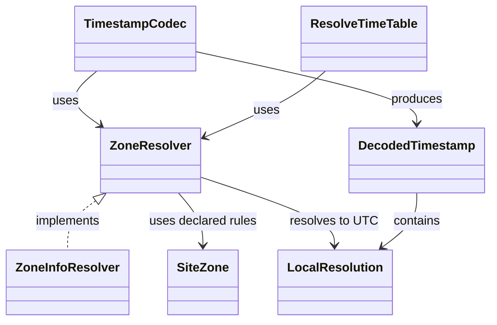

# Implementation plan · 001 · Time-series source: global time core

> Part of **Phase 4 · Specify** and approved with the spec at **G4**. The plan says *how* the build will proceed; the spec says *what* it must achieve.

## Approach

PBI-001-05 established the domain values, the `zoneinfo` adapter and `time-table`. Implement the
corrections in PBI-001-24 on one approved card branch, starting each step with the corresponding
acceptance tests. The domain and application remain independent of the CLI and IANA adapter.

## Context

| Source | What it contributes |
|---|---|
| [Requirements catalogue](../../docs/requirements/rt-catalog.yaml) | RT12 calls for UTC normalisation, retained source representation and known zone or offset, and flagged ambiguity. RT07 defines the three event times. |
| [Approved PRD](prd.md) | Six timestamp forms, exactness and declared site rules. |
| [Approved backlog](backlog.md) | Six marked acceptance criteria for PBI-001-24. |
| [Approved approach](ux-approach.md) | CLI input conventions and usage exit code. |
| [Validation](validation.md#functional-validation) | Reproductions of missing local decoding, precision loss, gap shifts and CLI range errors. |
| [ADR-0029](../../docs/architecture/decisions/0029-resolve-site-local-time-with-zoneinfo.md) | Explicit civil-time outcomes through a resolver port. |
| [Architecture](../../docs/architecture/README.md) and [component README](../../src/tssource/README.md) | Current package boundary and CLI entry point. |
| [Principles](../../harness/principles.md) and [security](../../harness/security.md) | Clean Architecture, typed values, input validation and safe errors. |
| [Timestamp forms](../../src/tssource/domain/time/representation.py), [time-table use case](../../src/tssource/application/time_table.py), [resolver](../../src/tssource/infrastructure/zoneinfo_resolver.py) | Current Python callers and layer boundaries. |
| [Python zoneinfo](https://docs.python.org/3/library/zoneinfo.html) and [IANA TZDB](https://www.iana.org/time-zones) | Civil-time rule sources collected for PBI-001-05 on 2026-11-13. |

## Steps

### PBI-001-05 · merged

1. Define site, resolution, and error value objects; table-test the five zone policies and DST cases. *(B01, B02)*
2. Add the `ZoneResolver` port and `ZoneInfoResolver`; prove gap/repeated detection by UTC round-trip. *(B01, B02)*
3. Add timestamp representations and decoded-value contracts; test exact and unresolved round trips. *(B03, B04)*
4. Add `ClockFault` and `EventTimes`; test UTC invariants and fault boundaries. *(B05)*
5. Wire `ResolveTimeTable` in `bootstrap.py`; add the Typer command and CLI integration tests. *(B06)*
6. Update component/architecture documentation, run `sdd verify 001`, and record G5 evidence. *(All)*

### PBI-001-24 · corrective card

7. Add AC1–AC2 tests, then centralise exact direct-form conversion in the domain. Retain the existing `encode_instant` and `decode_instant` signatures and supported exact values. Use their shared conversion logic to produce `DecodedTimestamp` for the application codec. Compute numeric units from UTC epoch deltas using days, seconds and microseconds. For numeric epoch inputs, retain exact values already accepted as `str`, `int` or `float` and validate their precision before constructing the datetime. For FILETIME, require non-negative integral ticks and an exact multiple of ten on decode. Report `FILETIME value cannot be represented at microsecond precision` for ticks between microseconds. *(B03)*
8. Add AC4–AC5 resolver tests. Store fixed offsets on `SiteZone` and bypass IANA lookup for those sites. For an IANA gap, derive UTC probes on opposite sides of the jump from the two fold offsets. Confirm they bracket the transition, then bisect in UTC at microsecond precision to find the first instant under the post-gap offset. Preserve the requested wall reading. Convert datetime overflows into a value error with a brief range diagnostic. *(B01, B02)*
9. Add AC3 application tests. Inject the existing `ZoneResolver` into `TimestampCodec`, with one reverse operation added to the port for UTC-to-local encoding. Delegate direct formats to the domain. For both local formats, require `SiteZone`, validate wall-time text in the domain, and dispatch to the resolver on decode. On encode, project UTC to the site's wall time first and enforce the form's precision. Wire the codec in bootstrap. *(B03, B04)*
10. Add AC6 CLI tests for malformed and impossible dates and for an out-of-range row at either end of datetime's range. Check ASCII `YYYY-MM-DD` before parsing the date. Complete the full table before writing stdout, and map syntax and range errors through the existing Typer usage path. For a UTC range failure, name the requested date and declared site and indicate how to choose a valid date. Example diagnostic: `The date 0001-01-01 is outside the supported UTC range for china. Choose a later date.` *(B06)*
11. Update the component and root READMEs, architecture page, ADR index and teaching guide. Run `poetry run sdd sync` and `poetry run sdd item verify 001 24`. Keep the RT07 and clock-fault regression tests in the suite. *(B01–B06)*

## Time contracts

| Form | Emitted value and precision | Decoded source metadata |
|---|---|---|
| `ISO_OFFSET` | ISO 8601 text in UTC, with `Z` and microsecond precision when needed. | The offset in the input, normalised to signed offset text. |
| `EPOCH_SECONDS` | Whole seconds since 1970-01-01T00:00:00Z. Signed integer. | `UTC`. |
| `EPOCH_MILLISECONDS` | Whole milliseconds since 1970-01-01T00:00:00Z. Signed integer. | `UTC`. |
| `FILETIME_TICKS` | Whole 100-nanosecond ticks since 1601-01-01T00:00:00Z. Non-negative integer, ten ticks per datetime microsecond. | `UTC`. |
| `ISO_LOCAL` | `YYYY-MM-DDTHH:MM:SS` with an optional fractional part of up to six digits. | The declared IANA zone name or fixed offset. |
| `LOCAL_TEXT` | `MM/DD/YYYY HH:MM:SS`, at whole-second precision. | The declared IANA zone name or fixed offset. |

| Contract | Rules |
|---|---|
| `DecodedTimestamp` | Retains the exact incoming `str`, `int` or `float`, its form, the known source reference and the resolution. For direct forms, the resolution is `ok` with one candidate. Its wall time uses the parsed ISO offset or UTC for numeric forms. |
| `LocalResolution` | Carries the requested naive wall time, status, UTC candidates in chronological order and an offset per candidate. `gap` carries one boundary candidate and its offset. `ambiguous` carries both candidates. |
| `SiteZone` | Brazil uses `America/Sao_Paulo`, the US Gulf Coast `America/Chicago`, and Belgium `Europe/Brussels`. China and India use `+08:00` and `+05:30` respectively. |
| `TimestampCodec` | `encode(instant, form, site=None)` returns `str` or `int`. `decode(value, form, site=None)` returns `DecodedTimestamp`. Both local forms require a declared site. Invalid, inexact or out-of-range conversions raise `ValueError`. |
| `EventTimes` | The three mandatory UTC-aware event times remain separate and clock faults retain their existing contract. |
| `time-table` | The existing options and four table columns remain. Success prints a header and 24 rows. Usage failure exits `2` with no table rows. |

## Design

Both use cases receive the resolver through bootstrap. `ZoneInfoResolver` owns the forward and
reverse zone conversions. The domain owns format parsing, exactness and immutable results.
The API adds an in-process result for callers. There is no file schema or database relation.

## Files to create or change

| Area | Card 24 files | Responsibility |
|---|---|---|
| Domain | `src/tssource/domain/time/{site_zone,representation}.py` | Declare site policies and convert forms exactly. |
| Application | `src/tssource/application/{time_table,timestamp_codec}.py` | Define the bidirectional site resolver port and coordinate codec calls. |
| Infrastructure | `src/tssource/infrastructure/zoneinfo_resolver.py` | Apply fixed offsets or IANA rules and find the exact gap boundary. |
| Interface and composition root | `src/tssource/bootstrap.py`, `src/tssource/interfaces/cli/app.py` | Wire the use cases and validate CLI input before writing the table. |
| Tests | `tests/tssource/domain/test_{site_zone,representation}.py`, `tests/tssource/test_timestamp_codec.py`, `tests/tssource/test_time_table.py` | Exercise AC1–AC6 and the normal entry points. |
| Documents | Root and component READMEs, `docs/architecture/README.md`, ADR-0030, teaching guide | Document approved site rules, precision limits and CLI usage. |

## Rollback

Revert the individual merged card commit. This work has no persistent output or external write;
the TZDB dependency already exists, so no data cleanup or dependency removal is necessary.

## Risks during the build

| Risk | Early signal | Response |
|---|---|---|
| Incorrect gap/repeated classification | A transition-table test disagrees with the expected UTC candidates. | Check the two UTC probes and verify that one microsecond before the reported boundary still uses the pre-gap offset. |
| Host/container TZDB differences | The same test differs locally and in the pinned image. | Pin/assert the `tzdata` version and investigate before approval. |
| Ambiguous local text gets coerced | A codec test yields one instant for a repeated hour. | Return both candidates in `LocalResolution`. |
| Numeric coercion silently rounds | An exact value fails to round-trip or a fractional tick is accepted. | Build integer microseconds before constructing the datetime and reject lossy numeric inputs. |
| Scope expands into event generation | A proposed file touches stream writers or acquisition. | Stop and open the relevant roadmap dossier instead. |
