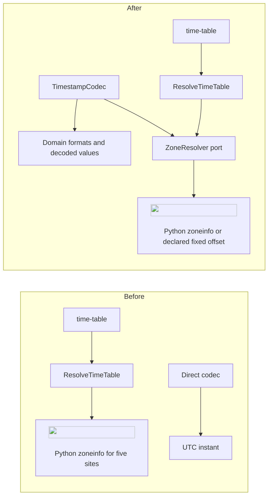

# Execution specification · 001 · Time-series source: global time core
## Context collected
| Source | Contribution |
|---|---|
| [Requirements and implementation context](plan.md#context) | RT07, RT12, approved artifacts, current time core, G6 findings, and existing architecture decisions. |
## Behaviour
| ID | EARS behaviour | RT / criteria |
|---|---|---|
| SPEC-001-B01 | When a declared local reading is unique or repeated, the resolver shall return `ok` with one UTC instant or `ambiguous` with both in UTC order. When skipped, it shall preserve the requested reading and return `gap` with the first valid UTC instant and its offset. | RT12 / 24 AC3–AC4 |
| SPEC-001-B02 | When resolving an in-range reading at China or India, the resolver shall use the site's declared fixed offset (`+08:00` or `+05:30`) for every date. Brazil, the US Gulf Coast and Belgium follow their declared IANA zones. | RT12 / 24 AC5 |
| SPEC-001-B03 | When decoding ISO-offset, epoch seconds, epoch milliseconds or FILETIME, the codec shall retain raw value, form and known offset or UTC reference, and recover each representable instant exactly. If a conversion would lose precision or exceed the format or datetime range, it shall return a value error. | RT12 / 24 AC1–AC2 |
| SPEC-001-B04 | When encoding or decoding ISO-local or local text, the codec shall require a declared site. Decode shall retain raw value, form, zone or fixed offset, and explicit resolution. Both UTC instants in a repeated hour shall encode to the same local value and decode to both candidates. | RT12 / 24 AC2–AC5 |
| SPEC-001-B05 | When an event is built, it shall retain separate UTC-aware occurrence, source-update, and reception times. When a clock fault is active, it shall alter the written occurrence time by the specified amount. | RT07 / 05 AC5 |
| SPEC-001-B06 | When `time-table` receives a declared site and a `YYYY-MM-DD` date whose entire table is in UTC range, it shall print the header and 24 local-hour rows with resolutions, offsets and candidates. If input or any row is invalid, it shall exit `2` with one usage diagnostic and no traceback or partial table. | RT12 / 24 AC6 |
## Architecture impact

The CLI and codec share site rules through `ZoneResolver`, wired by bootstrap. See the [affected files](plan.md#files-to-create-or-change).
## Contracts and data
| Contract | Shape, producer, consumer, version |
|---|---|
| [Time contracts](plan.md#time-contracts) | `DecodedTimestamp` retains source metadata and a `LocalResolution`. `EventTimes` keeps the three UTC fields. The CLI retains its options, table columns and exit codes. These are in-process values with no storage schema. |
## Design
| Layer | Design, pattern, SOLID reason |
|---|---|
| Domain | Frozen `SiteZone`, `LocalResolution` and `DecodedTimestamp` hold rules and results. Pure format conversion uses integer units. |
| [Application, adapter and CLI](plan.md#design) | `TimestampCodec` and `ResolveTimeTable` use the resolver port. The adapter owns zone rules. The CLI validates input and prints only complete results. |
## Security and threat model
| STRIDE | Threat, mitigation, verification |
|---|---|
| S | An arbitrary site identifier could pick an unintended zone. Accept declared sites only. Verify via unknown-site CLI and missing-site codec tests. |
| T | Timestamp rounding or a guessed fold could alter source meaning. Require exact units, retain raw metadata and check transitions against the locked dependency set. Verify AC1–AC5. |
| R | In-memory conversions make no auditable configuration or operator changes. Confirm in G6 review. |
| I | Invalid inputs could expose internals. Use short CLI diagnostics for syntax and UTC range failures. Verify AC6 and run secrets checks. |
| D | A skipped wall time could trigger excessive search. Use one date, 24 rows and bounded UTC bisection. Verify range tests and review the search bound. |
| E | The calculation introduces no privileged operations or new identities. Verify imports and review adapter and CLI calls at G6. |
## Validation plan
| Behaviour/RT | Evidence |
|---|---|
| B01–B02/RT12 | `test_site_zone.py`: Chicago's `2024-03-10 02:15:30.123456` resolves to `08:00:00Z`. Verify the old offset one microsecond before the transition. Cover Brussels, São Paulo and historical dates at both fixed-offset sites. |
| B03–B04/RT12 | `test_representation.py` and application codec tests: all six forms, raw metadata, exactness errors, both local folds, missing site, and gaps. |
| B05/RT07 | `test_event_times.py` and `test_clock_fault.py`: separate UTC times and fault boundaries. |
| B06/RT12 | `test_time_table.py`: 24 rows, gap output, invalid syntax, and both UTC range boundaries with the site and date in the diagnostic and empty stdout. |
## Architecture decisions
[ADR-0030](../../docs/architecture/decisions/0030-preserve-exact-timestamps-and-declared-site-rules.md) specifies exact conversion and declared site rules and refines [ADR-0029](../../docs/architecture/decisions/0029-resolve-site-local-time-with-zoneinfo.md).
## Documentation impact
Update `time-table` in the component and architecture READMEs, root README, and G6 teaching guide after build.
## Out of scope
Streams/files/contracts, stream-applied faults, leap seconds, and real plant access.
