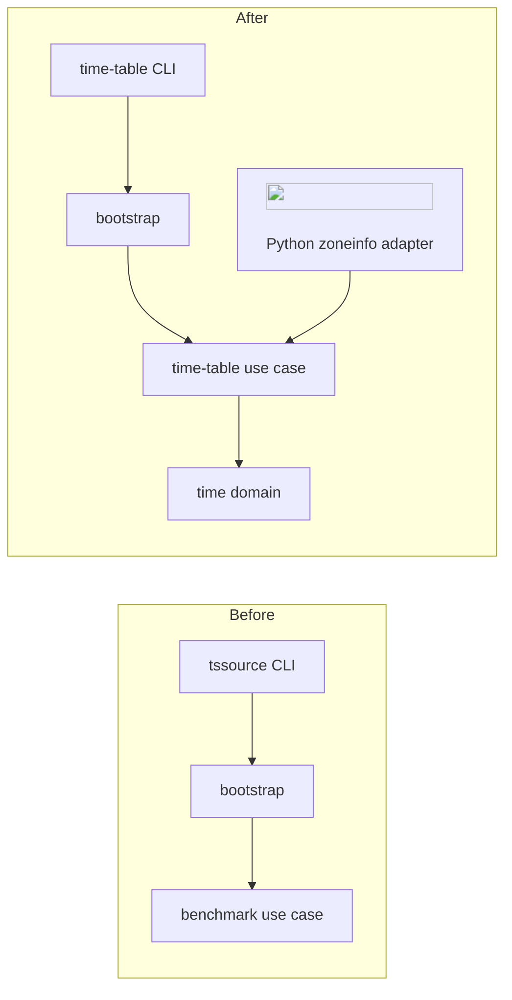

# Execution specification · 001 · Time-series source: global time core
## Context collected
| Source | Contribution |
|---|---|
| [RT07/RT12](../../docs/requirements/rt-catalog.yaml), [PRD](prd.md), [PBI-001-05](backlog.md), [approach](ux-approach.md), [principles](../../harness/principles.md), [security](../../harness/security.md), [ADR-0019](../../docs/architecture/decisions/0019-tssource-package-and-dependencies.md), [ADR-0020](../../docs/architecture/decisions/0020-deterministic-generation-and-simulated-reception-time.md), [ADR-0022](../../docs/architecture/decisions/0022-hidden-plant-and-site-local-time.md), [Python zoneinfo](https://docs.python.org/3/library/zoneinfo.html) and [IANA TZDB](https://www.iana.org/time-zones), accessed 2026-11-13 | Requirements, approved scope, layers/security, existing decisions, and authoritative civil-time rules. |
## Behaviour
| ID | EARS behaviour | RT |
|---|---|---|
| SPEC-001-B01-B02 | When a declared-site local time is valid, repeated, or skipped, the resolver shall return `ok` with one UTC instant, `ambiguous` with both, or `gap` with the first valid instant after the gap; Shanghai and Kolkata shall never be gap or ambiguous. | RT12 |
| SPEC-001-B03-B04 | When an instant is encoded in ISO-offset, ISO-local, epoch seconds, epoch milliseconds, local text, or FILETIME ticks, the codec shall preserve the original value and known zone/offset; five UTC/offset forms round-trip exactly, while local text requires a site zone and returns its resolution. | RT12 |
| SPEC-001-B05-B06 | When an event is built, it shall retain distinct UTC-aware occurrence, source-update, and reception times and an active fault shall alter written occurrence time exactly; when `tssource time-table --site CODE --date YYYY-MM-DD` runs, it shall print candidates/offsets/resolution and invalid input shall exit 2 without a traceback. | RT07, RT12 |
## Architecture impact

| Component/dependency | Change and reason |
|---|---|
| `domain/time/{site_zone,resolution,representation,clock_fault,event_times}.py`; `application/time_table.py`; `infrastructure/zoneinfo_resolver.py`; bootstrap; CLI; time tests | Add pure values, resolver port/adapter, command; use stdlib `zoneinfo` and existing `tzdata` only. |
## Contracts and data
| Contract | Shape, producer, consumer, version |
|---|---|
| `LocalResolution`; `DecodedTimestamp`; `EventTimes`; `time-table` | Status plus 0/1/2 UTC candidates and original value; codec; three mandatory UTC-aware fields; CLI `--site`/`--date`, exit 0/2; internal v1, additive only. |
## Design
| Layer | Design, pattern, SOLID reason |
|---|---|
| Domain | Frozen value objects `SiteZone`, `LocalResolution`, `ClockFault`, `EventTimes`, and pure codec keep illegal states out. |
| Application/infrastructure/interface | `ZoneResolver` Protocol plus `ZoneInfoResolver`, wired only by bootstrap, keeps TZDB mechanics outward and CLI validation at the boundary. |
## Security and threat model
| STRIDE | Threat, mitigation, verification |
|---|---|
| S | Forged site: whitelist `SiteCode`; invalid-site CLI test. |
| T | Altered rules: locked `tzdata`, original form/resolution retained; transition tests and lock review. |
| R | No mutable configuration or audit-relevant change; G6 review. |
| I | Error disclosure: one-line validated CLI errors; invalid-input test and `detect-secrets`. |
| D | Large request: one ISO date and five sites only; date-validation test. |
| E | Privilege: pure local calculation, no file/network/credential/industrial access; import and security review. |
## Validation plan
| Behaviour/RT | Evidence |
|---|---|
| B01-B02/RT12 | `test_site_zone.py`: Chicago 2026-03-08/11-01, Brussels 2026-03-29/10-25, São Paulo 2018/2019, fixed-offset sites. |
| B03-B04/RT12 | `test_representation.py`: six forms, five exact round trips, ambiguous local text unresolved. |
| B05/RT07 | `test_event_times.py` and `test_clock_fault.py`: separate UTC times and fault boundaries. |
| B06 | `test_time_table.py`: valid table, invalid options, output, exit code. |
| All | `poetry run sdd verify 001`, strict types, imports, secrets, and quality suite. |
## Architecture decisions
[ADR-0029](../../docs/architecture/decisions/0029-resolve-site-local-time-with-zoneinfo.md) is Proposed: use explicit `zoneinfo` outcomes.
## Documentation impact
Update `time-table` in the component and architecture READMEs, root README, and G6 teaching guide after build.
## Out of scope
Streams/files/contracts, stream-applied faults, leap seconds, and real plant access.
