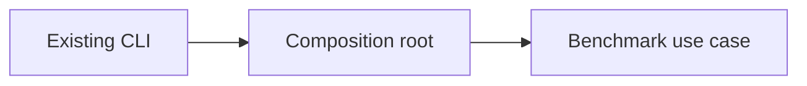
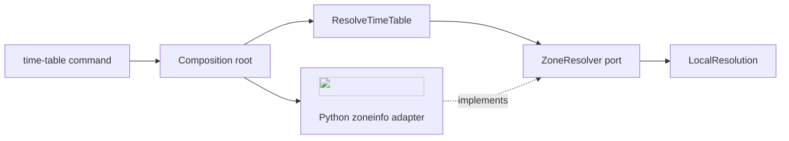
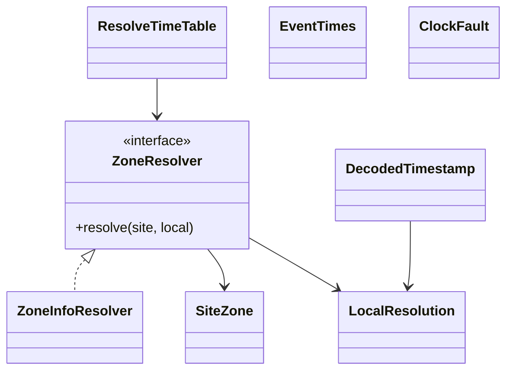
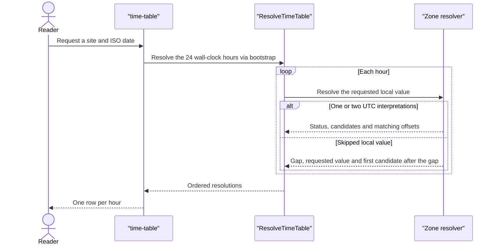

# Teaching guide · 001 · Time-series source: global time core

This chapter walks through the implementation merged in PR #24. The
[validation report](validation.md) records the gaps to close before G6.

## 1. The problem in plain words

A site's wall clock can show the same time twice when an offset decreases. When an offset
increases, the clock can skip a range of values. For example, Chicago showed `01:00` twice
on November 3, 2024. Either reading is plausible until the source provides an offset or
enough context to distinguish the two instants. An instant identifies a point on the UTC
timeline, whereas a local timestamp gives the clock reading as someone at the site saw it.

A corrected industrial measurement also needs three meanings for time. The measurement may
describe January 1, the source may correct it on February 1, and the data platform may receive
it on February 2. Collapsing those times loses the difference between when something happened
and when a consumer could have known about it.

## 2. Requirements served

**RT07** preserves occurrence, source-update and reception separately. `EventTimes` models all
three as UTC datetimes. `ClockFault` models a bad instrument clock by shifting the written
occurrence value when the caller applies the fault. The event model tests use separate values
and the validation report walks through the corrected-record example.

**RT12** asks for UTC standardisation, preservation of the source representation and known
offset or zone, and an ambiguity flag. `LocalResolution` supplies the requested wall time,
status, candidates and offsets. The codec currently supplies four conversions to or from a
UTC instant. The remaining local conversions and source metadata retention are open findings.

## 3. Architecture before and after



The CLI already used the composition root to assemble a benchmark from its ports and adapters.



The new command accepts a site and date. Bootstrap selects the site and supplies the resolver
to the application. The use case iterates the wall-clock hours and depends on its own port.
The adapter uses installed IANA rules and returns domain values the interface can format.

## 4. Decisions and the alternatives that lost

| Decision | Options considered | Trade-off |
| --- | --- | --- |
| Keep explicit civil-time outcomes. [ADR-0029](../../docs/architecture/decisions/0029-resolve-site-local-time-with-zoneinfo.md) | Default fold, reject unusual times, add a timezone library, or use the standard-library adapter. | An explicit result keeps the ambiguity and needs no new dependency. Callers must inspect status before using a candidate. |
| Proposed for PBI-001-24. Preserve source metadata and apply each site's declared clock rules. [ADR-0030](../../docs/architecture/decisions/0030-preserve-exact-timestamps-and-declared-site-rules.md) | Rounded numeric conversions and IANA histories at all five sites. | Exact conversion prevents shifts during round trips. Explicit fixed offsets keep historical fixtures consistent with the two sites' declarations. |
| Keep the source's site-local representation for later ingestion. [ADR-0022](../../docs/architecture/decisions/0022-hidden-plant-and-site-local-time.md) | Add a UTC helper to every external event or require the consumer to interpret the raw time. | Raw time supports the RT12 exercise. The consumer needs access to the declared source policy. |
| Model reception independently from execution wall time. [ADR-0020](../../docs/architecture/decisions/0020-deterministic-generation-and-simulated-reception-time.md) | Use the live clock or model reception and measure execution with a separate probe. | A model gives reproducible inputs across modes. Real delay requires separate measurement. |

The component already used the package layout and dependency group described in
[ADR-0019](../../docs/architecture/decisions/0019-tssource-package-and-dependencies.md).

## 5. The design: layers, classes and patterns



The domain value objects carry the rules. `SiteZone` binds the site's code to its civil zone.
`LocalResolution` checks the input is naive, candidates are UTC, and each candidate has an
offset. `DecodedTimestamp` defines a record for the source value, format and resolution.
`EventTimes` validates the time basis of its three values. `ClockFault.apply` returns a shifted
value with an optional activation instant and whole-day drift.

The port is a narrow protocol with a single method. It gives the application dependency
inversion and interface segregation: the use case can accept any resolver that honours the
contract. A substitute must preserve the resolution semantics and candidate ordering. That is
the Liskov substitution obligation. Single responsibility keeps timezone classification with
the adapter and output formatting with the interface. The port also lets a different rule
provider be wired in without editing the 24-hour use case, which illustrates open/closed design.

## 6. How it behaves at runtime



The adapter tries the two possible fold values. Each possible UTC instant must convert back to
the original wall reading. Deduplicating a normal hour leaves one candidate, while a repeated
hour leaves two ordered UTC candidates. For a skipped hour, the current adapter advances in
minute steps until it finds a candidate. The validation report shows where that approximation
misses the real transition boundary. An invalid site or unparseable date produces a usage error
before any table is printed.

## 7. Data and contracts

These are in-memory value objects and console output. The card introduces no storage schema.

| Contract | Invariant or limit |
| --- | --- |
| `SiteZone` | The command resolves one of five declared site codes. |
| `LocalResolution` | Keeps the requested naive local reading, a status, UTC candidates, and matching offsets. For a gap, an accompanying candidate describes recovery after the gap. |
| `DecodedTimestamp` | Models the source value, form, known zone or offset, and resolution. Decode functions currently return a bare UTC instant for four forms. |
| `EventTimes` | Occurrence, source-update, and reception are separate fields with explicit UTC. Equal instants can still have different roles. |
| `ClockFault` | Before start the occurrence is unchanged. At and after start the configured offset and elapsed whole-day drift are applied. Without a start the method applies the constant offset. |
| `time-table` | An accepted ordinary date returns 24 rows, including one row per local hour even on a transition day. The intended date syntax is `YYYY-MM-DD`. |

## 8. Code tour

1. Read [site_zone.py](../../src/tssource/domain/time/site_zone.py) and
   [resolution.py](../../src/tssource/domain/time/resolution.py) for the inputs and invariants.
2. Read [zoneinfo_resolver.py](../../src/tssource/infrastructure/zoneinfo_resolver.py). The
   round-trip is the decisive check:

   ```python
   candidate = local.replace(tzinfo=zone, fold=fold).astimezone(UTC)
   if candidate.astimezone(zone).replace(tzinfo=None) == local:
       values.add(candidate)
   ```

   Attaching a zone creates a possible reading. Converting back tests whether the reading
   exists under that zone's rules.
3. Read [time_table.py](../../src/tssource/application/time_table.py),
   [bootstrap.py](../../src/tssource/bootstrap.py) and
   [app.py](../../src/tssource/interfaces/cli/app.py) in that order. Follow one row from hour
   construction through dependency wiring to text rendering.
4. Read [representation.py](../../src/tssource/domain/time/representation.py) for the encoding
   helpers, then [event_times.py](../../src/tssource/domain/time/event_times.py) and
   [clock_fault.py](../../src/tssource/domain/time/clock_fault.py) for the source-time model.

## 9. Security

The site enum restricts input to declared sites and the use case bounds the result to one date.
The date parser and the offset conversion together define the actual input boundary. An
extreme date demonstrated a traceback in the merged CLI, so the date-error behavior is still
under review. Running the diagnostic uses installed zone rules and reads no plant data.
See the [STRIDE verification](validation.md#security-review) for each threat in the spec.

## 10. How we tested it

Marked unit tests cover selected Chicago and Brussels transitions, four timestamp conversions
at a whole-second sample, the event-time invariant and a drift example. The Typer test runner
checks the rendered row count, gap output and unknown-site behavior. Independent validation
also used the installed entry point, an actual zone adapter and synthetic corrected-event
times. The component suite passed 53 tests. The exploratory probes showed why a marked test
can run successfully while an acceptance criterion remains incompletely covered.

## 11. Run it yourself

Run the commands from the repository root with the component's Poetry dependencies installed.

```bash
poetry run tssource time-table --site us-gulf-coast --date 2024-03-10
poetry run tssource time-table --site us-gulf-coast --date 2024-11-03
poetry run tssource time-table --site india --date 2024-11-03
poetry run pytest -q tests/tssource/domain/test_site_zone.py tests/tssource/test_time_table.py --no-cov
```

On the spring table, find `02:00` marked `gap` and compare its reported UTC instant with
`03:00`. On the fall table, find `01:00` marked `ambiguous` with `06:00Z` and `07:00Z`.
Compare the same date in India to see an ordinary observed day.

## 12. Pitfalls and what we would do differently

A one-minute probe preserves the input's seconds, so it can land beyond the actual gap
boundary. A whole-second fixture cannot reveal a loss of fractional precision. Similarly,
testing the resolver with a parsed datetime does not prove the decoder can read the original
text. The next implementation should pin down precision and historical-date policies,
exercise their boundaries and assert source metadata through the actual codec.

## 13. Questions for the mentee

1. Why can two UTC instants both round-trip to the same Chicago local value?
2. Why can the gap row and the next ordinary row display the same UTC instant?
3. Which timestamp would you compare against feature availability for a corrected record?
4. Which object would change if a site reported clock drift, and which event fields would stay intact?
5. Which extra input makes a local timestamp resolvable, and when is it still ambiguous?
6. Where would you substitute a fake resolver to test the 24-row iteration independently of zone rules?

## 14. Glossary

| Term | Meaning |
| --- | --- |
| Civil time | The clock reading under a site's calendar and time-zone rules. |
| Daylight-saving gap | Local clock readings skipped when the offset moves forward. |
| FILETIME tick | A 100-nanosecond unit from the Windows epoch of January 1, 1601 UTC. |
| Fold | A selector for the earlier or later occurrence of a repeated local reading. |
| Naive datetime | A datetime with no time-zone information attached. |
| Offset | The difference between local clock time and UTC at an instant. |
| Reception time | When the receiving system obtained the record. |
| Source-update time | When the source last changed the record. |
| TZDB | IANA's database of civil-time rules. |
| UTC | Coordinated Universal Time, the common reference for the internal instants. |
