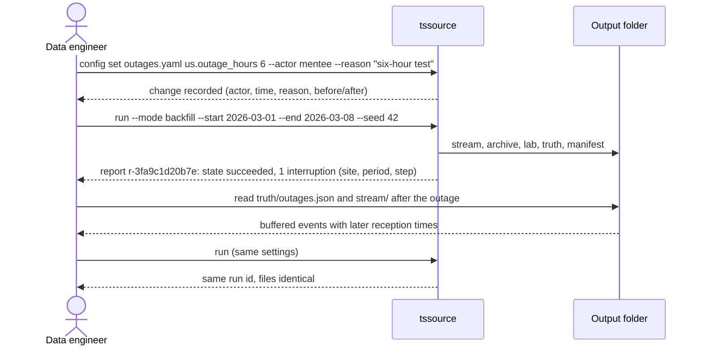
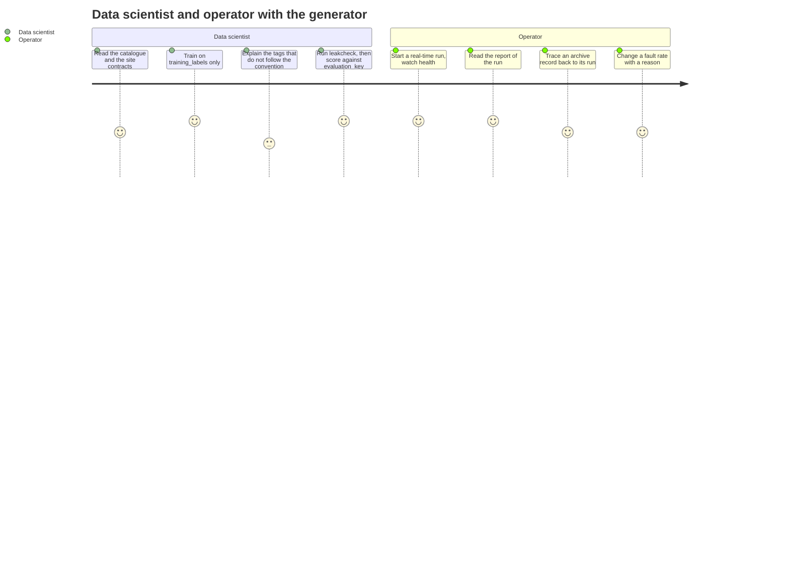

# Approach · 001 · Time-series source: global plant data generator

> **Phase 3 · Structure**, closed by **G3 · Approach approved** (both of us approve).
> In a data platform the "user experience" is often an API, a command line, a dataset or a
> dashboard: *how a person or a system meets what we build*. How to fill this file:
> [lifecycle, phase 3](../../harness/lifecycle.md#phase-3-structure).

Everything here is simulated: Orion Chemicals, its sites, tags and data are fictional. Command
names, option names and field names are the **approach** we agree now; the specification (G4)
fixes them exactly, and a change to one of them there is proposed to us first.

## Is a prototype needed?

**No.** The generator has no screen. People and programs meet it in three ways, and each one
follows a convention that already exists, so there is nothing about *how people will use it* that
we are unsure of:

- **A command line**, built the way the `sdd` command line already is (Typer, `--help` on every
  command, a short message that says what to do next, documented exit codes). We keep the same
  habits so that a person who knows `sdd` knows `tssource`.
- **A folder of files** (the dataset). Its shape is the real interface, and we settle it in this
  file as field tables, below, not as code. It follows what a historian export looks like, which
  is what the later ingestion has to read.
- **A container** started with Docker Compose, like the documentation site already is.

What we are unsure of is not the interface but the *numbers* (rates, delays, fault shares). Those
are measured by the throughput spike (PBI-001-04) and the trial (PBI-001-21), and a prototype of
the interface would not tell us anything about them.

## Interface approach

### Who meets what

| Who | Meets | Main interactions |
|---|---|---|
| **Data engineer** (building ingestion) | the output folder, the per-site contract, `run` | start a run with a seed; read the contract of a site; point an extraction job at `stream/`; replay an outage |
| **Data scientist** (contextualisation model) | `catalog/`, `stream/`, `lab/`, and `truth/` kept apart | train on the catalogue and the signals; score the result against `truth/`; run `leakcheck` to be sure nothing leaks |
| **Reliability or platform engineer** | `run`, `report`, `trial` | backfill a past period; read what faults were injected; measure rates and delay |
| **Data steward and operator** (the mentor) | `report`, `trace`, `config`, `health`, logs | see if a run is healthy; walk a record back to its run; change a rule and read who changed it |

### The command line (proposed surface)

One program, `tssource`, with these commands. The right column is the backlog item that delivers
each one.

| Command | What a person does with it | Item |
|---|---|---|
| `tssource run` | start a run: `--mode realtime\|backfill`, `--start`, `--end`, `--speed`, `--seed`, `--output-dir`, `--retain-days` | 03, then 11 to 15 |
| `tssource time-table` | show how one local time resolves to UTC at a site (gap, ambiguous, ok) | 05 |
| `tssource leakcheck <folder>` | prove nothing from `truth/` appears elsewhere | 08 |
| `tssource trace <file> <record>` | walk an archive record back to its stream events and its run | 17 |
| `tssource config set\|history\|show` | change a rule with an actor and a reason, read the history, show the configuration at a time | 18 |
| `tssource report <run_id>` | read the outcome of a run | 19 |
| `tssource health` | exit 0 when the run is alive (used by the container health check) | 19 |
| `tssource bench` | measure throughput quickly (spike) | 04 |
| `tssource trial` | the full throughput and sizing trial | 21 |

Rules of the command line:

- **Non-interactive.** `run` never asks a question: it runs in a container. Only the commands of
  the harness (`sdd approve`) prompt, and they are not part of this tool.
- **Messages say what to do next.** An error names the cause and the way out, for example
  "config file `faults.yaml` was changed without an audit entry: run `tssource config set` or
  restore the file".
- **Exit codes are a contract**, shown by `--help` and tested: 0 ok; 1 a check found a problem
  (leak found, unhealthy, not implemented yet); 2 invalid input; 3 below the throughput floor;
  4 unaudited configuration change; 5 partial run; 6 failed run; 7 interrupted run; 8 empty run.
- **Two forms of every report:** a Markdown page for people and a JSON file for programs. Logs
  are JSON lines on standard output and always carry the run id.
- **Safe by default:** writes only inside the output folder; no network; no credentials.

### The dataset (what a consumer reads)

```text
data/ts_source/
├── catalog/
│   ├── tags.parquet                  one row per tag, as the site publishes it
│   └── contracts/<site>.md|.json     one contract per site
├── stream/<site>/<yyyy-mm-dd>/<hh>/<seq>.jsonl.gz   events after the exception test, in small segments
│   └── (and <hh>/.done  written when the hour will receive no more segments)
├── archive/<site>/<yyyy-mm-dd>.parquet           compressed history of a closed day, with source_event_ids
├── lab/<site>/<yyyy-mm-dd>.jsonl.gz              laboratory results
├── runs/<run_id>/manifest.json       what produced these files
├── reports/<run_id>.md|.json         the outcome of the run
├── metrics/                          metrics and the heartbeat
├── audit/audit.jsonl                 changes to configuration
└── truth/                            the answers: plant, training_labels, evaluation_key, split, faults, outages, clock faults
```

Four rules make this folder a usable interface:

1. **Nothing is half written, and nothing waits for the end of the hour.** The stream is written
   in small **segments** (closed every few seconds, a setting) so a consumer can read data within
   the delay target of the PRD. A segment appears under its final name only when complete and
   never changes afterwards. Segment numbers inside an hour have no gaps (`000001`, `000002`...),
   so a consumer can see that one is missing. When the hour will receive no more segments, the
   generator writes `.done`, which holds the final segment count. A consumer that ignores
   `.done` can read all the segments it sees, but must not call the hour complete before the
   marker exists. The archive is history: a day file appears when the day is closed, so the delay
   target is measured on the stream, not on the archive.
2. **`truth/` is the only place with answers, and it is split in two.** A consumer who never
   opens `truth/` never sees the plant structure. Inside `truth/`, `training_labels.parquet` holds
   the answers a model may learn from (convention-following tags of the training sites only), and
   `evaluation_key.parquet` holds the answers it is scored against (the remaining tags: dialect
   and ad hoc tags, and every tag of the hold-out site). `split.json` names the hold-out site and
   the rule, so nobody trains on test answers by accident. The full plant (`plant.json`) is for
   the final scoring of structure, not for training.
3. **Each site writes time its own way** (decision of the PRD): the three timestamps of an event
   are in the representation declared by the site's contract, with no UTC helper field. Turning
   them into UTC is the platform's job (RT12), and giving a ready-made answer would remove the
   exercise. If the first ingestion finds this too hard, we build the fix then, as part of the
   learning (decision of the mentor, 2026-11-05).
4. **Every file says it is synthetic data of a fictional company.**

### What a record looks like (field tables, names proposed)

**Stream event** (`stream/`, one JSON object per line):

| Field | Meaning |
|---|---|
| `run_id`, `event_id` | the run, and the stable id of the event (a duplicate delivery repeats the same id) |
| `site` | site code |
| `tag` | the tag name as the site publishes it (not unique across sites) |
| `value` | a number, or text for digital states (for example `Bad Input`) |
| `quality` | `Good`, `Uncertain` or `Bad`, with `quality_reason` when not Good |
| `t_occurrence`, `t_source_update`, `t_reception` | the three timestamps (RT07), in the site's representation |

**Archive record** (`archive/`): the same fields, plus `source_event_ids` (the stream events that
justify the stored point).

**Lab result** (`lab/`): `site`, `tag`, `sample_id`, `value`, `quality`, `run_id`, `event_id`
and the same three timestamps of RT07, with the names a laboratory would use:
`t_sample` is the *occurrence* (when the sample was taken), `t_result` is the *source update*
(when the laboratory validated and stored the result, often hours later) and `t_reception` is
when our service handled it. A correction repeats the `event_id` with a later `t_result`.

**Catalogue row** (`catalog/tags.parquet`): `site`, `tag`, `descriptor` (English or Portuguese,
sometimes empty), `unit` (as the site spells it, sometimes empty), `data_type`, `scan_class`,
`generator` (the synthetic marker). It carries no equipment, area, loop, tier or surrogate id.

**Site contract** (`catalog/contracts/<site>`): owner, interface, fields, identifier rule
(site code + published name), time reference and representation, extraction limits, the list of
scan classes with their periods, history available, quality codes.

### Scenario journeys, from the user's side

The scenario of the data engineer: interrupt a link for six hours and check the recovery (RT23).



The scenario of the data scientist, and the one of the operator:



## Prototype (optional)

Not needed (see the first section).

## How we validate the approach

Before the specification, **a walk-through between us** of the four scenarios of the PRD, using
this file only:

1. *Data engineer, six-hour interruption:* can we say, from the commands and the folder, how to
   start the run, find the interruption and see the recovered period?
2. *Data scientist:* can we say what to train on (`training_labels`), what to score against
   (`evaluation_key`), what stays hidden, and how to check that nothing leaks?
3. *Reliability engineer:* can we say how to get a past period with known faults and where the
   fault labels are?
4. *Operator:* can we say how to know a run is healthy, which run made a file, and who changed a
   rule?

If any answer needs something not written here, we correct this file and ask again. The field
tables are then checked once more by the specification, and the first real files (PBI-001-11 to
15) are read against them at the end of the dossier, when the real output exists.
