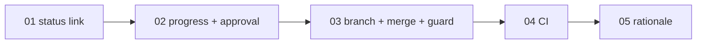

# Backlog · 002 · Harness: item-by-item flow and CI

> **Phase 2 · Plan**, closed by **G2 · Backlog approved** (both of us approve).
> Cards are slices of the umbrella backlog [001](../001-timeseries-source/backlog.md) (its cards 01, 22 split in two, 23, 02), shortened.
> All work is in `tools/sdd` (clean architecture, `harness/principles.md`); tests in `tests/sdd/`.

## Epics

| Epic | Outcome | PRD goal |
|---|---|---|
| E1 · A harness that builds big backlogs safely | one card, one branch, one approval, one pull request; merge blocked unless the checks pass | goals 1 to 4 |

## Features

| Feature | What a user can do | Cards |
|---|---|---|
| F1 Clean new dossiers | create a dossier whose `sdd check` passes and that always states its rationale | 01, 05 |
| F2 Item flow | approve, build, verify and merge a backlog one card at a time | 02, 03 |
| F3 Merge control | have every pull request blocked unless the CI is green | 04 |

## Work items

Order: 01, 02, 03, 04, 05 (01 unblocks commits; 02 and 03 install the flow; 04 the CI; 05 follows the new flow). G2 approves all five cards now, because they are short.

### PBI-002-01 · Status table links the teaching guide only when it exists

- **Feature:** F1 · **Serves:** none directly (repair) · **Size:** S · **Depends on:** none
- **Context:** `sdd sync` links `<folder>/teaching-guide.md` for every dossier, but ADR-0018 creates it only at G4, so `sdd check` reports a broken link and pre-commit blocks commits.
- **What:** the Guide column links the file only if it exists, else shows `not yet`.
- **How:** add `has_teaching_guide: bool` to `DossierReport` (`application/use_cases/evaluate_dossier.py`), filled via `DossierRepository.read_artifact` (returns `None` if missing); `application/generators/status.py` reads it and stays pure; run `sdd sync`.
- **Out of scope:** when ADR-0018 creates the guide.
- **Acceptance criteria (EARS):**
  - AC1: Where a dossier folder contains `teaching-guide.md`, the status table shall link it.
  - AC2: If it does not, then the Guide column shall show `not yet` and no link.
  - AC3: When `sdd sync` runs for a dossier at G1, `sdd check` shall report no broken link.
- **Verification:** `tests/sdd/test_docs_and_sync.py`, `tests/sdd/test_cli.py`; `poetry run pytest tests/sdd -q`, `sdd check`.

### PBI-002-02 · Per-card progress, approval and verification

- **Feature:** F2 · **Serves:** RT38, RT42 · **Size:** M · **Depends on:** 01
- **Context:** G2 approves a whole backlog and G5 means "all code passes". We want each card approved on its own digest and proven by its own tests.
- **What:** `specs/<id>-<slug>/progress.yaml` (written only by `sdd`) holds per card: state (`outline`, `refined`, `approved`, `building`, `verified`, `pr-open`, `merged`), approvals bound to the digest of that card's section, branch, commit, pull request, merge time. Commands: `sdd item status|verify <id> [nn]`, and a per-card form of the approve command for people.
- **How:** (1) `domain/item_progress.py` (`ItemState`, `ItemRecord`, `ItemProgress` with allowed transitions) and `card_digest.py` (hash of a `### PBI-...` section). (2) use cases `ApproveItem`, `VerifyItem`; ports `ProgressRepository`, `AcStatusReader`; adapter `yaml_progress_repository.py`; CLI group `item`. (3) marker `@pytest.mark.ac("PBI-<id>-<nn>:ACn")`; `verify` fails if an AC has no passing marked test, then runs `harness/checks.yaml`. (4) G2 digest = backlog without card bodies plus the first card; G5 = every card `merged`; dossiers without `progress.yaml` keep the old rules.
- **Out of scope:** git, branches, the commit guard (card 03).
- **Acceptance criteria (EARS):**
  - AC1: If a card is not approved by both members for its current digest, then `item verify` shall refuse work on it.
  - AC2: When a card's section changes, its approvals shall become stale and other cards' shall not.
  - AC3: If an AC has no marked test or a marked test fails, then `item verify` shall fail and list it.
  - AC4: When every card is `merged`, G5 shall show passed; a dossier without `progress.yaml` shall keep the old rules.
- **Verification:** `tests/sdd/test_item_progress.py`, `test_item_use_cases.py`, `test_cli_items.py`.

### PBI-002-03 · Item flow: branch, merge and commit guard

- **Feature:** F2 · **Serves:** RT38, RT42 · **Size:** M · **Depends on:** 02
- **Context:** with progress recorded, the harness must create each card's branch from an updated `main`, record the merge only when git confirms it, and refuse governed changes outside an approved card.
- **What:** `sdd item next <id>` and `sdd item merged <id> <nn>`; the commit guard accepts governed files on `feat/<id>-<nn>-<slug>` only if G4 passed and the card is `approved`.
- **How:** (1) port `GitRepository` and adapter `git_cli_repository.py` (argument lists, no shell, never `-D`, `--force` or `gh pr merge`). (2) use cases `NextItem` (fetch, switch to `main`, fast-forward, list then safe-delete merged local branches, create branch) and `MarkItemMerged` (commit contained in `origin/main`). (3) `guard_commit.py` item-branch rule and stale-spec rule. (4) update AGENTS.md, lifecycle, gates, how-it-works, skills (new `sdd-next-item`), ADR-0023, then `sdd sync`.
- **Out of scope:** merging (a person); GitHub settings. Agent guard rules are added by us.
- **Acceptance criteria (EARS):**
  - AC1: When `sdd item next` runs, the previous card is `merged`, the tree is clean and the remote reachable, it shall sync `main`, delete the other merged local branches and create the next card's branch.
  - AC2: If the previous card is not `merged`, the tree is dirty or a local branch is unmerged, then it shall change nothing and exit non-zero naming the reason.
  - AC3: If `item merged` finds the recorded commit not in `origin/main`, then it shall refuse and keep `pr-open`.
  - AC4: The tool shall never run `git branch -D`, `git push --force` or `gh pr merge`.
  - AC5: If a card is not approved for its current digest, then the commit guard shall refuse governed changes on its branch.
  - AC6: If the spec is stale, then `item verify` and the commit guard shall refuse governed changes on item branches.
- **Verification:** `tests/sdd/test_git_cli_repository.py` (temporary repository with bare remote), `test_item_use_cases.py`, `test_guard_commit_items.py`.

### PBI-002-04 · CI with GitHub Actions that blocks merging

- **Feature:** F3 · **Serves:** RT42, RT36 · **Size:** M · **Depends on:** 03
- **Context:** ADR-0004 chose local enforcement; there is now a remote and an agent opens pull requests, so a skippable local check is not a control.
- **What:** `.github/workflows/ci.yml`: one required job `quality` on pull requests into `main` and pushes to `main`, one step per command of `harness/checks.yaml`, plus the item verification read-only. `permissions: contents: read`, no secret, timeout, Poetry cache, concurrency cancel, actions pinned to full SHAs. The card prints a branch-protection checklist for a person to apply.
- **How:** (1) workflow as above (Python 3.11, pinned Poetry). (2) a test reads `checks.yaml` and fails if a command is missing. (3) `sdd verify --no-record` (use case `verify_quality.py`); `sdd item current` prints `<id> <nn>` from a card branch name and fails on any other branch; CI runs the item verification only when it succeeds. (4) add `.github/` to governed paths (`domain/governance.py`). (5) ADR-0024 accepted, ADR-0004 superseded; update quality.md, security.md, deployment.md, README.
- **Out of scope:** deployment, self-hosted runners; applying protection settings.
- **Acceptance criteria (EARS):**
  - AC1: When a pull request opens into `main`, the workflow shall run the job `quality`.
  - AC2: If any `checks.yaml` command fails, then `quality` shall fail.
  - AC3: The workflow shall have a step for every `checks.yaml` command, and a test shall fail when one is missing.
  - AC4: The workflow shall declare `permissions: contents: read`, use no secret and pin third-party actions to SHAs.
  - AC5: When a rule-breaking change is pushed, the check shall turn red and, with protection applied, block the merge; after the fix it shall turn green.
  - AC6: When `sdd verify --no-record` runs, it shall not modify `dossier.yaml`.
  - AC7: When the branch is not a card branch, the item verification step shall be skipped, not failed.
- **Verification:** `tests/sdd/test_ci_workflow.py` (AC1 to AC4), `test_cli.py` (AC6, AC7); AC5 is a manual proof by us on the first pull request, recorded in `validation.md`.

### PBI-002-05 · A rationale is required for every dossier

- **Feature:** F1 · **Serves:** none directly (repair) · **Size:** S · **Depends on:** 04
- **Context:** only enablers and out-of-catalogue work needed a rationale, so dossier 001 started with none. Dossiers 000, 001 and 002 already have one, so G0 of the existing dossiers does not change.
- **What:** `sdd new` without a rationale fails with exit 2 and creates nothing; G0 fails for an empty rationale, whatever the kind.
- **How:**
  - `domain/dossier.py`: remove `needs_rationale` (always true); `outside_catalogue` stays, it is used elsewhere.
  - `application/evidence.py`: one message replaces `_MISSING_RATIONALE`; G0 checks every dossier.
  - `create_dossier.py`: `NewDossier.rationale` has no default; a blank one raises `InvalidDossierError` before anything is written.
  - `interfaces/cli/app.py`: `--rationale` is required and its help says so.
  - Test fixtures that build dossiers or call `sdd new` without a rationale get one.
  - Docs saying "mandatory for enablers": `CONTRIBUTING.md`, `harness/gates.md`, `lifecycle.md`, `how-it-works.md`, `docs/tutorials/first-feature.md`, `docs/learn/glossary.md`, skill `sdd-start` (then `sdd sync`); ADR-0025 records the change to ADR-0014.
- **Out of scope:** judging rationale quality; changing old dossiers.
- **Acceptance criteria (EARS):**
  - AC1: If `sdd new` is called without a rationale, or with a blank one, then it shall create nothing and exit 2.
  - AC2: If the rationale of any dossier is empty or whitespace, then G0 shall fail with "a dossier must state its rationale in dossier.yaml".
  - AC3: When a dossier has a rationale and valid RTs, G0 shall pass.
  - AC4: The `sdd new --help` text shall say the rationale is mandatory.
- **Verification:** `tests/sdd/test_domain.py`, `test_use_cases.py`, `test_cli.py`; `sdd check` on the three existing dossiers.

## Order and dependencies

Risk first, then dependencies: 01 unblocks commits; 02 and 03 install the flow every later dossier uses; 04 protects `main`; 05 is a small correction that follows the new flow.

## Definition of done

Standard (tests, G5, documentation upkeep, teaching guide). From card 02 on, each card is built on its own branch and merged by a person before the next.
