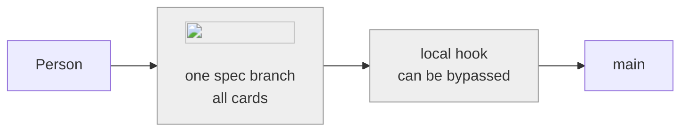
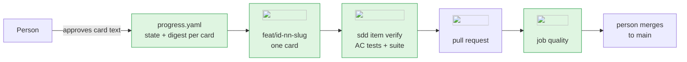
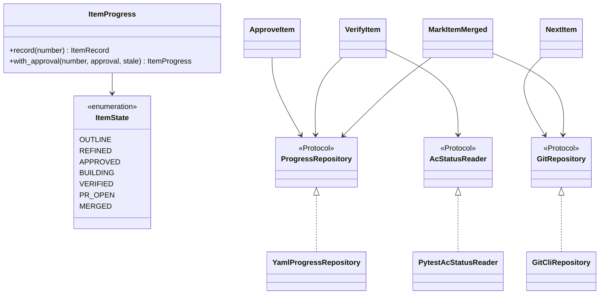
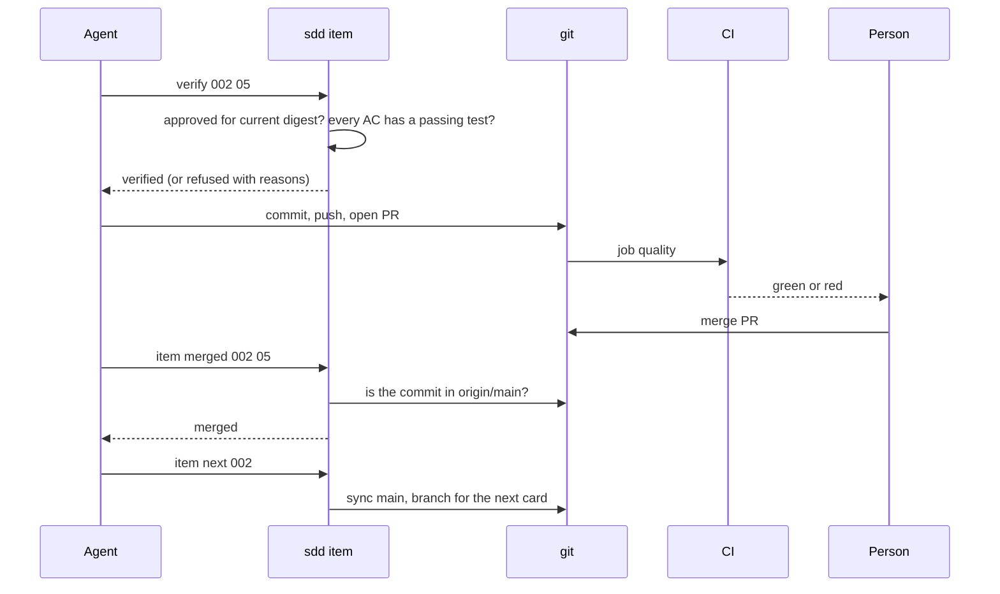

# Teaching guide · 002 · Harness: item-by-item flow and CI

> The didactic record of this dossier: **every decision, with its justification**, from the
> architecture down to the classes. It is written for the mentee who was not in the room,
> reads in order, and is approved at **G6** together with `validation.md`. Rules:
> [documentation standard](../../harness/documentation-standard.md#the-teaching-guide).
> Diagrams are Mermaid; every tool node carries its official logo.

## 1. The problem in plain words

Our harness (`sdd`) makes work pass **gates**: a *gate* is a checkpoint that two people approve
before the next phase starts. A *dossier* is the folder `specs/<id>-<slug>/` with every document
of one piece of work. Until this dossier, gate G2 approved the **whole backlog** (the list of
work items, called *cards*) in one go, and all the code of a dossier lived on one branch.

For a dossier with 23 cards that is a bad deal. A single review covers weeks of work, nobody sees
progress, and the later cards are frozen before the earlier ones teach us anything. Also, our only
control against unchecked changes was a local hook, and a local hook can be bypassed by whoever
commits, or be absent in another clone.

This dossier changes three things. **(1)** A backlog is approved and built **one card at a time**,
each on its own branch and pull request (PR), with a small record file, `progress.yaml`, that says
where each card is. **(2)** A **CI pipeline** (continuous integration: a server that runs the same
checks on every PR) reports the result where everybody sees it. **(3)** Every dossier must say
**why** it exists (its *rationale*), not only those outside the requirements catalogue.

## 2. Requirements served

- **RT42, a pipeline that blocks bad changes.** It asks that a failing check stops a change from
  reaching `main`. For Orion Chemicals (a fictional company) that is what keeps a broken data
  pipeline from being shipped. We satisfy it **partly**: the job `quality` runs every check
  (B05, `tests/sdd/test_ci_workflow.py`) and `sdd item verify` refuses unproved cards (B02), but
  GitHub's *branch protection*, the part that disables the Merge button, is not available on a
  free private repository. Today the block is our discipline (see section 12).
- **RT38, every approval records who, when and what.** Approvals are bound to the digest of the
  card's own text and stored with the card (B02, B03, B04, B06), so the record per card is
  traceable. See the [traceability matrix](../../docs/requirements/traceability.md).
- **RT36, no secrets.** The workflow has read-only permissions and uses no secret (B05).

## 3. Architecture before and after





Before, one long branch and a hook that could be bypassed. After, each card has its own branch,
its own approval and its own PR. `progress.yaml` is the new box: it holds the state of every
card and the digest each approval was given for. `sdd item verify` refuses a card whose text
changed after approval. The CI job reports the same checks on a server the author does not
control. The last arrow stays human on purpose: the agent never merges.

## 4. Decisions and the alternatives that lost

### 4.1 One card, one branch, one approval ([ADR-0023](../../docs/architecture/decisions/0023-item-by-item-build-flow.md))

| Option | Review size | Learning feeds the next card | Verdict |
|---|---|---|---|
| Whole backlog approved once | huge | no | the cause of the problem |
| One dossier per card | small | yes | repeats PRD, spec and gates 23 times |
| Cards approved and built one by one | small | yes | **won** |

We give up some ceremony per card; `sdd item` automates the mechanical parts.

### 4.2 CI with GitHub Actions ([ADR-0024](../../docs/architecture/decisions/0024-ci-with-github-actions-blocks-merge.md))

| Option | Out of the author's hands | Cost | Verdict |
|---|---|---|---|
| Local hooks only | no | none | bypassable, other clones |
| Self-hosted runner | yes | high | more attack surface |
| GitHub-hosted runner | yes (reports) | low | **won** |

We give up network-free checks (`pip-audit` needs it) and accept that pinned action SHAs are
refreshed on purpose. We also learned that blocking needs a paid plan (section 12).

### 4.3 A rationale for every dossier ([ADR-0026](../../docs/architecture/decisions/0026-a-rationale-is-required-for-every-dossier.md))

Before, only work outside the catalogue had to explain itself. Asking everyone costs one sentence
and gives the project's history the "why" of every dossier. The rule moved from a property
(`needs_rationale`) to a single check in G0 and in the use case.

## 5. The design: layers, classes and patterns



- **`ItemState` and `ItemProgress`** (domain): the state machine and the immutable record. Every
  change returns a new object, so the file is always a consistent snapshot. Without it, "which
  step may follow which" would be scattered `if`s.
- **`card_digest`** (domain): hashes only one card's section, so editing another card does not
  invalidate approvals.
- **Use cases** (application): `ApproveItem`, `VerifyItem`, `NextItem`, `MarkItemMerged`, each
  one action, each depending on ports only.
- **Adapters** (infrastructure): `YamlProgressRepository` (the file), `GitCliRepository` (git by
  argument lists), `PytestAcStatusReader` (runs the marked tests and folds the report).
- **CLI group `item`** (interfaces): parse, call one use case, print, map errors to exit codes.

| Pattern | Where | Why here |
|---|---|---|
| Ports and adapters | the three Protocols | git and YAML stay replaceable and fakeable |
| State machine | `ItemState` and `_ALLOWED` | illegal transitions raise `IllegalTransitionError` |
| Immutable value objects | `ItemRecord`, `ItemProgress` | no half-written state |
| Deny-list guard | `ensure_allowed` | dangerous git commands are refused by construction |

| Principle | How this code applies it |
|---|---|
| Single responsibility | one use case per action; one adapter per outside system |
| Open/closed | a new state or check is added in a table, not in the callers |
| Liskov substitution | fakes (`fake_git.py`) replace the real adapters in tests |
| Interface segregation | three small ports instead of one "environment" |
| Dependency inversion | use cases import ports; `bootstrap.py` wires adapters |

## 6. How it behaves at runtime



Failure path: if the text of the card changed after approval, `verify` lists
"not approved for its current text" and stops; if the commit is not in `origin/main`, `merged`
refuses and writes nothing. State of a card: outline, refined, approved, building, verified,
pr-open, merged, with allowed steps back to refined when the text changes.

## 7. Data and contracts

`progress.yaml` (`version: 1`) holds, per card: state, approvals with digest, branch, commit, PR
and merge time. Only `sdd` writes it; a dossier without the file keeps the old rules. Invariants:
a card never leaves `merged`; an approval counts only for its digest; times are UTC. They live
in the domain (state machine, digest) so no adapter can break them. CLI contract: stdout text,
exit 0 ok, 1 refused (a rule said no), 2 usage or typed error.

## 8. Code tour

1. [`tools/sdd/bootstrap.py`](../../tools/sdd/bootstrap.py): the only place that wires adapters.
2. [`tools/sdd/interfaces/cli/app.py`](../../tools/sdd/interfaces/cli/app.py): the `item` group.
3. [`tools/sdd/application/use_cases/items.py`](../../tools/sdd/application/use_cases/items.py)
   and [`item_flow.py`](../../tools/sdd/application/use_cases/item_flow.py): the use cases.
4. [`tools/sdd/domain/item_progress.py`](../../tools/sdd/domain/item_progress.py): the states.
5. [`tools/sdd/infrastructure/git_cli_repository.py`](../../tools/sdd/infrastructure/git_cli_repository.py):
   `ensure_allowed` runs before every git call.
6. [`.github/workflows/ci.yml`](../../.github/workflows/ci.yml): `permissions: contents: read`,
   `persist-credentials: false`, the branch name passed through `env:` (never interpolated in a
   shell line, which would allow script injection).
7. [`tools/sdd/application/use_cases/create_dossier.py`](../../tools/sdd/application/use_cases/create_dossier.py):
   the rationale check, done before the repository is touched.

## 9. Security

- **Tampering** (edit `progress.yaml`, bypass hooks, force push): approvals are bound to digests;
  git runs only through argument lists (no shell) and `ensure_allowed` refuses `push`, `reset`,
  `clean`, `-D` and force flags; CI repeats the checks. Verified by the AC tests of cards 02-04.
- **Elevation** (token, unpinned action): read-only token, no secret, actions pinned to full
  SHAs. We checked both SHAs against their tags with `git ls-remote` (checkout v4.2.2,
  setup-python v5.3.0) on 2026-11-13. The trigger is `pull_request`, not `pull_request_target`.
- **Known residue**: the deny-list matches the command only in the first position
  (`git -c x=y push` would pass); every call site is internal and fixed. An allow-list would be
  stricter.

## 10. How we tested it

Unit tests for the domain; use-case tests with fakes; adapter tests in a temporary git
repository with a bare remote; CLI tests with Typer's runner. Every acceptance criterion has a
test marked `@pytest.mark.ac("PBI-002-NN:ACn")` (24 criteria in total), and `sdd item verify`
refuses a card if one is missing or failing. Not tested automatically: that Merge is blocked
(needs branch protection), proved only as red then green on PR #7. Coverage gate: 85%.

## 11. Run it yourself

```bash
poetry run sdd item status 002          # every card and its state
poetry run sdd item current --branch feat/002-04-ci-with-github-actions-that-blocks
poetry run sdd new "Try" --slug try     # exits 2: the rationale is mandatory
poetry run sdd new "Try" --slug try --rationale "learning"   # creates the dossier folder
```

Try: pass `--rationale "  "` and see that nothing is created. Then break formatting in a file on
a throwaway branch, push it, and watch `quality` turn red; fix it and watch it turn green.
Delete the `try` dossier folder afterwards.

## 12. Pitfalls and what we would do differently

- ADR numbering: the card said ADR-0025, which already existed; we used 0026 and did not edit the
  approved card (it would void both approvals). The mismatch is recorded in `validation.md`.
- A `--help` assertion passed locally and failed in CI: Rich colours the output there and the
  ANSI codes split `--rationale`. Tests of terminal output must strip the codes.
- Python forbids a required parameter after a defaulted one, so `--rationale` had to move before
  `--rt` in `new`.
- Branch protection is unavailable on a free private repo. RT42 is therefore partly met. We would
  apply it the day the plan or the visibility changes.
- Editing `progress.yaml` while `main` moved made `sdd item next` fail; restore, sync, re-run.

## 13. Questions for the mentee

1. Why is an approval bound to a digest and not to a date?
2. What would break if `ItemProgress` were mutable?
3. Why does `item merged` ask git instead of trusting us?
4. What does `permissions: contents: read` stop an attacker from doing?
5. Why is the branch name passed through `env:` in the workflow?
6. A deny-list vs an allow-list for git: which would you ship, and why?
7. If CI is green but Merge is not blocked, which control actually protects `main`?
8. How would you add a new state to `ItemState` without touching the callers?
9. Why check the rationale before touching the repository?

## 14. Glossary

| Term | Meaning |
|---|---|
| AC | acceptance criterion; here each has a test marked `@pytest.mark.ac` |
| Branch protection | GitHub setting that makes checks mandatory for merging; not available to us |
| Card | one backlog item (`PBI-<dossier>-<nn>`), built on its own branch |
| CI | continuous integration: the server that runs the checks on every PR |
| Digest | hash of a text; an approval is valid only for the digest it was given for |
| Dossier | the folder `specs/<id>-<slug>/` holding every document of one piece of work |
| Gate | a checkpoint (G0-G7) that must pass before the next phase |
| Port / adapter | an interface the application needs / the code that talks to the real thing |
| Rationale | the stated reason a dossier is worth doing; mandatory for all (ADR-0026) |
| SHA pin | referring to an action by its full commit hash instead of a movable tag |
