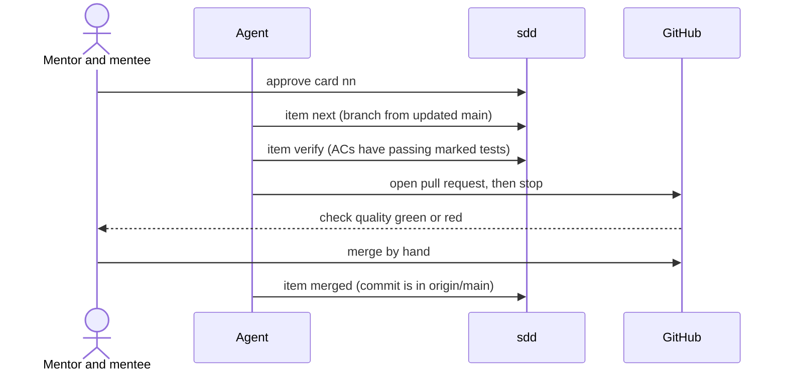

# Approach · 002 · Harness: item-by-item flow and CI

> **Phase 3 · Structure**, closed by **G3 · Approach approved** (both of us approve).
> In a data platform the "user experience" is often an API, a command line, a dataset or a
> dashboard: *how a person or a system meets what we build*. How to fill this file:
> [lifecycle, phase 3](../../harness/lifecycle.md#phase-3-structure).

## Is a prototype needed?

No, because there is no screen and no new query interface. The surface is the existing `sdd`
command line, extended with one group (`sdd item`), one YAML file and one CI check. Their
shape is fixed by the cards of the [backlog](backlog.md) and by ADR-0023 and ADR-0024.

## Interface approach

| Who | Interface | Main interactions |
|---|---|---|
| Mentor and mentee | `sdd approve` (per card form) | approve one card for its current digest |
| Mentor and mentee | GitHub pull request page | read the diff and the `quality` check, merge by hand |
| Agent | `sdd item next|verify|status|merged|current` | start a card, prove it, record the merge |
| Everyone | `specs/<id>/progress.yaml` | read the state of every card (written only by `sdd`) |
| GitHub | `.github/workflows/ci.yml`, job `quality` | run `checks.yaml` on each pull request |

Errors are plain sentences naming the reason and the next command, exit code non-zero, and
nothing is changed when a command refuses.

## How we validate the approach

Not applicable before building: the interface is a command line with a fixed contract. We
validate it on card 02 by walking through one card of this dossier end to end, and on card 04
by the red-then-green proof of the pipeline (PBI-002-04 AC5).
