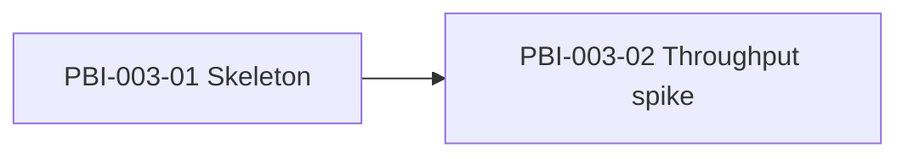

# Backlog · 003 · Generator skeleton and throughput spike

> **Phase 2 · Plan**, closed by **G2 · Backlog approved** (both of us approve).
> The backlog lives in the repository as Markdown (ADR-0012); this file is its part for this
> dossier. How to fill it: [lifecycle, phase 2](../../harness/lifecycle.md#phase-2-plan).

## Epics

- **E1 · A package every later card reuses and a measured answer on speed** (PRD goals 1, 2 and 3):
  the empty but complete `tssource` package, and the benchmark that says whether Python meets
  25,000 events/s and which writer wins.

## Features

- **F1.1 · Walking skeleton.** A person runs `poetry install --with tssource`, `tssource --help`
  and `docker compose up tssource`, and gets a typed, linted, tested, hardened, healthy service.
- **F1.2 · Throughput spike.** A person runs `tssource bench` and reads one table: events/s as a
  distribution, CPU, memory, three serialisers and one thread layout.

## Work items

Cards are copied from cards 03 and 04 of umbrella 001 (which stay there as the umbrella record,
see its backlog) and refined to be self-contained. Card numbers restart at 01 in this dossier.

### PBI-003-01 · Skeleton: package, CLI, container, quality gates

- **Feature:** F1.1 Walking skeleton
- **Serves:** RT01 and RT36 (must not break); RT29 (the base that later measures resources).
- **Size:** M
- **Depends on:** none (the flow and CI of dossier 002 are in force)
- **Context:** nothing of the generator exists. Every later card needs the same package layout,
  the same quality gates and a container that follows the hardening baseline. This card makes the
  walking skeleton: it does nothing useful, but it is built, typed, linted, tested and it runs.
- **What:** `poetry install --with tssource` works. `poetry run tssource --help` lists `run`,
  `bench`, `config`, `report` and `health`. `run`, `bench`, `config` and `report` print
  "not implemented yet" and exit 1; `health` exits 0. `docker compose up --build tssource`
  starts a container that is reported healthy. `lint-imports`, `mypy`, `ruff`, `bandit` and
  `pytest` all cover the new package.
- **How:**
  1. `pyproject.toml` (read it first): add the dependency group `tssource` (numpy, pyarrow,
     tzdata); add `{ include = "tssource", from = "src" }` to `packages`; add the script
     `tssource = "tssource.interfaces.cli.app:main"`; extend `ruff.src`, `mypy.packages`,
     `mypy_path`, `pytest.pythonpath` and `--cov=tssource`; add `tssource` to
     `[tool.importlinter] root_packages` and copy the three contracts of `sdd` for `tssource`
     (layers; interfaces never touch infrastructure; domain and application free of `numpy`,
     `pyarrow`, `typer`, `subprocess`). Extend bandit to scan `src`. Then `poetry lock`.
  2. Create `src/tssource/{domain,application,infrastructure,interfaces}/__init__.py`,
     `bootstrap.py` (the empty composition root, the only place that wires), and
     `interfaces/cli/app.py` with the Typer app and `main()`. Put the base error `TssourceError`
     in `domain/errors.py`. Every module has a docstring (why and contract).
  3. `application/settings.py`: immutable `Settings` (`@dataclass(frozen=True)`) with seed, output
     folder, mode, start, end and speed factor. `bootstrap.py` reads it once from CLI options and
     `TSSOURCE_` environment variables. No credential anywhere (RT36).
  4. `docker/tssource.Dockerfile`: slim Python base pinned by digest, multi-stage so the final
     image has no compiler, non-root user 10001. Service `tssource` in `compose.yaml` with the
     hardening of `docs`: `read_only: true`, `tmpfs: /tmp`, `cap_drop: [ALL]`,
     `no-new-privileges:true`, `user: "10001:10001"`, no `ports`, one writable bind mount
     `./data/ts_source`, and `healthcheck` running `tssource health`.
  5. Add `data/` to `.gitignore` (read the file first; add nothing that already matches).
  6. Write the tests of the Verification line. Check that numpy and pyarrow wheels resolve for
     our Python and the slim image, and record the result in the pull request.
- **Out of scope:** any generation logic; the heartbeat behind `health` (it returns 0 for now);
  Kafka or HTTP.
- **Acceptance criteria (EARS):**
  - AC1: When `tssource --help` runs, the CLI shall list `run`, `bench`, `config`, `report` and
    `health` and exit with code 0.
  - AC2: The `tssource` compose service shall run with a read-only root file system, no Linux
    capabilities, `no-new-privileges`, a non-root user and no published port.
  - AC3: If code in `domain` or `application` imports `numpy`, `pyarrow` or `typer`, then
    `lint-imports` shall fail.
  - AC4: When `tssource run` runs, the CLI shall print "not implemented yet" and exit with code 1.
  - AC5: The new files shall contain no credential (`detect-secrets` passes).
- **Verification:** `tests/tssource/test_cli.py` (AC1, AC4); `tests/tssource/test_compose_hardening.py`
  parses `compose.yaml` (AC2); `tests/tssource/test_layers.py` runs `lint-imports` on a temporary
  module with a forbidden import (AC3); `poetry run sdd item verify 003 01` (AC5).

### PBI-003-02 · Throughput spike: can Python meet the rate?

- **Feature:** F1.2 Throughput spike
- **Serves:** RT29, RT28.
- **Size:** M
- **Depends on:** 01
- **Context:** the largest technical risk is that Python cannot sustain 25,000 events/s in
  backfill, which would make the generator the limit of every later test. We prove or disprove it
  first, with throwaway generation but real writers, before anything else is built on it.
- **What:** `poetry run tssource bench` writes a synthetic block of events (random walks for
  2,050 tags, one value per scan tick) into a scratch folder through each candidate serialiser,
  then prints and saves `bench.json`: events/s per second of wall time (mean, p50, p95, p99,
  minimum), number of events, CPU seconds, peak memory, and whether the 25,000 events/s floor
  held for the whole run. Options: `--seconds` (default 60), `--seed`, `--format`
  (`jsonl-gzip`, `jsonl`, `parquet`), `--out`.
- **How:**
  1. `domain/benchmark.py`: `Distribution` value object (frozen) built from a list of per-second
     rates; pure Python percentiles; `BenchResult` value object.
  2. `application/bench.py`: use case `RunBenchmark` with ports (`typing.Protocol`) `EventSink`
     (write a batch), `EventSource` (next block of events), `ResourceProbe` (CPU seconds, peak
     memory) and `Clock`. It drives a generation thread and a writer thread through a bounded
     `queue.Queue`, and reports which stage waited (the bottleneck).
  3. `infrastructure/`: `NumpyBlockSource` (one `Generator.standard_normal` call per block of
     ticks for all tags, seeded), `JsonlGzipSink`, `JsonlSink`, `ParquetSink` (by row group),
     `ProcessResourceProbe` (`time.process_time`, `tracemalloc` or `resource`; no new
     dependency), `MonotonicClock`.
  4. `interfaces/cli/app.py`: replace the `bench` stub; `bootstrap.py` wires the use case. Exit 3
     and print the bottleneck stage when the sustained rate is below 25,000 events/s.
  5. Run it in the container for 60 seconds on this machine, once per format, and attach the three
     `bench.json` files and the table to the pull request (a measurement, not a unit test). The
     winner and the answer to the open question on the 60 s run go to the mentor.
- **Out of scope:** signal realism; the final file layout; the real-time writer; delay
  measurement; the 150,000 events/s stretch is only reported, never required; the full RT28/RT29
  report (card 21 of 001).
- **Acceptance criteria (EARS):**
  - AC1: When `tssource bench` finishes, it shall write `bench.json` with mean, p50, p95, p99 and
    minimum events per second, the number of events, the CPU seconds and the peak memory.
  - AC2: While the benchmark runs, the writer queue depth shall never exceed its declared bound.
  - AC3: If the sustained rate is below 25,000 events/s, then `tssource bench` shall exit with
    code 3 and print which stage (generation or writing) is the bottleneck.
  - AC4: When run twice with the same seed, the benchmark shall produce the same events (the
    timings may differ).
- **Verification:** `tests/tssource/test_benchmark.py` with fakes for the ports and a small
  block (`Distribution` maths, queue bound, exit code 3 with the stage named, determinism);
  `poetry run sdd item verify 003 02`; the real numbers are recorded in the pull request.

## Order and dependencies

Card 01 first: the spike needs the package, the gates and the container. Card 02 is the risk the
PRD names, so it follows immediately and nothing else is built before its answer.

RT coverage: RT29 and RT28 are served by card 02 (measured distribution, p95; first honest
inputs), and prepared by card 01. RT01 and RT36 are guarded by the hardening test and
`detect-secrets` in card 01.

## Definition of done

Every item is done only when: its acceptance criteria are verified by tests, G5 passes, the
documentation upkeep in [architecture-upkeep.md](../../harness/architecture-upkeep.md) is done,
and the teaching guide explains it.

Also for this dossier: the compose service and the image are documented in
`docs/architecture/deployment.md`, and the writer choice is recorded as an ADR draft for card 15
of 001.
