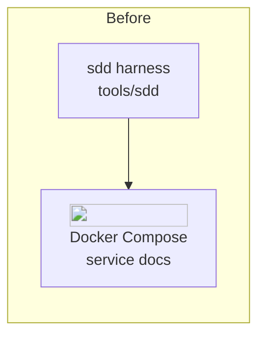
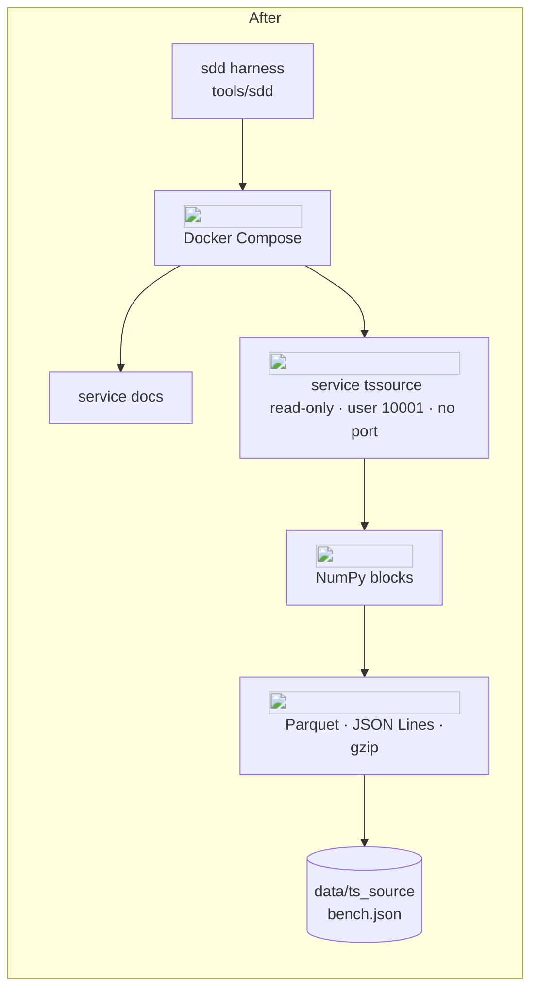
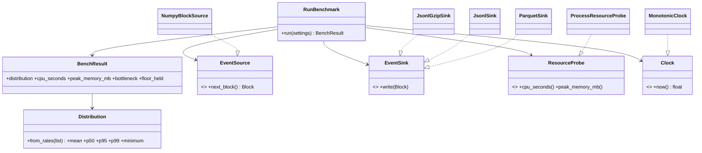

# Implementation plan · 003 · Generator skeleton and throughput spike

> Part of **Phase 4 · Specify** and approved with the spec at **G4**. The plan says *how* the
> build will proceed; the spec says *what* it must achieve. The spec is capped at 50 lines, so
> the diagrams, the class design and the file list live here.

## Approach

Walking skeleton first (card 01), then the riskiest question (card 02). The package, the gates
and the hardened container come first because every later card reuses them; the spike follows
at once because nothing else should be built before we know whether Python reaches 25,000
events/s. Each card is built test-first on its own `feat/003-<nn>-<slug>` branch, proved with
`sdd item verify`, and merged by a person only on a green `quality` job (dossier 002).

## Architecture before and after

## Design

| Pattern | Where | Why this one (and the alternative that lost) |
|---|---|---|
| Ports and adapters | `EventSource`, `EventSink`, `ResourceProbe`, `Clock` | tests use fakes and the writer is swappable; calling numpy and pyarrow from the use case lost (breaks layers) |
| Composition root | `bootstrap.py` | the only place that chooses adapters; a global registry lost (hidden coupling) |
| Value objects | `Distribution`, `BenchResult`, `Settings` | frozen, easy to test; mutable dicts lost (silent drift) |
| Producer-consumer | bounded `queue.Queue`, two threads | bound gives backpressure and names the slow stage; unbounded queue lost (ADR-0027) |

| SOLID | How |
|---|---|
| S | one class per reason to change: maths, orchestration, each format, each probe |
| O | a new format is a new `EventSink`; the use case does not change |
| L | every sink accepts the same `Block` and writes it whole |
| I | four small ports instead of one large one |
| D | `application` depends on ports; adapters depend inward; `lint-imports` enforces it |

## Steps

1. **Card 01, red first:** tests for `--help`, not-implemented exits, compose hardening, layer
   contract (B01-B03). 2. `pyproject.toml` group and tool settings, `poetry lock`. 3. package
   skeleton, `Settings`, `TssourceError`, Typer app, `bootstrap.py`. 4. Dockerfile, compose
   service, `.gitignore`; build and confirm *healthy*. 5. `sdd item verify 003 01`, PR, stop.
6. **Card 02, red first:** tests with fakes for `Distribution`, queue bound, exit 3, determinism
   (B04-B07). 7. domain, then use case, then adapters, then CLI wiring. 8. Three real 60 s runs
   in the container; attach `bench.json` and the table; draft the writer ADR for card 15 of 001.
   9. `sdd item verify 003 02`, PR, stop.

## Files to create or change

| Layer | Files |
|---|---|
| domain | `src/tssource/domain/{errors,benchmark}.py` |
| application | `src/tssource/application/{settings,bench}.py` |
| infrastructure | `src/tssource/infrastructure/{numpy_source,sinks,probe,clock}.py` |
| interfaces and root | `src/tssource/interfaces/cli/app.py`, `src/tssource/bootstrap.py`, `__init__.py` files |
| tests | `tests/tssource/{test_cli,test_compose_hardening,test_layers,test_benchmark}.py` |
| config and docker | `pyproject.toml`, `poetry.lock`, `docker/tssource.Dockerfile`, `compose.yaml`, `.gitignore` |
| docs | `docs/architecture/deployment.md`, `src/tssource/README.md`, `README.md`, teaching guide |

## Rollback

Revert the merge commit of the card; `data/` is untracked scratch output and can be deleted.
Nothing outside this repository changes.

## Risks during the build

| Risk | Early signal | What we do |
|---|---|---|
| numpy or pyarrow wheel missing for our Python or slim image | `poetry lock` or image build fails | pin another version; record it in the PR |
| Container read-only breaks pyarrow or tempfiles | health fails at start | write only under `/tmp` tmpfs or the one bind |
| The floor is missed | `bench` exits 3 | stop, report the stage, decide with the mentor (not a build failure) |
| Noisy laptop numbers | runs differ widely | repeat, report the distribution, do not choose on one run |
