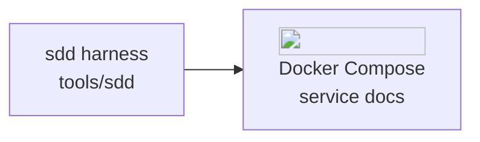
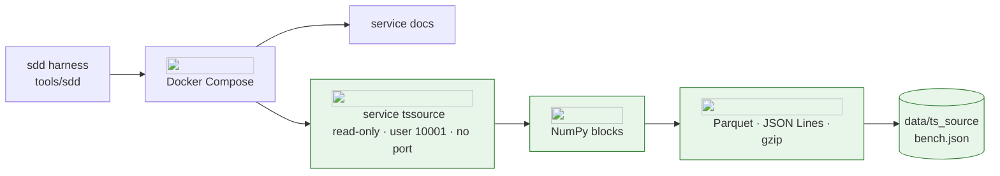
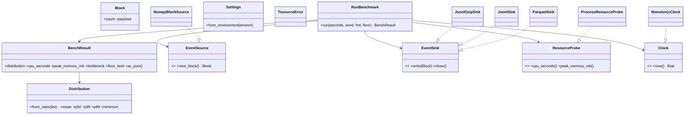
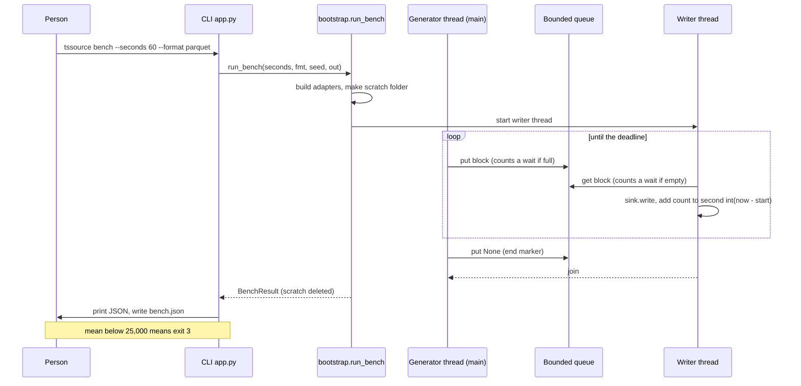
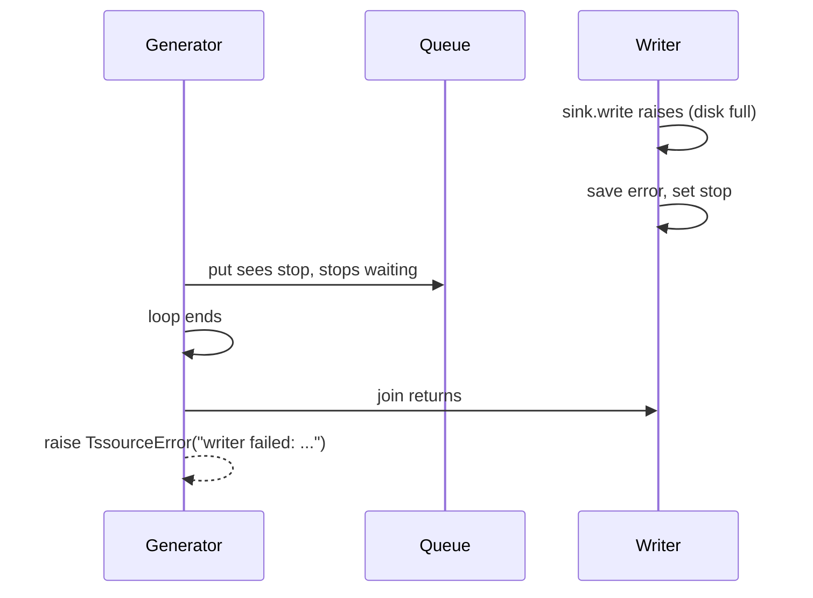
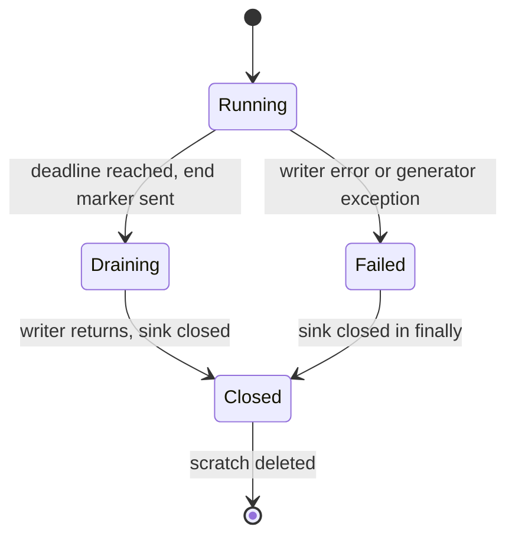
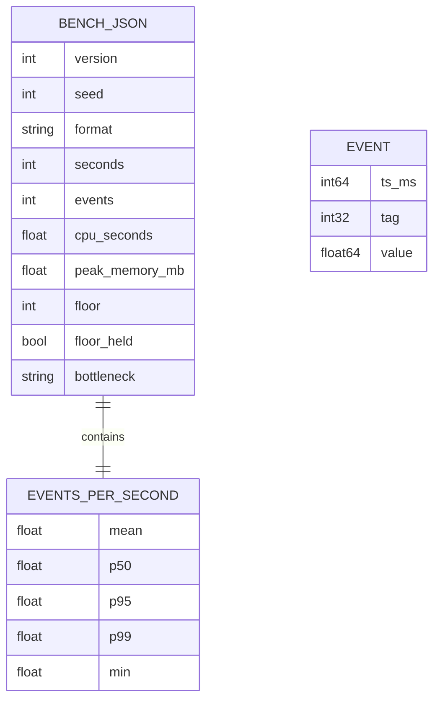

# Teaching guide · 003 · Generator skeleton and throughput spike

> The didactic record of this dossier: **every decision, with its justification**, from the
> architecture down to the classes. It is written for the mentee who was not in the room,
> reads in order, and is approved at **G6** together with `validation.md`. Rules:
> [documentation standard](../../harness/documentation-standard.md#the-teaching-guide).
> Diagrams are Mermaid; every tool node carries its official logo.

## 1. The problem in plain words

Orion Chemicals is a **fictional** company; its plants, tags and numbers here are invented. The
platform we are building will one day ingest data from industrial plants, but there is no real
plant to read from. So we build our own: `tssource`, a **generator** that produces believable
plant data on demand (dossier 001 is the umbrella for it).

A few terms first. A **tag** is one named measurement point of a plant, such as "temperature of
reactor 3"; our catalogue has 2,050 of them. An **event** is one reading: a timestamp, a tag and
a value. A **historian** is the plant system that stores such readings over time; the generator
imitates what a historian would emit. **Backfill** is the mode where we generate a long stretch
of past history as fast as possible, instead of waiting real time. **Throughput** is how many
events per second the pipeline sustains, and a **floor** is the minimum we must reach: RT29 asks
for 25,000 events/s in backfill. A **serialiser** (or *writer*, *sink*) turns events into bytes in
a file format: JSON Lines (one JSON object per line), the same gzip-compressed, or Parquet (a
columnar binary format).

This dossier does two things, one per backlog card. **Card 01 (skeleton)** builds the empty but
complete package: a command line, a settings reader, a hardened container, and the quality gates
(types, lint, layer rules, secret scan). It does nothing useful yet, but every later card reuses
it, so we want the boring parts right once. **Card 02 (spike)** answers the riskiest question
before we build anything else: *can Python, with 2,050 tags, reach 25,000 events/s, and which
writer is best?* A **spike** is a throwaway experiment whose product is knowledge, not features.
We use throwaway random-walk data, because the question is "can we move the bytes", not "are the
signals realistic".

The answer, measured in the hardened container, is yes by a wide margin (section 4, decision D5).
The point of the rest of this guide is to show *how* the measurement was made honest.

## 2. Requirements served

The catalogue is in [`rt-catalog.yaml`](../../docs/requirements/rt-catalog.yaml); the
[traceability matrix](../../docs/requirements/traceability.md) lists where each RT is covered.

- **RT29 (sustained throughput as a distribution).** It asks the prototype to measure sustained
  rate, not a lucky average, with percentiles. It matters because Orion cannot size the real
  platform from a number that hides stalls. Satisfied by SPEC-003-B04 (`bench.json` holds mean,
  p50, p95, p99, minimum, CPU, memory), B05 (bounded queue), B06 (exit 3 below the floor naming
  the stage). Tests: `test_distribution_maths`, `test_bench_json_has_the_contract_fields`,
  `test_queue_depth_never_exceeds_its_bound`, the two bottleneck tests and
  `test_cli_exits_three_and_names_the_stage_below_the_floor`.
- **RT28 (sizing declared from numbers).** Sizing must state tags, frequencies, sizes and growth.
  It matters because a sizing that is guessed rather than measured misleads purchases. The spike
  gives the measured input (events/s, CPU seconds, MB per format) and B07 (same seed, same events)
  makes the measurement repeatable. Tests: `test_same_seed_gives_the_same_events`,
  `test_same_seed_gives_identical_files`. The final sizing report is out of scope (001, card 21).
- **RT01 and RT36 (must not break: a runnable component; no secrets, hardened runtime).** RT01 is
  served by the CLI (B01) and the compose service; RT36 by B02 (read-only, no capabilities,
  `no-new-privileges`, user 10001, no published port) and B03 (layer contract, `detect-secrets`).
  Tests: `test_cli.py`, `test_compose_hardening.py`, `test_layers.py`, `test_no_secrets.py`.

## 3. Architecture before and after

Before this dossier the repository had only the harness (`tools/sdd`) and a documentation
container.



*Narration.* The harness runs on the developer machine and one compose service builds the
documentation. There was no data component at all.

After:



*Narration, arrow by arrow.*

- **Compose to `tssource`.** A new service, built from `docker/tssource.Dockerfile`. It is
  hardened (read-only root, no capabilities, non-root, no published port) because it is the first
  container that writes data, and RT36 sets that baseline for everything that follows. It idles
  when started without arguments so it can report *healthy*; with arguments it runs a command.
- **`tssource` to NumPy blocks.** The source builds a whole block (25 ticks of 2,050 tags, that
  is 51,250 events) in one vectorised call. Per-event Python loops would not reach the floor
  (ADR-0019), so the speed lives in numpy, outside the domain.
- **Blocks to serialisers.** Three interchangeable writers receive the same block. Their output is
  scratch: `bench` deletes the file and keeps only `bench.json`.
- **Bind to `data/ts_source`.** The single writable host folder; everything else is read-only.

## 4. Decisions and the alternatives that lost

### D1. A second clean-architecture package with its own dependency group ([ADR-0019](../../docs/architecture/decisions/0019-tssource-package-and-dependencies.md))

Forces: numeric speed, a pure domain, an image that carries only what it needs.

| Option | Speed | Purity of the domain | Verdict |
|---|---|---|---|
| Pure Python in the domain | slow | perfect | lost: cannot reach the floor |
| numpy inside the domain | fast | broken | lost: library in the core |
| numpy in infrastructure behind ports | fast | kept | **won** |
| Polars or pandas | fast | broken | lost: heavier, no gain here |

We give up one thing: rules that need numpy speed will need a numpy-free reference beside the
fast path, tested against each other.

### D2. Measure per-second rates, two threads, bounded queue, exit 3 ([ADR-0027](../../docs/architecture/decisions/0027-benchmark-measures-per-second-rates-with-a-bounded-queue.md))

| Option | Honest about slow seconds | Names the bottleneck | Verdict |
|---|---|---|---|
| One mean for the whole run | no | no | lost: hides stalls, RT29 forbids it |
| Per-second distribution, one thread | yes | no | lost: cannot tell generation from writing |
| Per-second distribution, two threads, bounded queue | yes | yes | **won** |
| Unbounded queue | yes | misleading | lost: memory grows, hides a slow writer |
| `multiprocessing` writer | yes | yes | lost for now: complexity before need |

We give up simplicity (two threads) and accept that threads share the GIL (section 12). At G4 we
decided that only the **mean** fails the run; minimum and p99 are reported, not enforced.

### D3. Counting waits, not seconds, to name the bottleneck

The producer counts how often it found the queue full; the writer counts how often it found it
empty. If `full > empty` the label is `writing`, otherwise `generation`.

| Option | Deterministic in tests | Cost | Verdict |
|---|---|---|---|
| Count waits (chosen) | yes | one integer per thread | **won** |
| Time spent blocked per stage | no, depends on machine speed | clock reads in hot loop | lost |
| CPU profiler | no | heavy, new dependency | lost |

### D4. Hardened container from day one ([ADR-0019](../../docs/architecture/decisions/0019-tssource-package-and-dependencies.md), RT36)

| Option | Safety | Cost | Verdict |
|---|---|---|---|
| Default container, harden later | low | rework, and the benchmark would run in a different environment | lost |
| Read-only, `cap_drop: ALL`, `no-new-privileges`, user 10001, `tmpfs /tmp`, one bind | high | must write only to two places | **won** |

Measuring in the hardened container matters: the numbers we quote are the numbers the real
deployment would see.

### D5. Proposed writer: Parquet by row group ([ADR-0028](../../docs/architecture/decisions/0028-writer-choice-after-the-throughput-spike.md), draft)

Three 60 s runs in the container, seed 42 (evidence: [`evidence/`](evidence/)):

| Format | Mean events/s | Minimum | CPU s per 60 s | Peak MB | Floor held |
|---|---|---|---|---|---|
| `jsonl-gzip` | 128,979 | 102,500 | 62.4 | 95 | yes, 5.2x |
| `jsonl` | 422,813 | 307,500 | 40.1 | 96 | yes, 16.9x |
| `parquet` | 1,393,146 | 973,750 | 25.2 | 117 | yes, 55.7x |

Parquet wins on speed and CPU; gzip JSON Lines stays as the fallback when a human must read the
file. This is a **proposal for card 15 of 001**, not a final layout. We give up certainty: the
real signal model will cost far more than a random walk, so the margin will shrink.

## 5. The design: layers, classes and patterns

Layers follow [principles](../../harness/principles.md): `domain` <- `application` <-
`infrastructure` / `interfaces`, wired only in `bootstrap.py`. `lint-imports` forbids `numpy`,
`pyarrow` and `typer` in the two inner layers.



*Narration.* `RunBenchmark` knows four ports and nothing else. Every arrow into a port is a
dependency on an interface; every dashed arrow out of an adapter is an implementation. The
adapters live in `infrastructure` and depend inward on `Block`.

Single responsibility of each class, and why it is separate:

- **`Distribution`** (domain): turns per-second rates into mean and percentiles. Pure maths, so
  it is tested with plain lists and no threads. Without it the maths would hide inside the
  threaded code and be untestable.
- **`BenchResult`**: what one run measured, plus `floor_held` and `as_json()` (the `bench.json`
  contract, version 1). One place owns the file shape.
- **`Block`**: a count plus an opaque payload. The use case only needs the count; only the two
  adapters know the payload. That keeps numpy out of the application layer.
- **`RunBenchmark`** (application): orchestrates two threads and the queue. It does not know any
  format.
- **`Settings`**: reads `TSSOURCE_*` once into a frozen object, from a mapping given to it, so
  tests pass a dict.
- **`TssourceError`**: the one base for handled errors, so the CLI prints one line, exit 1.
- **`NumpyBlockSource`**: seeded random walks per tag, vectorised.
- **`JsonlSink`, `JsonlGzipSink`, `ParquetSink`**: one adapter per format. Adding a fourth does
  not touch the use case.
- **`ProcessResourceProbe`, `MonotonicClock`**: the probe isolates the operating system (and the
  Windows gap); the clock is injectable so tests do not wait 60 real seconds.
- **Typer `app` and `bootstrap.py`**: parse input and map errors to exit codes; choose adapters.

| Pattern | Where | Why here |
|---|---|---|
| Ports and adapters | the four `Protocol`s and their adapters | fakes in tests; swap a writer without touching the use case |
| Composition root | `bootstrap.py` (`_SINKS` table, `run_bench`) | one place chooses concrete classes; no hidden global registry |
| Value object | `Distribution`, `BenchResult`, `Settings`, `Block` | frozen dataclasses cannot drift silently |
| Producer-consumer | bounded `queue.Queue`, two threads | the bound gives backpressure and names the slow stage |
| Sentinel | `None` put on the queue at the end | tells the writer to stop without a second channel |

| Principle | How this code applies it |
|---|---|
| Single responsibility | maths, orchestration, each format, probe, clock are different classes with different reasons to change |
| Open/closed | a new format is a new `EventSink` plus one line in `_SINKS`; `RunBenchmark` is untouched |
| Liskov substitution | every sink takes the same `Block` and writes it whole without changing it; `test_each_sink_writes_every_event` runs all three |
| Interface segregation | four tiny ports rather than one "pipeline" interface; a fake probe is three lines |
| Dependency inversion | `application` imports only its own ports; adapters import `Block` inward; `test_layers.py` proves the linter catches violations |

## 6. How it behaves at runtime

### Happy path of `tssource bench`



*Narration.* The CLI delegates to `run_bench`, the only function that knows real adapters. The
use case starts the writer thread and generates on the calling thread until `start + seconds`.
Each block is queued; when the writer finishes a block it adds its event count to the bucket of
the second in which the write *finished*. That is why per-second rates are **quantised by the
51,250-event block**: a second can only contain whole blocks, so p50 of the gzip run is exactly
three blocks (153,750). After the deadline the producer sends `None`, the writer returns, the sink
closes (Parquet writes its footer), and `finally` in `run_bench` deletes the scratch folder.

### The bottleneck rule

The producer finding the queue **full** means the writer cannot keep up, so writing is the limit.
The writer finding it **empty** means it waited for data, so generation is the limit. The label
is `writing` when `full > empty`. **Every real run reported `writing`.** That is not a verdict
that writing is slow: the vectorised numpy generator is simply much faster than any serialiser, so
the writer is always the *relatively* slower stage. Read the label as "who waited for whom".

### Failure path: the writer dies



*Narration.* Without the `stop` event a dead writer would leave the producer blocked forever on a
full queue. Both loops poll every 50 ms and check `stop`. The error reaches `main()`, which prints
one line and exits 1. `test_a_failing_sink_surfaces_as_a_handled_error` proves it does not hang.

### Lifecycle of a run



*Narration.* Whatever the path, the sink is closed and the scratch folder removed; only a
successful run produces a result, and only then does the CLI write `bench.json`.

## 7. Data and contracts



*Narration.* `bench.json` is the only file that stays. `EVENT` is the row shape inside the scratch
files (JSON keys `ts`, `tag`, `value`; Parquet columns of the same names), shown for completeness
though never kept.

Invariants and where they are enforced:

| Invariant | Enforced in | Why there |
|---|---|---|
| Queue depth never exceeds the bound | `queue.Queue(maxsize=...)`, checked via `max_queue_depth` | the library guarantees it; we only report it |
| `bench.json` names are stable, `version: 1` | `BenchResult.as_json` | a single producer of the shape |
| Same seed, same events | `NumpyBlockSource` (seeded `default_rng`, fixed epoch 2026-01-01T00:00:00Z) | randomness enters only here |
| Time is UTC, from a fixed epoch | `_EPOCH_MS` in the source | runs comparable across days |
| Floor compared on the mean only | `BenchResult.floor_held` | decided at G4 |
| An empty measurement is an error | `Distribution.from_rates` raises | a run shorter than one second proves nothing |
| Settings are immutable and validated once | `Settings.from_environment`, frozen dataclass | fail early with the variable named |

CLI contract: five commands (`run`, `bench`, `config`, `report`, `health`); exit 0 success, 1 not
implemented or handled error, 2 usage, 3 floor missed; additive changes only.

## 8. Code tour

Read from the entry point inwards.

1. [`interfaces/cli/app.py`](../../src/tssource/interfaces/cli/app.py). Five Typer commands.
   `run`, `config`, `report` call `_not_implemented` (exit 1) so the skeleton is honest about what
   exists. `bench` writes `bench.json` and `raise typer.Exit(code=3)` below the floor. `main()`
   turns `TssourceError` into `error: ...` and exit 1: no stack traces for expected failures.
2. [`bootstrap.py`](../../src/tssource/bootstrap.py). The composition root. `_SINKS` maps a
   `Format` to a filename and a class. `run_bench` merges CLI options over the environment,
   creates a scratch folder with `tempfile.mkdtemp`, builds the use case, and deletes the folder
   in `finally`. Why here: it is the only place allowed to know numpy and file names.
3. [`application/bench.py`](../../src/tssource/application/bench.py). The four ports and
   `RunBenchmark`. The lines that matter:
   ```python
   bottleneck = Bottleneck.WRITING if state.full > state.empty else Bottleneck.GENERATION
   ```
   and `_put`, which tries `put_nowait`, counts `queue.Full` once, then waits in 50 ms slices so
   it can notice `stop`. `_State` fields each have one writer thread, so no lock is needed.
4. [`domain/benchmark.py`](../../src/tssource/domain/benchmark.py). `Distribution.from_rates`
   sorts and interpolates percentiles linearly; `FLOOR_EVENTS_PER_SECOND = 25_000`.
5. [`domain/errors.py`](../../src/tssource/domain/errors.py) and
   [`application/settings.py`](../../src/tssource/application/settings.py). One error base;
   settings read from a mapping, `ValueError` rewrapped as `TssourceError`.
6. [`infrastructure/numpy_source.py`](../../src/tssource/infrastructure/numpy_source.py). One
   `standard_normal((25, 2050))` and a `cumsum` per block: the whole speed trick. `_level` carries
   each walk across blocks so time and values continue.
7. [`infrastructure/sinks.py`](../../src/tssource/infrastructure/sinks.py). `_columns` narrows the
   opaque payload or raises a one-line error. `_jsonl` builds the text; `ParquetSink` opens its
   writer lazily because it needs the schema from the first table.
8. [`infrastructure/probe.py`](../../src/tssource/infrastructure/probe.py) and
   [`clock.py`](../../src/tssource/infrastructure/clock.py). CPU from `time.process_time`
   (all threads); peak memory from `resource`, which does not exist on Windows, so it returns
   `0.0`. The monotonic clock cannot jump backwards.
9. [`docker/tssource.Dockerfile`](../../docker/tssource.Dockerfile) and the `tssource` service in
   [`compose.yaml`](../../compose.yaml). Two stages (builder with Poetry, runtime without), base
   image pinned by digest, user 10001, entrypoint idles with no arguments so the healthcheck
   (`tssource health`) can pass.

## 9. Security

| Threat (STRIDE) | Mitigation | Verified by |
|---|---|---|
| Tampering, Elevation of privilege | `read_only: true`, `cap_drop: [ALL]`, `no-new-privileges`, user 10001, `tmpfs /tmp`, a single bind | `test_service_is_hardened`, `test_only_one_writable_bind_and_a_healthcheck` |
| Information disclosure (credentials in code or image) | no credential is a setting; image copies only the venv and `src` | `test_detect_secrets_passes_on_the_new_files` |
| Denial of service (runaway run fills disk or memory) | `--seconds` bound (min 1), bounded queue, scratch under `data/ts_source` and deleted | `test_queue_depth_never_exceeds_its_bound`, `test_cli_real_run_writes_bench_json_and_removes_scratch` |
| Supply chain | dependencies pinned by `poetry.lock`; base image pinned by digest; only the `main` and `tssource` groups installed | build, review of lock diff |
| Layer erosion (a framework leaks into the core) | import contract | `test_layers.py` |

No port is published, so nothing listens. The service never reads `.env` or `deploy/secrets/`.

## 10. How we tested it

- **Unit with fakes.** `RunBenchmark` is tested with a `FakeClock` that only the fakes advance, so
  60 simulated seconds take milliseconds and do not depend on machine speed. Fake stages with a
  cost of 0.01 s or more also `sleep(0.002)` in real time; otherwise the queue would never fill and
  the bottleneck tests would be meaningless.
- **Direct adapter tests.** Each sink writes every event (read back for gzip and Parquet),
  rejects a foreign block, same seed gives identical files, and the clock of events continues
  across blocks.
- **Integration.** `CliRunner` runs the real commands; one test runs a real tiny benchmark per
  format and checks that `bench.json` exists and scratch is gone. Compose is parsed as YAML.
- **Layer test.** Builds a tiny fixture package and checks that `lint-imports` fails for each
  forbidden library in each inner layer, and passes a clean one.
- **Mapping.** Each acceptance criterion is marked `@pytest.mark.ac("PBI-003-nn:ACn")`; `sdd item
  verify` fails if one is missing.
- **Measurement.** The three 60 s container runs are evidence, not tests.

Honest gaps. We do not test the real 60 s container run in CI. We do not test that the
hardened container actually starts and is healthy (compose is only parsed as YAML; the plan's manual step confirmed healthy, no automated test does). Peak
memory is not tested on Windows, where it is `0.0`. The bottleneck label is tested with fakes
whose speeds are extreme; the realistic case (both stages close) is not tested. One run per
format on one laptop: no spread is known.

## 11. Run it yourself

```bash
poetry install --with tssource
poetry run tssource --help                      # five commands, exit 0
poetry run tssource run; echo $?                # "run: not implemented yet", 1
poetry run tssource bench --seconds 5 --format parquet --out ./scratch
cat ./scratch/bench.json                        # peak_memory_mb is 0.0 on Windows
poetry run pytest tests/tssource -q
poetry run lint-imports && poetry run mypy --strict src/tssource
mkdir -p data/ts_source                         # must be writable by uid 10001 on Linux
docker compose build tssource
docker compose run --rm tssource bench --format parquet --seconds 60
```

Observe: the JSON, the exit code (`echo $?`), and that no `bench-*` folder is left behind.

Small change to try: in `numpy_source.py` set `TICKS_PER_BLOCK = 50`. Predict first: blocks hold
102,500 events, so every per-second rate becomes a multiple of 102,500, `p50` jumps in bigger
steps, and some tests may need updating (they import the constant, so run them and read which
assertions break). Then try `--format jsonl-gzip --seconds 5` and
compare with the mean in section 4. To see exit 3, temporarily pass a floor above the mean in a
test with fakes (`bench` itself never takes a floor option).

## 12. Pitfalls and what we would do differently

- **The label `writing` is relative.** All three runs said `writing`. A reader who stops there
  concludes the writer is slow, while it did 129k to 1.39M events/s against a floor of 25k.
- **Quantised percentiles.** Rates move in 51,250-event steps, so p50, p95, p99 repeat the same
  values (gzip: 153,750 twice). Do not read precision into them.
- **Peak memory is `0.0` on Windows** because `resource` does not exist there. Only the container
  numbers count. We chose a visible zero over a guess.
- **Threads share the GIL.** gzip and Parquet release it while compressing or writing, which is
  why gzip used 62.4 CPU seconds in 60 s of wall time (more than one core). A pure-Python writer
  would not scale like this; a `multiprocessing` writer is the next step if it ever binds
  (new ADR).
- **Sinks delete their scratch file.** Good for disk safety, but it means the spike measures
  writing, not reading back, and not file size. File size and layout are for card 15 of 001.
- **A random walk is cheap.** Real signals add noise, quality codes and exceptions; the 55x margin
  for Parquet will shrink and must be measured again.
- **One laptop, one run per format.** We did not repeat runs to learn the spread.
- **Mistakes on the way.** Fake stages first did not sleep in real time, so queues never filled
  and the bottleneck tests passed for the wrong reason; and a dead writer first hung the producer
  on a full queue, which is why the `stop` event and 50 ms polling exist.

## 13. Questions for the mentee

1. Why does the bottleneck rule count waits instead of measuring time blocked? What would flake?
2. All runs said `writing`. What experiment would show the generation stage as the limit?
3. Why is `Block.payload` typed as `object`? What would break if it were a numpy array?
4. If the bound were 1 instead of 8, what changes in the numbers and in the label?
5. Why does only the mean fail the run, and what risk does that leave? When would you enforce the
   minimum?
6. A teammate puts `import numpy` in `application/bench.py`. Which check fails, and where?
7. Why must the writer decide the second of a block by when the write finished, not started?
8. How would you add a CSV sink? List every file you touch and explain why the use case is not one.
9. What would you change so that peak memory is real on Windows without a new dependency in the
   inner layers?
10. The ADR-0028 proposes Parquet. What evidence would make you reverse it?

## 14. Glossary

| Term | Meaning |
|---|---|
| Backfill | Generating past history as fast as possible, not in real time |
| Backpressure | A full bounded queue slowing the producer so memory stays flat |
| Block | A batch of events (25 ticks x 2,050 tags = 51,250) moved as one unit |
| Bottleneck | The stage that made the other wait; here a relative label, not a verdict |
| Composition root | The single module (`bootstrap.py`) that chooses concrete adapters |
| Distribution | Mean, p50, p95, p99 and minimum of the per-second rates |
| Event | One reading: timestamp, tag, value |
| Floor | The minimum sustained rate, 25,000 events/s (RT29) |
| GIL | Python's global interpreter lock; threads take turns running Python code |
| Historian | A plant system that stores readings over time |
| JSON Lines | A file with one JSON object per line |
| Parquet | A columnar binary file format, written here one row group per block |
| Port | A `typing.Protocol` the inner layers define and the adapters implement |
| Quantised | Restricted to multiples of a step; here, of the block size |
| Row group | A chunk of rows written together inside a Parquet file |
| Scratch file | The temporary benchmark output, deleted after the run |
| Sentinel | The `None` placed on the queue to say "no more blocks" |
| Spike | A throwaway experiment whose product is knowledge |
| Tag | One named measurement point of a plant (2,050 in the catalogue) |
| Throughput | Events per second sustained by the pipeline |
| Walking skeleton | The thinnest end-to-end version that builds, runs and is tested |
