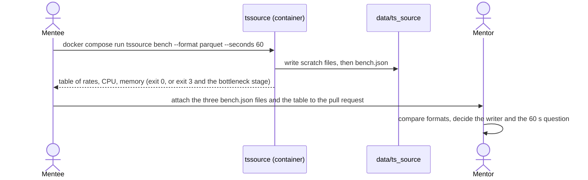

# Approach · 003 · Generator skeleton and throughput spike

> **Phase 3 · Structure**, closed by **G3 · Approach approved** (both of us approve).
> In a data platform the "user experience" is often an API, a command line, a dataset or a
> dashboard: *how a person or a system meets what we build*. How to fill this file:
> [lifecycle, phase 3](../../harness/lifecycle.md#phase-3-structure).

## Is a prototype needed?

**No.** The only surface is a command line with five commands and one JSON file. A command line
has no layout to explore, and the commands are already fixed by cards 03 and 04 of umbrella 001
(`run`, `bench`, `config`, `report`, `health`). The unknown that a prototype would remove is
not how people use it but how fast Python writes, and the benchmark itself is that experiment
(card 02), so a mock-up would add nothing. The spike code is throwaway-quality by design, but it
is built in `src/` under the quality gates, not in a separate prototype folder.

## Interface approach

Two kinds of people meet the result: the **mentee** (builds, runs the commands, reads help text
and errors) and the **mentor** (reads `bench.json` and the comparison table to decide). A third
reader, the **later cards of 001**, meets the Python package and the settings object, not the
CLI. There is no HTTP API, no port and no dashboard (RT01).

Rules for the interface, so that all five commands feel the same:

- **Commands** are verbs of the generator: `run`, `bench`, `config`, `report`, `health`. Only
  `health` and (in card 02) `bench` work in this dossier; the others print
  `<command>: not implemented yet` on stderr and exit 1.
- **Options** are long names (`--seconds`, `--seed`, `--format`, `--out`). Each has an
  environment variable `TSSOURCE_<NAME>` and the command line wins over the environment.
- **Exit codes**: 0 success, 1 not implemented or a handled error (`TssourceError`), 2 usage
  error (Typer's own), 3 benchmark floor missed. The meaning is written in `--help`.
- **Output**: `bench` prints a short human table to stdout (one row per format: mean, p95, min,
  CPU seconds, peak MB, floor held yes/no) and saves the full `bench.json`. When the floor is
  missed, one extra line names the bottleneck stage (`generation` or `writing`).
- **`bench.json`** is the data interface: one object per run with `seed`, `format`, `seconds`,
  `events`, `events_per_second` (`mean`, `p50`, `p95`, `p99`, `min`), `cpu_seconds`,
  `peak_memory_mb`, `floor`, `floor_held`, `bottleneck`. Field names are stable so the 001
  report card can read them.
- **Errors** say what happened and what to do, in one line, without a stack trace (the trace
  stays behind `--debug` only if a later card needs it).

## How we validate the approach

A walk-through between us of the PRD scenarios, on the text only: the mentee reads
`tssource --help` as designed above and finds each command and each exit code without opening
the code; the mentor reads one example `bench.json` and the example table and can say which
format wins and whether the floor held. We check the real thing again at the end of cards 01
and 02, when the commands exist and their help text and output are tested.
