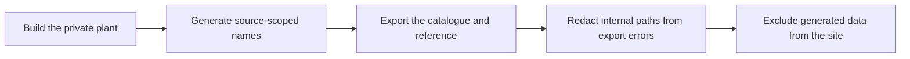

# Backlog · 004 · Plant and tag catalogue

> **Phase 2 · Plan**, closed by **G2 · Backlog approved** (both of us approve).
> The backlog lives in the repository as Markdown (ADR-0012); this file is its part for this
> dossier. How to fill it: [lifecycle, phase 2](../../harness/lifecycle.md#phase-2-plan).

## Epics

- E1 · Reproducible plant inventory. Serves the PRD goals for plant reproduction and sizing inputs.
- E2 · Realistic tag identity. Serves the PRD goals for identity matching and independent evaluation.

## Features

- F1.1 · Build a five-site plant with equipment identities and sampling expectations (E1).
- F2.1 · Generate reproducible tag names and source-scoped collisions (E2).
- F2.2 · Inspect a consumer catalogue and reconcile it with a separately stored reference (E1, E2).

## Work items

### PBI-004-01 · Build the private plant model

- **Feature:** F1.1.
- **Serves:** RT17, RT28.
- **Size:** M.
- **Depends on:** Merged generator skeleton from dossier 003.
- **Context:** The synthetic source needs stable equipment identities, measurable inventory
  and explicit sampling policies before names or signals can be generated. This card carries
  original roadmap card 06.
- **What:** `tssource plant build --seed N --out PATH` writes a versioned JSON plant model under
  `PATH/truth/plant.json`. It includes sites, areas, equipment, instruments, loops, equipment flows,
  shared driver references, and point counts by site and scan class. Default point counts are
  approximately 700 (Brazil), 450 (US Gulf Coast), 350 (Belgium), 350 (China) and 200 (India).
  The combined profile includes approximately 100 lab analytes. Each periodic point declares one
  of 1, 5, 10, 30, 60, 300 or 900 seconds. Lab and report-by-exception points have an unset interval.
- **How:**
  1. Add immutable model types (`Plant`, `Site`, `Area`, `Equipment`, `Instrument`, `ControlLoop`
     and `Stream`) under proposed `domain/plant/`. Reuse `SiteCode` in `domain/time/site_zone.py`.
     Declare the named site profiles, scan policies and equipment templates as data. Cover reactor,
     column, heat exchanger, pump, compressor, tank, furnace, separator, valve station and analyser
     house. Give template points a measurement, canonical unit, range and scan class.
  2. Build the model in `domain/plant/builder.py` from the seed and stable structural paths, using
     stable digests for surrogate IDs. Keep profile and template order stable. Each loop has a
     measurement, controller and final element in one area. Store same-area shared driver references
     for future signals. Resolve flow endpoints to existing equipment.
  3. Add `BuildPlant` and a `PlantWriter` port in proposed `application/plant.py`. Implement the
     JSON adapter in proposed `infrastructure/plant_json.py`. Write a complete temporary file in
     its destination directory before replacing the target. Wire the use case in `bootstrap.py`
     and register the `plant build` subcommand in `interfaces/cli/app.py`. Reuse the existing
     `Settings` seed and output-folder defaults. Exit 0 on success and use the existing CLI
     conventions for handled errors and invalid arguments.
- **Out of scope:** Published tag names, signal values, physics and larger profiles.
- **Acceptance criteria (EARS):**
  - AC1: When the default plant is built, the inventory shall contain the five declared sites
    with counts within 10% of the site profile, at least 10 instruments per equipment class, and
    counts by site and scan class that reconcile with the instrument list. (RT28)
  - AC2: When two builds use the same seed, the model and ordered JSON content shall be identical.
    (RT28)
  - AC3: When the seed changes, the corresponding equipment and instrument surrogate IDs shall
    differ. (RT28)
  - AC4: The plant shall have valid control-loop role references within each loop's area, valid
    equipment flow endpoints, and valid shared-driver references. (RT28)
  - AC5: Each instrument shall have the declared interval for its periodic class or an unset
    interval for its lab or report-by-exception class. (RT17, RT28)
  - AC6: When the CLI successfully builds a plant into an empty output directory, it shall create
    only `truth/plant.json` with a schema version and synthetic marker. (RT28)
- **Verification:** Proposed `tests/tssource/domain/test_plant_builder.py` for AC1–AC5 and
  `tests/tssource/test_plant_cli.py` for AC2 and AC6. Cover seeds 0, 42 and 101.

### PBI-004-02 · Generate source-scoped names and reference mappings

- **Feature:** F2.1.
- **Serves:** RT09, RT28.
- **Size:** M.
- **Depends on:** PBI-004-01.
- **Context:** A future matching exercise needs realistic deviations from the company convention
  and a known mapping from each original source name to equipment. This card carries the naming
  rules from original roadmap card 07.
- **What:** A seeded catalogue builder returns one current record per plant point, alongside its
  reference mapping. Create `docs/architecture/tag-naming-convention.md` with a versioned grammar
  for `<SITE>.<AREA>.<EQUIPMENT>.<INSTRUMENT>.<SIGNAL>` (for example
  `ORN.A200.R201.TIC-2011.PV`), the site-specific prefix for a lab name
  `<SITE>.LAB.<AREA>.<SAMPLEPOINT>.<ANALYTE>`, and the selected ISA-style instrument letters and
  PV, SP, OUT, MODE and ALM signal codes.
- **How:**
  1. Add `CanonicalName` under proposed `domain/naming/convention.py` with parse and render rules
     for both branches. Define the site abbreviations and signal tokens in the grammar. Derive
     the name tokens from the merged plant's site, area, equipment and point definitions.
  2. Add named variation strategies under proposed `domain/naming/violations.py` and one dialect
     per site. Cover dropped area, changed separators or case, glued equipment and loop, legacy
     abbreviations, changed signal suffix, numeric-only names, free text, typos and a renamed
     legacy tag. For a rename, retain the old alias and a fixed effective instant in the private
     reference. The consumer catalogue represents the current snapshot.
  3. Use a proposed `CatalogueBuilder` in `domain/naming/catalogue_builder.py` with injected
     variation draws. Spawn an independent NumPy seed sequence in the infrastructure adapter
     wired by `bootstrap.py`, leaving the domain free of NumPy. Reserve cases for the coverage
     floors, then distribute the rest by tier. Check source and name uniqueness after applying
     variants. Reserve deliberate cross-site collisions among distinct equipment identities.
  4. Carry the source code and original name as the join key. Attach English or Portuguese fixture
     descriptors (Portuguese primarily at the Brazil site), data type and the original unit
     spelling to the consumer record. Keep the canonical name, equipment and instrument IDs,
     loop, measurement, canonical unit, tier, applied variations and hold-out designation in
     the reference. Use the plant's IDs for these links. Resolve the nullable loop ID from
     explicit membership in a plant loop role. Assign one of the five sites as hold-out
     deterministically from the seed.
- **Out of scope:** Parquet output, model training, unit conversion and production identity rules.
- **Acceptance criteria (EARS):**
  - AC1: When a canonical instrument or lab name is parsed and rendered, the result shall equal
    the input. (RT09)
  - AC2: When the default catalogue is generated, it shall include at least 1,000 canonical names
    and tier shares within five percentage points of 60% convention, 25% dialect and 15% ad hoc.
    (RT28)
  - AC3: When the default catalogue is generated, the reference shall include at least 20
    examples of each declared naming variation. (RT09)
  - AC4: When a name is deliberately shared across sites, each source and original name pair
    shall resolve to equipment distinct from the other sites' equipment, with at least 15 such
    distinct names in the default catalogue. (RT09)
  - AC5: The current catalogue shall have one record per point and no duplicate source and name
    pairs. (RT09, RT28)
  - AC6: When the default catalogue is generated, the descriptors shall use English or Portuguese
    fixture vocabulary when present, with at least 5% empty descriptors and at least 5% empty
    or noncanonical unit spellings. (RT09)
  - AC7: When the catalogue is generated twice from the same model and seed, the records and
    references shall be identical, including the single private hold-out site. (RT09)
  - AC8: When a legacy rename is generated, its reference shall retain the old alias and its
    replacement instant alongside the current record. (RT09)
- **Verification:** Proposed `tests/tssource/domain/test_convention.py` for AC1,
  `tests/tssource/domain/test_catalogue_builder.py` for AC2–AC8, and a composition test for AC7.
  Exercise seeds 0, 42 and 101 and the canonical parser's malformed-input cases.

### PBI-004-03 · Export the catalogue and private reference

- **Feature:** F2.2.
- **Serves:** RT09, RT17, RT28.
- **Size:** S.
- **Depends on:** PBI-004-02.
- **Context:** A consumer needs a realistic catalogue, while the evaluator needs its joinable
  reference separately. This card carries the file boundary from original roadmap card 07.
- **What:** `tssource catalog build --seed N --out PATH` creates
  `PATH/catalog/tags.parquet` and `PATH/truth/tag_key.parquet` for the plant generated from the
  same seed as `plant build`. The consumer schema contains the source site code, original name,
  descriptor, reported unit, data type, scan class, optional expected interval in seconds and
  synthetic generator marker. The reference shares the source and name join key and carries
  the private fields from PBI-004-02.
- **How:**
  1. Add `BuildCatalogue` and a `CatalogueWriter` port in `application/catalogue.py`. Wire the
     merged `PlantBuilder` and `build_catalogue_builder(seed)` in `bootstrap.py`. Generate one
     `Catalogue` and pass its `ConsumerTag` and `ReferenceTag` rows to the writer together.
  2. In `infrastructure/catalogue_parquet.py`, map consumer columns by allowlist and use separate
     explicit Arrow schemas with `schema_version=1`, as defined in the approved plan. Validate
     unique, matching `(site_code, original_name)` keys and the schemas before publishing. Stage
     both files beside their targets and clean up unused staging files on failure. Reject symlinks
     at the fixed child directories and targets. Set the private file to mode `0600` on Linux and
     preserve existing directory permissions.
  3. Register `catalog build` in `interfaces/cli/app.py` with the same settings and exit
     conventions as `plant build`. Replace the catalogue first and the reference second. Print
     their paths in that order after both replacements succeed. A replacement failure returns
     exit 1 with a short stderr message and empty stdout. A failure between replacements can leave
     a mixed pair. Rerun with the intended seed and output directory to restore it. Use one
     writer per destination and keep readers out during publication.
- **Out of scope:** Signal files, publication services and the broader answer-key leak guard.
- **Acceptance criteria (EARS):**
  - AC1: When the CLI exports into an empty output directory, it shall create only the catalogue
    and reference at their declared paths. (RT09)
  - AC2: The consumer schema shall contain exactly the declared fields, with no private reference
    columns, aliases or hold-out flag. (RT09)
  - AC3: When the exported files are joined on source and original name, each consumer row shall
    match exactly one private row and a point in the same-seed plant model. (RT09, RT28)
  - AC4: When the consumer file is grouped by source and scan class, the counts shall match
    the plant inventory and the expected interval shall match the class policy, including nulls
    for lab and report-by-exception points. (RT17, RT28)
  - AC5: If staging fails for either file, then the command shall return a handled error and
    leave any previously published files intact. (RT09)
- **Verification:** Use `tests/tssource/test_catalogue_cli.py` for AC1–AC5. Read both Parquet
  schemas and metadata with PyArrow, check the private file mode, and reconcile every key,
  instrument ID, scan class and interval with the same-seed JSON plant. Inject failures while
  staging either file and during the second replacement, then verify same-seed recovery. Exercise
  invalid seeds and both child-directory and file-target symlinks.

### PBI-004-04 · Redact internal paths from catalogue errors

- **Feature:** F2.2.
- **Supports:** RT09, by keeping the catalogue export within the repository security baseline.
- **Size:** S.
- **Depends on:** PBI-004-03.
- **Context:** Independent validation found that `catalog build` can print internal paths in
  exception text. With a file as the destination, stderr includes the filesystem path of a fixed
  child. The [security baseline](../../harness/security.md#4-inputs-and-outputs) requires paths
  to stay out of errors.
- **What:** Publish a short catalogue error that identifies staging or publication and the
  affected artifact without forwarding the OS or Arrow exception text.
- **How:** In `src/tssource/infrastructure/catalogue_parquet.py`, translate OS and Arrow
  exceptions into fixed `TssourceError` messages at the affected operation. Preserve the original
  exception as its cause. Keep staging, cleanup and ordered replacement in the writer.
  The CLI already translates `TssourceError` into exit 1 and sends the message to stderr.
- **Out of scope:** Success output, schema, file permissions, and the publication protocol.
- **Acceptance criteria (EARS):**
  - AC1: If catalogue preparation or staging fails with an OS or Arrow error, the CLI shall
    exit 1 with empty stdout and a short stderr message identifying the failed operation.
    The message shall omit the destination, temporary paths and raw exception text. Previously
    published files shall remain intact.
  - AC2: If replacing either catalogue file fails, the CLI shall exit 1 with empty stdout and
    a short stderr message identifying publication and the affected artifact. The message shall
    omit filesystem paths and raw exception text. A successful same-seed rerun shall restore the
    pair.
- **Verification:** In `tests/tssource/test_catalogue_cli.py`, cover an existing file as the
  destination, a staging exception carrying a temporary path, and failed replacement of either
  artifact. Add the card's acceptance markers and retain the existing cleanup and recovery checks.

### PBI-004-05 · Keep generated fixtures out of the documentation site

- **Feature:** F2.2.
- **Supports:** RT09, by preserving the approved boundary between consumer data and its private
  reference when exported files persist in the checkout.
- **Size:** S.
- **Depends on:** PBI-004-03 and PBI-004-04.
- **Context:** The default Compose bind can persist catalogue output after host provisioning.
  The root-based MkDocs build then attempts to copy generated data despite Git ignoring
  `data/`. The strict build failed reading the owner-only catalogue. A readable reference
  must also stay out of the generated site. The same scan picked up the checkout's local
  LinkedIn draft directory, which is Git-ignored and meant to stay local.
- **What:** Keep the root `data/` and `linkedin-posts/` trees outside the documentation build
  and document how to provision and verify the existing bind mount for the non-root service.
- **How:** Add root-anchored `/data/` and `/linkedin-posts/` patterns to `exclude_docs` in
  `mkdocs.yml`. Exercise MkDocs file selection using a temporary docs directory with a
  readable Markdown page, synthetic fixture files at the three declared output paths and a
  placeholder draft under `linkedin-posts/`. Document bind mount
  provisioning and the write preflight in the root and component READMEs and the deployment page.
- **Out of scope:** Changes to the container user, Compose mount, data schemas, permissions on
  generated files, or other publication paths.
- **Acceptance criteria (EARS):**
  - AC1: When MkDocs enumerates a checkout containing files under root `data/` or
    `linkedin-posts/`, the site shall exclude those files even if they are readable and
    shall keep normal documentation pages.
  - AC2: When the default bind contains the three persisted seed-42 artifacts, the strict MkDocs
    build shall succeed without copying either excluded tree into its output.
- **Verification:** Mark the file-selection regression test with AC1. Mark an isolated strict
  build with a minimal documentation page and fake fixture files with AC2, and repeat the
  strict build against this checkout's real persisted artifacts before G7 review.

## Order and dependencies

Build the plant first to establish deterministic identity and inventory. Prove naming coverage
and source-scoped collision rules in memory next, when failures can be isolated from file output.
Export next and validate the consumer and reference schemas together. The diagnostic card addresses
the finding observed during independent validation. The final card protects the fixture boundary
when the default mount contains persistent data. The PRD's first scope cut
is naming-tier tolerance. The variation and collision floors still apply.

Naming depends on stable plant identities. Export depends on the two catalogue projections.
The diagnostic card tests the error surface of the merged export. The final card keeps the
resulting on-disk files outside the documentation site.

Inspect the inventory with `plant build` and the consumer and reference files with
`catalog build`, using the same seed for both commands when comparing their outputs. The
consumer file shows current names. Old aliases and replacement times stay in the private reference.

## Definition of done

Every item is done only when its acceptance criteria are verified by tests, G5 passes, the
documentation upkeep in [architecture-upkeep.md](../../harness/architecture-upkeep.md) is done,
and the teaching guide explains it. Each numbered criterion has a passing
`@pytest.mark.ac("PBI-004-NN:ACn")` test and `poetry run sdd item verify 004 NN` passes.
