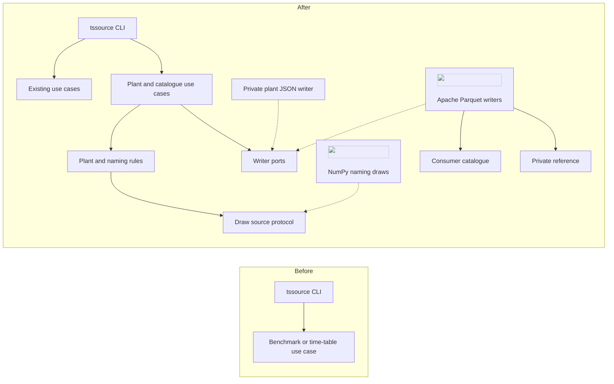
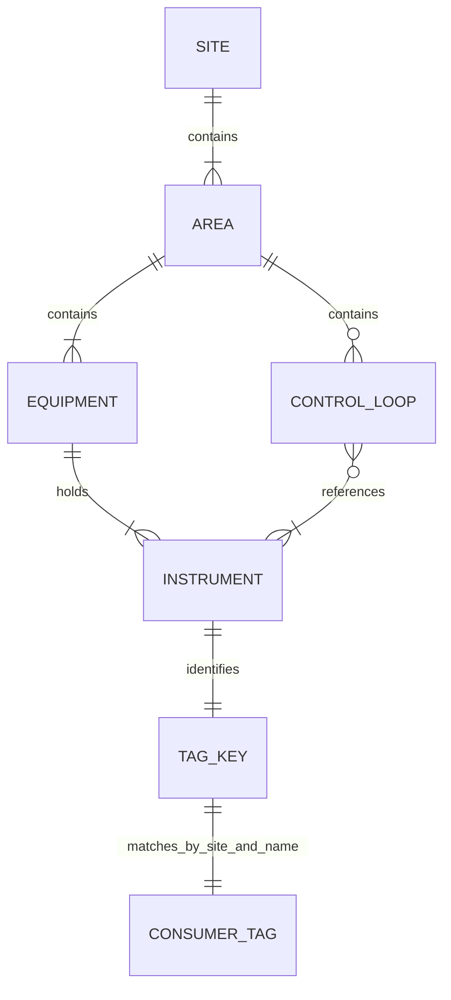
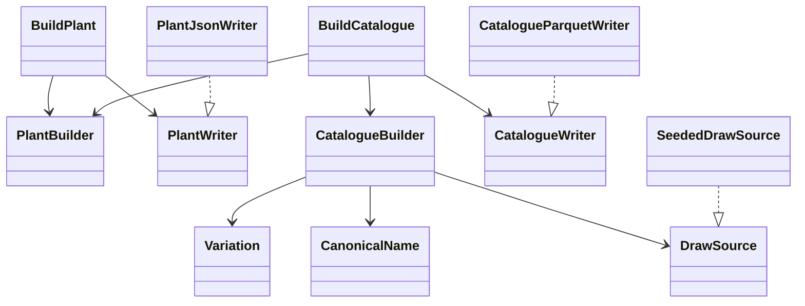

# Implementation plan · 004 · Plant and tag catalogue

> Approved with the [execution specification](spec.md) and [tasks](tasks.md) at G4.

## Context collected

| Source | Contribution |
|---|---|
| [Requirements catalogue](../../docs/requirements/rt-catalog.yaml) | RT09 identity, RT17 sampling and RT28 prototype sizing evidence. |
| [PRD](prd.md), [backlog](backlog.md), [approach](ux-approach.md) | Approved goals, card criteria, local CLI workflow and export recovery. |
| [Time-series roadmap](../001-timeseries-source/roadmap.md), [003 release](../003-tssource-skeleton-spike/release.md) | Cards 06 and 07, merged runtime and existing benchmark baseline. |
| [ADR-0020](../../docs/architecture/decisions/0020-deterministic-generation-and-simulated-reception-time.md), [ADR-0021](../../docs/architecture/decisions/0021-output-as-immutable-files-and-segments.md), [ADR-0022](../../docs/architecture/decisions/0022-hidden-plant-and-site-local-time.md) | Inherited proposals for seeded substreams, file replacement and private truth. ADR-0031 narrows these to the local fixture. |
| [ADR-0023](../../docs/architecture/decisions/0023-item-by-item-build-flow.md), [ADR-0030](../../docs/architecture/decisions/0030-preserve-exact-timestamps-and-declared-site-rules.md) | Card-by-card delivery and declared site semantics. |
| [Component](../../src/tssource/README.md), [architecture](../../docs/architecture/README.md), [Compose](../../compose.yaml) | Existing commands, layers, permissions and writable volume. |
| [Settings](../../src/tssource/application/settings.py), [composition root](../../src/tssource/bootstrap.py), [CLI](../../src/tssource/interfaces/cli/app.py), [site codes](../../src/tssource/domain/time/site_zone.py) | Entry points, defaults, error conventions and the shared site enum. |
| [Benchmark source](../../src/tssource/infrastructure/numpy_source.py), [benchmark sinks](../../src/tssource/infrastructure/sinks.py), [lock file](../../poetry.lock) | Existing numeric and serialization dependencies. The benchmark adapters own event blocks. |
| [Engineering principles](../../harness/principles.md), [security baseline](../../harness/security.md), [upkeep matrix](../../harness/architecture-upkeep.md) | Layer boundaries, STRIDE and maintenance obligations. |

The source is fictional. The naming convention uses a project-defined subset of instrument letters
from the approved backlog. It makes no external standards conformance claim.

## Approach

Build and prove the plant first. Next prove the hardest naming and identity invariants in memory.
Add the paired file export once the row shapes stabilize. Each card lands separately through the
item flow and keeps the existing commands working.

## Architecture impact

Bootstrap supplies the draw source and writers. Both use cases share the plant builder.
The catalogue use case derives both row sets from one pass.

| Component | Change | Layer | Why |
|---|---|---|---|
| CLI and bootstrap | Extend | Interface and composition root | Add the two commands and inject adapters. |
| Plant and naming | Add | Domain | Keep identity, inventory and naming policy deterministic. |
| BuildPlant and BuildCatalogue | Add | Application | Coordinate generation and writes through ports. |
| JSON, Parquet and seeded draws | Add | Infrastructure | Keep persistence, schemas and numeric libraries outside the domain. |
| Runtime dependencies | Reuse | Dependency group | Use locked Typer 0.27.3, NumPy 2.4.6 and PyArrow 24.0.0. |

## Contracts and data

| Contract | Producer and consumer | Version and shape |
|---|---|---|
| `plant build --seed N --out PATH` | CLI to fixture operator | Optional flags use `TSSOURCE_SEED` (default 42) and `TSSOURCE_OUT` (default `data/ts_source`). Accept integer seeds at or above zero. |
| `catalog build --seed N --out PATH` | CLI to fixture operator | Same options. Rebuild the plant in memory and write the pair. One writer per destination and no concurrent readers during publication. |
| CLI result | CLI to caller | Exit 0 with one output path per stdout line, in consumer-then-reference order for catalogue. Exit 2 for invalid arguments or settings. Exit 1 for handled generation or write errors, short stderr and empty stdout. |
| `truth/plant.json` | JSON writer to fixture operator and evaluator | UTF-8, version 1, marked synthetic. Keys `schema_version`, `generator`, `sites`, `areas`, `equipment`, `instruments`, `control_loops`, `streams`, `drivers` and `inventory`. Fix ordering and omit clock-dependent values. |
| `catalog/tags.parquet` | Consumer writer to ingestion engineer and planner | Column allowlist below. Parquet metadata `schema_version=1`. |
| `truth/tag_key.parquet` | Reference writer to evaluator | Private columns below. Parquet metadata `schema_version=1`. |

Give downstream users only the consumer file. Treat the plant and reference as restricted
evaluation material. The operator owns the destination and its parent folders. The CLI runs as
the current user or the existing non-root container user, with no new port, credentials or roles.
The Compose destination must be under the existing writable bind. Reject symlink output targets
and symlinked `catalog/` or `truth/` children. Do not change existing directories' permissions.
New private files have owner read/write permissions only on the supported Linux runtime.

| File | Columns and nullability | Key |
|---|---|---|
| Consumer | `site_code`, `original_name`, `data_type`, `scan_class`, `generator` as non-null strings. `descriptor` and `reported_unit` as non-null strings that may be empty. `expected_interval_seconds` as nullable int32. | `(site_code, original_name)` |
| Reference | Same two string key columns. Non-null strings `equipment_id`, `instrument_id`, `measurement`, `canonical_unit`, `canonical_name`, `tier`. Nullable strings `loop_id`, `old_alias`. Non-null list of strings `violations`, non-null Boolean `holdout` and nullable UTC microsecond timestamp `replaced_at`. | `(site_code, original_name)` |

The synthetic marker is `tssource`. The five site codes use the existing `SiteCode` values.
The JSON model stores stable string IDs, parent IDs and the referenced IDs for loop roles,
flow endpoints and drivers. Store point measurement, canonical unit, range, data type and
scan policy on the instrument. Inventory rows contain site code, scan class and count.
Use a new schema version for a breaking format change. Keep the public schema allowlist separate
from the reference schema, including file metadata.

The instrument contributes the sampling policy to the consumer row. The reference alone maps
that row to the instrument and its equipment.

## Design

| Layer | Unit | Responsibility | Collaborators |
|---|---|---|---|
| Domain | PlantBuilder | Assemble frozen model values from profiles, templates and seed. | SiteCode, scan policies, equipment templates. |
| Domain | CanonicalName | Parse and render the versioned naming grammar. | Site abbreviations and signal tokens. |
| Domain | CatalogueBuilder | Assign tiers, variants, descriptors and source-scoped identities. | Plant, Variation strategies and DrawSource protocol. |
| Application | BuildPlant | Build the plant and return the output path after a successful write. | PlantBuilder and PlantWriter. |
| Application | BuildCatalogue | Generate both row sets and return the pair of output paths after successful publication. | PlantBuilder, CatalogueBuilder and CatalogueWriter. |
| Infrastructure | SeededDrawSource | Supply independent seeded draws for naming and hold-out selection. | NumPy SeedSequence. |
| Infrastructure | PlantJsonWriter and CatalogueParquetWriter | Encode, stage and replace fixed output paths. | Standard library and PyArrow, respectively. |
| Interface | CLI | Validate options and translate results or errors. | Settings and build use cases. |
| Composition root | Bootstrap | Wire the use cases and adapters. | Builders, seeded draws and writers. |

| Pattern or principle | Implementation |
|---|---|
| Immutable values and single responsibility | Keep scan class and interval coupled in domain values. Validate references and counts when assembling the model. |
| Factory and open/closed design | Keep ordered site profiles and equipment templates as data. Add a naming variant through the strategy registry. |
| Dependency inversion and interface segregation | Inject a narrow draw protocol and separate plant/document and catalogue/pair writer ports. Keep paths and serialization types outside the domain. |
| Substitutability | Exercise the use cases with test writers implementing the same path and failure contracts. |

Build equipment and instrument IDs from SHA-256 over a versioned, unambiguous encoding of seed,
entity kind, site and structural path. Use profile paths and ordinals independent of display
names. Declare point and sampling counts by site. Validate associations by ID after construction.

Use explicit stable seed domains for variant selection, descriptor/unit selection and hold-out.
Assign one hold-out site to the private reference. For each variant, reserve at least 20 distinct
point examples before filling the remaining candidate slots by tier. Keep at least 1,000 canonical
names and reserve at least 15 separate collision names across different sites and equipment.
Reserve source-scoped keys before applying the rest of the variants and bound uniqueness retries
by the inventory size. Report a handled error if a profile cannot meet its floors. For legacy
renames use a fixed UTC replacement instant (`2025-01-01T00:00:00Z`) and reserve each old alias
within its source namespace. Publish only the current name. Declare and test the accepted site,
area, equipment, instrument and lab token grammar in the naming-convention document.

Stage files in their respective destination directories and validate the schemas and shared key
sets before the first replacement. Replace each file individually. Clean temporary files on
handled failure. A loss of power or interrupted second replacement may leave a mismatched pair.
Recover by running the same seed and destination again. Use a different destination for a different
seed when earlier output should be retained.

## Security and threat model

| Threat | Where | Mitigation | Verification |
|---|---|---|---|
| S · False source association | Naming and reference | Use the five declared source namespaces and validate pairs before writing. Preserve the synthetic marker. | B06, B08 and B09 identity and schema tests. |
| T · Path redirection | CLI and writers | Use fixed child paths under the trusted destination. Reject symlink children and targets. | Path boundary tests with a target and directory symlink. |
| T · Partial or inconsistent exports | Writer and local consumer | Stage both files and validate key parity. Replace each file independently. Use exit 0 as the handoff and document the single-writer recovery procedure. | B10 injected staging and replacement failures and rerun. |
| R · Claimed fixture cannot be reproduced | Inputs and generated files | Use explicit seed when sharing commands and versioned deterministic output. G6 confirms that commands introduce no authenticated actor or operator audit change. | B02 and B07 repeat tests and review. |
| I · Private labels leak | Consumer schema, metadata and CLI | Explicit public allowlist, separate private file and restricted new-file modes. CLI emits paths and short diagnostics. | B08 exact schema, metadata, mode and CLI tests. |
| D · Unbounded generation | Domain and CLI | Fixed inventory and bounded variant allocation. Handle exhausted capacity and invalid seeds. | B01 and B05 bounds plus capacity and argument tests. |
| E · Writes exceed intended permissions | Host and container | Use the current identity, inherited container hardening and fixed output locations beneath the selected destination. | Existing Compose hardening test and G6 writer review. |

## Validation plan

| Behaviour or RT | Test or evidence | Fixture |
|---|---|---|
| B01–B03, RT17, RT28 | `test_plant_builder.py`. Reconcile counts and references, compare seeds, check class-specific intervals and no assumed periodic interval for lab or exception points. | Seeds 0, 42 and 101, all equipment and scan classes. |
| B02, B04 | `test_plant_cli.py`. Compare JSON bytes, assert version, synthetic marker, printed path and single-file footprint. | Two clean destinations with the same seed. |
| B05–B07, RT09 | `test_convention.py`, `test_catalogue_builder.py`. Check parser round-trip and malformed inputs. Compare tiers, variant floors, missing metadata, collisions, unique keys, rename history and hold-out. Exercise a conflicting synthetic mapping and reject it before export. | Seeds 0, 42 and 101, plus a forced conflicting row pair and an insufficient profile. |
| B08–B09, RT09, RT17, RT28 | `test_catalogue_cli.py`. Compare schemas and modes, join all rows and reconcile scan-class counts with plant JSON. Measure tags and intervals from generated files. Record them as sizing inputs and keep any scale estimate separate. | Same-seed plant and Parquet outputs, including one-second, lab and exception classes. |
| B10 and input/output security | CLI and writer tests. Inject staging and second replacement failures, verify exit and stdout, then rerun and reconcile. Reject negative seeds and symlink child targets. | Existing outputs, failed replacements and a symlink fixture. |
| Security baseline | `test_compose_hardening.py`, existing secrets and import checks, and G6 review of the STRIDE mitigations. | Existing runtime config and new adapters. |

These results prove the synthetic-source contributions. Production conflict enforcement,
completeness calculation and a full capacity worksheet are separate platform evidence.

## Steps

1. Add plant builder and plant CLI tests. Implement and verify PBI-004-01 (B01–B04).
2. Add naming, collision and repeatability tests. Implement and verify PBI-004-02 (B05–B07).
3. Add Parquet, reconciliation and failure tests. Implement and verify PBI-004-03 (B08–B10).
4. After all cards merge, run full dossier verification and record evidence for G6.

## Files to create or change

| Area | Paths relative to the repository root |
|---|---|
| Domain | `src/tssource/domain/plant/` and `src/tssource/domain/naming/`. |
| Application | `src/tssource/application/plant.py`, `src/tssource/application/catalogue.py`. |
| Infrastructure | `src/tssource/infrastructure/plant_json.py`, `src/tssource/infrastructure/catalogue_parquet.py` and seeded naming draw adapter. |
| CLI and wiring | `src/tssource/interfaces/cli/app.py`, `src/tssource/bootstrap.py`. |
| Tests | Plant and naming domain tests under `tests/tssource/domain/`. CLI and writer tests under `tests/tssource/`. |
| Docs | Files in the upkeep table below. |

Existing import contracts govern the new modules. Compose, dependency pins and the time core remain
outside the implementation scope.

## Rollback

Revert the affected card commits in reverse dependency order. Use a new output directory when
regenerating fixtures after a rollback, and keep any older output needed for a comparison. The
fixture files are local and require no database migration.

## Risks during the build

| Risk | Early signal | Response |
|---|---|---|
| One variant silently creates duplicates within a site | Key validation fails on a fixed seed | Allocate keys before applying remaining variants and enforce the declared floors. |
| Export pair is interrupted | Nonzero exit or missing success paths | Rerun with the same seed and destination before using the files. |
| Private fields reach downstream tools | Consumer allowlist or metadata test fails | Correct consumer mapping and rerun the schema suite before merging. |

## Documentation impact

| Document | Update |
|---|---|
| `README.md` and component README | Summarise the two CLI commands, fixture recovery and sharing boundary. |
| Architecture README | Record the layer map, data model and flow with official logos. |
| Naming convention and component schema contract | Give the versioned grammar, file formats, keys and compatibility policy. |
| Decision index and dossier teaching guide | Link ADR-0031 and explain the implementation by card. |
| Generated indexes | Refresh with `poetry run sdd sync`. |

## Out of scope

| Excluded | Where it belongs |
|---|---|
| Signals, physics, acquisition, live sources and larger plants | Later roadmap dossiers. |
| Production conflict enforcement, completeness, capacity and throughput proof | Source contracts, ingestion, quality and sizing work. |
| Model training, split packages and automated leak guard | Answer-key and leak-guard dossier. |
| Concurrent publication and atomic replacement of a dataset pair | Revisit once a consumer needs live reads during writes. |
