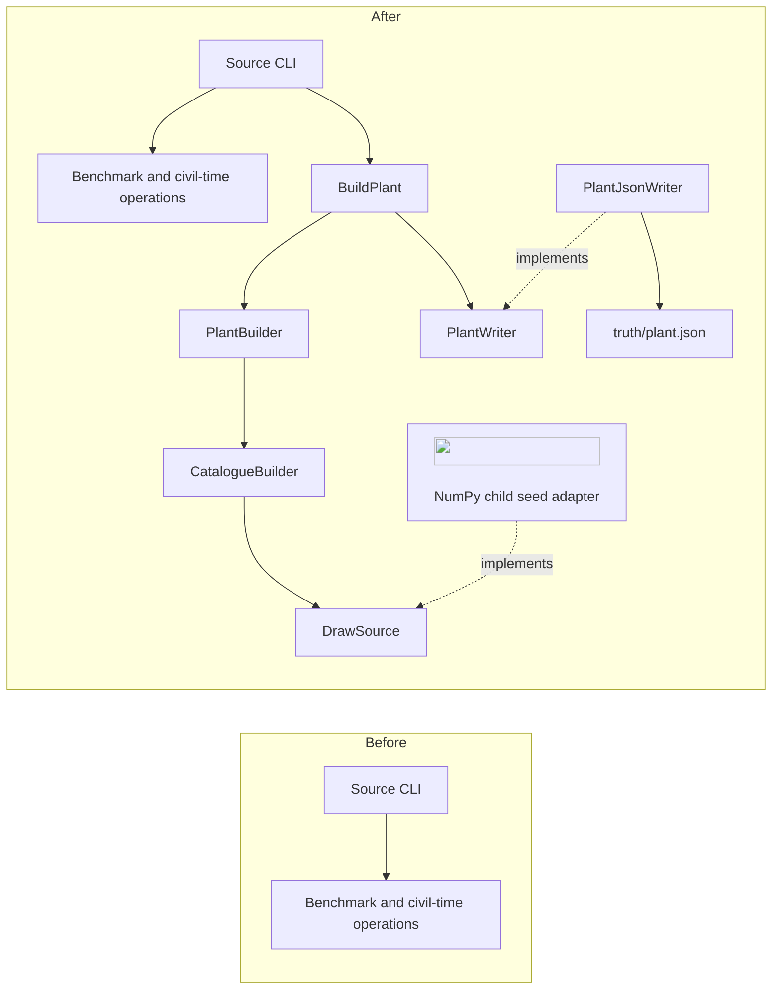
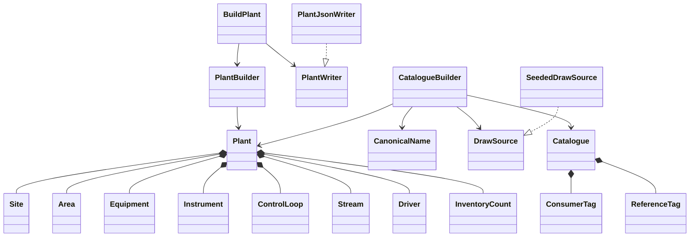

# Teaching guide · 004 · Plant and tag catalogue

## 1. The problem in plain words

A fixture is generated data used to exercise software under known conditions. This card makes a
fixture for five fictional industrial sites. Each site contains areas, such as numbered production
sections. Equipment holds instruments, meaning individual points that can report a measurement
or status. A periodic point arrives on a schedule. A laboratory point comes from a sample, and a
report-by-exception point reports when a condition changes.

The private plant records how those points relate to each other. This lets an evaluator count what
the generator created and check whether a catalogue tag matched the correct equipment.
A canonical name follows the fixture convention. A source name keeps the spelling
reported by one site, including any deliberate variation.

## 2. Requirements served

RT17 needs sampling expectations. Periodic points declare their interval and the other policies
carry a null interval (B03, AC5). RT28 needs credible source sizing inputs. The generator counts
points by site and scan class so a planner can measure the fixture composition (B01, AC1).
RT09 needs each current name scoped to a source. The catalogue assigns names to plant IDs and
keeps that mapping in the private reference (B05–B07, card 02 AC1–AC8).
See the [traceability matrix](../../docs/requirements/traceability.md).

## 3. Architecture before and after



The CLI now calls the plant use case for the new command. The use case builds the model then
passes it to the writer port. Bootstrap injects the adapter, which writes one private file.
The catalogue builder uses the same plant model and receives independent permutations
for name allocation, metadata, and the hold-out site.

## 4. Decisions and the alternatives that lost

[ADR-0031](../../docs/architecture/decisions/0031-separate-the-consumer-catalogue-from-plant-truth.md)
sets the sharing boundary. The evaluator keeps topology and the reference. The catalogue
builder produces a separate set of current source records for consumers.

| Choice | Benefit | Cost |
|---|---|---|
| Private, versioned plant file | The evaluator can inspect and reproduce the reference independently | The operator must keep the output directory private |
| Topology carried with consumer records | Consumers would have more context in one dataset | Consumers would also receive the relationships that the exercise asks them to infer |
| Seeded digest over structural segments | IDs reproduce independently of process or write order | Changing a structural path changes that entity's ID |
| Reserve variations and collisions before filling tiers | Each required example gets a point before quotas are filled | Insufficient profiles fail before returning rows |
| Independent seed domains | Changing descriptor selection leaves name and hold-out selection independent | Each decision needs a stable seed key |

## 5. The design: layers, classes and patterns



| Unit | Responsibility |
|---|---|
| Plant and its frozen records | Carry ordered entities with IDs, policy and counts |
| SiteProfile and EquipmentTemplate | Declare the fixture shape and repeatable equipment measurements |
| PlantBuilder | Bind template points to units, attach IDs and resolve relationships |
| BuildPlant | Ask the builder for the plant and publish it through the writer port |
| PlantWriter | Specify the return path and error contract for a complete write |
| PlantJsonWriter | Encode JSON, enforce the file rules and replace the destination |
| CanonicalName | Validate and render the operational and laboratory grammar |
| CatalogueBuilder | Coordinate point resolution, spelling allocation, and row projection |
| DrawSource | Provide reproducible permutations to pure allocation rules |
| ConsumerTag and ReferenceTag | Share the join key while keeping evaluation fields in the reference |

| Principle | Application |
|---|---|
| Single responsibility | The writer knows output paths. The builder knows relationships and scan rules. |
| Open/closed | Profile and template values determine the inventory without branching on every equipment class. |
| Liskov substitution | Any writer honoring the path and handled-error contract can serve the use case. |
| Interface segregation | The port exposes one write operation. |
| Dependency inversion | Application owns the port and bootstrap supplies its implementation. |

## 6. How it behaves at runtime

Follow the [publication sequence](../../docs/architecture/README.md#32-private-plant-inventory).
The command validates the seed and resolves the destination before invoking the use case. The
builder materializes the ordered plant in memory. The writer stages the document in the same
directory as the target, closes it and replaces the target. Only then does the CLI print the
path. If replacement fails, the writer removes the staging file and the command reports failure.

For catalogue generation, the builder first resolves plant points and reserves canonical keys
per source. It then reserves shared names and each variation floor. After filling the tier
quotas it derives the consumer and reference rows in plant order. An insufficient profile
fails before the builder returns any rows.

## 7. Data and contracts

See the [entity relationships](../../docs/architecture/README.md#32-private-plant-inventory)
and the [versioned JSON contract](../../src/tssource/README.md#private-plant-fixture). The builder
binds each equipment ID to an area and each point ID to equipment. The relationship check
resolves loop roles, flows and drivers by ID. The inventory counts emitted instruments. Scan
class determines the interval, including null for lab and exception classes.

The [naming convention](../../docs/architecture/tag-naming-convention.md) documents the versioned
grammar. Both row sets share the `(site_code, original_name)` key. The builder reserves current
names and old aliases within each source.

## 8. Code tour

1. [Bootstrap](../../src/tssource/bootstrap.py) returns
   `BuildPlant(PlantBuilder(), PlantJsonWriter())`.
2. [CLI](../../src/tssource/interfaces/cli/app.py) uses `seed` when supplied and reads settings
   for defaults. It translates writer errors into stderr and exit 1.
3. [Use case](../../src/tssource/application/plant.py) composes one operation,
   `self._writer.write(self._builder.build(seed), output_folder)`.
4. [Profiles](../../src/tssource/domain/plant/profiles.py) set units per area and share control
   points across classes. Analyser houses carry five lab points each.
5. [Builder](../../src/tssource/domain/plant/builder.py) hashes version, seed, kind, site and path.
   Each element is a separate JSON value, so one segment cannot join accidentally with the next.
6. [Writer](../../src/tssource/infrastructure/plant_json.py) uses `staged.replace(target)`
   to publish the versioned document in a single filesystem operation.
7. [Point resolution](../../src/tssource/domain/naming/plant_points.py) follows plant IDs to name
   each point. Only an explicit loop role supplies a loop ID.
8. [Allocation](../../src/tssource/domain/naming/allocation.py) pairs shared names across sites,
   then reserves each variation floor before distributing the remaining quotas.
9. [Catalogue builder](../../src/tssource/domain/naming/catalogue_builder.py) projects one current
   tag and one private reference from each resolved point and its selected spelling.

## 9. Security

There are no credentials in the fixture. Keep the destination and its parents under operator
control. The writer rejects symlink redirection at the two fixed output components and uses
mode `0600` for the staged file. Generation is bounded by the declared profiles. The command
uses existing dependencies, and the writer uses the standard library.
The current tag record carries source metadata and sampling policy. The private reference
keeps plant identifiers, canonical names, rename history, and hold-out designations.

## 10. How we tested it

The [domain tests](../../tests/tssource/domain/test_plant_builder.py) count instruments directly,
resolve references and compare ordered models over fixed seeds (AC1–AC5, RT17 and RT28).
The [CLI tests](../../tests/tssource/test_plant_cli.py) compare bytes, check the output footprint
and mode, reject invalid input and symlinks, and inject a failed replacement (AC2 and AC6, RT28).
The [grammar tests](../../tests/tssource/domain/test_convention.py) exercise both naming forms and
reject malformed input. The [catalogue tests](../../tests/tssource/domain/test_catalogue_builder.py)
check collisions, joins, coverage, metadata, rename history, and reproducibility with production
draws and an injected fixed ordering (card 02 AC1–AC8).

## 11. Run it yourself

```bash
poetry run tssource plant build --seed 42 --out data/ts_source/seed-42
poetry run tssource plant build --seed 101 --out data/ts_source/seed-101
poetry run pytest --no-cov -q tests/tssource/domain/test_plant_builder.py tests/tssource/test_plant_cli.py
```

Inspect `inventory` in both files. Their counts match. Corresponding equipment and instrument
IDs differ. Rerun either command with its original seed and compare the file bytes.

```bash
poetry run pytest --no-cov -q tests/tssource/domain/test_convention.py tests/tssource/domain/test_catalogue_builder.py
```

Trace two colliding names from their source-scoped keys to their distinct equipment IDs.

## 12. Pitfalls and what we would do differently

Changing display codes and changing structural identity are different operations. Preserve the
structural segments if an ID should remain stable. Keep the same seed and fixture version when
comparing output between runs. The fixture uses a fixed layout and its inventory is an input to
sizing, separate from measured ingestion capacity.

## 13. Questions for the mentee

1. Why include entity kind and site in the ID input?
2. Which code would you change to add a new lab analyte?
3. How would treating lab points as periodic distort expected event counts?
4. Why is staging done in the destination directory?
5. If replacing the file fails, how do the CLI and filesystem tell the operator what happened?
6. Which relationships would give away answers in a tag-matching exercise?
7. Why reserve shared names before filling the naming tiers?
8. How does changing a draw stream for descriptors affect rename history?

## 14. Glossary

| Term | Meaning |
|---|---|
| Canonical tag name | The spelling produced by a versioned naming convention |
| Control loop | A measurement, controller and final element associated to regulate a process |
| Driver | A shared influence on equipment in an area |
| Fixture | Repeatable generated input for a test or exercise |
| Hold-out site | A site reserved for independent evaluation |
| Scan class | A point's sampling policy |
| Stream | A directed material flow between pieces of equipment |
| Surrogate ID | An identifier derived independently of display names |
