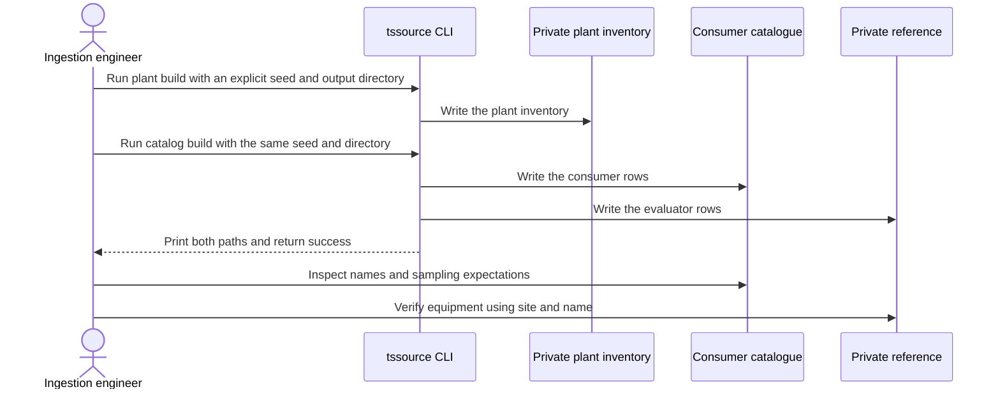

# Approach · 004 · Plant and tag catalogue

> **Phase 3 · Structure**, closed by **G3 · Approach approved** (both of us approve).
> In a data platform the "user experience" is often an API, a command line, a dataset or a
> dashboard: *how a person or a system meets what we build*. How to fill this file:
> [lifecycle, phase 3](../../harness/lifecycle.md#phase-3-structure).

## Is a prototype needed?

The existing `tssource bench` command already establishes the local CLI pattern for seed and
output options. A walkthrough with concrete commands, file paths and sample rows is enough to
review this interface before implementation.

## Interface approach

The ingestion engineer and capacity planner generate files locally. The evaluator uses the same
fixture and opens its private reference separately. Both commands use the existing seed and
output-folder settings when options are omitted. Use an explicit seed and output directory when
sharing instructions for reproducing a fixture.

| Interaction | What the user sees |
|---|---|
| `tssource plant build --seed 42 --out data/ts_source/example` | The versioned plant inventory at `truth/plant.json` under the output directory. Use it to check topology and point counts by site and scan class. |
| `tssource catalog build --seed 42 --out data/ts_source/example` | The consumer rows at `catalog/tags.parquet` and the evaluator's mapping at `truth/tag_key.parquet`. This command derives the plant from the seed and works on its own. |
| Inspect the consumer catalogue | Use the source site code and original name together. The same name can appear at several sites. Periodic tags have an expected interval in seconds. Lab and report-by-exception intervals are null. |
| Compare with the private reference | Join on source site code and original name. Inspect equipment identity, canonical name, old aliases and hold-out designation in the reference. Hand off the consumer file alone for downstream work. |
| Locate outputs after success | Each command prints the paths of the files it wrote to stdout, one path per line, after all its writes complete. |
| Handle invalid arguments or failed writes | Invalid arguments use exit code 2. Handled write failures use exit code 1 and a short error on stderr. Treat the two catalogue outputs as ready together after exit code 0. After interruption, rerun with the intended seed and output directory before reading or sharing either file. |

Use the shared seed to compare the inventory with the two catalogue files. The downstream
exercise needs the consumer file. The evaluator keeps the inventory and reference in the
local fixture directory.

## Prototype (optional)

The walkthrough below is the review artifact.

## How we validate the approach

Walk through these scenarios on paper at G3, then repeat with generated files during validation.

1. Build the inventory and catalogue with seed 42 in one output directory. Identify which file
   to give the ingestion engineer and which files the evaluator keeps.
2. Use two illustrative rows named `TIC-101` from different sites. Join each to the private
   reference by site and name. Verify that each row resolves to a different equipment identity.
3. Compare a one-second point, a lab point and a report-by-exception point in the consumer
   catalogue. Identify the only row with a periodic completeness denominator. Reconcile the
   counts by site and class with the inventory.
4. Walk through a build interrupted after its first catalogue replacement. Confirm that the
   engineer reruns the same command and waits for success before sharing the catalogue.
